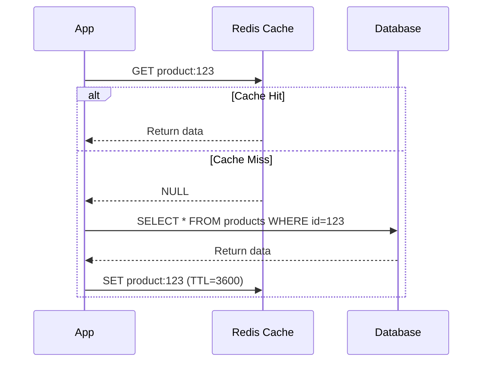

# Cache-Aside Pattern (Lazy Loading)

## Problem It Solves

Database becomes a bottleneck under high read load. Direct DB queries are expensive (disk I/O, connection overhead). We need a fast intermediate layer to serve frequently accessed data without overwhelming the database.

## How It Works

The application is responsible for managing the cache. Cache and DB are independent.

**Read Flow:**
1. Application checks cache first
2. **Cache hit** → return data from cache
3. **Cache miss** → fetch from DB, store in cache, return to user

**Write Flow:**
1. Application writes to DB
2. Application invalidates or updates cache entry

## When to Use

- **Read-heavy workloads** (product catalogs, user profiles)
- **Data that doesn't change often**
- When you want **memory efficiency** — only popular data cached
- Application needs **flexibility** to control caching logic

## When NOT to Use

- **Write-heavy systems** — cache constantly invalidated
- **Strong consistency required** — financial transactions
- **First request latency critical** — cold start hits DB
- Data accessed only once (no benefit from caching)

## Trade-offs

| Gain | Sacrifice |
|---|---|
| Memory efficient — only hot data | First request always slow (cold cache) |
| Simple to implement | Stale data risk between writes and TTL |
| Cache failure doesn't break system | App must handle cache logic |
| Flexible per-key TTL | Two round trips on miss |

## Real World Example

**Facebook** uses Memcached with cache-aside pattern at massive scale to cache user profiles, posts, and friend lists. Database load reduced by 99%.

**Netflix** caches movie metadata via cache-aside — movie details rarely change but are read millions of times.

## Interview Soundbite

> *"For read-heavy data like product catalogs, I use Cache-Aside with Redis. The app checks cache first, falls back to DB on miss, and populates cache. The trade-off is first-request latency and stale data risk between writes — both acceptable for catalog data with short TTL."*

## Comparison with Other Patterns

| Pattern | Write Path | Read Path | Best For |
|---|---|---|---|
| **Cache-Aside** | DB only, invalidate cache | Cache → DB on miss | Read-heavy |
| **Write-Through** | Cache + DB together | Cache only | Strong consistency |
| **Write-Behind** | Cache first, DB async | Cache only | Write-heavy, OK with loss |
| **Read-Through** | DB only | Cache fetches from DB | Simpler app code |
