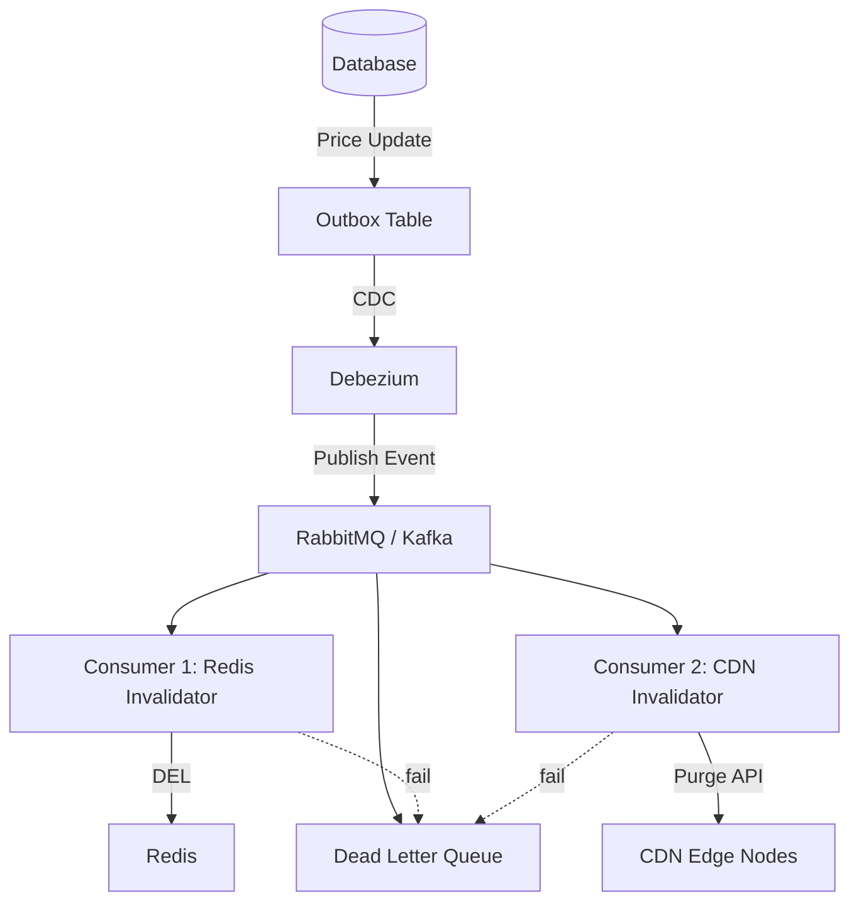
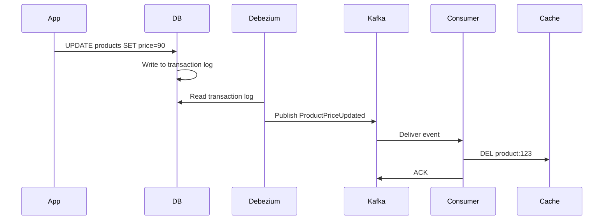
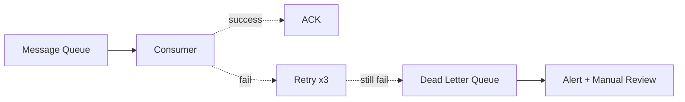
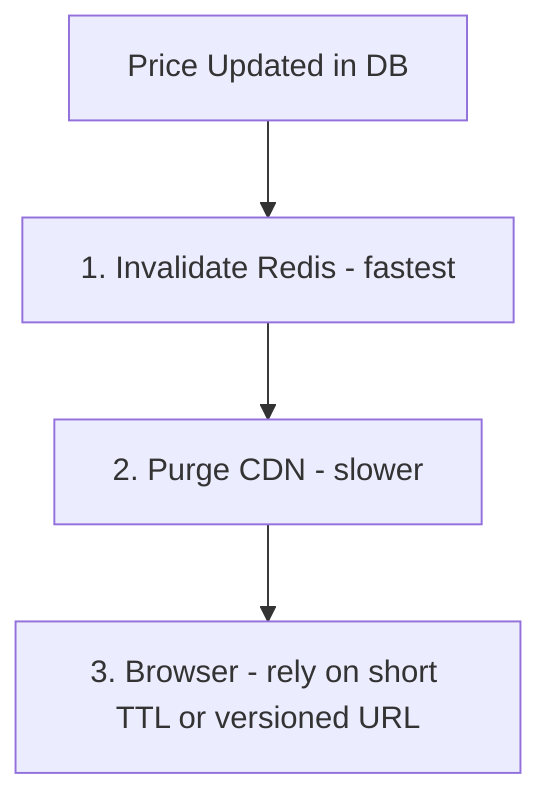

# Cache Invalidation Strategies

## Problem It Solves

> *"There are only two hard things in Computer Science: cache invalidation and naming things."* — Phil Karlton

Keeping cache consistent with the source of truth (database) is fundamentally difficult, especially across multiple cache layers (browser, CDN, Redis).

## How It Works — Event-Driven Invalidation

The most scalable approach for multi-layer caching.



## Invalidation Patterns

### Pattern 1 — TTL Based (Passive)

```
SET product:123 "data" EX 3600
```

**Pros:** Simple, no extra logic  
**Cons:** Stale data until TTL expires

### Pattern 2 — Write-Through Invalidation

```python
def update_price(product_id, new_price):
    db.update(product_id, new_price)
    cache.delete(f"product:{product_id}")  # Sync delete
```

**Pros:** Immediate consistency  
**Cons:** Tightly coupled, fails if cache is down

### Pattern 3 — Event-Driven (CDC)



**Pros:** Decoupled, scales, no app changes needed  
**Cons:** Eventual consistency, operational complexity

### Pattern 4 — Outbox Pattern

For when you need **business-semantic events** instead of raw DB changes.

```sql
BEGIN TRANSACTION;
  UPDATE products SET price = 90 WHERE id = 123;
  INSERT INTO outbox (event_type, payload)
    VALUES ('ProductPriceUpdated', '{"id":123,"price":90}');
COMMIT;
```

A separate relay reads the outbox and publishes to message broker.

**Pros:** Atomic with business logic, rich event payload  
**Cons:** Requires app code change

## CDC vs Outbox — Quick Comparison

| | Direct CDC (Debezium) | Outbox Pattern |
|---|---|---|
| App code changes | None | Required |
| Event shape | Raw DB row change | Business-semantic |
| Operational complexity | Higher (Debezium cluster) | Lower |
| Use case | Simple invalidation | Multiple consumers, rich events |

## Failure Handling

### Idempotent Consumers

Same event processed twice should produce same result:

```python
def handle_invalidation(event):
    cache.delete(f"product:{event.product_id}")  # Idempotent
    # Deleting non-existent key is a no-op — safe to retry
```

### Dead Letter Queue (DLQ)



### At-Least-Once Delivery

Only ACK message after BOTH Redis and CDN are invalidated. If one fails, message is redelivered.

## Multi-Layer Invalidation Order

When a price changes, invalidate in this order:



**Why this order?**
- Redis invalidation is instant (milliseconds)
- CDN purge takes 30s-2min to propagate globally
- Browsers can't be force-invalidated — use short TTL or versioned URLs

## When to Use Each

| Scenario | Strategy |
|---|---|
| Low write frequency, OK with staleness | TTL only |
| Single cache layer, simple system | Write-through invalidation |
| Multi-layer cache, complex system | Event-driven via CDC |
| Multiple downstream consumers need different events | Outbox pattern |
| Critical accuracy (prices, inventory) | Versioned URLs + short TTL |

## Trade-offs

| Approach | Latency | Complexity | Consistency |
|---|---|---|---|
| TTL | High staleness | Low | Eventual |
| Write-through | Instant | Medium | Strong |
| Event-driven CDC | Seconds | High | Eventual |
| Versioned URLs | Instant | Medium | Strong |

## Real World Example

**LinkedIn** uses Databus (their CDC system) to propagate database changes to multiple downstream consumers including caches, search indexes, and analytics — invalidating caches across the platform within seconds.

**Shopify** uses Debezium to capture changes from MySQL and publish to Kafka, where multiple consumers (cache, search, analytics) react independently.

## Interview Soundbite

> *"For multi-layer cache invalidation, I use event-driven architecture. A price change in DB triggers a CDC event via Debezium to Kafka. Consumers invalidate Redis and CDN independently. For atomicity, I use the outbox pattern when business events matter, or direct CDC when raw changes suffice. Idempotent consumers and DLQs handle failures. For client browsers, versioned URLs are more reliable than CDN purges."*
