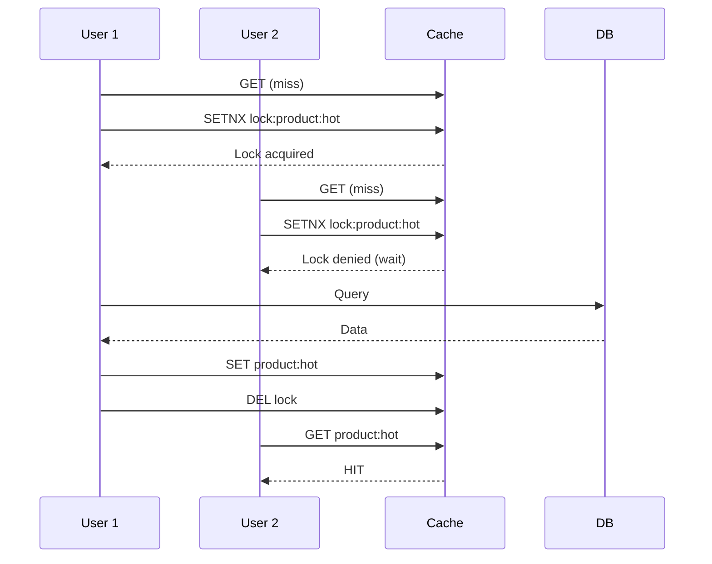

# Cache Stampede (Thundering Herd)

## Problem It Solves

When a popular cached item expires, thousands of simultaneous requests hit the database at once — potentially crashing it. Classic scenario: flash sale, viral content, scheduled cache expiry on popular keys.

## How It Works

**The Problem:**


## Solutions

### Solution 1 — Mutex / Distributed Lock

Only **one** request rebuilds the cache. Others wait.



**Pros:** Simple, predictable  
**Cons:** Adds latency for waiting requests

### Solution 2 — Probabilistic Early Expiry

Refresh cache **before** it expires, in the background.

```
TTL = 60 seconds
At T+50s (before expiry), randomly chosen requests
proactively refresh cache asynchronously.

By T+60s, cache already has new value → no stampede.
```

**Pros:** No user-facing latency  
**Cons:** Extra DB queries even when not strictly needed

### Solution 3 — Staggered TTL with Jitter

Don't set identical TTL for similar keys.

```python
# BAD - all expire together
ttl = 3600

# GOOD - randomized
ttl = 3600 + random.randint(-300, 300)
```

**Pros:** Trivial to implement, very effective  
**Cons:** Doesn't help single-key stampede

### Solution 4 — Stale-While-Revalidate

Serve stale data while refreshing in background.

```
HTTP Header:
Cache-Control: max-age=60, stale-while-revalidate=120

→ Fresh for 60s
→ For next 120s, serve stale immediately
→ Refresh happens in background
```

**Pros:** Zero user-facing latency  
**Cons:** Users may see slightly stale data

## When to Use Each

| Scenario | Best Solution |
|---|---|
| Single hot key (flash sale) | Mutex Lock |
| Many keys expiring together | Staggered TTL |
| Predictable, scheduled traffic | Probabilistic Early Expiry |
| Acceptable to serve stale briefly | Stale-While-Revalidate |

## Trade-offs

| Approach | Latency | Complexity | Staleness |
|---|---|---|---|
| Mutex Lock | High for waiters | Medium | None |
| Early Expiry | Zero | High | None |
| Jittered TTL | Zero | Low | None |
| Stale-While-Revalidate | Zero | Low | Slight |

## Real World Example

**Facebook** uses "leases" — a form of mutex — in Memcached to prevent stampedes on hot keys. Only one request can rebuild a cache key at a time.

**Instagram** uses jittered TTLs across all cache keys to prevent synchronized expirations across millions of users.

## Interview Soundbite

> *"For flash-sale scenarios, I prevent cache stampede using a Redis mutex lock — only one request rebuilds the cache, others wait. For broader prevention, I add random jitter to TTLs so keys don't expire in sync. For zero user-facing latency, stale-while-revalidate works well — serve stale, refresh in background."*
