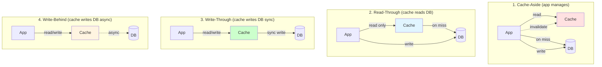
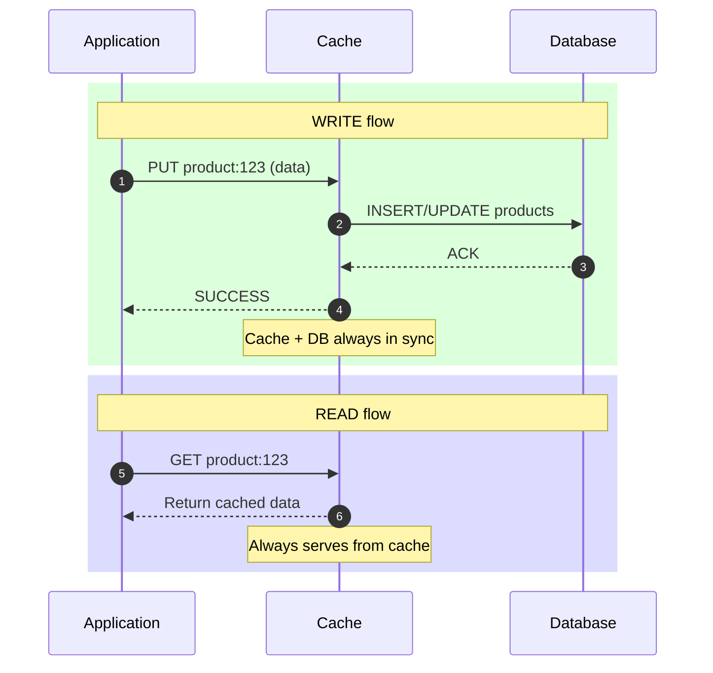
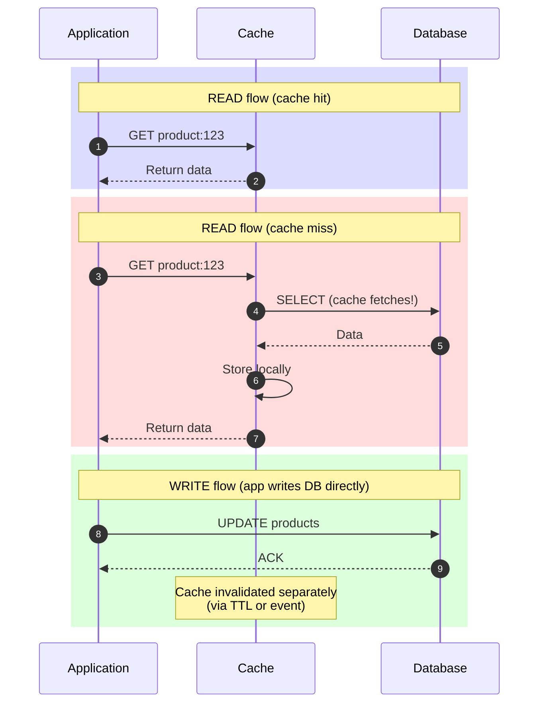
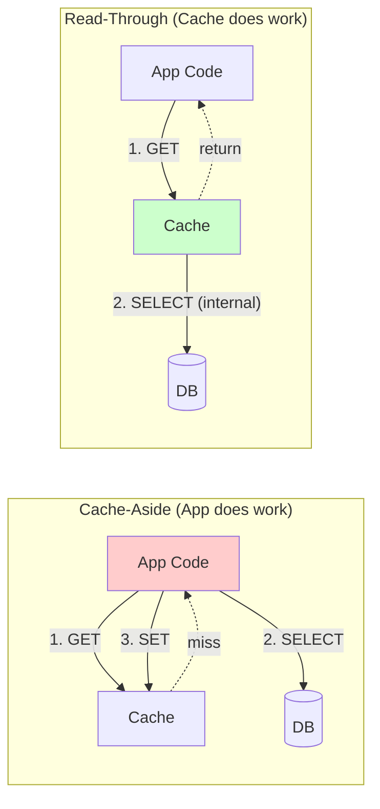
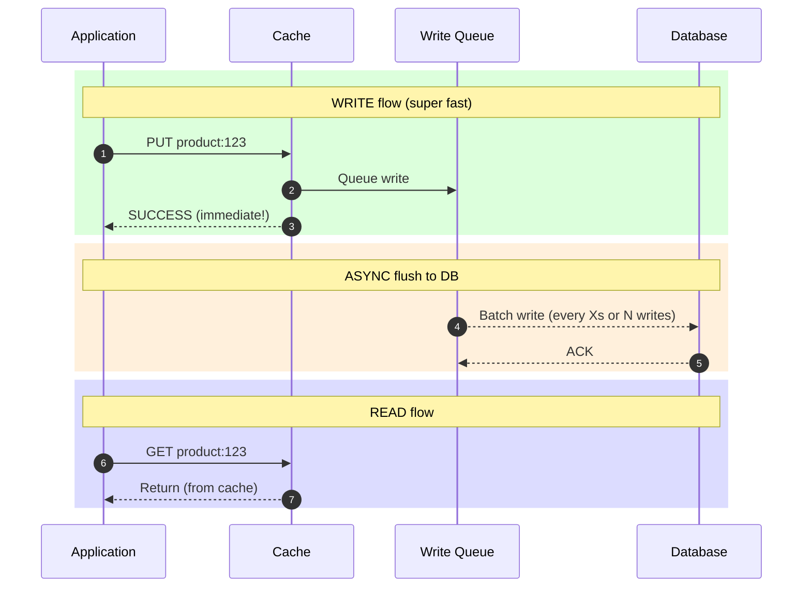
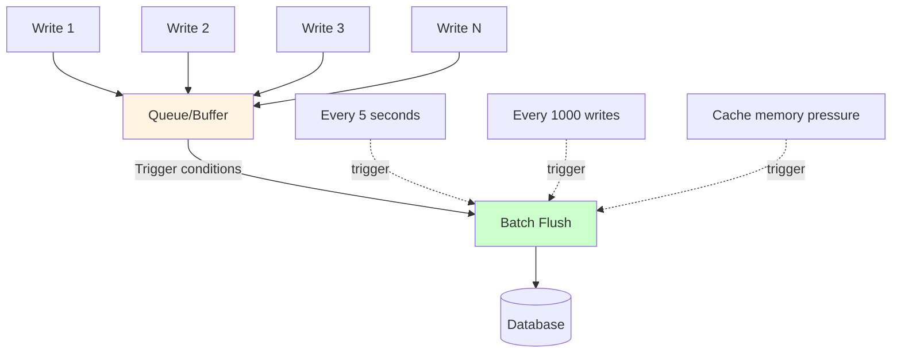
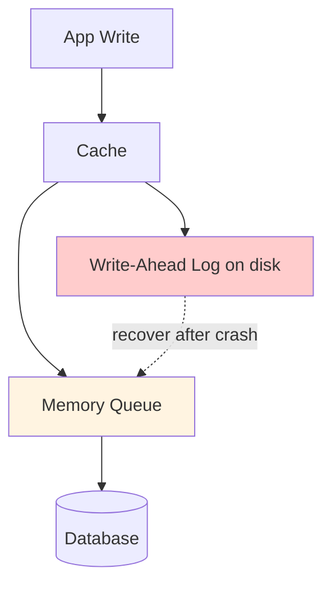
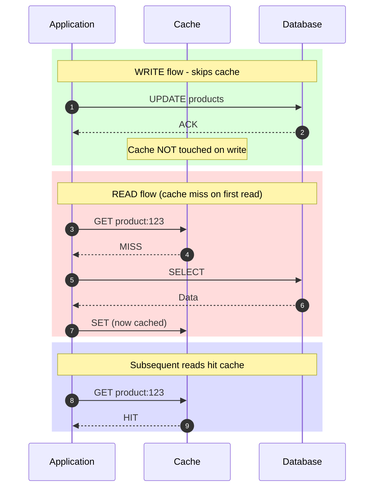
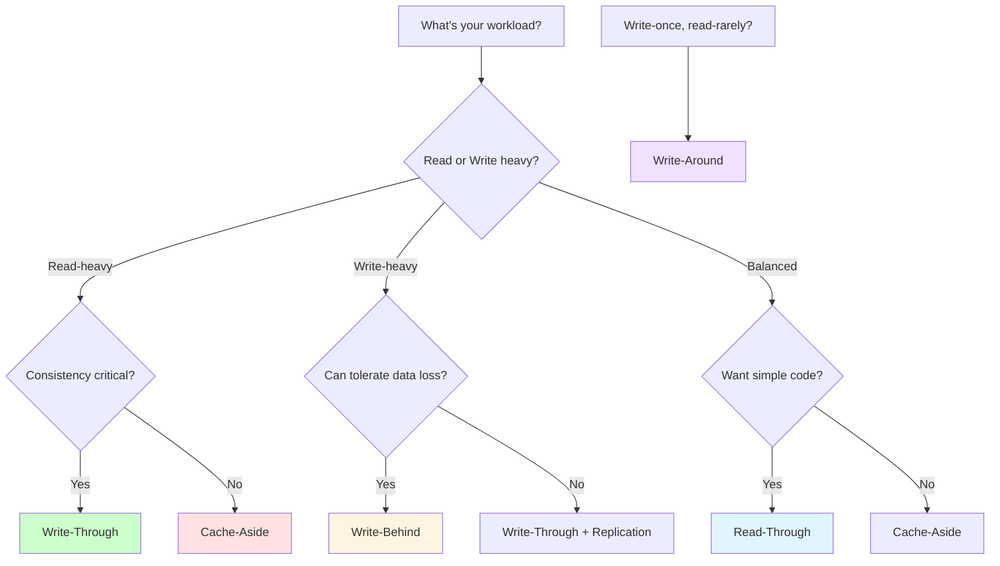
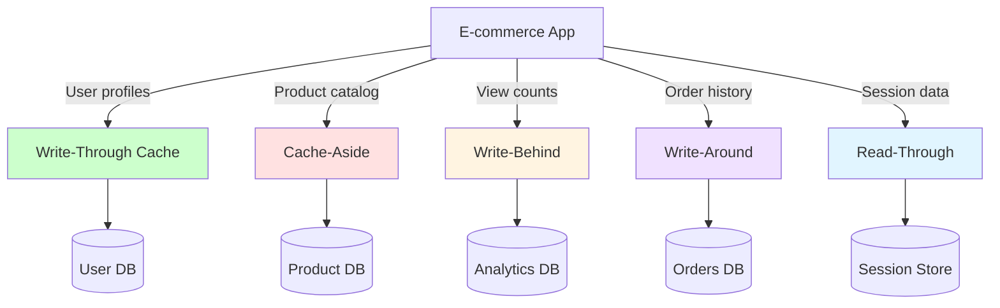

# Cache-Through Patterns (Write-Through, Read-Through, Write-Behind, Write-Around)

## Problem It Solves

Cache-Aside puts all caching logic in the application. As systems grow, this becomes:
- **Repetitive** — every service writes the same cache logic
- **Error-prone** — easy to forget invalidation
- **Inconsistent** — different services handle caching differently
- **Stale data risk** — gap between DB write and cache invalidation

**Cache-Through patterns** make the cache itself responsible for keeping in sync with the DB.

---

## The Four Patterns at a Glance

---

## Pattern 1 — Write-Through Cache

### How It Works

### Key Characteristics

- **Write path:** App → Cache → DB (synchronous)
- **Read path:** App → Cache (always hits cache)
- **Consistency:** Strong — cache and DB always match
- **Latency:** Higher writes (double hop), low reads
- **App complexity:** Low — no cache management logic

### When to Use

- ✅ **Read-heavy with critical consistency** (user profiles, settings)
- ✅ **Financial data** — cannot tolerate stale reads
- ✅ **Multiple services** sharing same cache (consistent view)
- ✅ When **read amplification** would benefit from always-cached data

### When NOT to Use

- ❌ **Write-heavy workloads** — every write pays double latency
- ❌ **Rarely-read data** — cache pollution (caches everything written)
- ❌ **Limited cache memory** — too much data, low hit ratio

### Trade-offs

| Gain | Sacrifice |
|---|---|
| Strong consistency | Higher write latency |
| Simpler app code | Cache pollution (every write cached) |
| No stale data risk | Cache failure blocks writes |
| Always-warm cache | Wasted memory on never-read keys |

### Real World Example

**DynamoDB Accelerator (DAX)** uses write-through — writes go to DAX which synchronously persists to DynamoDB. Reads served at microsecond latency.

**Microsoft Azure Cache for Redis** offers write-through integration with Azure SQL.

---

## Pattern 2 — Read-Through Cache

### How It Works

### Key Characteristics

- **Read path:** App → Cache (cache fetches from DB on miss)
- **Write path:** App → DB directly (cache not involved)
- **App complexity:** Very low — treats cache like a DB
- **Cache integration:** Cache library/proxy handles DB fetch

### Cache-Aside vs Read-Through — Crucial Difference

In Cache-Aside, **app code** handles the miss logic. In Read-Through, **cache library** handles it transparently.

### When to Use

- ✅ Want to **simplify app code** (looks like direct DB access)
- ✅ Multiple services need same caching behavior
- ✅ Want **consistent miss handling** across the system
- ✅ Using a cache framework that supports it (Spring Cache, Hibernate, EhCache)

### Trade-offs

| Gain | Sacrifice |
|---|---|
| Simple app code | First read always slow (cold cache) |
| Consistent miss logic | Less flexibility per-query |
| Easy to add caching | Requires cache that supports it |
| Centralized cache logic | Harder to debug |

### Real World Example

**Hibernate Second-Level Cache** is read-through — Hibernate transparently fetches from DB on cache miss.

**Spring Cache with @Cacheable** annotation — declarative read-through caching with one line of code.

---

## Pattern 3 — Write-Behind (Write-Back) Cache

### How It Works

### Key Characteristics

- **Write path:** App → Cache → (async) → DB
- **Write latency:** Extremely low (microseconds)
- **Throughput:** Very high — writes batched
- **Risk:** Data loss if cache fails before DB write
- **Consistency:** Eventual

### Batching Strategy

### When to Use

- ✅ **Write-heavy workloads** (analytics, logging, metrics)
- ✅ **Burst tolerance** — smooth out write spikes to DB
- ✅ **DB throughput limited** — batch reduces DB load
- ✅ **Latency-critical writes** — gaming leaderboards, view counts
- ✅ Acceptable to **lose a few writes** on cache failure

### When NOT to Use

- ❌ **Financial transactions** — cannot lose any writes
- ❌ **Strong consistency required**
- ❌ **Single-tenant cache** — high blast radius on failure

### Trade-offs

| Gain | Sacrifice |
|---|---|
| Ultra-fast writes | Risk of data loss |
| High throughput | Eventual consistency |
| DB protected from spikes | Complex failure handling |
| Batch write efficiency | Hard to debug write delays |

### Resilience Techniques

To minimize data loss:
- **Write-ahead log (WAL)** — persist queue to disk first
- **Replication** — replicate cache state across nodes
- **Acknowledged batches** — only remove from queue after DB ACK

### Real World Example

**Redis with AOF (Append-Only File)** can implement write-behind by buffering writes and flushing to DB asynchronously.

**Linux page cache** is write-behind by default — `write()` returns immediately, OS flushes to disk later.

**Apache Ignite, Hazelcast** offer built-in write-behind with configurable batching.

---

## Pattern 4 — Write-Around Cache

### How It Works

### Key Characteristics

- **Write path:** App → DB directly (cache bypassed)
- **Read path:** Cache-Aside style (populate on miss)
- **Cache contains:** Only frequently READ data, not all writes
- **Memory efficient:** Doesn't cache write-only data

### When to Use

- ✅ **Write-once, read-rarely** data (audit logs, archives)
- ✅ **Bulk imports** — don't pollute cache with rarely-read rows
- ✅ Combined with Cache-Aside or Read-Through for reads
- ✅ **Limited cache memory** — only cache hot data

### Trade-offs

| Gain | Sacrifice |
|---|---|
| Cache has only hot data | First read always slow |
| No write latency overhead | Possible stale data after write |
| Memory efficient | Need TTL/eventing for invalidation |

### Real World Example

**Audit log systems** — every action writes to DB but only recent entries are read; write-around prevents flooding cache with old logs.

**Bulk data import jobs** — load millions of rows to DB without polluting cache.

---

## Full Comparison Matrix

| Pattern | Write Path | Read Path | Write Latency | Read Latency | Consistency | Best For |
|---|---|---|---|---|---|---|
| **Cache-Aside** | App → DB; invalidate cache | App → Cache; on miss App → DB → Cache | Low | High on miss, Low on hit | Eventual | Read-heavy, flexible |
| **Read-Through** | App → DB; invalidate cache | App → Cache; on miss Cache → DB | Low | High on miss, Low on hit | Eventual | Simple app code |
| **Write-Through** | App → Cache → DB (sync) | App → Cache | High (double-hop) | Low | Strong | Critical consistency |
| **Write-Behind** | App → Cache → async DB | App → Cache | Very Low | Low | Eventual | Write-heavy |
| **Write-Around** | App → DB directly | App → Cache; on miss App → DB | Low | High on miss | Eventual | Write-once read-rarely |

---

## Decision Tree

---

## Combining Patterns — Real Architectures

Most real systems use **multiple patterns** for different data:

---

## Common Mistakes

❌ **Using Write-Through for write-heavy workload** — every write pays double latency  
❌ **Using Write-Behind for financial data** — data loss risk  
❌ **Mixing patterns inconsistently** — same data with different patterns causes chaos  
❌ **Ignoring cache failure scenarios** — what happens when cache is down?  
❌ **Not measuring hit ratio** — without metrics, you don't know if caching helps  

---

## Interview Soundbite

> *"I don't pick one cache pattern globally — I pick per data type. Write-Through for critical reads needing consistency, like user profiles. Cache-Aside for product catalog where staleness is OK. Write-Behind for high-volume writes like view counters where eventual consistency is fine. Write-Around for write-once-read-rarely data like audit logs. The key trade-off in all of these is consistency vs latency vs operational complexity."*

---

## Interview Follow-up Questions to Practice

1. *"In Write-Through, the DB write fails after cache write succeeds. What happens?"*
2. *"How do you implement Write-Behind without losing data on cache crash?"*
3. *"Read-Through requires cache to access DB — isn't that a tight coupling?"*
4. *"Cache-Aside has stale data window between DB write and cache invalidation. How do you reduce it?"*
5. *"You have Write-Through cache. Cache cluster goes down. Do writes block or fail-fast?"*
