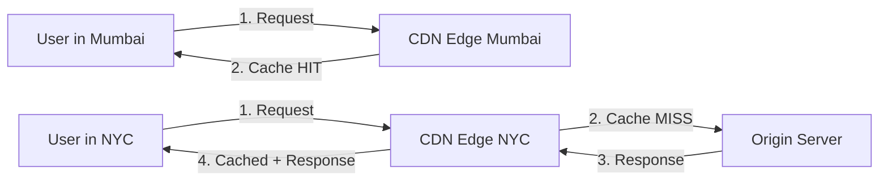
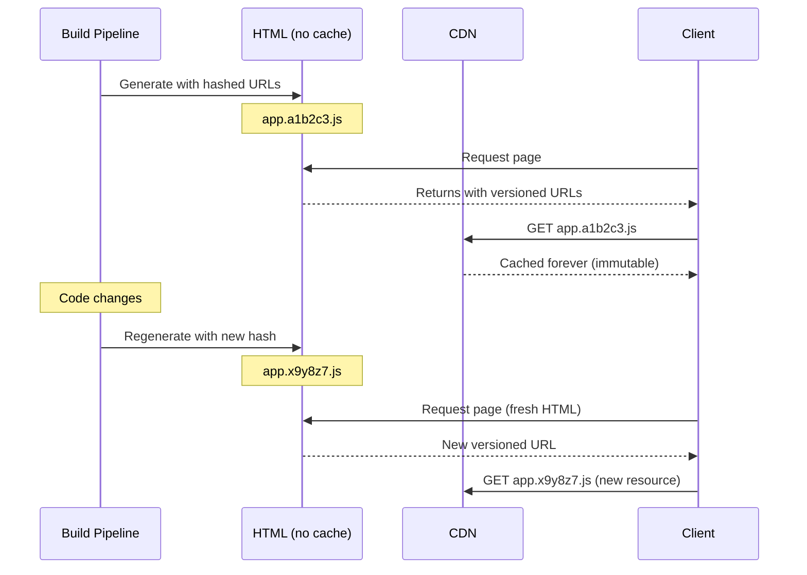

# CDN Caching Strategies

## Problem It Solves

Serving static content (images, JS, CSS, videos) directly from origin server creates latency for global users and overloads origin. CDN edge locations serve content from geographically closer servers.

## How It Works



## HTTP Caching Headers

### Cache-Control Directives

| Directive | Meaning |
|---|---|
| `max-age=3600` | Browser caches for 1 hour |
| `s-maxage=3600` | CDN-specific TTL (overrides max-age for CDN only) |
| `no-cache` | Must revalidate with server before serving |
| `no-store` | Never cache (sensitive data like banking) |
| `private` | Browser yes, CDN no |
| `public` | Both browser and CDN can cache |
| `stale-while-revalidate=60` | Serve stale for 60s while refreshing |
| `immutable` | Content will never change (versioned URLs) |

### Validation Headers

**ETag-based validation:**
```http
# Server response
ETag: "abc123"

# Client revalidation
If-None-Match: "abc123"

# If unchanged
HTTP/1.1 304 Not Modified
```

**Last-Modified validation:**
```http
# Server response
Last-Modified: Tue, 22 Apr 2026 08:00:00 GMT

# Client revalidation
If-Modified-Since: Tue, 22 Apr 2026 08:00:00 GMT
```

## Versioned URL Pattern

Instead of invalidating cache, change the URL.



**Key Insight:** HTML has short/no cache, assets have year-long cache. URL change = new resource for CDN.

## E-commerce Caching Strategy by Content Type

| Content Type | Cache-Control | Reasoning |
|---|---|---|
| Product images | `public, max-age=86400, s-maxage=604800, immutable` | Rarely changes, use versioned URLs |
| Product description | `public, max-age=3600` | Changes occasionally |
| Product price | `private, no-cache` OR don't cache on CDN | Changes frequently, must be accurate |
| User cart | `private, no-store` | User-specific, sensitive |
| Static JS/CSS | `public, max-age=31536000, immutable` | Versioned filename |
| HTML pages | `public, max-age=60, s-maxage=300` | Short TTL, contains versioned asset URLs |

## CDN Cache Invalidation Methods

| Method | Speed | Use Case |
|---|---|---|
| **TTL expiry** | Slow (depends on TTL) | Default, no action needed |
| **Purge API** | 30s - 2min globally | On-demand invalidation |
| **Surrogate keys / Cache tags** | Fast | Invalidate group of related URLs |
| **Versioned URLs** | Instant | Static assets |
| **Short TTL** | Fast (seconds) | Dynamic content |

## When to Use

- **Static assets** (images, JS, CSS, videos)
- **Geographically distributed users**
- **Public content** that's same for all users
- **High-volume traffic** to reduce origin load

## When NOT to Use

- **User-specific data** (cart, dashboard) — `private` content
- **Real-time data** (stock prices, live scores)
- **Financial/banking** APIs (sensitive)
- **POST/PUT/DELETE** requests (uncacheable by default)

## Trade-offs

| Gain | Sacrifice |
|---|---|
| Reduced latency globally | Cache invalidation complexity |
| Reduced origin load | Stale content risk |
| Better availability | Cost (CDN provider fees) |
| DDoS protection | Less visibility/debugging |

## Real World Example

**Cloudflare** serves over 50 million HTTP requests per second from edge locations. Sites using Cloudflare see 50-70% reduction in origin requests.

**Netflix** caches video content on ISP-level edge servers (Open Connect) — when you watch a show, it likely streams from a server inside your ISP.

## Interview Soundbite

> *"For e-commerce, I use layered caching: CDN with long TTL and versioned URLs for static assets, short TTL with stale-while-revalidate for product descriptions, and bypass CDN entirely for prices — those go through Redis. For invalidation, I prefer versioned URLs over CDN purge because they're instant and don't suffer from propagation delays."*
