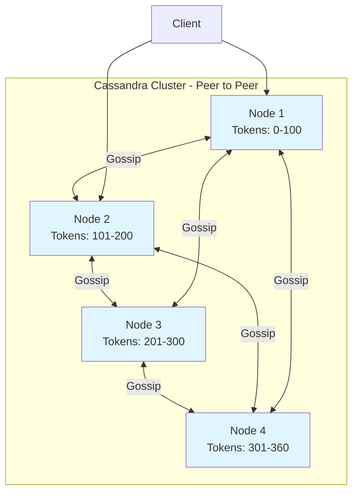
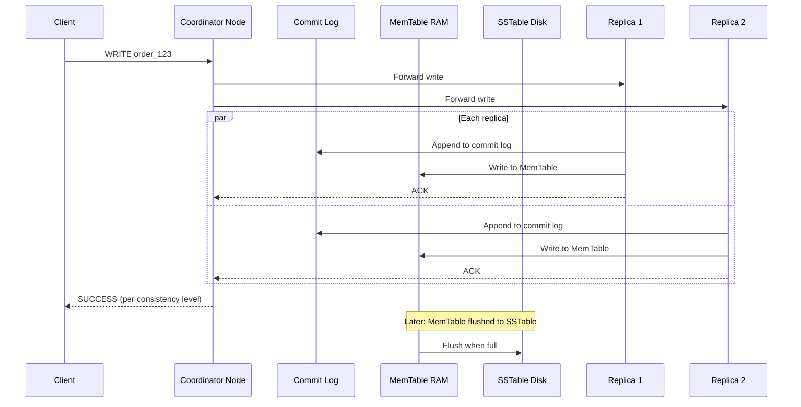
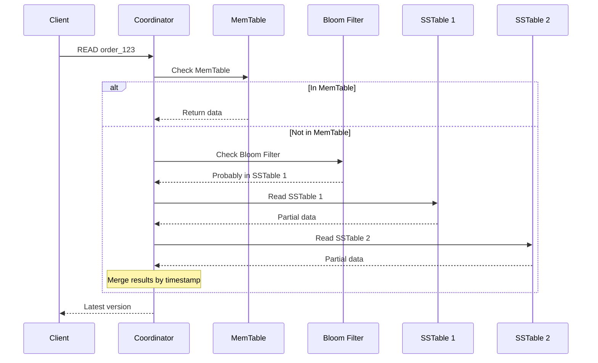

# Cassandra Internals

## Problem It Solves

Massive horizontal scale with high availability across regions. No single point of failure. Linear write scaling by adding nodes. Built for "always-on" services like Netflix, Uber, Instagram.

## Architecture Overview



**Key:** No master. Any node accepts requests and coordinates.

## Write Path



**Steps:**
1. Write to **Commit Log** (durability — survives crash)
2. Write to **MemTable** (in RAM)
3. Acknowledge client
4. Later: MemTable flushed to **SSTable** (immutable file on disk)
5. Background **compaction** merges SSTables

## Read Path



**Why Bloom Filter?**
- Probabilistic check: "Is this key probably in this SSTable?"
- Avoids unnecessary disk reads
- False positives possible, false negatives never

## Data Model — Query-First Design

### Wrong Mindset (SQL-style)
```sql
CREATE TABLE orders (
    order_id UUID PRIMARY KEY,
    user_id UUID,
    restaurant_id UUID,
    amount DECIMAL
);
-- Then query: SELECT * FROM orders WHERE user_id=?
-- PROBLEM: full cluster scan, terrible performance
```

### Right Mindset (Query-first)
```sql
-- Query: "Get all orders for a user, sorted by time"
CREATE TABLE orders_by_user (
    user_id UUID,
    order_time TIMESTAMP,
    order_id UUID,
    restaurant_name TEXT,    -- denormalized!
    amount DECIMAL,
    PRIMARY KEY (user_id, order_time)
);
-- user_id = partition key (which node)
-- order_time = clustering key (sort order within partition)
```

### If Multiple Queries Needed → Multiple Tables

```sql
-- Same data, different table per query
CREATE TABLE orders_by_restaurant (
    restaurant_id UUID,
    order_time TIMESTAMP,
    order_id UUID,
    user_name TEXT,
    PRIMARY KEY (restaurant_id, order_time)
);

CREATE TABLE orders_by_date (
    order_date DATE,
    order_time TIMESTAMP,
    order_id UUID,
    PRIMARY KEY (order_date, order_time)
);
```

**Yes, you duplicate data. This is intentional.**

## Consistency Levels (Tunable)

| Level | Meaning | Use Case |
|---|---|---|
| **ONE** | 1 replica acks | Fast writes, OK with risk |
| **QUORUM** | Majority acks | Balanced (most common) |
| **ALL** | All replicas ack | Strongest, slowest |
| **LOCAL_QUORUM** | Majority in local DC | Multi-region setups |

**Strong consistency formula:**
```
R + W > N
where N = replication factor
      R = read consistency level
      W = write consistency level

Example: N=3, W=QUORUM(2), R=QUORUM(2)
2 + 2 > 3 → strong consistency
```

## Partition Key Best Practices

### Good Partition Keys
- High cardinality (millions of unique values)
- Evenly distributed
- Aligned with query pattern

### Bad Partition Keys
- Low cardinality (e.g., country code → 200 partitions)
- Hotspots (e.g., timestamp alone → all writes to current partition)
- Unbounded growth (single partition gets too large)

### Time-Series Hotspot Fix

```sql
-- BAD: all today's data in one partition
PRIMARY KEY (date, timestamp)

-- GOOD: bucket by hour
PRIMARY KEY ((date, hour), timestamp)
```

## Common Anti-Patterns

❌ **Secondary indexes on high-cardinality columns** — slow, doesn't scale  
❌ **ALLOW FILTERING in production** — full cluster scan  
❌ **Large partitions** (>100MB) — read amplification, slow compaction  
❌ **Frequent updates to same partition** — tombstones accumulate  
❌ **Treating Cassandra as queue** — tombstone hell  

## When Things Go Wrong

### Node Failure
- Replicas continue serving
- Hinted handoff: other nodes store writes for dead node
- When node returns: hints are replayed

### Network Partition
- Each side continues serving (AP system)
- Read repair / anti-entropy syncs when partition heals

### Tombstones
- Deletes don't immediately remove data
- Marked with tombstone, removed during compaction
- Too many tombstones = slow reads

## Real World Example

**Netflix** runs the largest Cassandra deployment in the world — 10,000+ nodes globally storing viewing history, user preferences, A/B test data. Handles 1 trillion+ requests per day.

**Instagram** uses Cassandra for the inbox/feed of every user — high write volume, query by user_id.

**Discord** stores billions of messages in Cassandra — query by channel_id partition key.

## Interview Soundbite

> *"Cassandra's strength is its LSM Tree write path — sequential writes to commit log and MemTable make it incredibly fast. The peer-to-peer architecture with consistent hashing means no master and linear horizontal scaling. The key constraint is query-first data modeling — you design tables around queries, not entities, and accept denormalization. Tunable consistency lets me trade off latency vs accuracy per query."*
