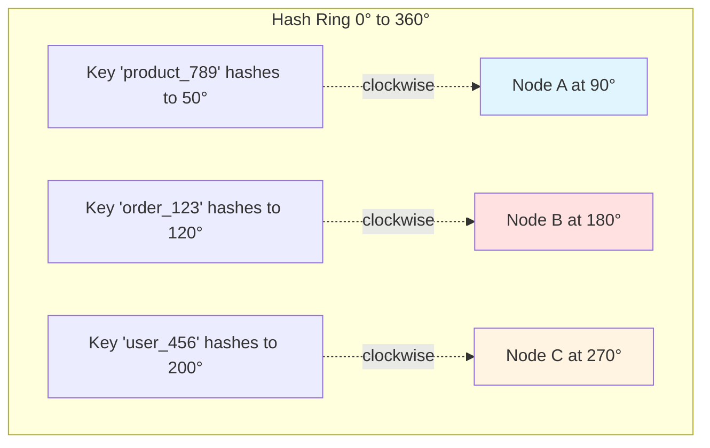
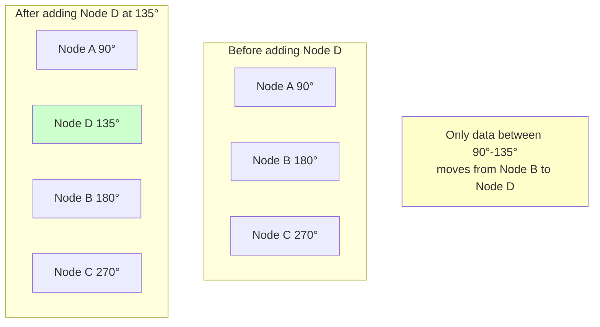
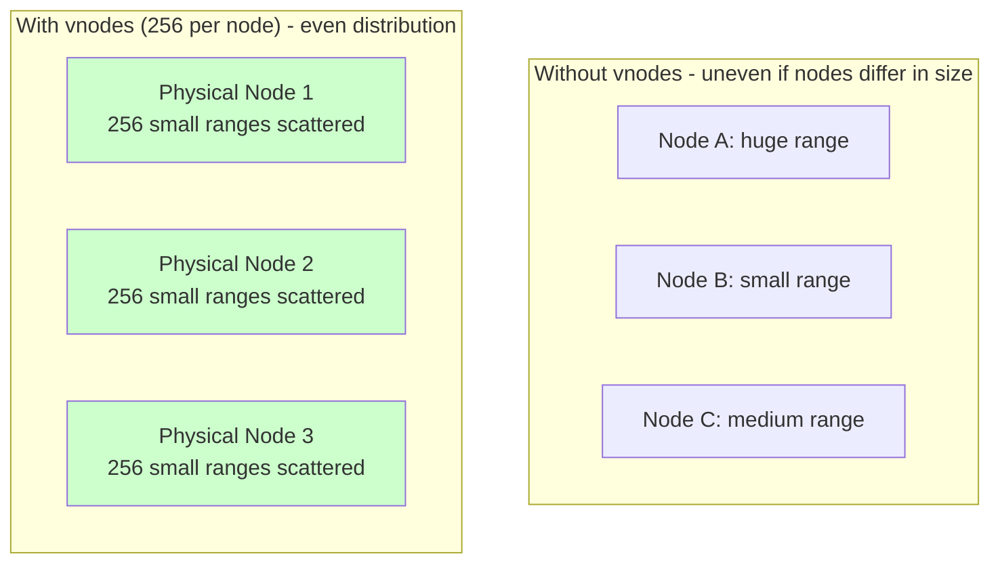
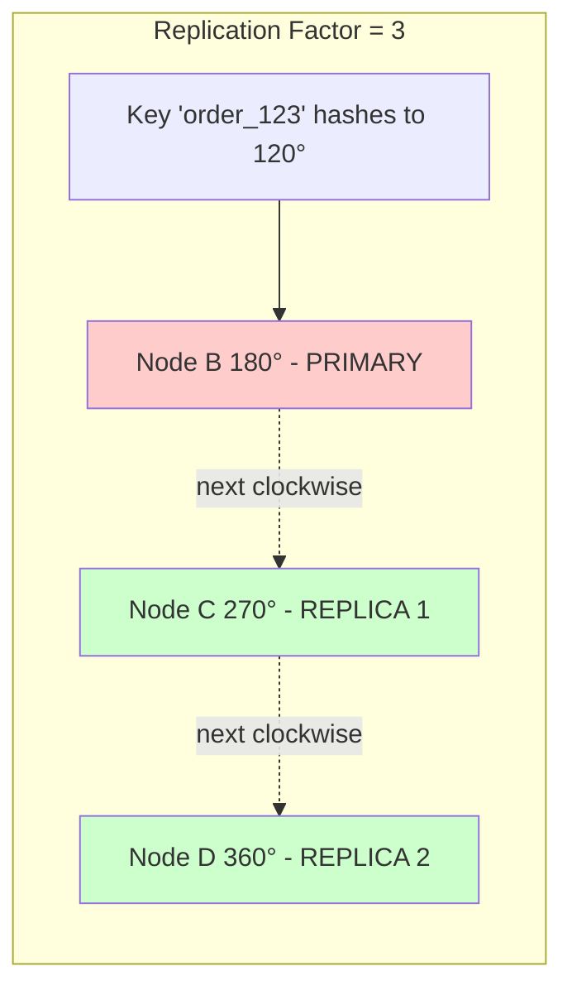
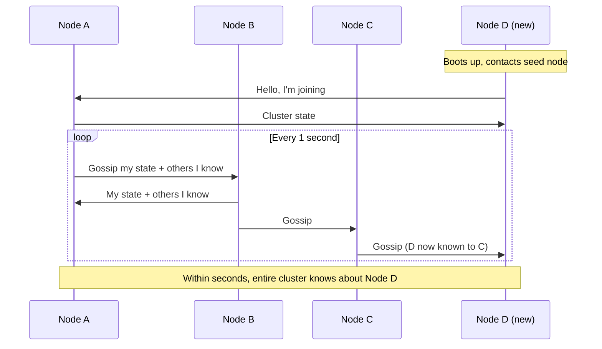
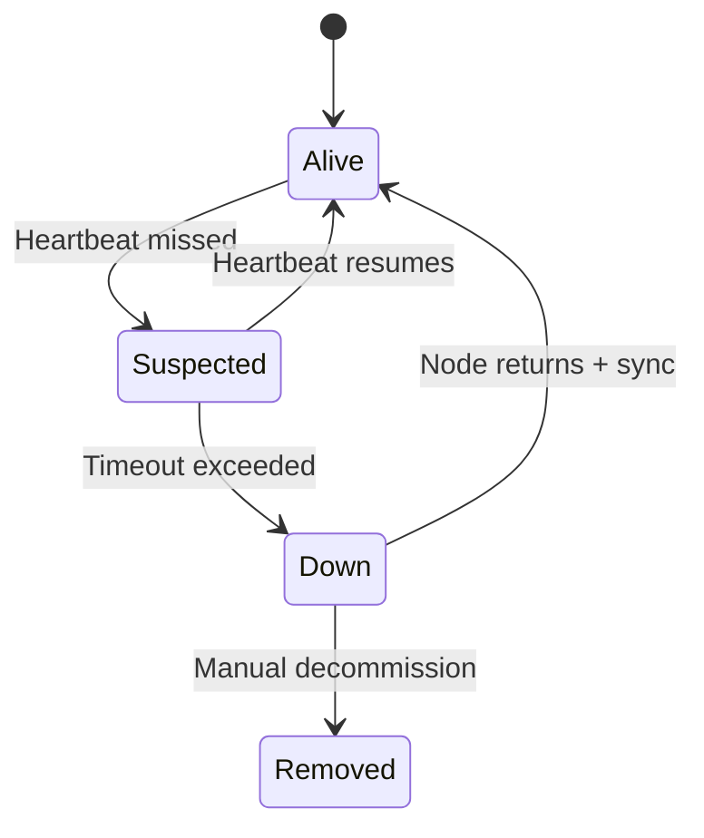
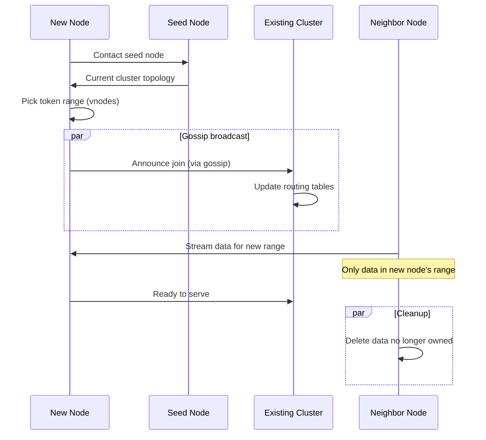

# Consistent Hashing (Cassandra Foundation)

## Problem It Solves

Traditional hashing (`hash(key) % N`) breaks catastrophically when nodes are added or removed — almost ALL keys remap to different nodes, causing massive data migration. Consistent hashing minimizes data movement when cluster size changes.

## Naive Hashing Problem

```
3 nodes:  key % 3
4 nodes:  key % 4

Adding 1 node → almost every key changes home
→ 75% of data moves ❌
```

## How Consistent Hashing Works

### The Hash Ring



**Rule:** Each key travels **clockwise** to find its node.

### Adding a Node — Minimal Disruption



**Result:** Only ~25% of data moves (proportional to new node's range), not 75%!

## Virtual Nodes (vnodes) — Better Distribution

Real Cassandra uses **virtual nodes** — each physical node owns many small token ranges.



**Benefits of vnodes:**
- Even data distribution even if nodes have different capacity
- Faster rebalancing (parallelized across many small ranges)
- Less hotspotting

## Replication on the Ring



Replicas placed on **next N-1 nodes clockwise**. Across racks/datacenters for fault tolerance.

## Gossip Protocol — How Nodes Discover Each Other



### What's in a Gossip Message?

```json
{
  "nodeId": "Node-A",
  "status": "UP",
  "load": "45%",
  "tokens": [90, 450, 780],
  "generation": 12345,
  "schemaVersion": "v3",
  "knownNodes": {
    "Node-B": { "status": "UP", "tokens": [...] },
    "Node-C": { "status": "DOWN", "lastSeen": "..." }
  }
}
```

## Failure Detection via Gossip



**Phi Accrual Failure Detector** — Cassandra's algorithm:
- Doesn't binary "up/down" — calculates suspicion level (phi)
- Adapts to network conditions
- Higher phi = more likely the node is down

## Full Rebalancing Flow



## Why This Matters for Architects

### Operational Benefits

| Scenario | Traditional Hashing | Consistent Hashing |
|---|---|---|
| Add node | 75%+ data moves | ~1/N data moves |
| Remove node | 75%+ data moves | Only that node's data moves |
| Node failure | All keys remap | Adjacent nodes pick up |
| Heterogeneous nodes | Uneven load | Even via vnodes |

### Real-World Impact

```
100 TB dataset, 10 nodes, add 1 more node:

Traditional hashing:    ~75 TB moves    → days of disruption
Consistent hashing:     ~10 TB moves    → hours
With vnodes:            ~10 TB parallel → minutes
```

## Where Else Consistent Hashing Is Used

- **DynamoDB** (Amazon) — original Dynamo paper
- **Cassandra** — directly inspired by Dynamo
- **Redis Cluster** — slightly different (16384 slots)
- **Memcached client libraries** (ketama hashing)
- **Akamai CDN** — request routing
- **Load balancers** — sticky sessions

## Trade-offs

| Gain | Sacrifice |
|---|---|
| Minimal data movement | More complex than modulo hashing |
| Auto-rebalancing | Eventual consistency during rebalance |
| Linear scaling | Requires coordination protocol (gossip) |
| Heterogeneous nodes (vnodes) | Higher memory for routing tables |

## Common Mistakes

❌ **Confusing consistent hashing with "consistency" in CAP** — unrelated concepts  
❌ **Not using vnodes** — leads to uneven distribution  
❌ **Bad partition key choice** — even consistent hashing can't fix hotspots  
❌ **Ignoring rack/DC awareness** — replicas all in one rack = no fault tolerance  

## Interview Soundbite

> *"Consistent hashing solves the catastrophic rebalancing problem of modulo hashing. Nodes and keys live on a hash ring; keys travel clockwise to their node. Adding a node moves only a fraction of data — proportional to the new node's range. Cassandra extends this with virtual nodes for even distribution across heterogeneous hardware, and gossip protocol for decentralized cluster awareness. The whole system has no master and scales linearly with zero downtime."*
