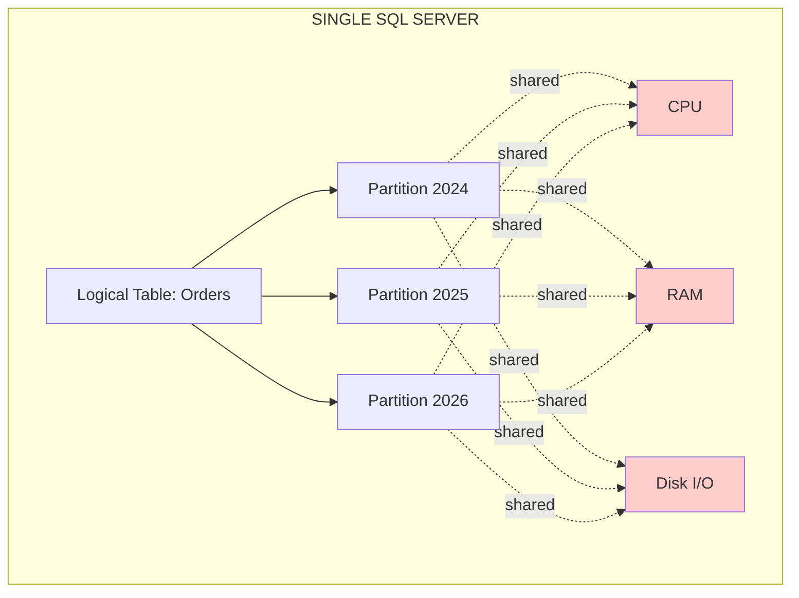
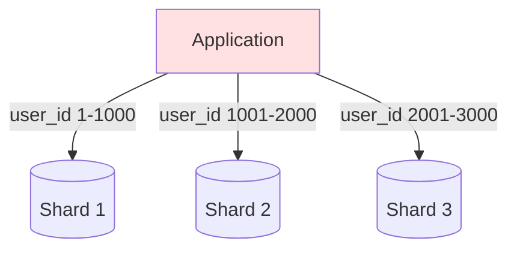
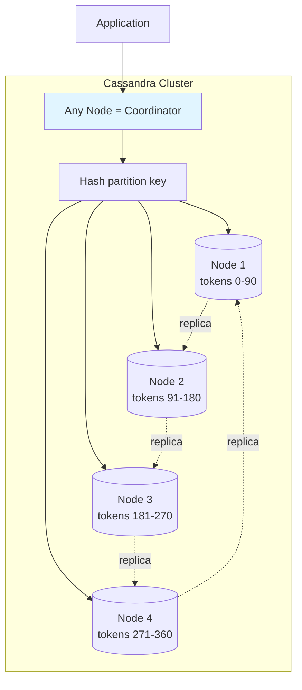
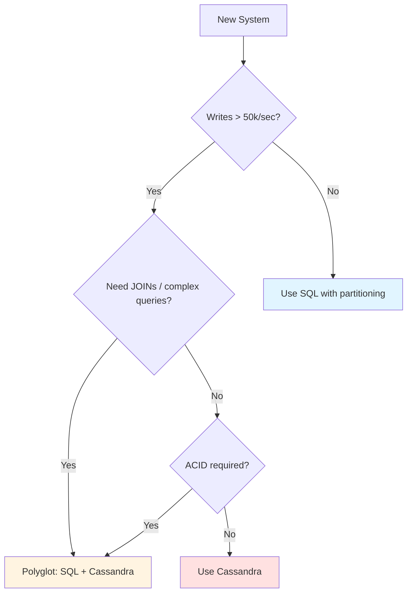

# SQL Partitioning vs Cassandra Partitioning

## Problem It Solves

Both SQL and Cassandra partition data — but for fundamentally different reasons. Architects often confuse them, leading to wrong tool choice.

## Core Difference

```
SQL Partitioning:       Performance optimization within one node
Cassandra Partitioning: Fundamental data distribution across nodes
```

## SQL Partitioning

### How It Works

```sql
-- PostgreSQL example
CREATE TABLE orders (
    order_id UUID,
    order_date DATE,
    amount DECIMAL
) PARTITION BY RANGE (order_date);

CREATE TABLE orders_2024 PARTITION OF orders
    FOR VALUES FROM ('2024-01-01') TO ('2024-12-31');

CREATE TABLE orders_2025 PARTITION OF orders
    FOR VALUES FROM ('2025-01-01') TO ('2025-12-31');
```

### Visualization



### Types of SQL Partitioning

| Type | Description | Example |
|---|---|---|
| **Range** | By value range | order_date by year |
| **Hash** | By hash of column | user_id % 4 |
| **List** | By explicit values | country IN ('IN', 'US') |
| **Composite** | Combination | range + hash |

### SQL Sharding (Cross-Server)

When data exceeds one server, manual sharding:



**Pain Points:**
- App must know shard routing
- Cross-shard JOINs nearly impossible
- Adding shard = manual data migration
- No built-in replication
- No automatic failover

## Cassandra Partitioning

### How It Works

```sql
CREATE TABLE orders (
    user_id UUID,
    order_time TIMESTAMP,
    order_id UUID,
    PRIMARY KEY (user_id, order_time)
    --         ▲ partition key (which node)
    --                    ▲ clustering key (sort order)
);
```

Cassandra **automatically:**
1. Hashes partition key → determines node
2. Replicates to N nodes (replication factor)
3. Handles rebalancing when nodes added/removed

### Visualization



## Side-by-Side Comparison

| Aspect | SQL Partitioning | Cassandra Partitioning |
|---|---|---|
| **Where partitions live** | Usually same node | Different nodes (always) |
| **Who decides routing** | Query planner | Hash function on partition key |
| **Rebalancing** | Manual DBA work | Automatic via gossip |
| **Cross-partition queries** | Supported (JOINs work) | Anti-pattern (no JOINs) |
| **Partition key requirement** | Optional optimization | Mandatory for every query |
| **Adding capacity** | Buy bigger server | Add node, auto-rebalance |
| **Replication** | Manual (master-slave) | Built-in (replication factor) |
| **Failure tolerance** | Failover takes seconds | Zero downtime (peer-to-peer) |
| **Max scale** | Limited by single node | Linear with nodes |

## Why You'd Stick with SQL Partitioning

### MS SQL / PostgreSQL Partitioning is Great When:

✅ **Moderate scale** (< 50k writes/sec)  
✅ **Need ACID transactions** across partitions  
✅ **Complex queries** with JOINs across partitions  
✅ **Reporting/analytics** workloads  
✅ **Single-region** deployment  
✅ **Strong consistency** mandatory  
✅ **Team SQL expertise** available  

### Cassandra Becomes Necessary When:

✅ **Write volume** > 50k/sec sustained  
✅ **Time-series data** at massive scale  
✅ **Multi-region active-active** writes needed  
✅ **Linear scalability** required  
✅ **High availability** > strong consistency  
✅ **Query patterns** are well-known upfront  

## Concrete Examples

### Stick with SQL Partitioning

**Scenario:** B2B SaaS with 10,000 enterprise customers, 100k orders/day  
**Why:** ACID needed, complex reporting, moderate scale, partition by tenant_id works fine

### Go with Cassandra

**Scenario:** IoT platform, 1M devices reporting telemetry every 10 seconds  
**Why:** 100k+ writes/sec, time-series, never need JOINs, query by device_id

## The Honest Architect View



## Common Mistakes

❌ **"NoSQL scales better, so use Cassandra"** — only true for specific workloads  
❌ **"SQL doesn't scale"** — modern Postgres handles huge scale with partitioning  
❌ **Using Cassandra for relational data** — pain when requirements evolve  
❌ **Manually sharding SQL when Cassandra would be better** — reinventing the wheel  

## Trade-offs Summary

| Choice | Gain | Sacrifice |
|---|---|---|
| **SQL Partitioning** | ACID, JOINs, simple ops | Single-node limit |
| **Cassandra Partitioning** | Linear scale, HA | Query flexibility, JOINs, ACID |

## Real World Examples

**Stack Overflow** runs on a few large SQL Server instances with smart partitioning. Handles billions of requests with vertical scaling.

**Discord** initially used MongoDB, migrated to Cassandra when messages grew to billions. Now partitions by channel_id across thousands of nodes.

**Shopify** uses Postgres with smart sharding (by shop_id) for orders. Cassandra would be overkill.

## Interview Soundbite

> *"SQL partitioning is a single-node performance optimization — same machine, multiple file groups. Cassandra partitioning is the fundamental data distribution mechanism — different machines, automatic replication, automatic rebalancing. I choose SQL with partitioning when ACID and JOINs matter at moderate scale. I choose Cassandra when I need linear horizontal scaling and write throughput beyond what a single machine can handle, even with the biggest hardware."*
