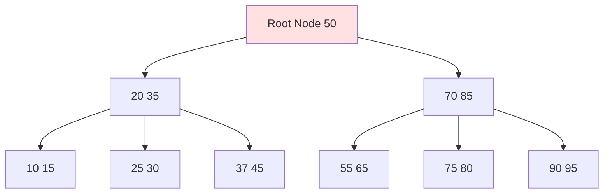
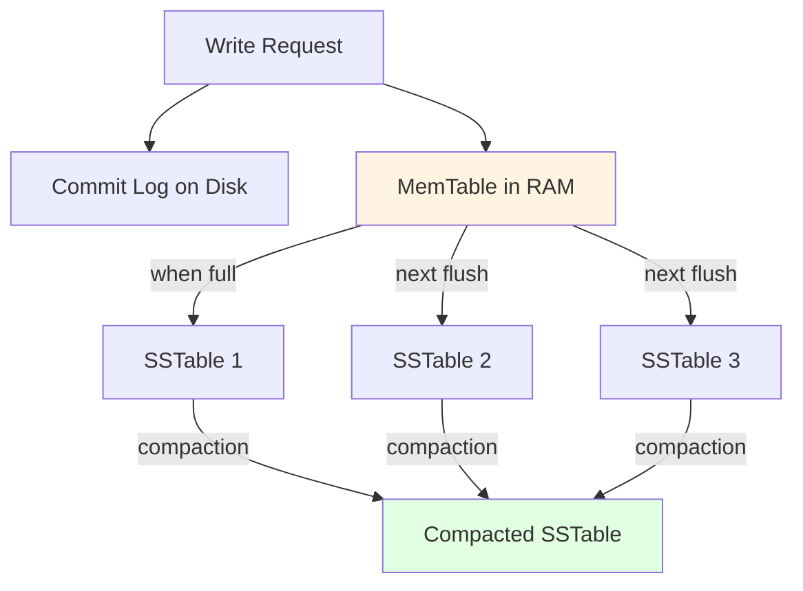
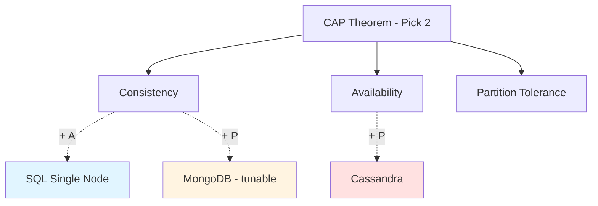

# SQL vs NoSQL (Cassandra Focus)

## Problem It Solves

Different data and access patterns demand different storage. Choosing wrong = scalability nightmare or unnecessary complexity. Architects must match storage to workload.

## Fundamental Difference

```
SQL:       Storage first → query however you want later
NoSQL:     Query first → design storage around queries
```

## How It Works — Internals

### SQL (B-Tree based)



**Key points:**
- Balanced tree, sorted on disk
- Read: O(log n) — jump directly to row
- Write: must rebalance tree → expensive at scale
- Random disk I/O

### NoSQL (LSM Tree — Cassandra)



**Key points:**
- All writes sequential (fast)
- MemTable in RAM → flushed to immutable SSTables
- Background compaction merges SSTables
- Read may check multiple SSTables (slower than B-Tree)

## Comparison Table

| Aspect | SQL (RDBMS) | Cassandra (NoSQL) |
|---|---|---|
| **Data structure** | B-Tree | LSM Tree |
| **Schema** | Strict, predefined | Flexible, denormalized |
| **ACID** | Full | Limited (tunable consistency) |
| **JOINs** | Native | Not supported |
| **Scaling** | Vertical (scale up) | Horizontal (scale out) |
| **Topology** | Master-Slave | Peer-to-peer (no master) |
| **Write performance** | Good (limited by single node) | Excellent (linear with nodes) |
| **Read performance** | Excellent for complex queries | Fast for partition key lookups |
| **CAP** | CA (single node), CP (distributed) | AP (Available + Partition tolerant) |
| **Consistency** | Strong by default | Eventual (tunable) |
| **Best for** | Transactional, relational | High write throughput, time-series |

## CAP Theorem Mapping



## Decision Framework

### Choose SQL When:
- ACID transactions required (banking, payments)
- Complex JOINs and aggregations needed
- Strong consistency mandatory
- Moderate scale (< 50k writes/sec)
- Reporting and ad-hoc queries common
- Strong relational model

### Choose Cassandra When:
- Write throughput > 50k/sec
- Time-series data (location, metrics, logs)
- Multi-region active-active writes
- Linear horizontal scaling needed
- Query patterns known in advance
- Availability > consistency

## Real World Polyglot Example

### Zomato/Swiggy Architecture

| Data | Storage | Why |
|---|---|---|
| User profiles | PostgreSQL | Relational, ACID, occasional queries |
| Restaurant menus | PostgreSQL | Complex relationships (menu→items→prices) |
| Orders (records) | PostgreSQL | Transactional, source of truth |
| Order status timeline | Cassandra | High write volume, time-series |
| Driver locations | Cassandra | Millions of writes/sec |
| Delivery analytics | Cassandra | Time-series, append-only |
| Session data | Redis | In-memory speed |
| Restaurant search | Elasticsearch | Full-text search |

## Trade-offs Summary

| Choice | Gain | Sacrifice |
|---|---|---|
| **SQL** | ACID, JOINs, mature tooling | Horizontal scaling difficulty |
| **Cassandra** | Massive scale, HA | JOINs, complex queries, ACID |

## Common Mistakes

❌ **Using Cassandra for relational data** — pain when business asks for "all orders by region by category"  
❌ **Using SQL for time-series at scale** — DB chokes under millions of writes/sec  
❌ **Querying Cassandra without partition key** — full cluster scan, terrible performance  
❌ **Treating Cassandra like SQL** — adding secondary indexes everywhere, expecting JOINs  

## Interview Soundbite

> *"I don't choose SQL or NoSQL — I choose based on workload. SQL for transactional data with relationships and ACID needs. Cassandra for write-heavy, time-series, or globally distributed data where eventual consistency is acceptable. Most real systems use polyglot persistence — Postgres for orders, Cassandra for tracking, Redis for caching, Elasticsearch for search."*
