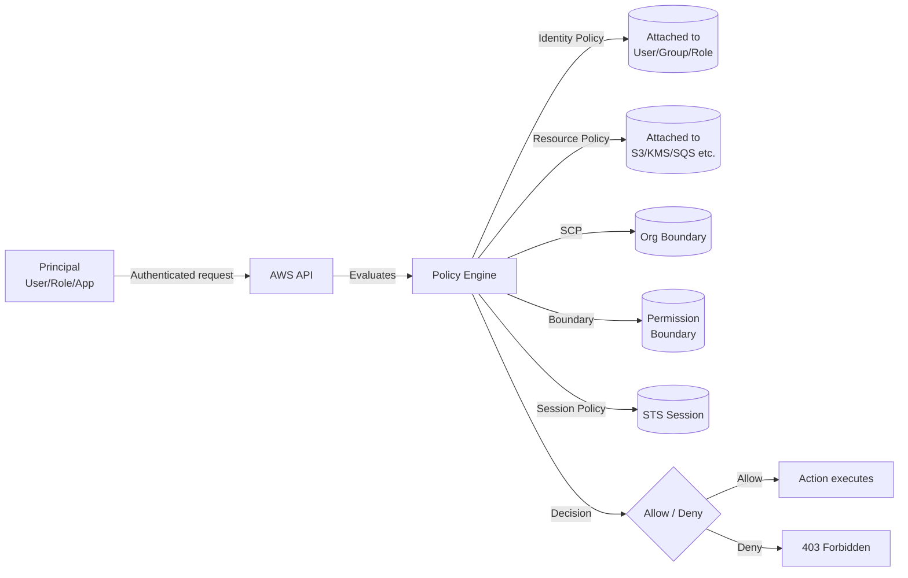

# IAM Core — Users, Groups, Roles, Policies

## Problem It Solves
AWS resources are valuable. Without IAM, anyone with credentials could do anything. IAM provides **authentication** (who are you?) and **authorization** (what can you do?) for every API call across every AWS service.

## How It Works



### The 4 IAM Identity Types

| Identity | Purpose | Credentials | Best For |
|---|---|---|---|
| **Root User** | Account owner | Email + password + MFA | Almost nothing — only billing changes, account closure |
| **IAM User** | Long-term human or app | Password / Access Keys | Legacy use — prefer SSO/roles |
| **IAM Group** | Logical bucket of users | None (inherits from users) | Apply policies to groups of humans |
| **IAM Role** | Temporary identity | STS-issued temp credentials | Apps, services, federated users, cross-account |

### The 6 Policy Types

```
┌────────────────────────────────────────────────────────┐
│ 1. IDENTITY-BASED POLICIES                              │
│    Attached to: User, Group, Role                       │
│    Says: "This identity can do X on Y"                  │
├────────────────────────────────────────────────────────┤
│ 2. RESOURCE-BASED POLICIES                              │
│    Attached to: S3, KMS, SQS, SNS, Lambda, etc.         │
│    Says: "These principals can do X on this resource"   │
├────────────────────────────────────────────────────────┤
│ 3. PERMISSION BOUNDARIES                                │
│    Attached to: User or Role (NOT groups)               │
│    Says: "Max permissions this identity can EVER have"  │
├────────────────────────────────────────────────────────┤
│ 4. SERVICE CONTROL POLICIES (SCPs)                      │
│    Attached to: OU or Account (via Organizations)       │
│    Says: "Maximum permissions for ALL identities here"  │
├────────────────────────────────────────────────────────┤
│ 5. SESSION POLICIES                                     │
│    Passed in: AssumeRole / GetFederationToken           │
│    Says: "Temporarily reduce this session's permissions"│
├────────────────────────────────────────────────────────┤
│ 6. ACCESS CONTROL LISTS (ACLs)                          │
│    Legacy — used mostly for S3 cross-account            │
└────────────────────────────────────────────────────────┘
```

### Policy Anatomy

```json
{
  "Version": "2012-10-17",        ← Always this date (policy language version)
  "Statement": [
    {
      "Sid": "AllowS3Read",        ← Optional statement label
      "Effect": "Allow",            ← Allow or Deny
      "Principal": {                ← WHO (only in resource policies)
        "AWS": "arn:aws:iam::111122223333:root"
      },
      "Action": [                   ← WHAT actions
        "s3:GetObject",
        "s3:ListBucket"
      ],
      "Resource": [                 ← WHICH resources
        "arn:aws:s3:::my-bucket",
        "arn:aws:s3:::my-bucket/*"
      ],
      "Condition": {                ← WHEN (optional conditions)
        "IpAddress": {
          "aws:SourceIp": "192.0.2.0/24"
        },
        "Bool": {
          "aws:MultiFactorAuthPresent": "true"
        }
      }
    }
  ]
}
```

## When to Use

- **IAM Users** → Legacy systems, break-glass admin accounts, third-party tools that can't assume roles
- **IAM Groups** → ALWAYS for organizing humans (Devs, Admins, ReadOnly)
- **IAM Roles** →
  - EC2 instances accessing AWS resources (Instance Profile)
  - Lambda functions
  - Cross-account access
  - Federated users (SAML, OIDC, Web Identity)
  - Service-linked roles (auto-created by services)

## When NOT to Use

- ❌ **Don't use root user** for anything except initial setup, billing changes, closing account
- ❌ **Don't embed access keys** in code, EC2 user-data, or container images → use Roles
- ❌ **Don't use IAM users for humans in multi-account orgs** → use IAM Identity Center
- ❌ **Don't rely on ACLs** → prefer bucket policies + IAM

## Trade-offs

| Choice | Gain | Sacrifice |
|---|---|---|
| Roles over Users | Auto-rotating temp credentials, no key leakage | Slightly more setup; STS calls needed |
| Identity Center over IAM Users | Centralized, SSO, MFA, per-account access | Requires IAM Identity Center setup, Org |
| Resource policy + IAM policy | Fine-grained cross-account | Two policies to maintain, evaluation complexity |
| Permission Boundary | Safe developer self-service | Complex to debug; "deny by omission" issues |

## Real World Example

**Netflix** uses thousands of IAM roles, one per microservice, each with **least-privilege policies** scoped to the exact resources that service needs. Their build pipeline auto-generates these IAM policies from code annotations. No IAM users for humans — everyone uses SSO via Identity Center.

**Capital One** uses Permission Boundaries so developers can create their own roles within boundaries — speeding up delivery while keeping the security team in control of the maximum blast radius.

## 🎯 Exam Soundbite

> "IAM Roles with STS-issued temporary credentials replace long-lived access keys for any workload running on AWS or federated from an external identity provider. The root user is reserved for account-level tasks only and must be protected with hardware MFA."

---

## ⚡ Quick Recall Card

```
┌─────────────────────────────────────────────────┐
│ IAM IDENTITY CHOICE                              │
├─────────────────────────────────────────────────┤
│ Human in 1 account     → IAM User in Group       │
│ Human in many accounts → IAM Identity Center     │
│ EC2 → AWS resource     → IAM Role (Instance Prof)│
│ Lambda → AWS resource  → IAM Role (Execution)    │
│ Cross-account access   → IAM Role + sts:AssumeRole│
│ Corporate AD users     → SAML federation → Role  │
│ Mobile/web app users   → Cognito + Identity Pool │
│ Third-party SaaS       → IAM Role + ExternalID   │
└─────────────────────────────────────────────────┘
```
