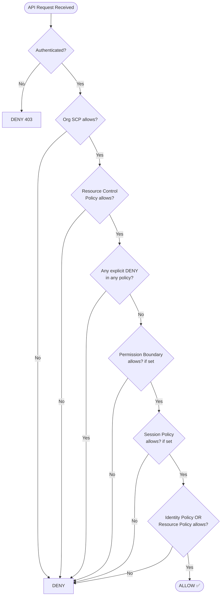
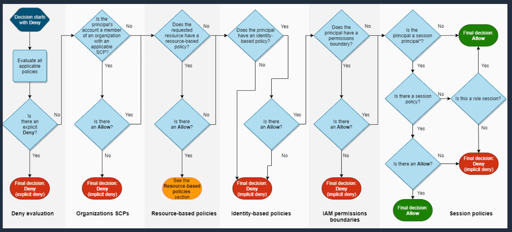

# IAM Policy Evaluation Logic

> 🔥 **This is the #1 most tested IAM concept on SAP-C02.** Memorize the flow chart.

## Problem It Solves
When multiple policies apply to a request — IAM identity policy, S3 bucket policy, SCP, permission boundary, session policy — AWS needs deterministic rules to decide **Allow** or **Deny**. Without this, security is unpredictable.

## How It Works — The Master Flow Chart



### The Golden Rules (Memorize These)

```
┌───────────────────────────────────────────────────────────┐
│ RULE 1:  EXPLICIT DENY beats everything                    │
│          A Deny in ANY policy overrides ALL Allows         │
├───────────────────────────────────────────────────────────┤
│ RULE 2:  DEFAULT is implicit DENY                          │
│          Permission must be explicitly Allowed somewhere   │
├───────────────────────────────────────────────────────────┤
│ RULE 3:  All applicable policies must ALLOW                │
│          SCP ∩ Boundary ∩ Identity = effective permissions │
├───────────────────────────────────────────────────────────┤
│ RULE 4:  Identity Policy OR Resource Policy can grant      │
│          But within the SAME account either is sufficient  │
│          Cross-account requires BOTH                       │
└───────────────────────────────────────────────────────────┘
```

### Same-Account vs Cross-Account Logic

```
SAME ACCOUNT (Account A → Resource in Account A):
─────────────────────────────────────────────────
Identity Policy says Allow → ✅ Access granted
OR
Resource Policy says Allow → ✅ Access granted
(Either is enough — they UNION)


CROSS-ACCOUNT (Account A → Resource in Account B):
─────────────────────────────────────────────────
Identity Policy in A says Allow ── AND ──
Resource Policy in B says Allow ──────────► ✅ Access
                                                granted
(BOTH required — they INTERSECT)


EXCEPTION — Services that require BOTH even same-account:
• KMS Keys
• IAM Roles (the trust policy)
```

### The "Cap" Diagram — Permission Boundaries & SCPs

```
                    ┌─────────────────────────┐
                    │     What you CAN do     │
                    │  (Effective permissions) │
                    └─────────────────────────┘
                              ▲
                              │ = intersection of...
                              │
        ┌─────────────────────┼────────────────────┐
        │                     │                    │
        ▼                     ▼                    ▼
   ┌────────┐           ┌──────────┐         ┌──────────┐
   │  SCP   │           │ Boundary │         │ Identity │
   │  (Org) │           │ (Account)│         │  Policy  │
   └────────┘           └──────────┘         └──────────┘
   Maximum for         Maximum for          What you've
   the whole OU/        this specific        actually
   Account              user/role            been granted

  Example:
  SCP allows:              s3:*, ec2:*, rds:*
  Boundary allows:         s3:*, ec2:*
  Identity Policy allows:  s3:*, dynamodb:*

  Effective permissions = s3:*  (only)
  (intersection of all three)
```

### Policy Evaluation Flow



## When to Use Each Policy Type

| Need | Use |
|---|---|
| Grant permissions to a user/role | **Identity-based policy** |
| Grant cross-account access to an S3 bucket | **Resource-based policy (bucket policy)** |
| Cap maximum permissions for an entire OU | **SCP** |
| Let developers create roles but not exceed limits | **Permission Boundary** |
| Temporarily reduce permissions during AssumeRole | **Session Policy** |
| Block ALL access to a service org-wide | **SCP with Deny** |

## When NOT to Use

- ❌ Don't use SCPs to GRANT permissions — they only RESTRICT. Identity policies still required.
- ❌ Don't put `Deny` in an Identity Policy when you can use a Permission Boundary or SCP — much harder to audit.
- ❌ Don't rely on Resource Policy alone for same-account access — Identity Policy is preferred for auditability.

## Trade-offs

| Approach | Gain | Sacrifice |
|---|---|---|
| Heavy SCP usage | Strong central guardrails | Hard to debug "why can't I do X?" |
| Permission Boundaries everywhere | Safe self-service IAM | Cognitive overhead, easy to misconfigure |
| Resource policies for cross-account | No role-chaining needed | Policy proliferation across resources |
| `NotAction` / `NotResource` | Concise policies | Easy to grant more than intended ❌ |

## Real World Example — Common Exam Trap

```
SCENARIO:
─────────────────────────────────────────────────────
Developer has an IAM policy granting s3:* on bucket "data-lake".
The S3 bucket has a bucket policy with this statement:

    {
      "Effect": "Deny",
      "Principal": "*",
      "Action": "s3:*",
      "Resource": "arn:aws:s3:::data-lake/*",
      "Condition": {
        "Bool": { "aws:SecureTransport": "false" }
      }
    }

QUESTION: Can the developer upload via HTTP?
─────────────────────────────────────────────────────
ANSWER: NO ❌
The explicit Deny in the bucket policy beats the
Allow in the identity policy. Even though identity
policy grants s3:*, the resource policy explicitly
denies non-HTTPS requests.
```

## 🎯 Exam Soundbite

> "AWS evaluates all applicable policies — SCPs, resource policies, identity policies, permission boundaries, and session policies — and grants access only if there is NO explicit deny and at least one explicit Allow within every applicable policy scope. Explicit Deny always wins."

---

## ⚡ Quick Recall Card

```
┌─────────────────────────────────────────────────┐
│ POLICY EVALUATION ORDER                          │
├─────────────────────────────────────────────────┤
│ 1. Explicit Deny?     → DENY (stop here)        │
│ 2. SCP allows?        → continue                │
│ 3. Boundary allows?   → continue                │
│ 4. Session allows?    → continue                │
│ 5. Identity/Resource  → ALLOW                   │
│    policy allows?                               │
│ 6. Otherwise          → DENY (implicit)         │
└─────────────────────────────────────────────────┘

Cross-account = need BOTH Identity (caller's) AND
                Resource (target's) to allow
```

## 🎓 Practice Question

**Q:** A developer has an Identity Policy allowing `dynamodb:*`. The SCP on their OU allows `dynamodb:GetItem` and `dynamodb:Query` only. They try to `dynamodb:PutItem`. What happens?

<details>
<summary>Answer</summary>

❌ **DENY**. The SCP restricts the maximum to `GetItem` and `Query`. Even though their identity policy grants `dynamodb:*`, the SCP cap means `PutItem` is not allowed. Effective permissions = intersection of SCP and Identity = `{GetItem, Query}`.

</details>
