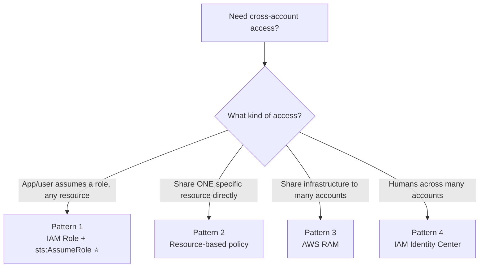
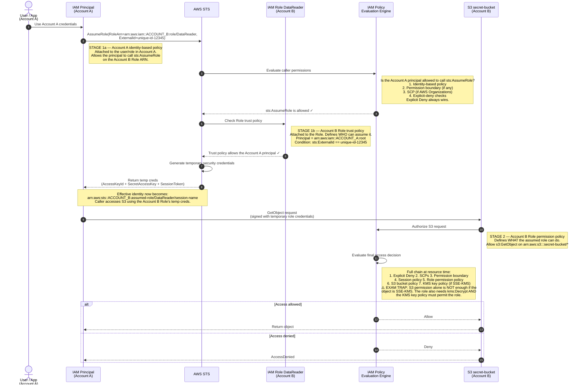
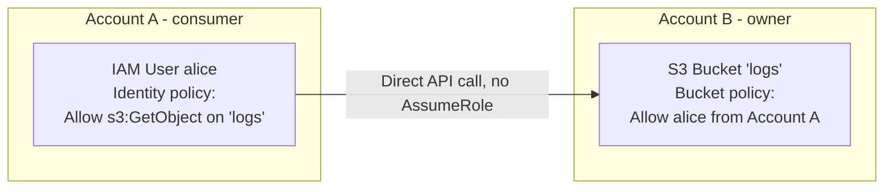
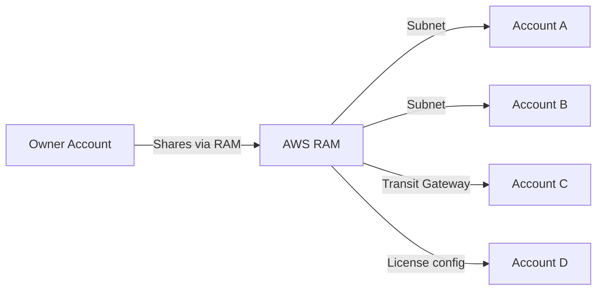
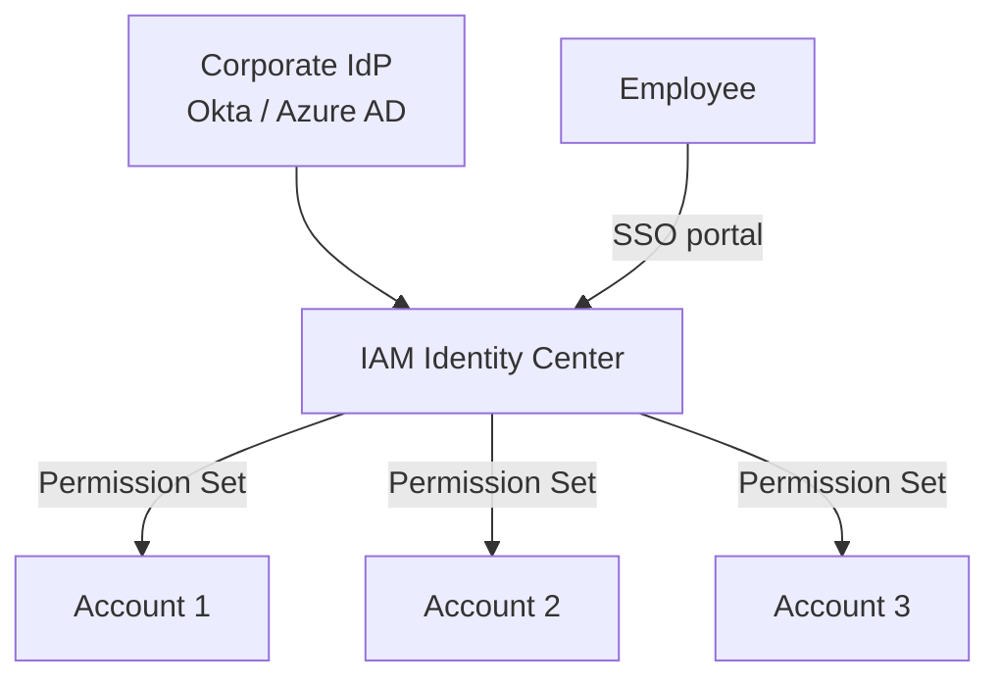
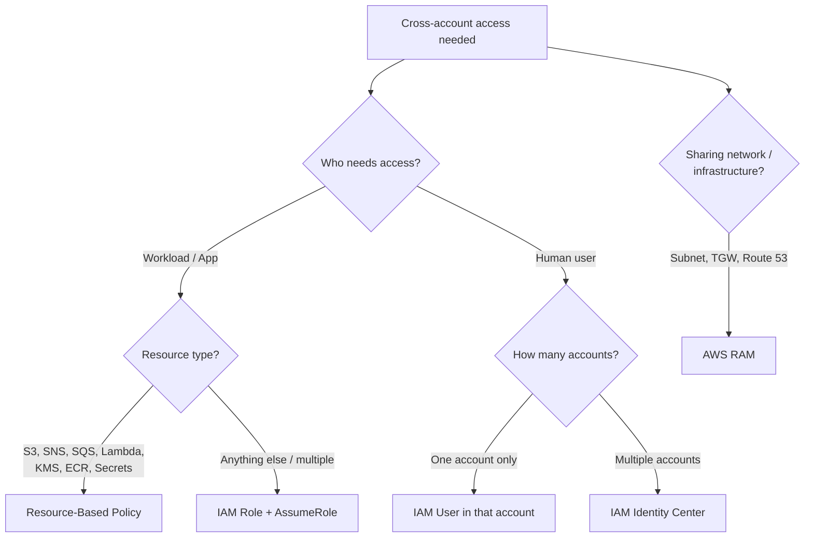

# AWS Cross-Account Access — Feynman-Style Notes

> **The one-line idea:** You have many AWS accounts (per-team, per-environment, per-workload). Something in *one* account constantly needs to reach a resource in *another*. Cross-account access is the set of safe ways to do that — and the workhorse is the same as everywhere else in IAM: **STS hands out temporary credentials by letting a caller assume a Role in the other account.**

> ⚠️ **This is NOT federation.** Federation brings *external* identities (corporate AD, Google, GitHub) *into* AWS. Cross-account access is one *AWS account* reaching into *another AWS account*. Same engine underneath (STS + Roles), different problem.

---

## 1. Why does this exist? (Explain it to a 10-year-old)

Imagine a company with many locked office buildings — one for the dev team, one for production, one for logging. Each building is an **AWS account**.

A developer in the **Dev building** needs to grab a file from a cabinet in the **Logging building**. You have two bad options and one good one:

- ❌ Give the developer a permanent key to the Logging building (= an IAM user in every account). Too many keys, impossible to track.
- ❌ Photocopy the file into every building (= copy data everywhere). Stale, wasteful, insecure.
- ✅ The developer walks to the Logging building's front desk, shows their own Dev badge, and the desk hands them a **visitor pass that expires tonight** — and that pass only opens the one cabinet they're allowed to open.

That visitor pass is **temporary credentials**, issued by **STS**, for an **IAM Role** that lives in the *owner* account.

---

## 2. The direction convention (learn this or every diagram confuses you)

Throughout, the scenario is: *an Account A user wants to read an S3 bucket that lives in Account B.*

- **Account A = the CONSUMER** — where the user/app lives. It *calls* AssumeRole.
- **Account B = the OWNER** — it holds the IAM Role *and* the S3 bucket being accessed.

> 🧠 **Hook:** **A** sks. **B** owns. The consumer Asks to borrow; the owner Bestows the Role.

---

## 3. The four patterns (the whole map)



| Pattern | Use it when | Mechanism in one line |
|---|---|---|
| **1. IAM Role + AssumeRole** ⭐ | App/user needs to act in another account; *any* resource type | STS issues temp creds for a Role in the owner account |
| **2. Resource-based policy** | Sharing *one specific* resource (S3, SQS, SNS, Lambda, KMS...) | No role — *both* accounts' policies must Allow |
| **3. AWS RAM** | Sharing *infrastructure* (subnets, Transit Gateway, Route 53 rules) | Share the resource itself, no copying |
| **4. IAM Identity Center** | *Humans* signing into *many* accounts | Central Permission Sets → auto-provisioned roles + SSO |

---

## 4. Pattern 1 — IAM Role + `sts:AssumeRole` ⭐ (the one to know cold)

### The big insight: three policies, evaluated at TWO different stages

This is the single most-tested idea. There are **three** policies in play, but they are **not all checked at the same moment**.

| Stage | Policy | Lives in | Question it answers |
|---|---|---|---|
| **Stage 1 — AssumeRole time** | **Identity policy** | Account A (consumer) | Is this user *allowed to call* AssumeRole? |
| **Stage 1 — AssumeRole time** | **Trust policy** | Account B, on the Role | Does this Role *trust* Account A to assume it? |
| **Stage 2 — Resource-access time** | **Permission policy** | Account B, on the Role | What can the assumed Role actually *do*? |

> ✅ **Timing insight:** Account A's identity policy AND Account B's trust policy are *both* validated at **AssumeRole time**. Once STS issues the temporary credentials, the identity policy is **never re-checked**. At resource-access time only the Role's permission policy (plus the broader evaluation chain) is checked.

### The three policies as JSON

**1. Identity policy** — in **Account A** — *who can call AssumeRole?*
```json
{
  "Effect": "Allow",
  "Action": "sts:AssumeRole",
  "Resource": "arn:aws:iam::ACCOUNT_B_ID:role/DataReader"
}
```

**2. Trust policy** — on the Role in **Account B** — *who is allowed to assume me?*
```json
{
  "Effect": "Allow",
  "Principal": { "AWS": "arn:aws:iam::ACCOUNT_A_ID:root" },
  "Action": "sts:AssumeRole",
  "Condition": {
    "StringEquals": { "sts:ExternalId": "unique-id-12345" }
  }
}
```

**3. Permission policy** — on the Role in **Account B** — *what can I do once assumed?*
```json
{
  "Effect": "Allow",
  "Action": ["s3:GetObject"],
  "Resource": "arn:aws:s3:::secret-bucket/*"
}
```

### End-to-end sequence (this is the `cross-account.puml`, rendered in markdown)



### Three subtleties that trip people up

**`:root` vs a specific user in the trust policy.** `"Principal": {"AWS": "...:root"}` trusts the *whole* of Account A and **delegates** the per-user decision to Account A's own identity policies — Account A's admin then controls exactly who. A specific user ARN (`...:user/alice`) is tighter, but you must edit the Role's trust policy every time the allowed-user set changes. Use `:root` when you trust Account A to manage its own people; use the specific ARN when Account B insists on controlling *exactly who*.

**`ExternalId` = third parties only.** It exists to defeat the **confused-deputy problem** when a third-party SaaS vendor assumes your role on your behalf. The vendor must pass the agreed `ExternalId` on AssumeRole. If you own *both* accounts (same org), you usually don't need it. Mental hook: **ExternalId → third party → confused deputy.**

**The KMS gotcha (classic SAP-C02 trap).** If the S3 object is encrypted with a customer-managed KMS key (SSE-KMS), `s3:GetObject` is *not enough*. (1) The Role's permission policy also needs `kms:Decrypt`, and (2) the **KMS key policy** (or a grant) must permit that Role to use the key. Miss either and you get `AccessDenied` even though the S3 permission looks correct.

> 🧠 **Explicit Deny always wins.** Even in a clean AssumeRole flow, an explicit Deny anywhere in the chain (e.g. in the bucket policy) beats the Role's Allow.

---

## 5. Pattern 2 — Resource-Based Policy (no AssumeRole)

Instead of borrowing a Role, you attach a policy *to the resource itself* saying "Account A's principal may use me." No role assumption, no temp-credential dance — the consumer calls the resource directly with its *own* credentials.



> ⚠️ **The cross-account double-Allow rule:** across accounts you need Allow on **both** sides — Account A's identity policy must allow the action **AND** Account B's resource policy must allow the Account A principal. (Within a *single* account, one Allow on either side is enough; across accounts both are mandatory.)

**Resources that support resource-based policies:** S3 buckets, SQS queues, SNS topics, Lambda functions, KMS keys, API Gateway, Secrets Manager secrets, EFS file systems, ECR repositories.

**Prefer a resource policy when:** you're sharing *one specific* resource, you don't want to manage a role in the target account, or you need to grant several accounts at once.

---

## 6. Pattern 3 — AWS Resource Access Manager (RAM)

RAM shares the *actual resource* across accounts **without copying it**. Best for shared *infrastructure*, especially networking.



**Shareable resources include:** VPC subnets (the big one — enables shared networking), Transit Gateway, Route 53 Resolver Rules, License Manager configs, Aurora DB clusters, AWS Outposts, CodeBuild projects.

**Killer use case:** a central networking team shares a subnet via RAM, and multiple workload accounts launch EC2 into that *same* subnet on the *same* VPC. Networking team controls connectivity centrally; workload teams just consume.

---

## 7. Pattern 4 — IAM Identity Center (formerly AWS SSO)

Best for **humans accessing many accounts**. One login, then pick an account + role from a portal.



**How it works:** users authenticate once via Identity Center; **Permission Sets** (IAM-policy-style JSON) are defined centrally; Identity Center auto-provisions the matching IAM Roles in each target account; the user picks account+role from the portal; STS issues temporary credentials. Requires AWS Organizations.

---

## 8. Decision tree — which pattern?



| Scenario | Best pattern |
|---|---|
| EC2 in Account A reads S3 in Account B | **Resource-based bucket policy** (simplest) |
| Lambda in A processes SQS in B | **Resource-based queue policy** |
| Developer needs admin in dev, read-only in prod | **IAM Identity Center** |
| Third-party SaaS needs your CloudTrail | **IAM Role with ExternalId** |
| Central team owns VPC, workload teams launch instances | **AWS RAM (share subnets)** |
| One Organization with shared services | **RAM + Identity Center** |
| On-prem connecting to data in Account B | **IAM Role + AssumeRoleWithSAML** |

---

## 9. What NOT to do, and the trade-offs

**Anti-patterns:**
- ❌ Don't create IAM users in multiple accounts for the same person → use **Identity Center**.
- ❌ Don't share access via long-lived **access keys** → use **Roles + STS**.
- ❌ Don't grant `iam:PassRole` broadly → scope to specific role ARNs.
- ❌ Don't skip `ExternalId` when granting access to **third parties**.

| Pattern | Pros | Cons |
|---|---|---|
| **AssumeRole** | Most flexible, CloudTrail audit trail, temporary | Needs the AssumeRole call; role-chaining limits |
| **Resource policy** | No role to manage in target account | Only some resources support it |
| **RAM** | Central management, no duplication | Limited resource types |
| **Identity Center** | Best UX, central permissions | Requires AWS Organizations |

---

## 10. Feynman self-check — say the AssumeRole flow out loud

```
1. Account A user calls sts:AssumeRole on Account B's role.
   └─ STS checks Account A IDENTITY POLICY: allowed to call AssumeRole?  ──▶ if no, STOP
2. STS checks Account B ROLE TRUST POLICY: does it trust Account A
   (+ ExternalId match if present)?                                      ──▶ if no, STOP
3. STS returns TEMPORARY CREDENTIALS (AccessKeyId + Secret + SessionToken).
   Effective identity = arn:aws:sts::ACCOUNT_B:assumed-role/DataReader/session
4. User calls s3:GetObject with the temporary credentials.
   └─ AWS evaluates the FULL chain:
      ExplicitDeny ▸ SCP ▸ PermBoundary ▸ SessionPolicy
      ▸ Role permission policy ▸ Bucket policy ▸ KMS key policy
   └─ Explicit Deny ALWAYS wins.                                         ──▶ Allow ⇒ object returned
```

---

## ⚡ 30-second recall card

```
CROSS-ACCOUNT  (A = consumer/asks, B = owner/bestows)

PATTERN 1  AssumeRole ⭐  → app/user, ANY resource. 3 policies, 2 stages:
             Stage 1 (AssumeRole time): A identity policy + B trust policy
             Stage 2 (resource time):   B permission policy + full chain
PATTERN 2  Resource policy → share ONE resource (S3/SQS/SNS/Lambda/KMS).
             Cross-account = BOTH sides must Allow.
PATTERN 3  AWS RAM        → share INFRA (subnets, Transit Gateway, Route 53).
PATTERN 4  Identity Center→ HUMANS across MANY accounts. Permission Sets + SSO.

GOTCHAS
  ExternalId   → third-party SaaS only, stops confused deputy.
  :root        → trusts whole Account A, delegates 'who' to A's policies.
  SSE-KMS      → need kms:Decrypt on the role AND key policy must allow it.
  Explicit Deny→ always wins, anywhere in the chain.

STS verbs:  AssumeRole (accounts/roles) • AssumeRoleWithSAML (SAML) •
            AssumeRoleWithWebIdentity (OIDC) • GetFederationToken (legacy)
```
