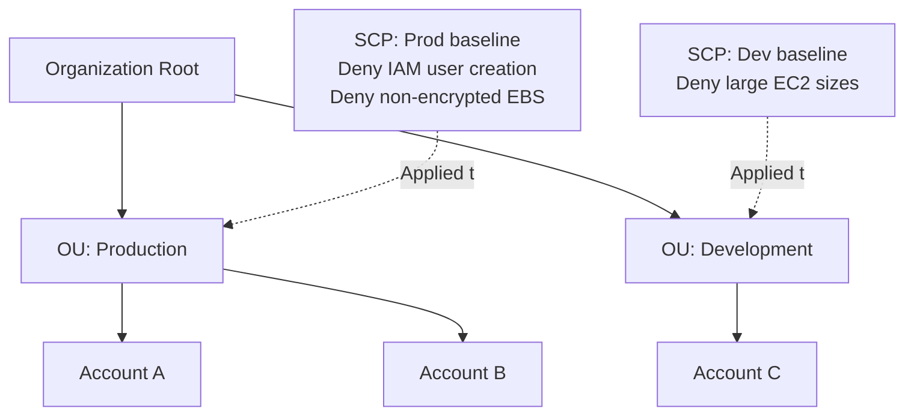
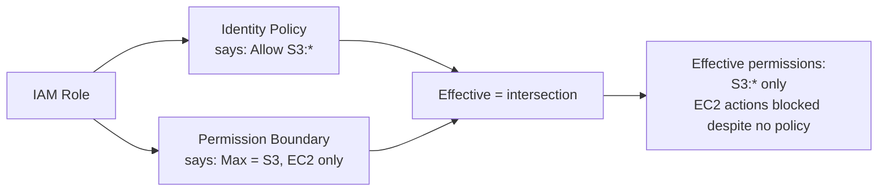
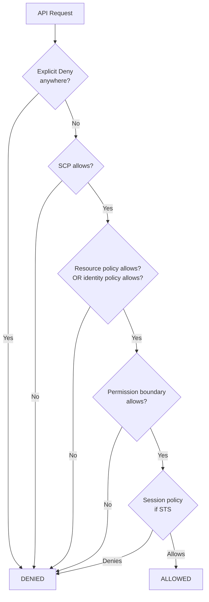
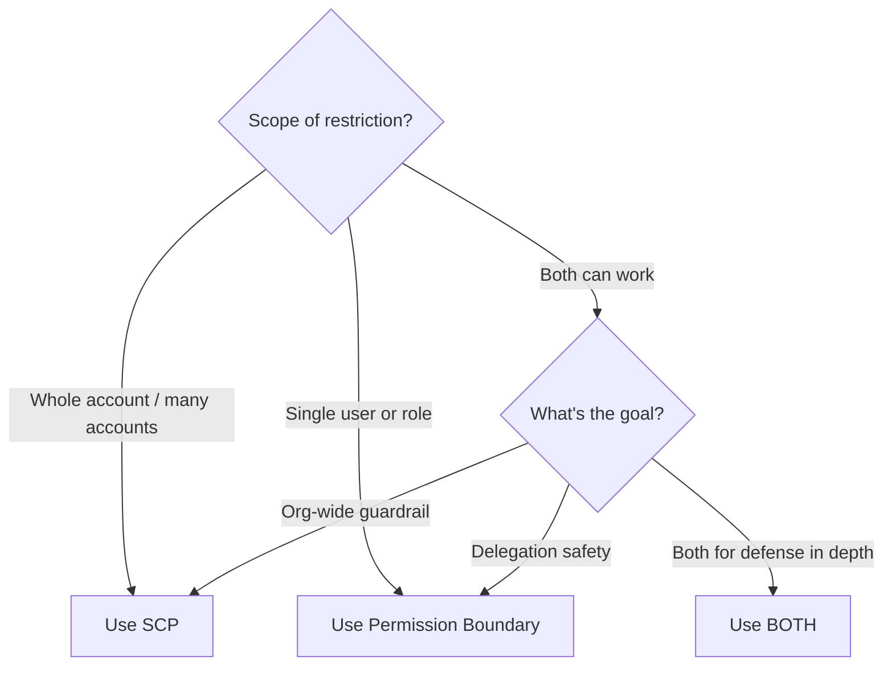

# Permission Boundaries vs SCPs

> 🔥 **Frequent exam confusion.** Master these guardrails.

## Problem It Solves
IAM policies grant permissions. But sometimes you need **guardrails** — caps that say "no matter what the policy grants, you can't do MORE than this". AWS has two distinct guardrail mechanisms:

- **Permission Boundaries**: Cap an individual IAM user/role's effective permissions
- **Service Control Policies (SCPs)**: Cap an entire account's (or OU's) effective permissions

## The Key Difference

```
GRANT MECHANISMS:
─────────────────────────────────────────────
✅ Identity-based policies (attached to user/role)
✅ Resource-based policies (attached to resource)
✅ Session policies (passed via STS)

CAP MECHANISMS (deny only, never grant):
─────────────────────────────────────────────
🛡 Permission Boundaries (per IAM identity)
🛡 Service Control Policies (per account / OU)
```

```
THE RULE:
─────────────────────────────────────────────
Final permission = ALL grants intersected with ALL caps,
then minus any explicit denies

If ANY cap doesn't allow it → DENIED
Caps cannot grant permissions, only restrict them.
```

---

## Service Control Policies (SCPs)



```
SCP CHARACTERISTICS:
─────────────────────────────────────────────
✅ Apply at Org root, OU, or individual account level
✅ Inheritance: account inherits ALL SCPs in chain
✅ Affects ALL identities in the account (incl. root!)
✅ Doesn't apply to management account by default
✅ Maximum permission boundary for the entire account
✅ Cannot be overridden by IAM policy (deny wins)

LIMITATIONS:
─────────────────────────────────────────────
❌ SCPs don't grant — only deny / restrict
❌ Account still needs IAM policies for users to do anything
❌ Service-linked roles often exempt (specifically)
```

### SCP Strategies

```
ALLOW LIST STRATEGY:
─────────────────────────────────────────────
Start with "Deny *" implicit
Explicitly allow only certain actions

Example: Allow only EC2, S3, RDS in production OU
{
  "Effect": "Allow",
  "Action": ["ec2:*", "s3:*", "rds:*"],
  "Resource": "*"
}

✅ Very restrictive
❌ Easy to break by forgetting a service

DENY LIST STRATEGY (default + recommended):
─────────────────────────────────────────────
By default everything allowed (FullAWSAccess SCP)
Explicitly deny dangerous actions

Example: Block leaving the org
{
  "Effect": "Deny",
  "Action": "organizations:LeaveOrganization",
  "Resource": "*"
}

✅ More flexible
✅ Easier to maintain
```

### Common SCP Examples

```yaml
# Prevent leaving the organization
{
  "Effect": "Deny",
  "Action": "organizations:LeaveOrganization",
  "Resource": "*"
}

# Block specific regions (data residency)
{
  "Effect": "Deny",
  "NotAction": [
    "iam:*", "organizations:*", "route53:*", "cloudfront:*"
  ],
  "Resource": "*",
  "Condition": {
    "StringNotEquals": {
      "aws:RequestedRegion": ["eu-west-1", "eu-central-1"]
    }
  }
}

# Require MFA for sensitive actions
{
  "Effect": "Deny",
  "Action": ["s3:DeleteBucket", "ec2:TerminateInstances"],
  "Resource": "*",
  "Condition": {
    "BoolIfExists": {"aws:MultiFactorAuthPresent": "false"}
  }
}

# Prevent disabling security services
{
  "Effect": "Deny",
  "Action": [
    "guardduty:DeleteDetector",
    "guardduty:DisableOrganizationAdminAccount",
    "config:DeleteConfigurationRecorder",
    "cloudtrail:StopLogging",
    "cloudtrail:DeleteTrail"
  ],
  "Resource": "*"
}

# Require encryption on EBS
{
  "Effect": "Deny",
  "Action": "ec2:CreateVolume",
  "Resource": "*",
  "Condition": {
    "Bool": {"ec2:Encrypted": "false"}
  }
}
```

---

## Permission Boundaries



```
PERMISSION BOUNDARY CHARACTERISTICS:
─────────────────────────────────────────────
✅ Attached to ONE IAM user or role
✅ Defines the MAX permissions that identity can have
✅ Identity policy + boundary = effective permission
✅ Doesn't grant — only caps
✅ Useful for delegation

vs SCP:
─────────────────────────────────────────────
SCP:    Whole account / OU scope
Boundary: Single identity scope
```

### The Classic Use Case: Safe Delegation

```
SCENARIO:
─────────────────────────────────────────────
You're the AWS admin. You want to let team leads
create IAM users for their team members.

PROBLEM:
─────────────────────────────────────────────
A team lead could grant their new users AdminAccess
→ now you have rogue admins!

SOLUTION — Permission Boundary:
─────────────────────────────────────────────
1. Create boundary "TeamMemberBoundary"
   - Allows S3, EC2, RDS only
2. Give team leads permission to create users + roles
   BUT require that any new user/role have this boundary
3. Even if a lead grants AdminAccess, the boundary caps it
```

```yaml
# Team lead's policy: can create roles ONLY with the boundary
{
  "Effect": "Allow",
  "Action": ["iam:CreateRole", "iam:AttachRolePolicy"],
  "Resource": "*",
  "Condition": {
    "StringEquals": {
      "iam:PermissionsBoundary": "arn:aws:iam::ACCOUNT:policy/TeamMemberBoundary"
    }
  }
}
```

---

## Permission Evaluation — The Full Picture



### Order Matters

```
EVALUATION ORDER (simplified):
─────────────────────────────────────────────
1. Explicit Deny in ANY policy → DENIED (final)
2. SCP must allow
3. Some identity-based or resource-based policy must allow
4. If Permission Boundary exists, it must allow
5. If Session Policy exists, it must allow

ALL CAPS MUST PASS.
ANY DENY KILLS IT.
```

---

## Tag Policies (Bonus Governance)

```
TAG POLICIES:
─────────────────────────────────────────────
Standardize tagging across accounts
Enforce specific tag keys + value formats

EXAMPLE:
─────────────────────────────────────────────
Tag policy requires:
- "CostCenter" tag with format /^CC-\d{4}$/
- "Environment" tag with values dev/staging/prod

ENFORCEMENT:
─────────────────────────────────────────────
- Optional: Block creation of resources without proper tags
- Optional: Auto-correct tags

USE:
─────────────────────────────────────────────
✅ Cost allocation enforcement
✅ Compliance tagging requirements
```

---

## SCP vs Permission Boundary — Decision Guide



| | **SCP** | **Permission Boundary** |
|---|---|---|
| Scope | Account or OU | Single user/role |
| Requires Orgs? | ✅ Yes | ❌ No |
| Applied to | Every identity in account | One IAM identity |
| Use case | Org-wide guardrails | Safe delegation |
| Affects root? | ✅ Yes (except mgmt) | ❌ No (only the identity) |
| Cannot be overridden | By IAM policies | By identity's own policy |
| Stops disabling security tools | ✅ Strong | ❌ Less suited |
| Restricts specific person | ❌ All users affected | ✅ Per-identity |

---

## Common Patterns

### Pattern 1: Production OU Guardrails (SCP)

```
APPLY TO PROD OU:
─────────────────────────────────────────────
Deny:
- IAM user creation (force federation)
- Disabling CloudTrail
- Disabling GuardDuty/Config
- Public S3 buckets without explicit acks
- Non-encrypted EBS / RDS

✅ All accounts in Production OU get same baseline
✅ Account admins can't override
```

### Pattern 2: Region Restriction (SCP)

```
APPLY TO ENTIRE ORG:
─────────────────────────────────────────────
Deny all actions except in eu-west-1 and eu-central-1
(GDPR data residency)

Exceptions for:
- IAM (global service)
- Route 53 (global)
- CloudFront (global)
- Organizations (mgmt account global)
```

### Pattern 3: Safe Delegation (Boundary)

```
GIVE DEVELOPERS THE ABILITY TO:
─────────────────────────────────────────────
- Create IAM roles for their services
- Attach policies to those roles

REQUIREMENT:
─────────────────────────────────────────────
All such roles MUST have "DeveloperBoundary"
which limits to: S3, DynamoDB, Lambda, SQS, SNS

Developers can't accidentally grant Admin to their services.
```

### Pattern 4: Cross-Account Role with Boundary

```
SHARED SERVICES ACCOUNT:
─────────────────────────────────────────────
Provides roles for other accounts to assume.
Each role has a Permission Boundary scoped to:
- Only the resources that team should access

Even if assume role + identity policy says "S3:*",
boundary limits to specific buckets.
```

---

## When to Use What

| Need | Solution |
|---|---|
| Block all accounts from leaving Org | **SCP** |
| Force region restriction org-wide | **SCP** |
| Prevent disabling CloudTrail in accounts | **SCP** |
| Let team leads create IAM users safely | **Permission Boundary** |
| Restrict one role despite admin policies | **Permission Boundary** |
| Mandate tags on all resources | **Tag Policies** |
| Cap on single service account | **Permission Boundary** |
| Org-wide max permissions | **SCP** |
| MFA enforcement for sensitive ops | **SCP** with condition |

## When NOT to Use

- ❌ Don't use SCP if you don't have Organizations — not available
- ❌ Don't put SCPs on management account — they're ignored
- ❌ Don't expect SCPs to grant permissions — they only cap
- ❌ Don't expect Permission Boundary to grant — same

## Trade-offs

| Choice | Gain | Sacrifice |
|---|---|---|
| SCP allow list | Very tight control | Easy to break things accidentally |
| SCP deny list | Flexible, easier | Need to enumerate threats |
| Permission Boundary | Safe delegation | Per-identity management |
| Both SCP + Boundary | Defense in depth | Complexity |

## Real World Example

**A multi-account enterprise:**
- **SCPs at OU level**:
   - Prod OU: deny IAM users, deny disabling security tools, deny large instances
   - Dev OU: deny large instances, region restriction
   - Sandbox OU: spending limit, region restriction, deny "expensive" services like Bedrock
- **Permission Boundaries** for delegated admins:
   - Developers can create roles for their apps
   - Boundary scopes to: app's resources only (S3 prefix, specific DDB tables)
- **Tag Policies** enforce CostCenter + Environment tags

## 🎯 Exam Soundbite

> "Service Control Policies (SCPs) cap permissions at the account or organizational unit level via AWS Organizations — they apply to every identity in scope, including root, and cannot grant permissions, only restrict them. Permission Boundaries cap permissions at the individual IAM user or role level — their main use case is safe delegation, letting team leads create new roles without risk of granting more permissions than allowed by the boundary. Use SCPs for org-wide guardrails like region restriction and preventing disabling of security tools; use Permission Boundaries for safely letting developers create their own service roles."

---

## ⚡ Quick Recall Card

```
┌─────────────────────────────────────────────────┐
│ GUARDRAIL MECHANISMS                             │
├─────────────────────────────────────────────────┤
│ SCP                                              │
│   Requires Organizations                          │
│   Applied at root / OU / account                 │
│   Affects EVERY identity in scope (incl. root)   │
│   Mgmt account exempt                            │
│   Best for: Org-wide guardrails                  │
│                                                  │
│ PERMISSION BOUNDARY                              │
│   Attached to IAM user/role                      │
│   Caps that identity's max permissions           │
│   Identity's own policy still required to grant  │
│   Best for: Safe delegation                      │
│                                                  │
│ EFFECTIVE PERMISSION =                           │
│   Identity policy ∩ Boundary ∩ SCP ∩ Session     │
│   minus any explicit Deny                        │
├─────────────────────────────────────────────────┤
│ NEITHER CAN GRANT — ONLY RESTRICT                │
└─────────────────────────────────────────────────┘
```

## 🎓 Common Exam Patterns

> **"Prevent any account in production OU from disabling CloudTrail."**
>
> ✅ **SCP** applied to Production OU: `Deny cloudtrail:StopLogging, cloudtrail:DeleteTrail`.

> **"Allow developers to create their own IAM roles for Lambda functions, but they shouldn't be able to grant those roles more than S3 + DynamoDB access."**
>
> ✅ Create **Permission Boundary** "DevServiceRoleBoundary" limiting to S3 + DDB. Give devs `iam:CreateRole` with condition that `iam:PermissionsBoundary` must equal that boundary's ARN.

> **"For GDPR compliance, all resources must be in EU regions only."**
>
> ✅ **SCP** at Org root denying actions outside EU regions (with exceptions for global services like IAM, Route 53, CloudFront).
