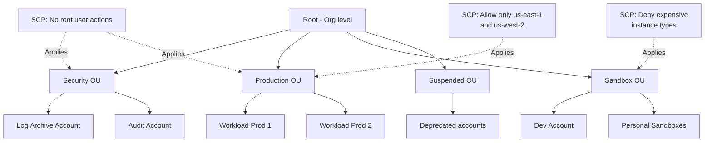

# AWS Organizations & SCPs

## Problem It Solves
Companies running serious workloads on AWS need **dozens to hundreds of accounts** — for blast-radius isolation, billing separation, compliance, team autonomy. Without central governance, this becomes chaos: inconsistent security, runaway costs, untrackable resources. AWS Organizations + SCPs + Control Tower solve this.

## How It Works



### The Building Blocks

```
┌──────────────────────────────────────────────────────────┐
│ MANAGEMENT ACCOUNT (a.k.a. Payer / Master)               │
│  - Creates the Organization                              │
│  - Cannot have SCPs applied to itself                    │
│  - Should contain NO workloads (high blast radius)       │
└─────────────────────────────────────────────────────────┘
                          │
                          ▼
┌──────────────────────────────────────────────────────────┐
│ ROOT (the org root, not the root user)                   │
│  - Logical container at top of Org                       │
│  - Can have SCPs that apply org-wide                     │
└─────────────────────────────────────────────────────────┘
                          │
                          ▼
┌──────────────────────────────────────────────────────────┐
│ ORGANIZATIONAL UNITS (OUs) — nested up to 5 levels       │
│  - Logical grouping for accounts                         │
│  - SCPs applied here cascade to all child OUs/accounts   │
│  - Best practice: organize by environment or compliance   │
└─────────────────────────────────────────────────────────┘
                          │
                          ▼
┌──────────────────────────────────────────────────────────┐
│ MEMBER ACCOUNTS                                          │
│  - Standard AWS accounts                                 │
│  - Inherit SCPs from parent OUs                          │
│  - Can be created via API or invited                     │
└──────────────────────────────────────────────────────────┘
```

### Service Control Policies (SCPs) — The Guardrails

**Critical:** SCPs **do NOT grant permissions**. They define the **maximum** permissions available. You still need identity/resource policies to actually grant access.

```
┌─────────────────────────────────────────────┐
│ SCP says:    s3:*, ec2:*, rds:* allowed     │
│ IAM says:    s3:GetObject allowed           │
│                                             │
│ Effective:   s3:GetObject only              │
│              (intersection)                  │
└─────────────────────────────────────────────┘
```

### SCP Strategies

**Strategy A — Allow List (Whitelist)**

```json
{
  "Version": "2012-10-17",
  "Statement": [
    {
      "Effect": "Allow",
      "Action": ["s3:*", "ec2:*", "rds:*", "lambda:*"],
      "Resource": "*"
    }
  ]
}
```
Default `FullAWSAccess` is removed; only listed services allowed. **Strict but maintenance-heavy.**

**Strategy B — Deny List (Blacklist) — RECOMMENDED**

```json
{
  "Version": "2012-10-17",
  "Statement": [
    {
      "Effect": "Deny",
      "Action": ["organizations:LeaveOrganization", "ec2:RunInstances"],
      "Resource": "*",
      "Condition": {
        "StringNotEquals": {
          "ec2:InstanceType": ["t3.micro", "t3.small"]
        }
      }
    }
  ]
}
```
Default `FullAWSAccess` is retained; specific actions denied. **More flexible.**

### Common SCP Patterns (Exam Favorites)

```
┌──────────────────────────────────────────────────────────┐
│ 1. RESTRICT REGIONS                                       │
│    Deny all actions outside approved regions             │
│    (GDPR, data residency)                                │
├──────────────────────────────────────────────────────────┤
│ 2. PROTECT CRITICAL RESOURCES                             │
│    Deny deletion of CloudTrail, KMS keys, IAM roles      │
│    (Even admins can't disable security)                  │
├──────────────────────────────────────────────────────────┤
│ 3. PREVENT LEAVING ORG                                    │
│    Deny organizations:LeaveOrganization                  │
├──────────────────────────────────────────────────────────┤
│ 4. ENFORCE ENCRYPTION                                     │
│    Deny s3:PutObject unless encrypted                    │
├──────────────────────────────────────────────────────────┤
│ 5. LIMIT EXPENSIVE RESOURCES                              │
│    Deny launching anything bigger than m5.xlarge         │
│    in sandbox accounts                                   │
├──────────────────────────────────────────────────────────┤
│ 6. ENFORCE MFA                                            │
│    Deny critical actions if aws:MultiFactorAuthPresent   │
│    is false                                              │
└──────────────────────────────────────────────────────────┘
```

### Organizations Features (Beyond SCPs)

| Feature | Purpose |
|---|---|
| **Consolidated Billing** | One bill across all accounts + volume discounts |
| **All Features mode** | Required for SCPs, RAM cross-account share, etc. |
| **Service-Linked Roles** | Auto-create roles in member accounts |
| **Delegated Administration** | Let a non-management account run Org services (Security Hub, GuardDuty) |
| **Tag Policies** | Enforce consistent tagging |
| **Backup Policies** | Centrally enforce AWS Backup plans |
| **AI Services Opt-out** | Block data use for ML training |

### Consolidated Billing — Hidden Cost Wins

```
WITHOUT Organizations:
─────────────────────────────────────────
Account A: 100GB S3 storage          ($)
Account B: 100GB S3 storage          ($)
Account C: 100GB S3 storage          ($)
Total: 300GB ALL at top tier price

WITH Organizations (consolidated billing):
─────────────────────────────────────────
Combined: 300GB S3 storage           ($)
Tiered pricing applies to total
Reserved Instances shared across accounts
Savings Plans shared across accounts
```

## When to Use

- ✅ More than 1 AWS account (which is everyone in production)
- ✅ Want central billing and discounts shared across accounts
- ✅ Need to enforce security guardrails (CloudTrail, region locks)
- ✅ Want to use IAM Identity Center
- ✅ Need consistent tagging or backup policies
- ✅ Want shared resources via RAM

## When NOT to Use

- ❌ Don't put workloads in the **management account** — high blast radius
- ❌ Don't use SCPs to grant permissions — they only restrict
- ❌ Don't skip the **Suspended OU** — it's how you decommission accounts safely
- ❌ Don't apply SCPs to the management account — they don't work there

## Trade-offs

| Choice | Gain | Sacrifice |
|---|---|---|
| Many accounts | Strong isolation, blast radius control | More complexity, more IAM setup |
| Strict SCPs everywhere | Tight security | "Why can't I do X?" debugging pain |
| Account-per-workload | Maximum isolation | Cost overhead, networking complexity |
| Account-per-environment | Simpler | Shared workloads in same account = larger blast radius |

## Real World Example

**Coinbase's** account structure:
- **Management account** — billing + Org admin only, no workloads
- **Security OU** — Log Archive + Audit accounts (centralized CloudTrail, Config)
- **Sandbox OU** — Engineer playgrounds, strict SCPs limiting cost (no big EC2, only certain regions)
- **Workload OUs** — Per business unit, per environment (Wallet/Dev, Wallet/Prod, Trading/Dev, Trading/Prod)
- **Suspended OU** — Accounts being decommissioned, SCP denies all actions

## 🎯 Exam Soundbite

> "AWS Organizations enables central governance across many accounts via OUs and Service Control Policies. SCPs define the maximum permissions an account can have — they restrict but never grant. Combine SCPs with permission boundaries and identity policies to implement defense-in-depth and least privilege."

---

## ⚡ Quick Recall Card

```
┌─────────────────────────────────────────────────────┐
│ ORGANIZATIONS — KEY FACTS                            │
├─────────────────────────────────────────────────────┤
│ Management account     → No SCPs apply here          │
│ SCPs apply to          → OUs, accounts (NOT mgmt)    │
│ SCPs do NOT            → Grant permissions           │
│ SCPs cap               → IAM users, roles, ROOT user │
│ OU nesting             → Up to 5 levels deep         │
│ Account creation       → Via API or invite           │
│ Consolidated billing   → Auto with Org               │
│ All Features mode      → Required for SCPs           │
└─────────────────────────────────────────────────────┘
```

## 🎓 Exam Trap

> **Q:** A developer has Admin IAM policy in a member account. An SCP on the OU denies `s3:DeleteBucket`. They try to delete a bucket. What happens?
>
> **A:** ❌ **DENIED.** SCPs cap permissions including for users with Admin policies. Even if the root user tries it, SCP denial wins (except in the management account which is exempt from SCPs).
