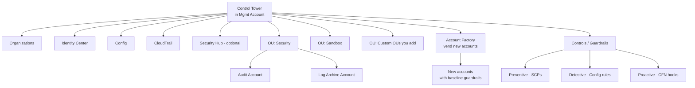
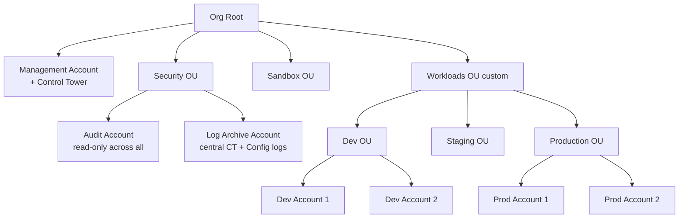
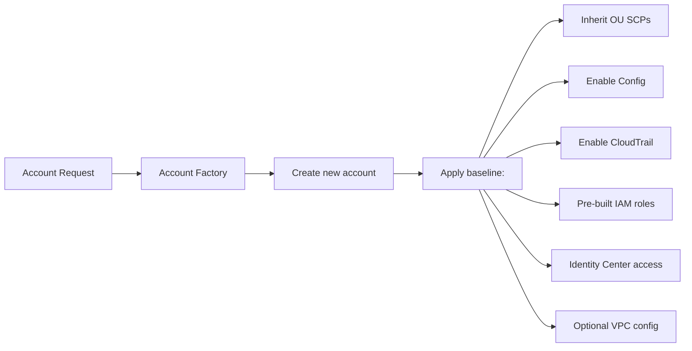

# AWS Control Tower — Landing Zone

> 🔥 **Common SAP-C02 question.** "Set up multi-account env with guardrails" → Control Tower.

## Problem It Solves
Building a multi-account AWS environment from scratch is hundreds of hours of work:
- Org structure design
- OU policies
- Identity Center setup
- Centralized logging
- Security guardrails
- Account vending process
- Compliance checks

**Control Tower automates all of this** — gives you a production-ready landing zone in hours.

## How It Works



```
WHAT YOU GET ON SETUP:
─────────────────────────────────────────────
✅ AWS Organizations with multi-account structure
✅ Pre-built OUs:
   - Security OU (for audit + log archive accounts)
   - Sandbox OU (for experimentation)
   - You add Workload OUs, etc.
✅ Audit Account (read-only access to all accounts)
✅ Log Archive Account (central CloudTrail + Config logs)
✅ Identity Center configured
✅ Baseline guardrails (SCPs + Config rules)
✅ Account Factory (self-service account vending)
✅ Dashboard for compliance posture
```

---

## The Landing Zone Structure



### Key Accounts

```
MANAGEMENT ACCOUNT:
─────────────────────────────────────────────
- Where Control Tower lives
- Bills consolidated
- Don't put workloads here
- Tightly restricted access

LOG ARCHIVE ACCOUNT (auto-created):
─────────────────────────────────────────────
- Central CloudTrail logs from all accounts
- Central Config snapshots
- S3 Object Lock to prevent tampering
- Few admins have access

AUDIT ACCOUNT (auto-created):
─────────────────────────────────────────────
- Read-only role into all member accounts
- Used by auditors / security team
- Hosts cross-account dashboards
```

---

## Controls (Guardrails)

```
CONTROL TYPES:
─────────────────────────────────────────────

PREVENTIVE CONTROLS (SCPs):
- "Disallow public access to S3 buckets"
- "Disallow IAM users in production"
- "Require encryption on EBS"
Applied as SCPs to OUs

DETECTIVE CONTROLS (Config Rules):
- "Detect untagged resources"
- "Detect non-encrypted RDS"
- "Detect public access on S3"
Don't prevent, but report violations

PROACTIVE CONTROLS (CFN Hooks):
- Block non-compliant resources at CFN deploy time
- Stops bad config from ever existing
- Newer feature
```

### Strongly Recommended Controls

```
AT LAUNCH, ENABLE:
─────────────────────────────────────────────
✅ "Disallow changes to bucket policy for centralized logs"
✅ "Disallow public read/write to S3 buckets"
✅ "Enable encryption at rest for EBS"
✅ "Require MFA on root user"
✅ "Disallow internet access through an internet gateway"
   (for sensitive OUs)
✅ "Disallow modifications to logging configuration"

ELECTIVE (optional but useful):
─────────────────────────────────────────────
Region deny SCPs
Stricter IAM access controls
Backup requirements
```

---

## Account Factory



```
SELF-SERVICE ACCOUNT CREATION:
─────────────────────────────────────────────
1. User goes to Service Catalog portal
2. Selects "Create AWS Account" product
3. Fills in:
   - Account name
   - Email
   - Target OU
   - Owner
4. Account created in ~30 min
5. Baseline applied automatically

CUSTOMIZATIONS:
─────────────────────────────────────────────
- Account Factory for Terraform (AFT)
- Account Factory Customizations (AFC)
  Apply custom CloudFormation, networking, etc. on creation
```

### Account Factory for Terraform (AFT)

```
AFT = TERRAFORM-BASED CUSTOMIZATION:
─────────────────────────────────────────────
For teams using Terraform:
- Define account customizations as Terraform modules
- AFT applies them on account creation
- Per-account or global customizations
- Modern approach for advanced shops
```

---

## Control Tower vs Manual Setup

```
WITHOUT CONTROL TOWER:
─────────────────────────────────────────────
You'd do (manually or via IaC):
1. Set up Organizations
2. Design OU structure
3. Create SCPs
4. Set up CloudTrail Org trail
5. Set up Config aggregator
6. Set up Security Hub
7. Identity Center configuration
8. Account creation runbook
9. Baseline IAM roles per account
10. Account vending automation
11. Compliance dashboards
... maybe 200-400 hours of engineering work

WITH CONTROL TOWER:
─────────────────────────────────────────────
Click-setup in hours
Get production-ready landing zone
Continuous compliance checks
Easy account vending
```

---

## Control Tower vs Landing Zone Accelerator

```
CONTROL TOWER:
─────────────────────────────────────────────
✅ Default / lighter option
✅ Console-based setup
✅ Good for most enterprises
❌ Less customization
❌ Some limits (account count, network patterns)

AWS LANDING ZONE ACCELERATOR (LZA):
─────────────────────────────────────────────
✅ More customizable (CloudFormation/CDK based)
✅ For complex compliance (FedRAMP, ITAR)
✅ Pre-built reference architectures
✅ Use when Control Tower's defaults aren't enough

USE CONTROL TOWER unless you have very specific
compliance or scale needs.
```

---

## Common Patterns

### Pattern 1: Greenfield Multi-Account Setup

```
DAY 1:
─────────────────────────────────────────────
1. Set up Control Tower in management account
2. Review baseline controls (enable strongly recommended)
3. Create OUs: Workloads/Prod, Workloads/Dev, etc.
4. Vend audit + log archive accounts (auto)

DAY 2:
─────────────────────────────────────────────
5. Add custom Config Rules / Conformance Packs
6. Set up cross-account observability (CloudWatch)
7. Identity Center groups for teams
8. Account Factory available for self-service

WEEK 1:
─────────────────────────────────────────────
9. Vend dev accounts for teams
10. Vend prod accounts as needed
11. Each new account = secure baseline from day 1
```

### Pattern 2: Migrating Existing Org to Control Tower

```
SCENARIO:
─────────────────────────────────────────────
Existing Organization with 20 accounts (manual setup).
Want to adopt Control Tower.

STEPS:
─────────────────────────────────────────────
1. Set up Control Tower in management account
2. ENROLL existing accounts into Control Tower:
   - Pre-existing accounts can be enrolled
   - Control Tower validates baseline compliance
   - Applies guardrails
3. Migrate to Control Tower OU structure
4. Decommission old vending process
```

### Pattern 3: Compliance Mandate (PCI, FedRAMP)

```
STRICT COMPLIANCE NEEDED:
─────────────────────────────────────────────
Control Tower baseline + 
- Enable Security Hub PCI standard
- Apply Conformance Pack for PCI DSS
- Custom proactive controls for PCI requirements
- AWS Audit Manager with PCI DSS framework
- All driven via OU policies + Control Tower
```

---

## When to Use What

| Need | Solution |
|---|---|
| Set up new multi-account env | **Control Tower** |
| Existing Org, want guardrails | **Control Tower (enroll existing)** |
| Highly customized landing zone | **Landing Zone Accelerator** |
| Self-service account creation | **Account Factory** |
| Account creation with Terraform | **Account Factory for Terraform (AFT)** |
| Central CloudTrail | Built into Control Tower |
| Central Config aggregation | Built into Control Tower |
| Org-wide compliance monitoring | **Control Tower + Security Hub** |
| Just one account, no multi-account | Skip — overkill |

## When NOT to Use

- ❌ Don't use if you have only 1-2 AWS accounts — overkill
- ❌ Don't use if you have highly customized non-standard architecture without ability to migrate — use LZA
- ❌ Don't manually create accounts after enabling — defeats the purpose

## Trade-offs

| Choice | Gain | Sacrifice |
|---|---|---|
| Control Tower over manual | Time savings, best practices | Less customization |
| LZA over Control Tower | Max customization | More implementation work |
| Control Tower over plain Orgs | Full landing zone | More configuration to learn |
| Account Factory | Self-service | Need to limit who can vend |

## Real World Example

**A growing startup at 50 employees:**
- Started with 1 AWS account, now needs separation
- Adopts **Control Tower**:
   - Mgmt account + log archive + audit (auto-created)
   - OUs: Workloads/Dev, Workloads/Staging, Workloads/Prod
   - Strongly recommended controls enabled
   - Each team gets their own dev account
- **Account Factory** for self-service dev account creation
- All accounts auto-enrolled in Security Hub, GuardDuty, Config
- Identity Center federated to Google Workspace

**A regulated enterprise:**
- Migrates from manually-built landing zone
- Adopts **Landing Zone Accelerator** for FedRAMP requirements
- More customization than Control Tower allows
- Custom networking patterns (specific TGW topology)
- Custom proactive controls

## 🎯 Exam Soundbite

> "AWS Control Tower automates landing zone setup for multi-account AWS environments. It creates an Organizations structure with pre-built OUs and accounts (Log Archive and Audit), configures Identity Center, sets up central CloudTrail and AWS Config, and applies preventive (SCPs) and detective (Config Rules) guardrails. Use Account Factory for self-service account vending where new accounts automatically inherit the OU's controls and baseline configuration. For highly customized requirements like FedRAMP, use the Landing Zone Accelerator instead."

---

## ⚡ Quick Recall Card

```
┌─────────────────────────────────────────────────┐
│ CONTROL TOWER                                    │
├─────────────────────────────────────────────────┤
│ Built on:                                        │
│   Organizations + Identity Center +              │
│   CloudTrail + Config + Service Catalog          │
│                                                  │
│ Auto-creates:                                    │
│   Log Archive Account (central logs)             │
│   Audit Account (read-only cross-account)        │
│   Security OU, Sandbox OU                        │
│                                                  │
│ Guardrails (Controls):                           │
│   Preventive — SCPs                              │
│   Detective — Config Rules                       │
│   Proactive — CFN Hooks                          │
│                                                  │
│ Account Factory:                                 │
│   Self-service via Service Catalog               │
│   AFT for Terraform shops                        │
│                                                  │
│ When NOT enough:                                 │
│   Landing Zone Accelerator (LZA)                 │
└─────────────────────────────────────────────────┘
```

## 🎓 Common Exam Patterns

> **"Set up a new AWS multi-account environment with security best practices, central logging, and self-service account creation."**
>
> ✅ **AWS Control Tower** — full landing zone in hours.

> **"Need every new AWS account to automatically have CloudTrail, Config, GuardDuty enabled, with SCPs preventing security tool tampering."**
>
> ✅ **Control Tower with strongly-recommended controls + Account Factory**. New accounts inherit baseline automatically.

> **"Existing 20 AWS accounts not under Control Tower. Want to add guardrails without recreating accounts."**
>
> ✅ **Enroll existing accounts into Control Tower** — adds them under management without recreation.
