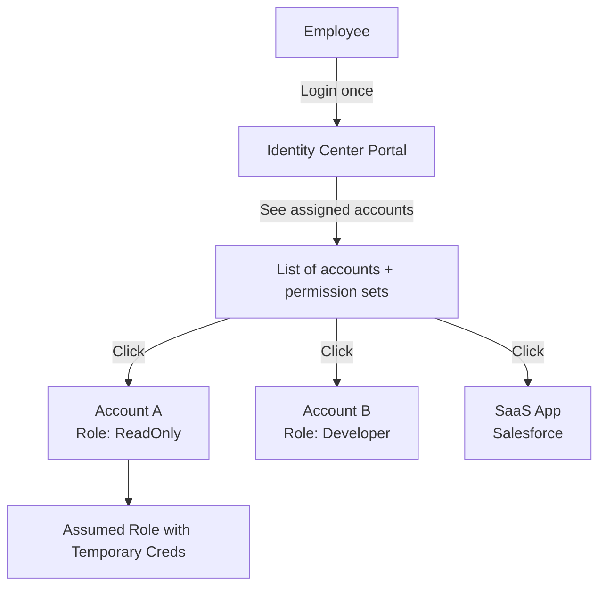
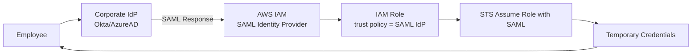

# IAM Identity Center (formerly AWS SSO)

> 🔥 **Modern multi-account access management.** Know how it differs from IAM users.

## Problem It Solves
Imagine 50 employees needing access to 30 AWS accounts:
- IAM users in each account = 1500 user records to manage
- Password rotation = nightmare
- Off-boarding = touch 30 accounts
- No central audit
- No SSO from corporate identity

**IAM Identity Center provides centralized workforce identity and access management** across all accounts in an AWS Organization (and beyond to SaaS apps).

## How It Works



### Key Components

```
┌──────────────────────────────────────────────────────────┐
│ IDENTITY SOURCE — WHO ARE YOUR USERS?                     │
│   - Identity Center Directory (default, built-in)         │
│   - Active Directory (on-prem or AWS Managed AD)         │
│   - External IdP (Okta, Azure AD, OneLogin) via SAML 2.0 │
├──────────────────────────────────────────────────────────┤
│ USERS & GROUPS                                            │
│   Users assigned to groups for easier management         │
│   Provisioned manually, via SCIM, or AD sync             │
├──────────────────────────────────────────────────────────┤
│ PERMISSION SETS                                           │
│   Template of permissions (like IAM policies)            │
│   AWS managed or custom                                  │
│   Examples: ReadOnly, AdministratorAccess, Developer     │
├──────────────────────────────────────────────────────────┤
│ AWS ACCOUNTS                                              │
│   Accounts in your Organization                          │
│                                                           │
│ ASSIGNMENT = User/Group + Permission Set + Account        │
│   "Alice's group gets Developer access in Account-Dev"   │
└──────────────────────────────────────────────────────────┘
```

### What Happens When User Logs In

```
1. User browses to https://<id>.awsapps.com/start
2. Authenticate via IdP (or directly to Identity Center)
3. See list of accounts they have access to
4. Click an account + permission set
5. Identity Center calls STS AssumeRoleWithSAML
6. User gets temporary credentials (1-12 hour session)
7. User is now operating as an IAM Role in that account
```

---

## Setting Up Identity Center

### Step 1: Enable in Management Account

```
PREREQUISITES:
─────────────────────────────────────────────
✅ AWS Organizations enabled with All Features
✅ One region designated as Identity Center home region
```

### Step 2: Configure Identity Source

```
OPTIONS:
─────────────────────────────────────────────

IDENTITY CENTER DIRECTORY (built-in):
- AWS hosts user store
- Best for: Small orgs without existing IdP
- Users created manually or via SCIM API

ACTIVE DIRECTORY:
- Connect to AWS Managed Microsoft AD
- Or via AD Connector to on-prem AD
- Users sync automatically
- Best for: Companies with existing AD

EXTERNAL IDP (SAML 2.0):
- Okta, Azure AD, Ping, Google Workspace
- Users sync via SCIM
- Best for: Companies with established IdP
- ⭐ Modern best practice
```

### Step 3: Create Permission Sets

```
AWS MANAGED PERMISSION SETS:
─────────────────────────────────────────────
- AdministratorAccess
- PowerUserAccess
- ReadOnlyAccess
- ViewOnlyAccess
- DatabaseAdministrator
- Billing
- NetworkAdministrator

CUSTOM PERMISSION SETS:
─────────────────────────────────────────────
- Custom inline policy
- Or attach existing AWS managed policies
- Set session duration (1-12 hours)
- Attach Permission Boundary (cap max perms)
```

### Step 4: Assign Users → Permission Sets → Accounts

```
ASSIGNMENT MATRIX:
─────────────────────────────────────────────
Group: Developers
  Permission Set: Developer
  Accounts: All "dev" OU accounts
  
Group: SRE Team
  Permission Set: AdminAccess
  Accounts: prod-* accounts
  
Group: Finance
  Permission Set: Billing
  Accounts: management account only
```

---

## Application Assignments (SAML Apps)

```
IDENTITY CENTER ALSO DOES SSO TO SAAS:
─────────────────────────────────────────────
Pre-built integrations with:
- Salesforce, Office 365, Slack, GitHub
- Atlassian (Jira, Confluence), Box, Dropbox
- Plus any SAML 2.0 app

USE:
─────────────────────────────────────────────
✅ One portal for AWS + SaaS apps
✅ Replace per-app password management
✅ Centralized off-boarding (remove from Identity Center
   = removed from all apps)
```

---

## Identity Center vs IAM Users

| | **IAM Users** | **Identity Center** |
|---|---|---|
| Scope | Per-account | Org-wide |
| Identity | Local to account | Centralized |
| Credentials | Long-lived passwords/keys | Short-lived role sessions |
| Best practice in 2026 | ❌ Legacy | ✅ Modern |
| Off-boarding | Per-account effort | One delete |
| Federation | Manual per-account | Built-in |
| Audit | Per-account CloudTrail | Centralized |
| SCIM/AD sync | Manual | Native |
| Mobile/CLI access | Access keys | Short-lived creds via AWS CLI v2 |

```
WHEN TO STILL USE IAM USERS:
─────────────────────────────────────────────
❌ Mostly never for humans
✅ Programmatic access for legacy CI/CD (better: use roles)
✅ Cross-org service users (rare)
✅ "Break glass" emergency users

USE IAM ROLES (not users) for:
─────────────────────────────────────────────
✅ EC2, Lambda, ECS, EKS service identity
✅ Cross-account access
✅ Federated humans (via Identity Center or SAML)
```

---

## SAML 2.0 Federation (Without Identity Center)



```
TRADITIONAL SAML FEDERATION:
─────────────────────────────────────────────
- IAM has SAML Identity Provider config (per account)
- IAM Roles trust the SAML IdP
- Users assume roles via STS
- Works but requires PER-ACCOUNT setup

VS IDENTITY CENTER:
─────────────────────────────────────────────
- Identity Center does this for you across all accounts
- Single place to manage assignments
- Better choice for new builds
```

---

## SCIM Provisioning

```
SCIM (System for Cross-domain Identity Management):
─────────────────────────────────────────────
Automated user provisioning from IdP to Identity Center

WORKFLOW:
─────────────────────────────────────────────
1. New hire added in HR system
2. HR system syncs to Okta/Azure AD
3. IdP pushes user to Identity Center via SCIM
4. User gets correct group memberships
5. Group assignments grant correct AWS access
6. User logs in — has access immediately

OFFBOARDING:
─────────────────────────────────────────────
1. HR marks departure
2. User removed from IdP
3. SCIM propagates removal to Identity Center
4. User loses all AWS access — automatically
```

---

## AWS CLI with Identity Center

```bash
# Configure once
aws configure sso

# Login
aws sso login --profile dev-account

# Use it (credentials auto-refresh)
aws s3 ls --profile dev-account
```

```
AWS CLI v2 NATIVELY INTEGRATES:
─────────────────────────────────────────────
✅ No more long-lived access keys
✅ Browser-based auth flow
✅ Short-lived creds auto-managed
✅ Per-account profiles
```

---

## Common Patterns

### Pattern 1: Multi-Account Workforce Access

```
COMPANY STRUCTURE:
─────────────────────────────────────────────
- 30 AWS accounts in Organization
- 100 employees across teams
- Use Okta as IdP

IDENTITY CENTER SETUP:
─────────────────────────────────────────────
1. Configure Okta as external IdP (SAML + SCIM)
2. Sync Okta groups to Identity Center
3. Create permission sets: Admin, Dev, ReadOnly, Billing
4. Assign:
   - "Engineering" group → Dev permset → Dev accounts
   - "SRE" group → Admin permset → Prod accounts
   - "Finance" group → Billing permset → Mgmt account
   - "All Employees" group → ReadOnly permset → All accounts
5. Off-boarding via Okta = automatic removal from AWS
```

### Pattern 2: Hybrid AD Integration

```
EXISTING ACTIVE DIRECTORY:
─────────────────────────────────────────────
Customer has on-prem AD they use for everything.

OPTIONS:
─────────────────────────────────────────────
1. AD Connector (lightweight proxy to on-prem AD)
   - Identity Center uses on-prem AD via Connector
   - Simpler, but on-prem AD = single point of failure

2. AWS Managed AD with two-way trust to on-prem
   - More resilient
   - On-prem users can authenticate via AWS Managed AD
```

### Pattern 3: Permission Boundaries

```
LIMIT WHAT PERMISSION SETS CAN DO:
─────────────────────────────────────────────
"Developers can grant themselves any permission UP TO this boundary"

Permission Set: Developer
  Inline policy: Allow EC2, S3, RDS, etc.
  PERMISSION BOUNDARY: Forbid Production resources by tag

Result: Even though policy says "S3:*", boundary blocks 
        access to prod-tagged buckets.
```

---

## When to Use Identity Center

| Need | Solution |
|---|---|
| Multi-account workforce access | **Identity Center** ✅ |
| Single SSO for AWS + SaaS | **Identity Center** with app assignments |
| Off-boarding compliance | **Identity Center + SCIM from IdP** |
| Federated CLI access | **Identity Center + AWS CLI v2** |
| Single-account, single-user | IAM user (acceptable but federation preferred) |
| Service authentication | **IAM Role** (not user, not Identity Center) |
| Mobile app authentication | **Cognito User Pool** (different service) |

## When NOT to Use Identity Center

- ❌ Single AWS account with one user — overkill
- ❌ Service-to-service auth — use IAM Roles
- ❌ End-user app authentication — use Cognito
- ❌ Standalone account without Organizations — must enable Orgs first

## Trade-offs

| Choice | Gain | Sacrifice |
|---|---|---|
| Identity Center over IAM users | Centralized, short-lived creds | Setup complexity |
| External IdP integration | Single source of truth | Setup work |
| SCIM auto-provisioning | Off-boarding compliance | IdP needs SCIM support |
| AWS Managed Microsoft AD | Resilient AD in cloud | Costs ~$3/hour |

## Real World Example

**A 500-person SaaS company:**
- **Okta** as primary IdP for everything
- **Identity Center** with Okta as external IdP via SAML
- SCIM provisioning syncs Okta groups → Identity Center groups
- ~40 AWS accounts organized in OUs
- Permission Sets per role (Admin, Dev, ReadOnly, Billing, NetworkAdmin)
- Group assignments to OUs (Engineers → all Dev accounts)
- New hire: HR creates user → Okta → AWS access ready in minutes
- Off-boarding: Remove from Okta → All AWS access gone within hour
- CLI: Engineers use `aws sso login` — no static keys ever

## 🎯 Exam Soundbite

> "AWS IAM Identity Center is the modern way to manage workforce access across an AWS Organization. Connect to your existing identity provider via SAML 2.0 and provision users via SCIM. Define permission sets (collections of permissions), then assign user groups to permission sets within specific accounts. Users access AWS via a unified portal with short-lived role-based credentials — no long-lived access keys. This eliminates per-account IAM user management and centralizes off-boarding via your IdP. AWS CLI v2 integrates natively with Identity Center for credential-free CLI access."

---

## ⚡ Quick Recall Card

```
┌─────────────────────────────────────────────────┐
│ IAM IDENTITY CENTER                              │
├─────────────────────────────────────────────────┤
│ Scope         Org-wide (all member accounts)     │
│ Identity sources                                  │
│   - Built-in directory                           │
│   - Active Directory (Connector or AWS Managed)  │
│   - External IdP via SAML (Okta, Azure AD)       │
│                                                  │
│ COMPONENTS                                       │
│ Users / Groups       Provisioned manually or SCIM│
│ Permission Sets      Permission templates        │
│ Assignments          Group + PermSet + Account   │
│                                                  │
│ FEATURES                                         │
│ ✅ AWS account access (multi-account)             │
│ ✅ SaaS app SSO (200+ pre-built)                 │
│ ✅ Native AWS CLI v2 integration                  │
│ ✅ Short-lived role-based credentials             │
│ ✅ Centralized off-boarding via IdP+SCIM          │
└─────────────────────────────────────────────────┘
```

## 🎓 Common Exam Patterns

> **"Company has 25 AWS accounts and uses Azure AD for corporate identity. Want SSO into all AWS accounts based on Azure AD groups."**
>
> ✅ **IAM Identity Center** with **Azure AD as external IdP via SAML 2.0** and **SCIM provisioning** for automatic user/group sync. Map Azure AD groups to permission sets.

> **"Need short-lived credentials for AWS CLI without managing access keys."**
>
> ✅ **Identity Center + AWS CLI v2** with `aws sso login`. CLI handles credential refresh automatically.
