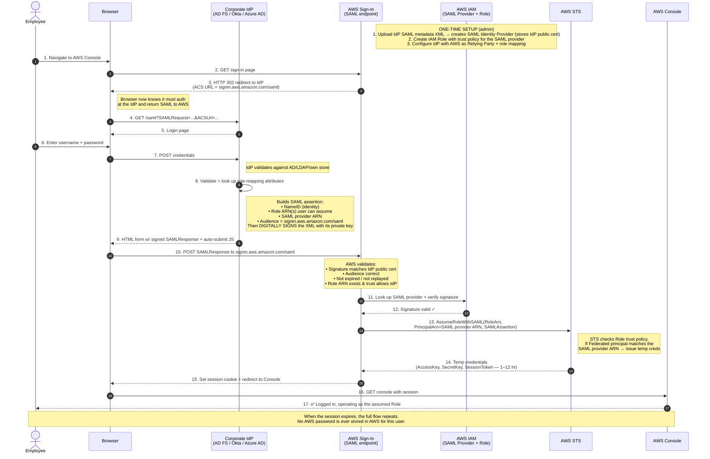
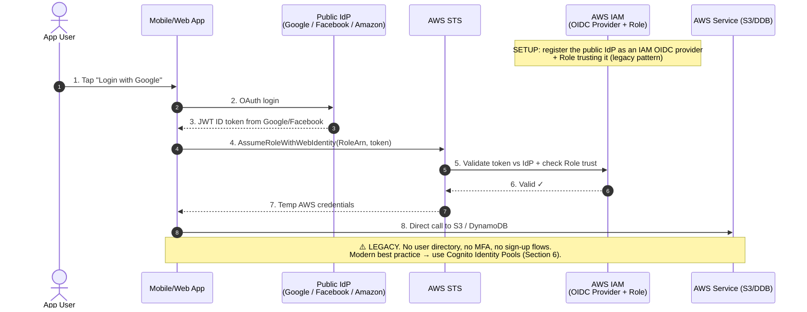
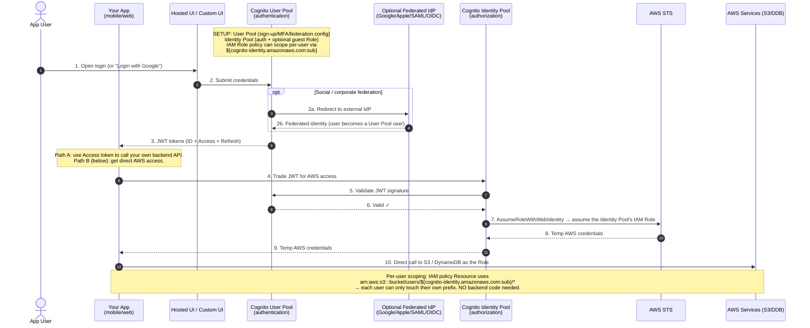
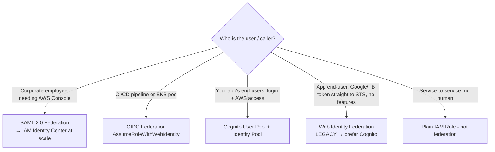

# AWS Identity Federation — Feynman-Style Notes

> **The one-line idea:** Your users *already* have an identity somewhere else (corporate AD, Google, GitHub, an app login). Federation lets that existing identity **borrow a temporary AWS identity (an IAM Role)** instead of you minting a permanent AWS user for everyone. Nobody ever gets long-lived AWS credentials.

---

## 1. Why does federation even exist? (Explain it to a 10-year-old)

Imagine AWS is a theme park.

- The **old way (IAM users)** is giving every visitor their own permanent lifetime membership card. If you have 800 employees, that's 800 cards to print, track, and revoke when someone quits. Painful.
- **Federation** is letting people in using the ID they *already* carry — their company badge, their Google account, their GitHub login. At the gate, the park checks "is this badge real?", and if yes, hands them a **day-pass wristband** that expires tonight. That wristband is the *temporary credential*.

So the whole game is:

> **External identity → prove who you are at your own identity provider → AWS gives you a short-lived wristband (temp credentials) tied to a Role → you act with that Role's permissions until it expires.**

The thing handing out wristbands is always **STS (Security Token Service)**.

---

## 2. The cast of characters (learn these once, reuse everywhere)

| Character | What it really is | Plain-English job |
|---|---|---|
| **IdP (Identity Provider)** | Your company AD FS / Okta / Azure AD / Google / GitHub | The place that *knows the user* and vouches for them |
| **Assertion / Token** | SAML XML or JWT | A signed note saying "this is Vijay, he's in Finance" |
| **IAM Identity Provider** | A config object inside AWS | AWS's record of "I trust this external IdP and here's its public key" |
| **IAM Role** | A set of permissions + a trust policy | The borrowable identity. *Trust policy* = who's allowed to borrow it |
| **Trust policy** | JSON on the Role | "I will let assertions from THIS IdP assume me" |
| **STS** | AWS service | Hands out the temporary credentials (the wristband) |
| **Temporary credentials** | AccessKey + SecretKey + SessionToken | The wristband. Expires (1–12 hrs) |
| **Policy evaluation (IAM authorization)** | Separate AWS engine | When you USE the wristband, this checks "is this action actually allowed?" |

### The single most important correction from our discussion

You initially thought STS does *everything* — generate, validate, AND check role policies. Untangle it:

- **STS** = generates and validates the **temporary credentials** (the wristband itself). That's it.
- **IAM authorization / policy evaluation engine** = a *separate* step. When you later call S3 or DynamoDB with those credentials, *this* engine checks the Role's attached policies to decide if the action is allowed.

> 🧠 **Mental hook:** STS is the *bouncer who stamps your hand*. The *policy engine* is the *security guard at each ride* who checks your stamp before letting you on. Two different people.

And the IdP does **not** generate AWS credentials. The IdP only generates the *assertion/token*. AWS (via STS) generates the credentials.

---

## 3. SAML 2.0 Federation — "Employees logging into the AWS Console"

### When you'd use it
Corporate employees with an existing IdP (AD FS, Okta, Azure AD) who need **SSO into the AWS Console** using their company login. Protocol is **SAML 2.0**, which is XML-based.

### The Feynman walkthrough
1. You open the AWS Console. AWS says "I don't know you — go authenticate at your company."
2. AWS **redirects your browser** to your corporate IdP.
3. You log in there with your normal company credentials. Your IdP already knows you're in **Finance**.
4. The IdP builds a **SAML assertion** — a signed XML note that says *who you are*, *which Role ARN(s) you may assume*, and the *audience* (`signin.aws.amazon.com/saml`). It **signs it with its private key**.
5. Your browser POSTs that assertion back to the AWS sign-in endpoint.
6. AWS checks the **signature** against the IdP's public certificate (stored when you set up the SAML Identity Provider), checks audience/expiry/replay, and confirms the **Role's trust policy** allows this IdP.
7. AWS calls **`sts:AssumeRoleWithSAML`**. STS issues **temporary credentials** (1–12 hr).
8. You're dropped into the Console acting as that Role.

> 🔑 **The mapping you kept asking about:** *How does "I'm in Finance" become "I get FinanceRole"?*
> An admin pre-creates an IAM Role (`FinanceRole`) with a **trust policy** that says "I trust assertions from this SAML provider." The IdP is configured to put the **Role ARN** for Finance users inside the assertion. AWS reads the Role ARN from the assertion, confirms the trust policy matches, and STS issues credentials for *that* Role. **You do NOT create one Role per user** — you create a few Roles (Finance, Dev, Admin) and map *groups* of users to them.

### End-to-end sequence (this is the puml diagram, rendered in markdown)



**Trust policy example (the thing that makes the mapping work):**
```json
{
  "Effect": "Allow",
  "Principal": { "Federated": "arn:aws:iam::ACCOUNT:saml-provider/MyIdP" },
  "Action": "sts:AssumeRoleWithSAML",
  "Condition": {
    "StringEquals": { "SAML:aud": "https://signin.aws.amazon.com/saml" }
  }
}
```

> **Modern note:** For many accounts, don't wire SAML into each account by hand. Use **IAM Identity Center**, which manages SAML to your IdP across the whole AWS Organization.

---

## 4. OIDC Federation — "Workloads & CI/CD, no long-lived keys"

### When you'd use it
Machines and pipelines, not browser users: **GitHub Actions, GitLab CI, EKS pods (IRSA)**. Protocol is **OAuth 2.0 / OpenID Connect**, and the "note" is a **JWT** instead of SAML XML.

### Feynman walkthrough — why it's almost identical to SAML
It's the same story with a different paper format. Instead of an XML assertion you get a **JWT** containing claims (who/what, which repo, which branch). AWS validates the JWT signature against the registered OIDC provider, checks the Role's trust policy, and STS issues temp creds via **`sts:AssumeRoleWithWebIdentity`**.

The killer benefit: **no static AWS access keys** sitting in GitHub Secrets waiting to leak.

### End-to-end sequence

```mermaid
sequenceDiagram
    autonumber
    participant WL as Workload<br/>(GitHub Actions / EKS pod)
    participant IDP as OIDC IdP<br/>(token.actions.githubusercontent.com / EKS OIDC)
    participant STS as AWS STS
    participant IAM as AWS IAM<br/>(OIDC Provider + Role)
    participant AWS as AWS Service (S3/ECR/...)

    Note over IAM: ONE-TIME SETUP (admin)<br/>1. Create IAM OIDC Identity Provider (Provider URL + Audience=sts.amazonaws.com)<br/>2. Create IAM Role; trust policy scoped by sub (repo/branch or service account)

    WL->>IDP: 1. Authenticate as the workload
    IDP-->>WL: 2. Signed JWT ID token<br/>(claims: aud, sub=repo:org/repo:ref, etc.)
    WL->>STS: 3. AssumeRoleWithWebIdentity(RoleArn, WebIdentityToken=JWT)
    STS->>IAM: 4. Validate JWT signature vs OIDC provider<br/>+ check Role trust policy conditions (aud, sub)
    IAM-->>STS: 5. Valid ✓ + conditions match
    STS-->>WL: 6. Temp credentials (short-lived)
    WL->>AWS: 7. Call AWS API with temp creds
    Note over WL,AWS: ✅ No long-lived AWS keys anywhere.<br/>Trust policy condition (sub) restricts WHICH repo/branch/pod can assume the Role.
```

**Trust policy example (scoped to one repo):**
```json
{
  "Effect": "Allow",
  "Principal": { "Federated": "arn:aws:iam::ACCOUNT:oidc-provider/token.actions.githubusercontent.com" },
  "Action": "sts:AssumeRoleWithWebIdentity",
  "Condition": {
    "StringEquals": { "token.actions.githubusercontent.com:aud": "sts.amazonaws.com" },
    "StringLike":   { "token.actions.githubusercontent.com:sub": "repo:my-org/my-repo:*" }
  }
}
```

> **EKS twist (IRSA = IAM Roles for Service Accounts):** the EKS cluster has a built-in OIDC provider. You annotate a Kubernetes ServiceAccount with a Role ARN, and pods using that SA get temp AWS creds — **per-pod permissions, not per-node**.

---

## 5. Web Identity Federation — "The legacy way for app end-users"

### When you'd use it
Honestly — **you mostly wouldn't anymore.** This is the *original* pattern: let a mobile/web app user log in with Google/Facebook, then hand that provider's token **directly to STS** via `sts:AssumeRoleWithWebIdentity` to get temp AWS creds. **No Cognito layer in between.**

### Feynman walkthrough — why it got replaced
It works, but it's bare-bones. You don't get a user directory, password reset, MFA, sign-up flows, or multi-IdP management. AWS now says: **use Cognito Identity Pools instead** — same underlying STS call, but with a proper managed wrapper.

### End-to-end sequence



> 🧠 **One-liner to remember it:** *Web Identity Federation is Cognito Identity Pool with the training wheels off and most of the features missing.*

---

## 6. Cognito — "Identity for YOUR app's users"

### The crucial distinction (the thing the exam loves)
Federation (Sections 3–5) is about **getting people/workloads INTO AWS**. **Cognito is about running authentication for YOUR application's users.** Different problem.

Cognito has **two separate services** — keep them apart in your head:

| | **User Pool** | **Identity Pool** |
|---|---|---|
| Question it answers | "**Who are you?**" (authentication) | "**What AWS can you touch?**" (authorization) |
| Output | **JWT tokens** (ID + Access + Refresh) | **Temporary AWS credentials** (via STS) |
| Has a user directory? | ✅ Yes, built-in | ❌ No — it trusts external identities |
| Sign-up / MFA / password reset | ✅ Built-in | ❌ Not its job |
| Example use | App login page | App user uploads directly to S3 |

> 🔑 **The two questions you raised, answered:**
> - *"When the user enters credentials, does it go only to the User Pool? Is it a web page?"* — The User Pool is a **backend service**, not a page. Your app shows a login form (your own, or Cognito's **Hosted UI**). The form sends credentials to the User Pool, which validates them and returns **JWT tokens**.
> - *"When the app sends the token, what happens?"* — Two paths: (a) use the **Access token** to call your own backend API (backend validates the JWT signature), or (b) send the token to the **Identity Pool** to swap it for **temporary AWS credentials** so the app can hit S3/DynamoDB directly.

### Tokens cheat-sheet
- **ID token** — *who the user is* (identity claims). Use in your frontend. Don't use it to authorize API calls.
- **Access token** — *call your backend API* with this; backend checks signature + scopes.
- **Refresh token** — long-lived; gets fresh ID/Access tokens without re-login.

### End-to-end sequence (User Pool + Identity Pool combined)



### Per-user S3 scoping — the "magic" trick
```json
{
  "Effect": "Allow",
  "Action": ["s3:GetObject", "s3:PutObject"],
  "Resource": "arn:aws:s3:::my-bucket/users/${cognito-identity.amazonaws.com:sub}/*"
}
```
`${cognito-identity.amazonaws.com:sub}` is a unique ID per user, so IAM itself enforces "each user only sees their own folder" — no backend logic required.

> **When NOT to use Cognito:** workforce SSO to the AWS Console → use **IAM Identity Center**. Service-to-service → use **IAM Roles**. Cognito is for *your app's end-users*.

---

## 7. STS operations — the four verbs

| Operation | Trusted by | Use it for |
|---|---|---|
| `sts:AssumeRole` | IAM users, other roles, AWS services | Cross-account access, role chaining |
| `sts:AssumeRoleWithSAML` | A SAML Identity Provider | **SAML federation** (employees via corporate IdP) |
| `sts:AssumeRoleWithWebIdentity` | An OIDC Identity Provider | **OIDC federation** (GitHub Actions, EKS, mobile/web identity, Cognito Identity Pools) |
| `sts:GetFederationToken` | An IAM user | Legacy federated sessions — rarely used now |

---

## 8. The whole picture in one decision tree



---

## 9. 30-second recall card

```
FEDERATION = external identity borrows a temporary IAM Role. No long-lived AWS creds.

SAML        Employees → AWS Console SSO.   sts:AssumeRoleWithSAML.        XML assertion.  Scale → Identity Center.
OIDC        CI/CD, EKS pods.               sts:AssumeRoleWithWebIdentity. JWT token.      GitHub/GitLab, IRSA.
WEB IDENTITY Legacy app end-users.         sts:AssumeRoleWithWebIdentity. JWT, no Cognito. → use Cognito instead.
COGNITO     YOUR app's users.
            User Pool  = "who are you?" → JWT tokens.
            Identity Pool = "what AWS can you touch?" → temp creds via STS.

WHO DOES WHAT:
  IdP             → creates the assertion/token (NOT AWS creds)
  STS             → generates + validates the temp credentials (the wristband)
  Policy engine   → SEPARATE: checks Role policies when you USE the creds
  Trust policy    → decides WHO is allowed to assume the Role (the mapping)
```
