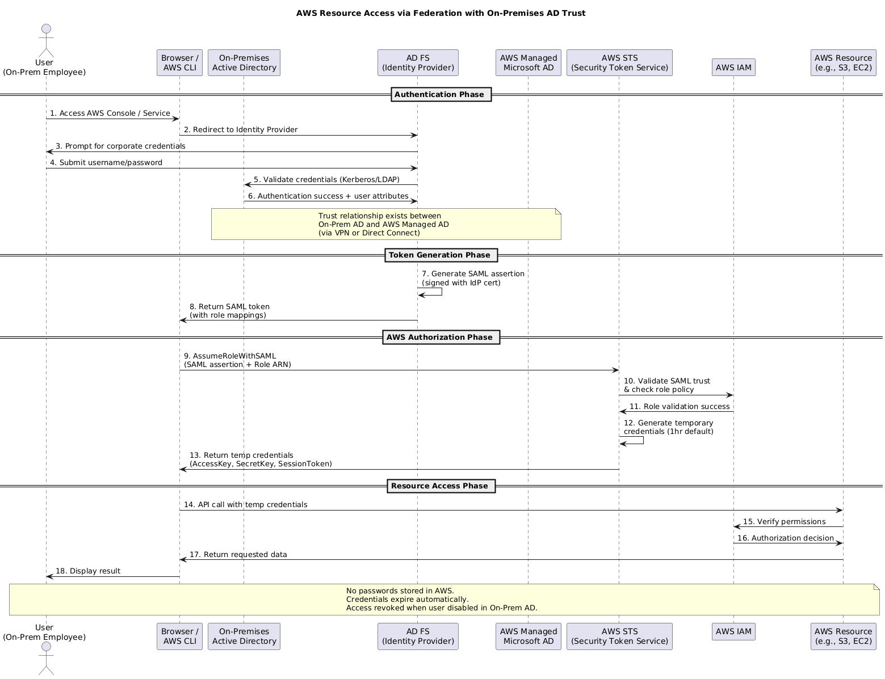

# AWS Directory Services — Feynman Notes

## 1. The Simple Idea (Explain it like I'm 12)

Imagine a **big office building**. Every employee has an **ID card**. That ID card lets them into the building, the cafeteria, the meeting rooms, and the parking lot — all with one swipe.

The **ID card system** is the **directory**. It knows:
- Who you are (your identity)
- What you're allowed to do (your permissions)
- Which groups you belong to (engineering, finance, HR)

**Active Directory (AD)** is Microsoft's famous ID card system that most companies use on-premises.

**AWS Directory Services** = AWS's way of running that same ID card system **in the cloud**, or connecting your existing on-premises one to AWS.

---

## 2. Why Do We Need It?

Companies already have an on-premises AD with hundreds or thousands of users. When they start using AWS, they don't want to:
- ❌ Create everyone all over again in AWS
- ❌ Manage two separate sets of passwords
- ❌ Deal with users forgetting which login to use

So AWS gives you **three flavours** of directory services to fit different needs.

---

## 3. The Three Flavours (The Heart of the Topic)

### 🏛️ Flavour 1: AWS Managed Microsoft AD
**The Full Restaurant**

Think of this as **AWS running a complete, real Active Directory for you in the cloud**. It's the actual Microsoft AD — not a clone, not a copy — running on Windows servers that AWS manages (patches, backs up, makes highly available across availability zones).

**Use it when:**
- You want a real AD in AWS for Windows workloads (EC2 Windows, RDS SQL Server, FSx)
- You want a **trust relationship** with your on-prem AD (one-way or two-way)
- You need Group Policy, schema extensions, LDAP signing — the full Microsoft experience

**Trust relationships:**
- **One-way trust**: On-prem AD trusts AWS, or vice versa
- **Two-way (bidirectional) trust**: Both trust each other — users on either side can access resources on the other

**Networking:** Needs VPN or Direct Connect between on-prem and your VPC for trust to work.

### AWS Fully Managed AD Flow


---

### 🥪 Flavour 2: Simple AD
**The Sandwich Shop**

A **lightweight, cheaper** directory. It's **not real Microsoft AD** — it's actually Samba 4 under the hood, made to *look* like AD for basic use cases.

**Use it when:**
- Small workloads (up to 500 users for Small, 5,000 for Large)
- You just need basic user management, group policy support is limited
- You don't need to connect to on-prem AD (no trust relationships supported)
- Cost matters more than features

**Big limitation:** ❌ No trust with on-prem AD. It's standalone.

---

### 🚪 Flavour 3: AD Connector
**The Receptionist**

This is **not a directory at all** — it's a **proxy**. It stores nothing. It just passes authentication requests from AWS back to your existing on-prem AD over a VPN or Direct Connect.

**Analogy:** You walk into the AWS office. The receptionist (AD Connector) phones your office and asks: "Hey, is this Vijay? Is his ID valid?" Your office says yes, and you're in. The receptionist never wrote anything down.

**Use it when:**
- You already have a solid on-prem AD and want to keep it as the **single source of truth**
- You want AWS services (WorkSpaces, WorkDocs, AWS Console) to authenticate against on-prem AD
- You **don't want a separate directory** in AWS

**Big difference from Managed AD:** AD Connector doesn't store users. Managed AD does.

---

## 4. Quick Comparison Table

| Feature | Managed Microsoft AD | Simple AD | AD Connector |
|---|---|---|---|
| Real Microsoft AD? | ✅ Yes | ❌ No (Samba) | ❌ No (proxy) |
| Stores users in AWS? | ✅ Yes | ✅ Yes | ❌ No (on-prem only) |
| Trust with on-prem AD? | ✅ Yes (one/two-way) | ❌ No | N/A (just proxies) |
| Needs VPN/Direct Connect? | Only for trust | ❌ No | ✅ Always |
| Group Policy? | ✅ Full | ⚠️ Limited | Uses on-prem GPO |
| Cost | 💰💰💰 High | 💰 Low | 💰💰 Medium |
| Best for | Enterprise, Windows workloads | Small/standalone | Pure on-prem-first companies |

---

## 5. The Decision Tree (How to Pick One)

```
Do you have an on-prem AD?
│
├── NO ──> Do you need real Microsoft AD features?
│         ├── YES ──> Managed Microsoft AD
│         └── NO ───> Simple AD
│
└── YES ──> Do you want to store users in AWS too?
           ├── YES ──> Managed Microsoft AD (with trust)
           └── NO ───> AD Connector (pure proxy)
```

---

## 6. Common Misconceptions to Avoid

- ❌ "Managed AD always syncs with on-prem AD." → **No.** It only does if you set up a trust. It can also run standalone.
- ❌ "AD Connector stores a copy of my users." → **No.** It's purely a proxy. Zero storage of identity data.
- ❌ "Simple AD can connect to on-prem AD." → **No.** It doesn't support trust relationships.
- ❌ "Federation and Directory Services are the same thing." → **No.** Federation is about *trusting tokens* from an IdP. Directory Services is about *running or connecting to an actual directory*. They can work together but solve different problems.
- ❌ "I need Directory Services to log into AWS Console." → **No.** Regular IAM users or federation can do that. Directory Services is mainly for Windows workloads, WorkSpaces, RDS SQL Server, etc.

---

## 7. Real-World Scenarios

**Scenario A:** *A startup with no on-prem infrastructure wants WorkSpaces for 50 employees.*
→ **Simple AD** — cheap, simple, no on-prem needed.

**Scenario B:** *A large bank wants to run Windows EC2 instances joined to a domain, but their corporate AD must remain the source of truth.*
→ **Managed Microsoft AD with a two-way trust** to on-prem AD.

**Scenario C:** *A company already has a rock-solid on-prem AD. They want AWS WorkSpaces but refuse to duplicate user data anywhere.*
→ **AD Connector** — pure pass-through to on-prem.

**Scenario D:** *A company building Windows-based cloud-only workloads with no on-prem at all.*
→ **Managed Microsoft AD** (standalone mode).

---

## 8. The One-Sentence Summary (Feynman Test)

> **AWS Directory Services gives you three ways to handle Microsoft Active Directory in the cloud: run a real one (Managed AD), run a cheap lookalike (Simple AD), or just proxy back to your existing on-prem one (AD Connector).**

---

## 9. Quick Self-Quiz

1. Which directory service is actually real Microsoft AD? *(Managed Microsoft AD)*
2. Which one stores no user data in AWS? *(AD Connector)*
3. Can Simple AD have a trust relationship with on-prem AD? *(No)*
4. What network connectivity does AD Connector require? *(VPN or Direct Connect)*
5. You have 200 users, no on-prem AD, just need basic auth for WorkSpaces. Which one? *(Simple AD)*
6. You want EC2 Windows instances to join a domain *and* trust your on-prem AD. Which one? *(Managed Microsoft AD with trust)*
7. Does Managed Microsoft AD always need on-prem connectivity? *(No — only if you set up trust)*

---

## 10. Connection to Federation (Bonus)

Directory Services and Federation are **complementary**:
- **Directory Services** = managing the actual user accounts and Windows domain stuff in AWS
- **Federation** = letting users log into AWS using their existing identity (often from the same AD)

You can use them together: Managed AD hosts your domain in AWS, and federation (via ADFS or IAM Identity Center) lets those same users single-sign-on into the AWS Console.
