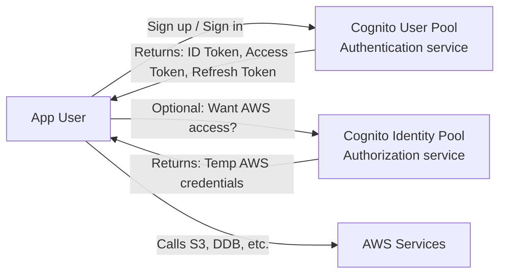
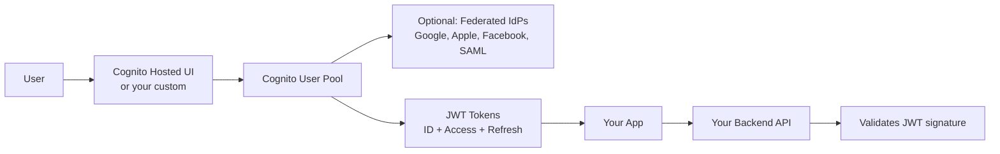
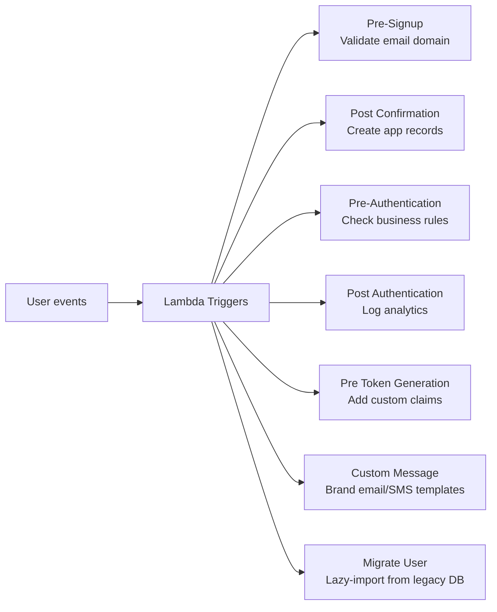
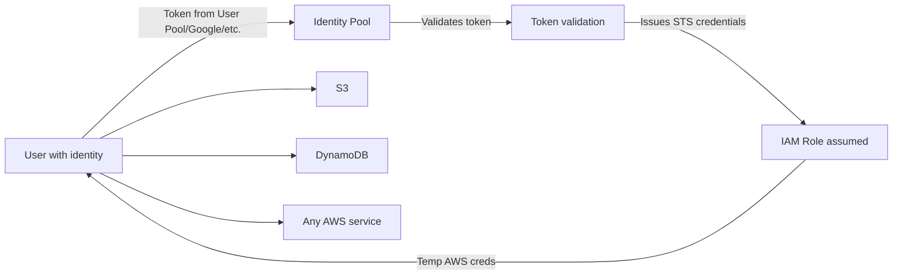
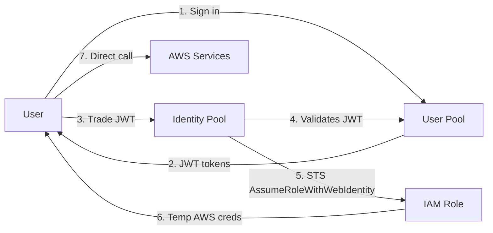

# Amazon Cognito — User Pools vs Identity Pools

> 🔥 **Common exam confusion.** Memorize the distinction: User Pool authenticates users, Identity Pool gives them AWS access.

## Problem It Solves
Adding authentication to a web/mobile app is complex:
- User sign-up, sign-in
- Password hashing, reset flows
- MFA, OAuth social login
- Token issuance and validation
- Compliance (SOC 2, GDPR)

**Cognito provides managed authentication infrastructure** so you don't roll your own.

## The Two Cognito Services



### Side by Side

| | **User Pool** | **Identity Pool** |
|---|---|---|
| Purpose | Authentication (who are you?) | Authorization to AWS (what can you do in AWS?) |
| Output | JWT tokens (ID, Access, Refresh) | Temporary AWS credentials |
| Use case | App login, password reset, MFA | App users calling AWS services directly |
| User store | Built-in user directory | No user store — trusts external IdPs |
| Federation | Can federate FROM social IdPs / SAML | Can use User Pool tokens or external IdPs |
| Sign-up flow | ✅ Built-in | ❌ Not its job |
| MFA | ✅ Built-in | ❌ Inherited from User Pool if used together |

```
THE MENTAL MODEL:
─────────────────────────────────────────────
User Pool      = "Who are you?" (login)
Identity Pool  = "Here are AWS keys for you" (authorize for AWS)

You can use them:
- Together: User Pool sign-in → Identity Pool exchange → AWS access
- User Pool alone: Just login for your app's backend (no direct AWS)
- Identity Pool alone: Federated AWS access without your own user DB
```

---

## Cognito User Pool — Authentication



### Features

```
SIGN-UP & SIGN-IN:
─────────────────────────────────────────────
✅ Username + password
✅ Email or phone verification
✅ Password policies (length, complexity)
✅ Account recovery flows
✅ Custom user attributes
✅ Hosted UI (white-labelable) or build your own
✅ Customizable signup attributes

MFA:
─────────────────────────────────────────────
✅ SMS OTP
✅ TOTP (authenticator apps)
✅ FIDO2 / WebAuthn (security keys)
✅ Risk-based adaptive MFA (Cognito Advanced Security)

FEDERATION:
─────────────────────────────────────────────
✅ Google, Apple, Facebook, Amazon
✅ SAML 2.0 (corporate IdPs)
✅ OpenID Connect IdPs
✅ Users from federated IdPs ARE users in your pool

ADVANCED SECURITY (extra cost):
─────────────────────────────────────────────
✅ Compromised credentials detection
✅ Risk-based adaptive authentication
✅ Account takeover protection
```

### Tokens

```
ID TOKEN (JWT):
─────────────────────────────────────────────
Contains user identity claims
Use: Identify user in your frontend
Don't use: Authenticate API calls (use Access Token)

ACCESS TOKEN (JWT):
─────────────────────────────────────────────
Used to call your backend API
Backend validates signature + scopes
Don't expose to anyone but your backend

REFRESH TOKEN:
─────────────────────────────────────────────
Long-lived (default 30 days, configurable)
Used to get new ID + Access tokens without re-login
Store securely (encrypted local storage / Keychain)
```

### Lambda Triggers — Custom Logic



```
COMMON LAMBDA TRIGGER USES:
─────────────────────────────────────────────
✅ Pre-Signup: Restrict to corporate email domains
✅ Post-Confirmation: Create user row in your DB
✅ Pre-Token Generation: Add custom claims (role, tenant)
✅ Migrate User: Lazy import users from existing DB
✅ Custom Message: Brand verification emails
```

---

## Cognito Identity Pool — AWS Access



### Identity Pool Configuration

```
AUTHENTICATED ROLE:
─────────────────────────────────────────────
Users who logged in via supported IdP assume this role
Has policies granting AWS access

UNAUTHENTICATED ROLE (optional):
─────────────────────────────────────────────
Guest users (no login)
Typically minimal permissions (read public S3 only)
Disable if not needed

ROLE-BASED ACCESS (advanced):
─────────────────────────────────────────────
Different IAM Roles per user attribute
E.g., "Premium" users get a different role than "Free" users
Implemented via custom rules in Identity Pool
```

### Per-User Resource Scoping

```yaml
# IAM Role policy attached to authenticated users
# Restricts each user to their own S3 prefix
{
  "Effect": "Allow",
  "Action": ["s3:GetObject", "s3:PutObject"],
  "Resource": "arn:aws:s3:::my-bucket/users/${cognito-identity.amazonaws.com:sub}/*"
}
```

```
THE MAGIC:
─────────────────────────────────────────────
${cognito-identity.amazonaws.com:sub} = unique ID per user
Each user can only access their own prefix
NO BACKEND CODE NEEDED — IAM enforces it
```

---

## Combined: User Pool + Identity Pool



```
TYPICAL MOBILE APP PATTERN:
─────────────────────────────────────────────
1. User signs up/in via User Pool (built-in UI or custom)
2. App receives JWT tokens
3. App sends JWT to Identity Pool
4. Identity Pool gives back temp AWS creds
5. App uses creds for direct S3 uploads, DDB writes
6. Backend isn't in the upload path — saves backend cost
```

---

## When to Use What

| Scenario | Solution |
|---|---|
| Add login to my app | **User Pool** |
| Social login (Google/Apple) | **User Pool with social federation** |
| Corporate SSO via SAML | **User Pool with SAML IdP** |
| Let users directly upload to S3 | **User Pool + Identity Pool** |
| Mobile app, backend-light arch | **User Pool + Identity Pool** |
| Guest users with limited AWS access | **Identity Pool with unauthenticated role** |
| Federation from Google → AWS only | **Identity Pool alone** (no User Pool needed) |
| Corporate SSO to AWS Console | **Identity Center** (NOT Cognito) |
| Service-to-service auth | **IAM Roles** (NOT Cognito) |
| API authentication | **API Gateway Cognito Authorizer** (uses User Pool) |

## When NOT to Use Cognito

- ❌ Don't use for employee/workforce → **Identity Center**
- ❌ Don't use for service auth → **IAM Roles**
- ❌ Don't use for one-time access — overkill, use IAM users
- ❌ Don't use if you need very custom auth flows → consider Auth0 or self-built

## Trade-offs

| Choice | Gain | Sacrifice |
|---|---|---|
| User Pool over self-built auth | Managed MFA, federation, security | Per-MAU cost (free tier 50k MAU/month) |
| Identity Pool over backend proxy | Direct AWS access, less backend | More complex IAM policies |
| Combined User+Identity Pool | Most powerful | More complex setup |
| Hosted UI | Quick start, security best practices | Less customization |
| Custom UI | Full brand control | More code |

## Real World Example

**A photo-sharing app:**
- **User Pool**: Email + password sign-up, Google federation, MFA optional
- **Identity Pool**: Authenticated users get IAM Role allowing S3 uploads to `s3://photos/{cognito-sub}/*`
- Each user can ONLY access their own photos via IAM
- App backend is small — most operations are direct AWS calls
- **API Gateway Cognito Authorizer** for the few backend endpoints (uses User Pool JWT)

**A SaaS B2B app:**
- **User Pool** with SAML federation to customer corporate IdPs (multi-tenant)
- **Lambda triggers**: Pre-Token to add `tenantId` custom claim
- Backend uses `tenantId` from JWT to scope DB queries
- Identity Pool not used — all AWS access via backend IAM Role

## 🎯 Exam Soundbite

> "Cognito has two distinct services: User Pools handle authentication for app users with built-in sign-up, sign-in, MFA, password reset, and federation from social or SAML identity providers — returning JWT tokens. Identity Pools handle authorization to AWS, exchanging identity tokens for temporary AWS credentials so users can directly call AWS services like S3 and DynamoDB. Use them together for backend-light mobile apps, or User Pools alone if you only need authentication. For workforce SSO to AWS, use IAM Identity Center instead."

---

## ⚡ Quick Recall Card

```
┌─────────────────────────────────────────────────┐
│ COGNITO USER POOL vs IDENTITY POOL               │
├─────────────────────────────────────────────────┤
│ USER POOL — Authentication                       │
│   Sign-up, sign-in, MFA                          │
│   Returns JWT (ID + Access + Refresh)            │
│   Federate from Google, Apple, SAML, OIDC        │
│   Lambda triggers for custom logic               │
│   Use: App login                                 │
│                                                  │
│ IDENTITY POOL — AWS Authorization                │
│   Exchanges tokens for temp AWS creds            │
│   Returns STS credentials                        │
│   Supports User Pool, social, SAML, OIDC, custom │
│   Use: Direct AWS access for app users           │
│                                                  │
│ TOGETHER                                         │
│   UP login → JWT → IP → AWS creds → S3/DDB       │
├─────────────────────────────────────────────────┤
│ NOT FOR                                          │
│   Workforce SSO → Identity Center                │
│   Service auth → IAM Roles                       │
└─────────────────────────────────────────────────┘
```

## 🎓 Common Exam Patterns

> **"Mobile app needs to authenticate users with Google login and allow them to upload photos directly to S3 (one prefix per user)."**
>
> ✅ **Cognito User Pool** with Google federation + **Cognito Identity Pool** → IAM Role with policy using `${cognito-identity.amazonaws.com:sub}` to scope S3 prefix per user.

> **"B2B SaaS where each customer's employees log in via their corporate SAML IdP. App backend needs to know which tenant the user belongs to."**
>
> ✅ **User Pool with SAML federation per customer IdP** + **Pre-Token Generation Lambda Trigger** to inject `tenantId` claim. Backend reads claim from JWT.

> **"API protected so only signed-in app users can call it. Want a managed solution."**
>
> ✅ **API Gateway with Cognito Authorizer** — API Gateway validates User Pool JWT, no custom code needed.
