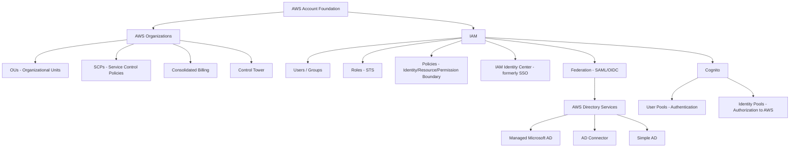

# 01 — Foundation: Identity, Organizations & Federation

> **Exam weight:** ⭐⭐⭐⭐⭐ — Easily 15-20% of the exam. Almost every scenario question touches IAM, cross-account access, or multi-account governance.

---

## 🗺️ Topic Map



---

## 📚 Notes in This Section

| # | Topic | Priority |
|---|---|---|
| 01 | [IAM Core - Users, Groups, Roles, Policies](./01-iam-core.md) | 🔥 |
| 02 | [IAM Policy Evaluation Logic](./02-policy-evaluation.md) | 🔥 |
| 03 | [Cross-Account Access Patterns](./03-cross-account-access.md) | 🔥 |
| 04 | [Permission Boundaries vs SCPs](./04-boundaries-vs-scps.md) | 🔥 |
| 05 | [AWS Organizations & SCPs](./05-organizations.md) | 🔥 |
| 06 | [AWS Control Tower](./06-control-tower.md) | High |
| 07 | [IAM Identity Center (SSO)](./07-identity-center.md) | 🔥 |
| 08 | [Federation - SAML, OIDC, Web Identity](./08-federation.md) | High |
| 09 | [AWS Directory Services](./09-directory-services.md) | Medium |
| 10 | [Amazon Cognito](./10-cognito.md) | High |

---

## 🎯 The 5 Things SAP-C02 Tests on Foundation

```
1. POLICY EVALUATION
   - Explicit Deny > Allow > Implicit Deny
   - SCP intersects with IAM (both must allow)
   - Permission Boundary caps maximum permissions

2. CROSS-ACCOUNT ACCESS
   - When to use Role + sts:AssumeRole
   - When to use Resource-based policy (S3 bucket policy, KMS)
   - When to use RAM (Resource Access Manager)

3. FEDERATION
   - SAML 2.0 for corporate AD → AWS
   - OIDC for web/mobile via Cognito
   - IAM Identity Center for multi-account user access

4. MULTI-ACCOUNT STRATEGY
   - Account per environment vs per workload
   - SCPs at OU vs Account level
   - Control Tower vs raw Organizations

5. LEAST PRIVILEGE
   - Permission Boundaries for developer self-service
   - Access Analyzer for unused permissions
   - Policy conditions (aws:SourceIp, aws:MultiFactorAuthPresent)
```
