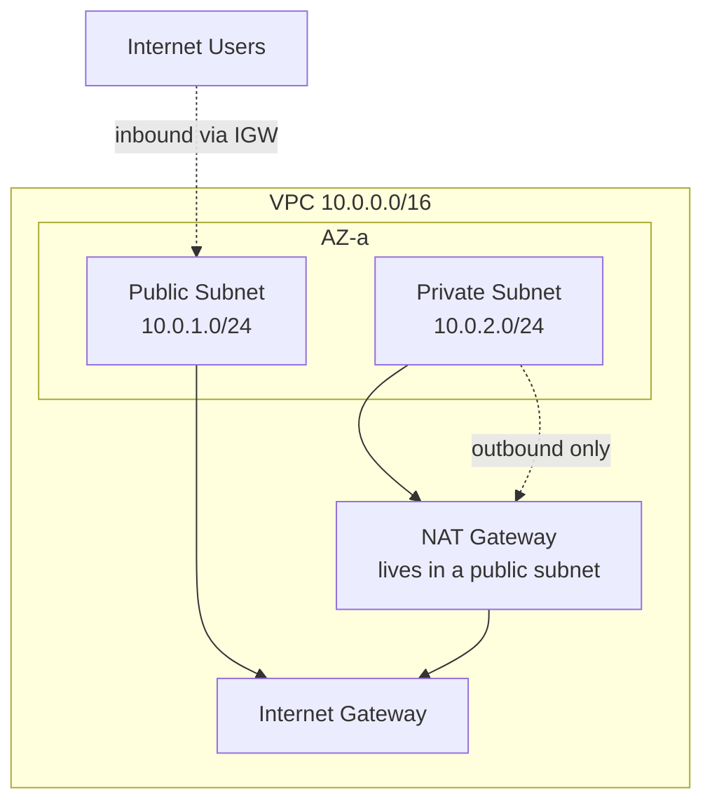
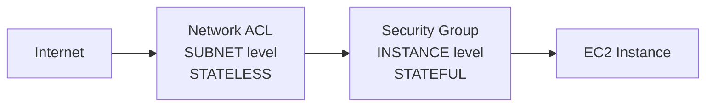

# VPC Fundamentals — Explained Simply

> **Feynman rule:** If you can't explain it to a beginner without jargon, you don't understand it yet. Every section below starts with the *why*, then the *how*, then the *gotcha*.

---

## 1. What problem are we even solving?

Imagine you rent a small office inside a giant shared building (that building is AWS). You don't want strangers wandering into your office, and you want to decide yourself which doors open to the street, which rooms are locked, and how mail gets in and out.

A **VPC (Virtual Private Cloud)** is your private office space inside AWS. It's a network you fully control — your own IP addresses, your own rooms (subnets), your own doors (gateways), your own locks (security) — but you never touch a single physical cable. It's "virtual," meaning it's all software-defined, yet it behaves like a real private network (think of it as your own private LAN living inside AWS).

---

## 2. The physical world underneath (so the rest makes sense)

Before networking, know where things physically live:

- **Region** = a geographical area (e.g. Mumbai, N. Virginia). Think "a city." Regions are isolated from each other on purpose.
- **Availability Zone (AZ)** = one or more physical data centers inside that region, connected to each other by fast private links. Think "separate buildings in the same city, wired together."

Why split into AZs? So that if one building catches fire (power loss, flood, hardware failure), your app keeps running from another building. This is why best practice is spreading across **2–3 AZs**.

Your VPC stretches across the whole region; your **subnets** each live inside *one* AZ.

---

## 3. IP addressing & CIDR — the part most people fumble

This is where you had questions, so let's build it from zero.

### An IPv4 address is just 32 bits, shown as 4 chunks

`10.0.1.0` → four numbers, each is **8 bits** → 8 × 4 = **32 bits total**.

### CIDR notation: the "/number" tells you how many bits are locked

When you write `10.0.0.0/16`, the `/16` means: **"the first 16 bits are the network part and are fixed. The remaining bits are free for hosts."**

```
10  .  0  .  0  .  0   /16
└──────┘   └──────────┘
 16 bits     16 bits
 NETWORK     HOST (free to use)
(locked)
```

- **/16** → 16 host bits free → 2¹⁶ = **65,536 addresses**. This is the **largest** VPC you can make.
- **/28** → only 4 host bits free → 2⁴ = **16 addresses**. This is the **smallest**.

### So what's the actual range of a /16?

For `10.0.0.0/16`, the first two octets (`10.0`) are frozen. The last two are free to roam:

```
10.0.0.0   →   10.0.255.255
```

That's your whole VPC address space.

### Subnetting = chopping the big block into smaller rooms

Inside the `/16` VPC, you carve out **subnets**. A subnet is just a smaller CIDR *within* the VPC range.

Example: `10.0.1.0/24`
- `/24` means 24 bits locked, **8 bits free** → 2⁸ = 256 addresses.
- The third octet (`1`) now identifies *which subnet*, and the last octet is for hosts.

```
10.0.1.0/24  →  range 10.0.1.0  to  10.0.1.255
                └─ 256 total addresses ─┘
```

> **Mental model:** the VPC `/16` gives you the 3rd and 4th octets to play with. You spend the 3rd octet to *number your subnets* (`.1`, `.2`, `.11`…) and the 4th octet holds the *hosts inside* each subnet.

### The 5 reserved IPs (why a /24 gives you 251, not 256)

AWS quietly steals 5 addresses from **every** subnet for its own plumbing. In `10.0.1.0/24`:

```
10.0.1.0    → Network address (identifies the subnet itself)
10.0.1.1    → VPC router (the default gateway)
10.0.1.2    → DNS (Route 53 Resolver)
10.0.1.3    → Reserved for future AWS use
10.0.1.255  → Broadcast address (reserved; AWS doesn't support broadcast)

Usable = 256 − 5 = 251 IPs
```

That's why you never get the full count — AWS needs those 5 to route, resolve names, and stay future-proof.

---

## 4. Getting traffic in and out — the doors

A subnet by itself is just a walled room. Whether it can reach the internet depends entirely on its **route table**.



### Route table — the signpost
Every subnet is attached to a route table that says "to reach destination X, send traffic to Y." The rule **most specific match wins**.

- `0.0.0.0/0 → Internet Gateway` means "anything not local, send to the internet." This makes a subnet **public**.
- No such route? The subnet is **private** — it simply has no path to the internet.

### Internet Gateway (IGW) — the front door
A single, AWS-managed, highly-available door that allows **two-way** internet traffic. A public subnet *must* route through it.

### NAT Gateway — the one-way mail slot
Here's the clever bit. A private subnet (say, your app servers) often needs to *reach out* — to download updates — but should **never** be reachable *from* the internet.

The **NAT Gateway** solves this: it sits in a public subnet and lets private resources send traffic out and receive the replies, but **nobody outside can initiate a connection inward**. It's a one-way mail slot: you can post letters out, but strangers can't push letters in.

- NAT is **AZ-scoped** → deploy one per AZ, or one AZ failing drops the others' internet.
- It costs money per hour **and** per GB processed.

### Egress-only IGW — the IPv6 version
IPv6 has no NAT concept. If you want IPv6 outbound-only, you use an **egress-only internet gateway**. Same idea: out yes, in no.

---

## 5. Security — two locks, two different levels

You asked the great question: *"If security groups can do the job, why do NACLs even exist?"* Let's earn that answer.



Traffic hits the **NACL first** (at the subnet boundary), and only if it passes does it reach the **Security Group** (at the instance). If the NACL blocks it, the security group never even sees it — it's already dead at the gate.

### Security Group = the lock on each individual door
- Operates at the **instance/ENI** level.
- **Stateful**: if you allow traffic *out*, the reply is *automatically* allowed back in. You don't think about return traffic.
- **Allow rules only.** There is no "deny" rule. Everything is implicitly denied; you only ever open things up.
- Because there's no deny, **rule order doesn't matter** — there's nothing to conflict.

### NACL = the gate at the building entrance
- Operates at the **subnet** level — one rule covers *everything* in the subnet at once.
- **Stateless**: it does NOT remember connections. If you allow traffic in, you must *separately* allow the reply going out.
- Has **both allow and deny** rules.
- Rules are **numbered, and the first match wins** (e.g. rule #100 is checked before #200).

### So — why have NACLs at all?
Two reasons, and they're about *layers*, not redundancy:

1. **Efficiency / blast radius.** A security group is a lock on *one* door. If you have 50 instances in a subnet and want to block a malicious IP, you'd edit 50 security groups. With a NACL you write **one** rule at the gate and it protects the whole subnet instantly.
2. **The ability to DENY.** Security groups can only *allow*. If you specifically need to *block* a known-bad IP range, only a NACL can do that.

> **Analogy:** Security groups = locks on each office door. NACLs = the security gate at the building entrance. You want both — they guard different layers. This is **defense in depth**.

### The classic stateless gotcha (exam trap)
```
NACL allows port 80 inbound  ✓
NACL forgot to allow outbound ephemeral ports (1024–65535)  ✗
Security Group allows 80 in/out  ✓

Result: request arrives fine, but the RESPONSE is blocked.
Because the NACL is stateless, the reply leaves on a random high
port (ephemeral), and you never opened those outbound. Always
allow ephemeral ports outbound on NACLs for replies to work.
```

---

## 6. The Elastic Network Interface (ENI)

An **ENI** is the virtual network card attached to your EC2 instance. It's the thing that actually holds the instance's private IP and connects it into the subnet, so traffic can flow from the instance → subnet → route table → gateway → internet. Security groups attach *to the ENI*, which is why they're "instance level."

---

## 7. Storage detour — EBS (since it came up)

Not strictly VPC, but worth nailing down.

- **Instance store** = disk physically *inside* the host running your EC2. Very **fast**, but **ephemeral** — it vanishes if the instance stops. Like RAM-adjacent scratch space.
- **EBS (Elastic Block Store)** = a **network-attached** drive. Slightly higher latency (it's reached over the network), but **persistent** — it survives instance stop/start, and you can attach more capacity any time.

### Can one EBS volume attach to multiple EC2 instances?
**Normally, no — one volume, one instance.** Why? Because if two instances wrote to the same disk at once, you'd get **data corruption, file-system inconsistency, and locking conflicts** — the operating systems each assume they own the disk and would trample each other's writes. Single-attach sidesteps all of that.

> **Nuance:** AWS does offer **EBS Multi-Attach** for specific volume types, but then *your application* must handle the concurrency safely (clustered file systems). For standard use, treat it as one-to-one.

---

## 8. When to use what (decision cheatsheet)

| Need | Use |
|---|---|
| Accept inbound from internet (load balancer, web server) | **Public subnet** |
| Outbound to internet, but no inbound (app servers) | **Private subnet + NAT Gateway** |
| Fully isolated, no internet at all (databases) | **Private subnet, no NAT** |
| Block a specific bad IP across a whole subnet | **NACL deny rule** |
| Outbound IPv6 only | **Egress-only IGW** |
| Connect VPCs privately | **VPC Peering** (small) / **Transit Gateway** (scales) |

### When NOT to
- ❌ Databases in public subnets — never; keep them isolated.
- ❌ One NAT Gateway shared across AZs — an AZ failure breaks the others.
- ❌ NACLs as your *primary* firewall — security groups are simpler and stateful; use NACLs for coarse subnet-wide blocks.
- ❌ Overlapping CIDRs across VPCs you might one day connect — peering breaks.

---

## 9. Standard layout to memorize (3-tier, multi-AZ)

```
VPC: 10.0.0.0/16   (65,536 IPs)
├── AZ-a
│   ├── Public:  10.0.1.0/24   ← load balancers, NAT
│   ├── Private: 10.0.2.0/24   ← app servers
│   └── DB:      10.0.3.0/24   ← databases, no internet
├── AZ-b
│   ├── Public:  10.0.11.0/24
│   ├── Private: 10.0.12.0/24
│   └── DB:      10.0.13.0/24
└── AZ-c
    ├── Public:  10.0.21.0/24
    ├── Private: 10.0.22.0/24
    └── DB:      10.0.23.0/24
```

---

## 🎯 Exam Soundbite

> "A VPC is a logically isolated, software-defined network inside one region. Spread subnets across multiple AZs for high availability — public subnets for load balancers and NAT, private subnets for app tiers, isolated subnets (no internet route) for databases. Security Groups are stateful and instance-level with allow-only rules; NACLs are stateless and subnet-level with ordered allow+deny rules. Together they give defense in depth."

---

## ⚡ Quick Recall Card

```
┌────────────────────────────────────────────────────┐
│ VPC FUNDAMENTALS                                    │
├────────────────────────────────────────────────────┤
│ IPv4 address           32 bits = 4 octets × 8 bits  │
│ /N in CIDR             first N bits = network locked │
│ VPC CIDR range         /16 max (65,536), /28 min(16)│
│ /16 range example      10.0.0.0 → 10.0.255.255      │
│ /24 subnet             256 addrs, 251 usable        │
│ Reserved IPs/subnet    5 (first 4 + last 1)         │
│ Subnet scope           bound to ONE AZ              │
│ Public subnet          = route 0.0.0.0/0 → IGW      │
│ Private + outbound     = route 0.0.0.0/0 → NAT      │
│ NAT scope              AZ-scoped (one per AZ)        │
│ Security Group         Stateful, instance, ALLOW only│
│ SG rule order          doesn't matter (no deny)     │
│ NACL                   Stateless, subnet, ALLOW+DENY │
│ NACL rule order        numbered, first match wins   │
│ Eval order             NACL first, then SG          │
│ Default NACL           allows all; custom denies all │
│ EBS                    network-attached, 1 instance  │
│ Instance store         local, fast, ephemeral        │
└────────────────────────────────────────────────────┘
```
