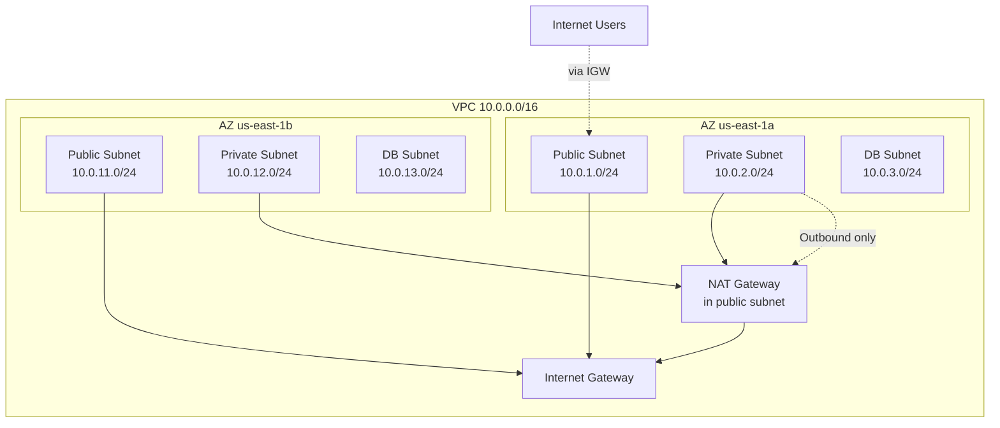
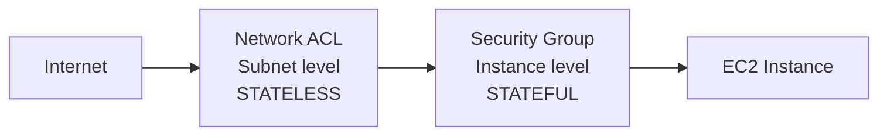

# VPC Fundamentals

## Problem It Solves
You need an **isolated, software-defined network** in AWS that you fully control — IP addresses, subnets, route tables, gateways, security — without managing physical hardware. VPC gives you a private cloud that can integrate with your on-prem network and the public internet on your terms.

## How It Works



### The Key Components

```
┌────────────────────────────────────────────────────────────┐
│ VPC (10.0.0.0/16)                                          │
│   Region-scoped. Max /16 = 65,536 IPs                      │
│   Min /28 = 16 IPs                                         │
├────────────────────────────────────────────────────────────┤
│ SUBNETS                                                    │
│   AZ-scoped. CIDR within the VPC                           │
│   First 4 + last 1 IPs reserved by AWS                     │
│   Public if route table points to IGW                      │
│   Private if no IGW route                                  │
├────────────────────────────────────────────────────────────┤
│ ROUTE TABLES                                               │
│   Subnet → which route table?                              │
│   Most specific match wins                                 │
│   0.0.0.0/0 → IGW = public subnet                          │
│   0.0.0.0/0 → NAT = private subnet with outbound           │
├────────────────────────────────────────────────────────────┤
│ INTERNET GATEWAY (IGW)                                     │
│   Horizontally scaled, redundant, AZ-independent           │
│   Allows bidirectional internet traffic                    │
│   Required for public subnets                              │
├────────────────────────────────────────────────────────────┤
│ NAT GATEWAY                                                │
│   AWS-managed, AZ-scoped (deploy 1 per AZ for HA)          │
│   Outbound internet for private subnets                    │
│   $$ Charged per hour + per GB processed                   │
├────────────────────────────────────────────────────────────┤
│ NAT INSTANCE (Legacy)                                      │
│   Self-managed EC2 acting as NAT                           │
│   Cheaper but you manage HA, patching, scaling             │
├────────────────────────────────────────────────────────────┤
│ EGRESS-ONLY INTERNET GATEWAY                               │
│   For IPv6 — outbound only, no inbound                     │
│   (IPv6 has no NAT; this is the equivalent)                │
└────────────────────────────────────────────────────────────┘
```

### Security Layers — Defense in Depth



| | **Security Group** | **NACL** |
|---|---|---|
| Level | Instance (ENI) | Subnet |
| State | **Stateful** — return traffic auto-allowed | **Stateless** — must allow both ways |
| Rules | Allow only | Allow + Deny |
| Default inbound | Deny all | Allow all (default NACL) |
| Rule evaluation | All rules evaluated | Numbered order, first match wins |
| When to use | Primary firewall | Subnet-wide blocks (block bad IPs) |

```
EXAM TRAP:
─────────────────────────────────────────
NACL on subnet allows port 80 inbound
NACL on subnet DENIES port 80 outbound (return)
Security Group allows port 80 in/out

Result: Traffic IN succeeds, response BLOCKED.
NACLs are stateless — you must allow ephemeral
ports (1024-65535) outbound for HTTP responses!
```

### Subnet Sizing Pattern (Memorize)

```
Standard 3-tier app in 2 AZs (best practice = 3 AZs):

VPC:          10.0.0.0/16     (65,536 IPs)
├── AZ-a
│   ├── Public:    10.0.1.0/24    (251 IPs usable)
│   ├── Private:   10.0.2.0/24
│   └── DB:        10.0.3.0/24
├── AZ-b
│   ├── Public:    10.0.11.0/24
│   ├── Private:   10.0.12.0/24
│   └── DB:        10.0.13.0/24
└── AZ-c (recommended)
    ├── Public:    10.0.21.0/24
    ├── Private:   10.0.22.0/24
    └── DB:        10.0.23.0/24
```

### Reserved IPs in Every Subnet

```
Subnet 10.0.1.0/24:
─────────────────────────────────
10.0.1.0    → Network address
10.0.1.1    → VPC router
10.0.1.2    → DNS (Route 53 Resolver)
10.0.1.3    → Reserved for future use
10.0.1.255  → Broadcast (not used, reserved)

Usable: 256 - 5 = 251 IPs
```

## When to Use What

| Need | Use |
|---|---|
| Resources accept inbound from internet (ALB, web server) | **Public subnet** |
| Resources outbound to internet but not inbound (app server, Lambda for npm) | **Private subnet + NAT Gateway** |
| Resources fully isolated (databases, internal services) | **Private subnet, no NAT** |
| Multi-region private connectivity | **VPC Peering or Transit Gateway** |
| Outbound IPv6 only | **Egress-only IGW** |
| Inspect/filter East-West traffic | **AWS Network Firewall or Gateway Load Balancer** |

## When NOT to Use

- ❌ Don't put databases in public subnets — always private
- ❌ Don't use a single NAT Gateway across AZs — it's an AZ-scoped HA risk
- ❌ Don't use NACLs as primary security — SGs are simpler and stateful
- ❌ Don't use overlapping CIDRs across VPCs you might connect (breaks peering)

## Trade-offs

| Choice | Gain | Sacrifice |
|---|---|---|
| Larger CIDR (/16 vs /20) | Future room to grow | Slightly more complex IP planning |
| NAT Gateway over NAT Instance | AWS-managed, scales auto | More expensive |
| Single NAT Gateway | Cheap | One AZ failure breaks others |
| NAT per AZ | High availability | 3x the cost |
| Larger subnets | Fewer subnets to manage | Less granular ACL control |

## Real World Example

**Airbnb's** VPC architecture:
- Multiple VPCs per environment (Prod, Staging, Dev)
- 3 AZs minimum for all production workloads
- Public subnets only for load balancers and NAT
- All application tier in private subnets with NAT egress
- DB tier in fully isolated subnets — no internet path at all
- Cross-VPC connectivity via Transit Gateway (used to be peering, didn't scale)

## 🎯 Exam Soundbite

> "A VPC is a logically isolated software-defined network within a region. Use multiple subnets across multiple Availability Zones for high availability — public subnets for load balancers and NAT gateways, private subnets for application tiers, and isolated subnets without internet routes for databases. Security Groups (stateful, instance-level) and NACLs (stateless, subnet-level) form a defense-in-depth model."

---

## ⚡ Quick Recall Card

```
┌────────────────────────────────────────────────────┐
│ VPC FUNDAMENTALS                                    │
├────────────────────────────────────────────────────┤
│ VPC CIDR range          /16 max, /28 min            │
│ Reserved IPs per subnet 5 (first 4 + last 1)        │
│ Subnet AZ scope         AZ-bound                    │
│ Public subnet =         Route to IGW                │
│ NAT scope               AZ-scoped (deploy per AZ)   │
│ Default VPC quota       5 per region                │
│ Security Group          Stateful, instance, ALLOW   │
│ NACL                    Stateless, subnet, ALLOW+DENY│
│ Default NACL            Allows everything           │
│ Custom NACL             Denies everything           │
└────────────────────────────────────────────────────┘
```
