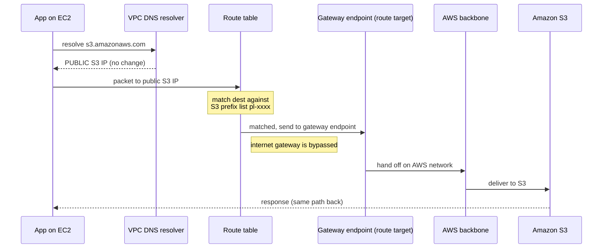
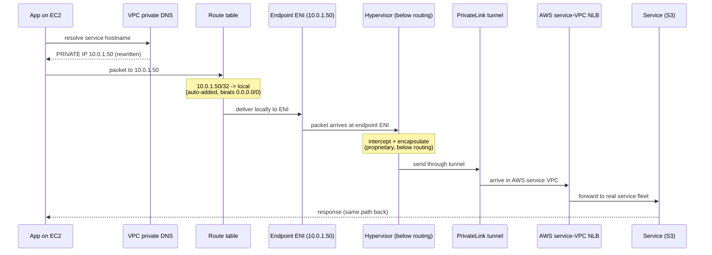
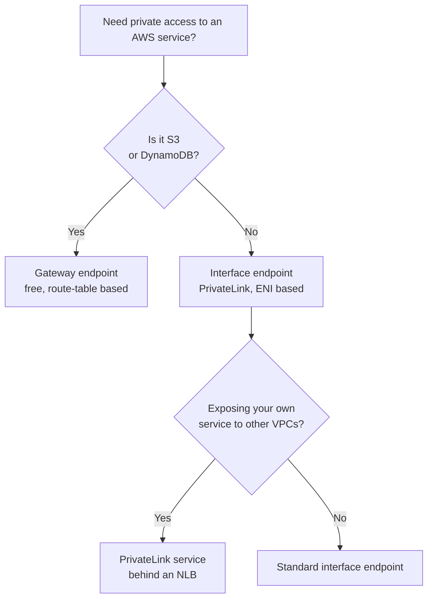

# VPC Endpoints — Feynman Notes

> The test of understanding: can you explain it to someone who has never heard of it, with no jargon, and have it actually make sense? These notes are written that way.

---

## 1. The problem, explained simply

You have an EC2 instance in a private subnet. It wants to talk to S3.

Even though both EC2 and S3 are "inside AWS," by default the EC2 instance reaches S3 the long way round: out through a NAT gateway, onto the public internet, to S3's public address, and back. Two things are wrong with this:

1. **Latency** — the traffic takes a detour onto the public internet instead of staying inside AWS.
2. **Cost** — you pay NAT gateway charges and bandwidth for traffic that never needed to leave AWS.

VPC endpoints fix this by giving the traffic a private door directly into the AWS service, so it never touches the internet.

---

## 2. Two kinds of door

There are two types of endpoint, and the single most important thing is that **they work by completely different mechanisms**. If you remember nothing else, remember this split.

| | Gateway endpoint | Interface endpoint (PrivateLink) |
|---|---|---|
| Works by | A **route table** entry | An **ENI** (a network card) in your subnet |
| What gets you there | IP matching against a **prefix list** | **Private DNS** resolving to the ENI's private IP |
| DNS change? | **No** — hostname still resolves to the public IP | **Yes** — hostname resolves to a private IP |
| Supported services | **S3 and DynamoDB only** | 100+ services (almost everything else) |
| Cost | **Free** | ~$0.01/hr per AZ + ~$0.01/GB |
| Lives in your subnet? | No (it's a route target) | Yes (a real ENI with a private IP) |

The trap to avoid: do **not** imagine the gateway endpoint using DNS, and do **not** imagine the interface endpoint needing a route you write yourself. Each uses one mechanism, not both.

---

## 3. Gateway endpoint — how it actually works

The mental model: **the route table intercepts the traffic before it can leave.**

1. Your EC2 instance resolves `s3.amazonaws.com` to a normal **public** S3 IP. (No DNS trick here.)
2. The packet sets off with that public destination IP.
3. Before it reaches the internet gateway, the route table checks the destination against the **S3 prefix list** (`pl-xxxx`) — which is simply AWS's published list of S3's IP ranges.
4. It matches, so the route table sends the packet to the **gateway endpoint** as the target, not the internet gateway.
5. The gateway endpoint hands the traffic to S3 over the AWS backbone. Never touches the internet.

The gateway endpoint is **not a device sitting in your subnet** and **not a router you manage**. It is a *route target* — a logical entry — and the actual "route this to S3 on the backbone" decision is a policy baked into the AWS network fabric at a layer you cannot see or configure.

---

## 4. Interface endpoint — how it actually works

The mental model: **a private IP in your subnet that is secretly the mouth of a tunnel into AWS.**

1. You create the interface endpoint. AWS drops an **ENI** (elastic network interface — a virtual network card) into your subnet with a private IP, e.g. `10.0.1.50`.
2. With private DNS enabled, AWS creates a **private hosted zone** so that when your app resolves the service hostname, your VPC resolver returns the ENI's private IP **instead** of the public one. The hostname is unchanged — only the resolution result changes, so your application code never has to change.
3. Your app sends the packet to `10.0.1.50`.
4. The packet reaches the ENI (see the next section for exactly *how* — this is the gap most people miss).
5. The ENI is one end of a **PrivateLink** tunnel. The other end is in an **AWS-managed service VPC** you never see, terminating at a **Network Load Balancer** that fronts the real service fleet.
6. PrivateLink carries the traffic through the AWS backbone to that NLB, which forwards it to S3. The response returns the same way.

Key correction to a common misconception: **the ENI is not doing the translating.** The ENI is just the gate. The work of forwarding to the real service fleet happens at the **NLB on the AWS side**, inside the service VPC AWS manages.

---

## 5. ⭐ Things I Don't know: how does traffic get from the private subnet IP *into* PrivateLink?

This is the part that is genuinely confusing and that most explanations skip. Here is the honest, complete answer.

**Step A — the automatic local route.**
When you create an interface endpoint in a subnet, AWS **automatically** adds a route to your route table for the ENI's private IP:

```
Destination        Target
10.0.1.50/32       local
```

You do **not** write this yourself. The `/32` means "this one exact IP address." Because `/32` is the most specific possible match, it **wins over** the `0.0.0.0/0` internet-gateway route. This is the answer to "won't my traffic accidentally go to the internet gateway?" — no, because the specific local route is matched first.

**Step B — delivery to the ENI.**
The route table sees `local`, so it delivers the packet within the subnet to the ENI. Normal subnet routing — nothing special yet.

**Step C — the interception (the proprietary part).**
Once the packet **physically arrives at the ENI**, PrivateLink takes over. This happens **below the routing layer** — at the hypervisor / network-card level. The hypervisor recognizes "this ENI is flagged as an endpoint ENI," intercepts the packet *before* normal onward network processing, **encapsulates** it (wraps it in a tunnel envelope with an AWS-internal address), and sends it through the backbone to the service-side NLB.

You will **never** see a route table entry that says "→ PrivateLink," and you can't write one — because PrivateLink isn't a nameable route target. It operates a layer beneath what you can inspect or configure.

**The honest boundary of what's knowable:** you can observe the *effect* (a `/32` local route, an ENI, traffic that stays private). The exact firmware/virtual-switch mechanism of the interception is **proprietary** — AWS deliberately does not publish it. Knowing it exists below the routing layer is the correct and complete mental model.

So the full chain is:

```
private DNS → ENI private IP → /32 local route delivers to ENI
            → hypervisor intercepts at the ENI
            → encapsulate → PrivateLink tunnel → service-VPC NLB → S3
```

---

## 6. End-to-end sequence diagrams

### Gateway endpoint (S3 / DynamoDB)



### Interface endpoint (PrivateLink) — with the local-route + interception detail



---

## 7. When to use which (decision)



---

## 8. Exam soundbite

> Gateway endpoints give free, private access to S3 and DynamoDB by adding a route to a managed prefix list — no DNS change. For every other service, use interface endpoints backed by PrivateLink, which place an ENI with a private IP in your subnet; private DNS rewrites the hostname to that private IP, an auto-added `/32` local route delivers traffic to the ENI, and the hypervisor tunnels it through PrivateLink to an AWS-managed NLB. PrivateLink also lets you expose your own services privately across VPCs and accounts.

---

## 9. Self-test (Feynman check)

Answer these out loud without looking up:

1. Does the gateway endpoint change DNS? (No — public IP, route table intercepts.)
2. Does the interface endpoint need a route table entry you write? (No — AWS auto-adds a `/32` local route.)
3. Why doesn't interface-endpoint traffic accidentally hit the internet gateway? (`/32` is more specific than `0.0.0.0/0`, so it's matched first.)
4. What sits on the far side of the ENI? (A PrivateLink tunnel ending at an AWS-managed NLB in a service VPC.)
5. Where does the ENI-to-PrivateLink interception happen, and can you configure it? (At the hypervisor, below the routing layer — proprietary, not configurable.)
6. What's on the far side of a gateway endpoint? (Not a router — a routing policy in the AWS backbone fabric.)

If any answer was fuzzy, re-read the matching section above.
