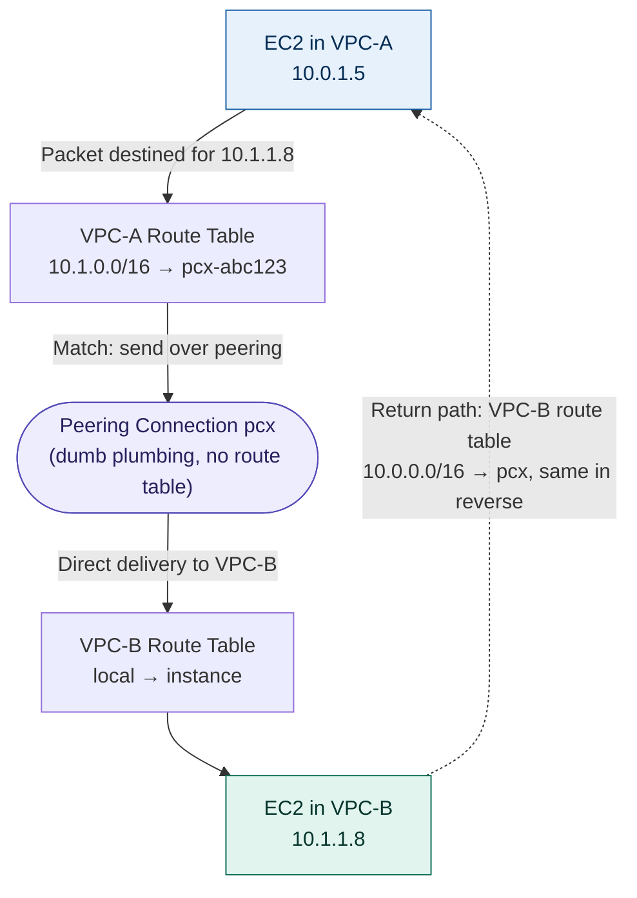
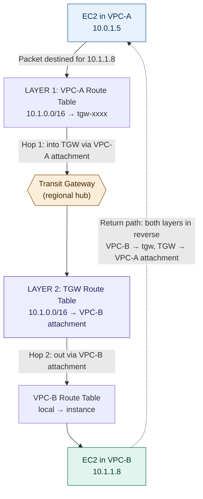

# VPC Peering vs Transit Gateway — Feynman Notes

## 1. The Simple Idea (Explain it like I'm 12)

Imagine each **VPC is a house** in a neighbourhood. Each house has its own address range (CIDR block), its own rooms (subnets), and its own people (resources like EC2, RDS).

Sometimes, **houses need to talk to each other**. Maybe House A has the database, House B has the app server, and House C is for analytics.

You have two ways to connect them:

### 🚪 Way 1: VPC Peering — Build a Door Between Two Houses
You build a **direct door** from House A to House B. Just those two. If House C also needs to talk to both, you build *another* door from A to C, *and* another from B to C. Soon you've got doors everywhere — a tangled mess.

### 🚉 Way 2: Transit Gateway — Build a Central Train Station
Instead of doors between every pair of houses, you build **one central train station** in the middle. Every house just connects to the station once. Now any house can talk to any other house through the station. Clean, scalable, one connection per house.

---

## 2. Why Do We Need These?

By default, **VPCs are completely isolated**. An EC2 in VPC-A literally cannot ping an EC2 in VPC-B — they're separate networks.

But real-world architectures need connectivity:
- Dev VPC needs to access shared services VPC
- Application VPC needs to reach database VPC
- Multiple business units each have their own VPC but share central logging/security tools
- Different AWS accounts in an organisation need cross-account communication

So we need a way to **wire VPCs together** safely.

---

## 3. VPC Peering — The Direct Door

### What it is
A **point-to-point** private connection between **exactly two VPCs**. Traffic flows over AWS's private network — never the internet.

### Key facts
- ✅ **Free** for data transfer within the same Availability Zone (you pay only cross-AZ data transfer)
- ✅ Works **across regions** (Inter-Region Peering) and **across AWS accounts**
- ✅ Low latency — direct path, no intermediate hop
- ✅ Encrypted automatically (within and across regions)
- ❌ **No transitive routing** — this is the big limitation!
- ❌ VPC CIDR blocks must **not overlap**
- ❌ Each peering connection requires manual **route table updates** in both VPCs
- ❌ **Strictly one-to-one (unicast only)** — a peering connection links exactly two VPCs. No broadcast or multicast across it (sending one packet to many destinations at once). TGW supports multicast; peering does not.
- ⚠️ **Cross-region works, but at a cost** — Inter-Region Peering is supported, but it adds latency and incurs cross-region data-transfer charges. Within a region, the direct path is lowest-latency.

### What is "No Transitive Routing"?

This is the most important VPC Peering concept to remember.

**Scenario:** VPC-A is peered with VPC-B. VPC-B is peered with VPC-C. Can VPC-A talk to VPC-C through B?

**Answer: NO.** ❌

Even though B is connected to both A and C, traffic from A *cannot* hop through B to reach C. AWS doesn't allow it.

**Analogy:** Just because your house has a door to your neighbour's, and your neighbour has a door to *their* neighbour, doesn't mean you can walk through both. The neighbour says "this door is between us only — you can't use it as a hallway."

To make A talk to C, you must create a **direct peering between A and C**.

### Quick clarification: Unicast vs Multicast (don't confuse this with CIDRs)

- **Unicast** = one sender → one receiver (one packet per destination). This is all peering does.
- **Multicast** = one sender → *many* receivers with a *single* send. Useful for real-time streaming or distributed cache updates where you want to hit many instances at once.
- This is **not** about IP address reuse across regions — it's purely a traffic pattern. Peering can't do multicast; TGW (with its multicast feature) can.

### The Mesh Problem

If you have **4 VPCs** all needing to talk to each other:
- Connections needed: 4 × 3 ÷ 2 = **6 peerings**

For **10 VPCs**:
- Connections needed: 10 × 9 ÷ 2 = **45 peerings** 😱

This is called the **full mesh problem** — it scales horribly.

### Use VPC Peering when:
- You only have 2-3 VPCs that need to talk
- You want the simplest, cheapest option
- You need lowest latency (direct path)
- Connectivity needs are stable and won't grow

### 🔑 Peering Routing — Only ONE Layer

Unlike TGW, peering has **only one layer of routing** — the VPC route tables themselves. The peering connection (`pcx-xxxx`) is **dumb plumbing** with no route table of its own.

**Required routes for VPC-A ↔ VPC-B peering:**

**VPC-A's route table:**
| Destination | Target |
|---|---|
| 10.0.0.0/16 (own CIDR) | local |
| 10.1.0.0/16 (VPC-B's CIDR) | pcx-abc123 |

**VPC-B's route table:**
| Destination | Target |
|---|---|
| 10.1.0.0/16 (own CIDR) | local |
| 10.0.0.0/16 (VPC-A's CIDR) | pcx-abc123 |

That's it. No second layer. The peering connection just delivers packets between the two specific VPCs — it can't make routing decisions of its own. This is **why peering can't do transitive routing**: there's no intelligent router in the middle.

---

## 4. Transit Gateway — The Central Station

### What it is
A **regional network hub** that lets you connect **thousands of VPCs and on-premises networks** through a single gateway. Each VPC attaches to the Transit Gateway once, and it can talk to everything else attached to it.

### Key facts
- ✅ Connects **up to 5,000 VPCs** per Transit Gateway (with limit increase)
- ✅ **Transitive routing supported** — VPC-A can talk to VPC-C through the gateway
- ✅ Connects **VPCs + VPN + Direct Connect + other Transit Gateways**
- ✅ Cross-account sharing via AWS Resource Access Manager (RAM)
- ✅ **Route tables** within TGW let you control which attachments can talk to which
- ✅ Inter-region peering between Transit Gateways
- ❌ **Costs money** — hourly charge per attachment + data processing per GB
- ❌ Slight latency overhead (extra hop)

### How it works (Plain English)

1. Create a Transit Gateway in your region (it's a **regional resource**).
2. **Attach** each VPC to it. An attachment is like plugging a cable into the hub.
3. The Transit Gateway has its **own route tables** (at the regional level) that decide which attachment can reach which other attachment.
4. Each VPC's route table sends traffic destined for other VPC CIDRs **to the Transit Gateway**.
5. TGW handles the rest — routes traffic between attachments based on its own route tables.

### 🔑 The Two-Layer Routing Model (Critical Concept)

Transit Gateway uses **TWO independent layers of routing**. Both must be configured correctly for traffic to flow.

**Scenario:** EC2 in VPC-A wants to reach EC2 in VPC-B.

```
EC2 in VPC-A (10.0.1.5)
    │
    │  Wants to reach 10.1.2.8 in VPC-B
    ▼
┌─────────────────────────────────────────┐
│ LAYER 1: VPC-A's Subnet Route Table     │
│   Entry: "10.1.0.0/16 → tgw-xxxx"        │
│   Decision: Send to Transit Gateway      │
└─────────────────────────────────────────┘
    │
    ▼
┌─────────────────────────────────────────┐
│ LAYER 2: Transit Gateway Route Table     │
│   (regional, lives inside TGW)           │
│   Entry: "10.1.0.0/16 → VPC-B attachment"│
│   Decision: Forward to VPC-B attachment  │
└─────────────────────────────────────────┘
    │
    ▼
VPC-B receives packet → delivers to EC2 (10.1.2.8)
```

**What lives where:**

| Layer | Where it lives | What it does | Who configures it |
|---|---|---|---|
| **Layer 1** | VPC-A's subnet route table | "Hand off traffic for VPC-B's CIDR to TGW" | You (manually or via IaC) |
| **Layer 2** | TGW's own route table (regional) | "Forward VPC-B's CIDR to VPC-B attachment" | Auto-populated via propagation, or you add static routes |

**Both layers must agree** — break either one and traffic fails:
- ❌ Missing Layer 1 → Traffic never leaves VPC-A
- ❌ Missing Layer 2 → Traffic reaches TGW but gets dropped (blackholed)

**Return path (VPC-B → VPC-A):** The same two layers must exist in reverse — VPC-B's route table needs `VPC-A CIDR → tgw-xxxx`, and TGW's route table needs `VPC-A CIDR → VPC-A attachment`. Traffic is bidirectional, so both directions need to be wired up.

### How TGW Route Table Entries Get Populated

There are two ways routes appear in a TGW route table:

1. **Propagated routes (automatic)** — When you enable propagation for an attachment, the attachment's VPC CIDR is automatically advertised into the TGW route table. Dynamic and easy.

2. **Static routes (manual)** — You explicitly add them. Useful for overriding behaviour, blackholing CIDRs, or routing to specific attachments (like VPN).

### Associations vs Propagations (Often Confused)

Each attachment has two relationships with TGW route tables:

- **Association** (1 per attachment): Determines **which TGW route table is used** when traffic *enters* the TGW from this attachment.
- **Propagation** (can be many): Determines **which TGW route tables this attachment's CIDR is advertised into** — i.e., who can *reach* this attachment.

**Analogy:** Association = "which phone book do I use to look up numbers?" Propagation = "which phone books list MY number?"

### TGW Does NOT Use Security Groups

Transit Gateway is a Layer 3 router — it cares about IPs and routes, **not** stateful filtering.

- ❌ TGW itself has **no security groups**
- ✅ Security groups still apply at **source and destination ENIs** (EC2, RDS, etc.)
- ❌ You **cannot reference security groups across VPCs** when using TGW (unlike same-region peering, which allows this) — must use CIDR-based rules instead
- ✅ NACLs still apply at the subnet level on both sides

### Powerful Features

- **Segmentation:** Use multiple TGW route tables to isolate groups. E.g., Dev VPCs can talk to each other but not to Prod VPCs.
- **Centralised connectivity:** Connect on-prem (via VPN or Direct Connect Gateway) once to TGW, and all VPCs get on-prem access automatically.
- **Cross-region:** Peer Transit Gateways across regions for global networks.
- **Sharing:** Share TGW across AWS accounts using AWS RAM.

### Use Transit Gateway when:
- You have **many VPCs** (5+) needing interconnection
- You need **transitive routing**
- You want **centralised on-prem connectivity** for all VPCs
- You need **network segmentation** between groups of VPCs
- You're building a **hub-and-spoke architecture**
- You're working in a **multi-account AWS Organisation**

---

## 4.5. End-to-End Packet Flow (Mermaid Diagrams)

These trace a single packet from a source EC2 instance all the way to the destination instance, for both models. The key visual difference: **peering is one direct hop; TGW always passes through the central hub and consults its own route table.**

### VPC Peering — Direct Hop

The packet leaves the source, the VPC route table matches the peering route (`pcx`), and it's delivered directly. No intermediary makes a routing decision.



**One layer of routing.** Only the VPC route tables decide anything. The `pcx` connection just delivers — which is exactly why peering can't do transitive routing.

### Transit Gateway — Two Hops Through the Hub

The packet makes **two hops**: into the TGW via the source attachment, then out via the destination attachment. The TGW's own route table (Layer 2) makes the forwarding decision in the middle.



**Two layers of routing.** Break either layer and traffic fails — missing Layer 1 means the packet never leaves VPC-A; missing Layer 2 means it reaches the TGW and gets blackholed. The middle route table is precisely what makes TGW transitive: it can forward between *any* two attachments, whereas peering has no such table.

---

| Feature | VPC Peering | Transit Gateway |
|---|---|---|
| **Connection model** | Point-to-point (mesh) | Hub-and-spoke |
| **Transitive routing** | ❌ No | ✅ Yes |
| **Max connections** | 125 peerings per VPC | 5,000 VPC attachments |
| **Cost** | Free (only data transfer) | Hourly + data processing |
| **Latency** | Lowest (direct) | Slight overhead (extra hop) |
| **Cross-region** | ✅ Yes (Inter-Region Peering) | ✅ Yes (TGW Peering) |
| **Cross-account** | ✅ Yes | ✅ Yes (via AWS RAM) |
| **On-prem connectivity** | ❌ Not directly | ✅ Yes (VPN + DX) |
| **Route management** | Manual per VPC | Centralised TGW route tables |
| **CIDR overlap allowed?** | ❌ No | ❌ No |
| **Best for** | 2-3 VPCs | Many VPCs, complex networks |

---

## 6. The Mesh Problem Visualised

### 4 VPCs with Peering (6 connections needed):
```
   VPC-A ──── VPC-B
     │  ╲    ╱  │
     │   ╲  ╱   │
     │    ╳     │
     │   ╱  ╲   │
     │  ╱    ╲  │
   VPC-C ──── VPC-D
```

### 4 VPCs with Transit Gateway (4 connections):
```
   VPC-A         VPC-B
       ╲         ╱
        ╲       ╱
         ╲     ╱
        ┌─TGW─┐
         ╱     ╲
        ╱       ╲
       ╱         ╲
   VPC-C         VPC-D
```

Much cleaner. ✨

---

## 7. The Decision Tree

```
How many VPCs do you need to connect?
│
├── 2 (just two) ──> VPC Peering
│
├── 3-4 (small scale) ──> VPC Peering if stable
│                         Transit Gateway if you'll grow
│
└── 5+ or growing ─────> Transit Gateway

Do you need transitive routing?
│
├── YES ──> Transit Gateway (peering can't do it)
└── NO ───> Either works

Do you need on-prem + multi-VPC connectivity?
│
├── YES ──> Transit Gateway (centralised hub)
└── NO ───> VPC Peering is fine
```

---

## 8. Real-World Scenarios

**Scenario A:** *Startup has a Production VPC and a Shared Services VPC. That's it.*
→ **VPC Peering** — simple, free, low-latency.

**Scenario B:** *Enterprise with 20 VPCs across multiple accounts, needs on-prem connectivity.*
→ **Transit Gateway** — peering would need 190 connections, TGW needs 20.

**Scenario C:** *Dev, Staging, Prod VPCs need isolation — Dev should NOT reach Prod.*
→ **Transit Gateway with multiple route tables** for segmentation.

**Scenario D:** *Two VPCs in different regions need to talk privately.*
→ **Inter-Region VPC Peering** (or TGW peering if more complex).

**Scenario E:** *Company merges and inherits a network with 50 VPCs already peered in a mesh.*
→ **Migrate to Transit Gateway** to simplify.

**Scenario F:** *Single VPC in AWS connecting to corporate data centre, no other VPCs.*
→ Neither — just use **Site-to-Site VPN** or **Direct Connect** to the VPC directly.

---

## 9. Common Misconceptions to Avoid

- ❌ "VPC Peering allows transitive routing." → **No.** This is the #1 mistake. A↔B and B↔C does NOT give you A↔C.
- ❌ "Transit Gateway works across regions automatically." → **No.** You must explicitly peer Transit Gateways across regions.
- ❌ "Peered VPCs can have overlapping CIDRs." → **No.** CIDRs must not overlap — same rule applies to TGW.
- ❌ "Transit Gateway is always better." → **No.** For 2 VPCs, peering is cheaper and faster.
- ❌ "VPC Peering goes over the internet." → **No.** Both options use AWS's private backbone. Neither touches the internet.
- ❌ "Security groups work across peering automatically." → **Partially.** You *can* reference SGs across peering, but only same-region; cross-region requires CIDR-based rules.

---

## 10. The One-Sentence Summary (Feynman Test)

> **VPC Peering builds private one-to-one connections between two VPCs (great for small setups, but no transitive routing and gets messy at scale), while Transit Gateway is a central regional hub that connects many VPCs and on-premises networks together with proper routing — costs money, but scales beautifully.**

---

## 11. Quick Self-Quiz

1. Can you have transitive routing with VPC Peering? *(No)*
2. What's the maximum number of VPCs a single Transit Gateway can connect? *(5,000 with limit increase)*
3. Is VPC Peering free? *(Mostly — you only pay for cross-AZ or cross-region data transfer)*
4. Which option is better for connecting 20+ VPCs? *(Transit Gateway)*
5. Can VPC Peering connect across regions? *(Yes, via Inter-Region Peering)*
6. Can VPC Peering connect to on-premises networks? *(No — that's what VPN/Direct Connect is for)*
7. Can Transit Gateway segment traffic between groups of VPCs? *(Yes, using multiple TGW route tables)*
8. If you have 6 VPCs all needing to talk to each other via peering, how many peering connections do you need? *(15: 6 × 5 ÷ 2)*
9. Which is the regional network hub: peering or TGW? *(Transit Gateway)*
10. Do both peering and TGW require non-overlapping CIDRs? *(Yes, both do)*
11. How many routing layers does TGW use? *(Two — VPC route table + TGW route table)*
12. How many routing layers does VPC Peering use? *(One — only the VPC route tables; the peering connection itself has no routing logic)*
13. If VPC-A's route table points to TGW correctly, but TGW's route table has no entry for VPC-B, what happens? *(Traffic reaches TGW but is dropped — blackholed)*
14. What's the difference between TGW route table "association" and "propagation"? *(Association = which TGW route table is used when traffic enters from this attachment; Propagation = which TGW route tables this attachment's CIDR gets advertised into)*
15. Does Transit Gateway have security groups? *(No — TGW is a Layer 3 router; security groups still apply at source/destination ENIs)*
16. Can VPC Peering carry multicast traffic? *(No — peering is unicast only, one-to-one. TGW supports multicast.)*
17. How many hops does a packet take in peering vs TGW? *(Peering = one direct hop; TGW = two hops, into the hub then out via the destination attachment)*
18. Does cross-region peering cost the same as same-region? *(No — inter-region peering adds latency and incurs cross-region data-transfer charges)*

---

## 12. Memory Tricks

- **Peering** = **P**air = only two VPCs at a time, like a **P**rivate door between two houses
- **Transit Gateway** = **T**rain station = central hub where many lines (VPCs) meet and **T**ransit through
- Peering = **P**oint-to-point
- TGW = **T**ree-to-trunk (hub-and-spoke)

---

## 13. Bonus: When to Use Other Options

Sometimes neither is right:

- **AWS PrivateLink / VPC Endpoint Services** — When you want to expose just *one specific service* (not full network connectivity) to other VPCs. Used by SaaS providers.
- **VPC Sharing** — When multiple accounts in an organisation should share *one* VPC (subnets owned by different accounts).
- **VPN Gateway / Direct Connect** — For on-prem to single VPC connectivity (without TGW).
- **AWS Cloud WAN** — Newer service for managing global wide-area networks across regions. Even higher-level abstraction than TGW.

So the broader question is always: "Do I need full network connectivity, or just service-level access?" If service-level, use PrivateLink. If full network, choose between Peering and TGW based on scale.
