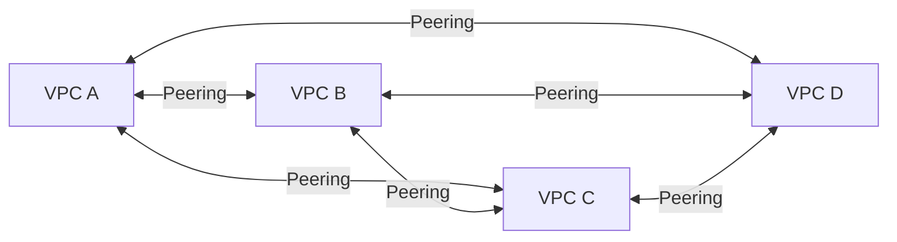
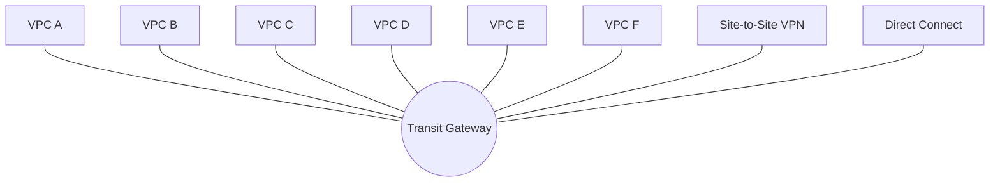
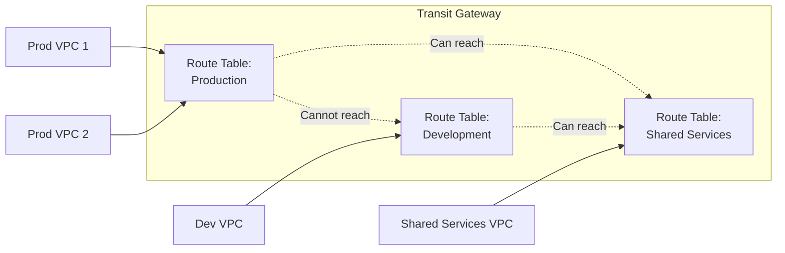
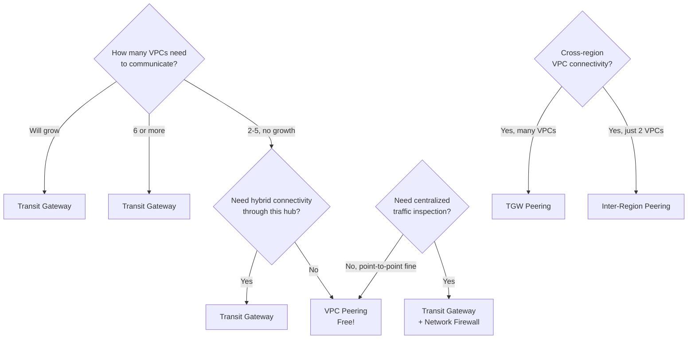

# VPC Peering vs Transit Gateway

> 🔥 **The #1 connectivity-architecture exam topic.** Every multi-VPC scenario question will test whether you choose Peering or TGW.

## Problem It Solves
Modern AWS deployments have many VPCs — per account, per environment, per workload. Without a way to connect them, you have data silos. The challenge: pick the right connectivity model. Wrong choice = either cost waste or massive operational burden.

## How It Works

### Option 1 — VPC Peering



**Pairwise connections.** N VPCs need N×(N-1)/2 peering connections. Doesn't scale.

### Option 2 — Transit Gateway



**Hub-and-spoke.** Every VPC attaches to TGW once. TGW routes between them.

### Side-by-Side Comparison

| | **VPC Peering** | **Transit Gateway** |
|---|---|---|
| Topology | Pairwise mesh | Hub-and-spoke |
| Transitive routing | ❌ No (A↔B, B↔C ≠ A↔C) | ✅ Yes |
| Max connections | 125 peerings per VPC | 5,000 attachments per TGW |
| Cross-region | ✅ Inter-region peering | ✅ TGW peering across regions |
| Cross-account | ✅ Via accept/decline | ✅ Via RAM share |
| Hybrid (VPN, DX) | ❌ Not supported | ✅ Attach VPN & DX |
| Pricing | **FREE** + data transfer | $0.05/hr per attachment + $0.02/GB |
| Latency | Lower (direct) | Slightly higher (extra hop) |
| Bandwidth | Up to instance limits | Up to 50 Gbps per attachment |
| Multicast | ❌ | ✅ |
| Best for | 2-5 VPCs, simple needs | Many VPCs, hybrid, central management |

### The Transitive Routing Trap

```
VPC PEERING — NOT TRANSITIVE ❌
─────────────────────────────────────────────

  VPC A ─────────── VPC B
  (10.0.0.0/16)    (10.1.0.0/16)
                       │
                       │ Peered
                       │
                   VPC C
                   (10.2.0.0/16)

  Question: Can VPC A talk to VPC C?
  Answer: NO ❌
  
  Even though A↔B and B↔C are peered,
  A cannot route to C via B.
  
  You need: A↔C direct peering too.


TRANSIT GATEWAY — TRANSITIVE BY DESIGN ✅
─────────────────────────────────────────────

  VPC A ──┐
          │
  VPC B ──┼── TGW
          │
  VPC C ──┘
  
  A → C? Just configure TGW route table.
  Done. Transitive. ✅
```

### Cost Reality Check

```
3 VPCs scenario:
─────────────────────────────────────
VPC Peering:    3 connections × $0      = $0
TGW:            3 attachments × $0.05/hr = $108/month

VPC Peering wins ✅


10 VPCs scenario:
─────────────────────────────────────
VPC Peering:    45 connections (manual config nightmare)
TGW:            10 attachments × $0.05/hr = $360/month

TGW wins on operations + scaling ✅


50 VPCs + 3 VPNs + 1 DX:
─────────────────────────────────────
VPC Peering:    Impractical (1225+ peerings)
TGW:            54 attachments + hybrid support

TGW only viable choice ✅
```

### Transit Gateway Route Tables

A killer TGW feature — segmentation via route tables:



You can isolate Prod from Dev while both reach Shared Services — all in one TGW.

## When to Use Which



### Use VPC Peering When:
- Only 2-5 VPCs that need to talk
- Cost-sensitive (Peering is free)
- No need for hybrid connectivity through the hub
- Communication is point-to-point only
- Simple, won't grow much

### Use Transit Gateway When:
- 6+ VPCs (operational complexity argument)
- Need to attach VPN or Direct Connect
- Want segmentation between groups of VPCs
- Multiple accounts sharing networking (RAM)
- Want to inspect East-West traffic centrally
- Growing fast

## When NOT to Use

- ❌ Don't use Peering if **overlapping CIDRs** (impossible — must be unique)
- ❌ Don't peer **edge-to-edge** (e.g. don't route VPN traffic from VPC A to VPC B via Peering — not supported)
- ❌ Don't use TGW for 2 VPCs that will never grow — overpay for nothing
- ❌ Don't forget to update **route tables** on both sides — peering is bidirectional but routes are not auto-added

## Trade-offs

| Choice | Gain | Sacrifice |
|---|---|---|
| VPC Peering | Free, lower latency, direct | Doesn't scale, no transitive routing |
| Transit Gateway | Scales, transitive, hybrid | Cost per hour + per GB |
| Inter-Region Peering | Cheap cross-region for 2 VPCs | Doesn't scale beyond a few |
| TGW Peering | Scale cross-region hub | More expensive than direct VPC peering |

## Real World Example

**Slack's** evolution:
1. **2015** — Few VPCs, used VPC Peering. Worked fine.
2. **2018** — 30+ VPCs, peering matrix was hell. Engineers spent weeks debugging route tables.
3. **2019** — Migrated to **Transit Gateway** as soon as it launched. Hub-and-spoke architecture. Each new VPC = one attachment to TGW.
4. **2021** — Multi-account expansion. TGW shared via **RAM** so workload accounts attach into central network team's TGW.
5. **2023** — Cross-region active-active via **TGW Peering** between us-east-1 and us-west-2 TGWs.

## 🎯 Exam Soundbite

> "Use VPC Peering for a small, fixed number of VPCs with simple point-to-point needs — it's free and direct. Use Transit Gateway when you have many VPCs, need transitive routing, want to incorporate hybrid connectivity via VPN or Direct Connect, or need centralized network segmentation across accounts shared via AWS Resource Access Manager."

---

## ⚡ Quick Recall Card

```
┌────────────────────────────────────────────────────┐
│ PEERING vs TRANSIT GATEWAY                          │
├────────────────────────────────────────────────────┤
│ # VPCs                Peering ≤5, TGW >5            │
│ Transitive routing    Peering NO, TGW YES           │
│ Cost                  Peering FREE, TGW $0.05/hr/att│
│ Hybrid (VPN/DX)       Peering NO, TGW YES           │
│ Segmentation          Peering NO, TGW route tables  │
│ Cross-account sharing Peering accept, TGW via RAM   │
│ Cross-region          Peering yes (1-1), TGW peering│
│ Overlapping CIDR      Both NO                       │
└────────────────────────────────────────────────────┘
```

## 🎓 Common Exam Pattern

> **"Company has 30+ VPCs across 5 accounts + 2 on-prem data centers via VPN. They want centralized routing and the ability to inspect inter-VPC traffic. What's the best solution?"**
>
> ✅ **Transit Gateway** shared across accounts via **RAM**, with both VPNs attached, optionally with traffic mirroring or Network Firewall in the inspection VPC.
