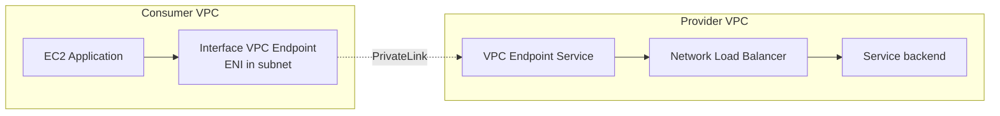
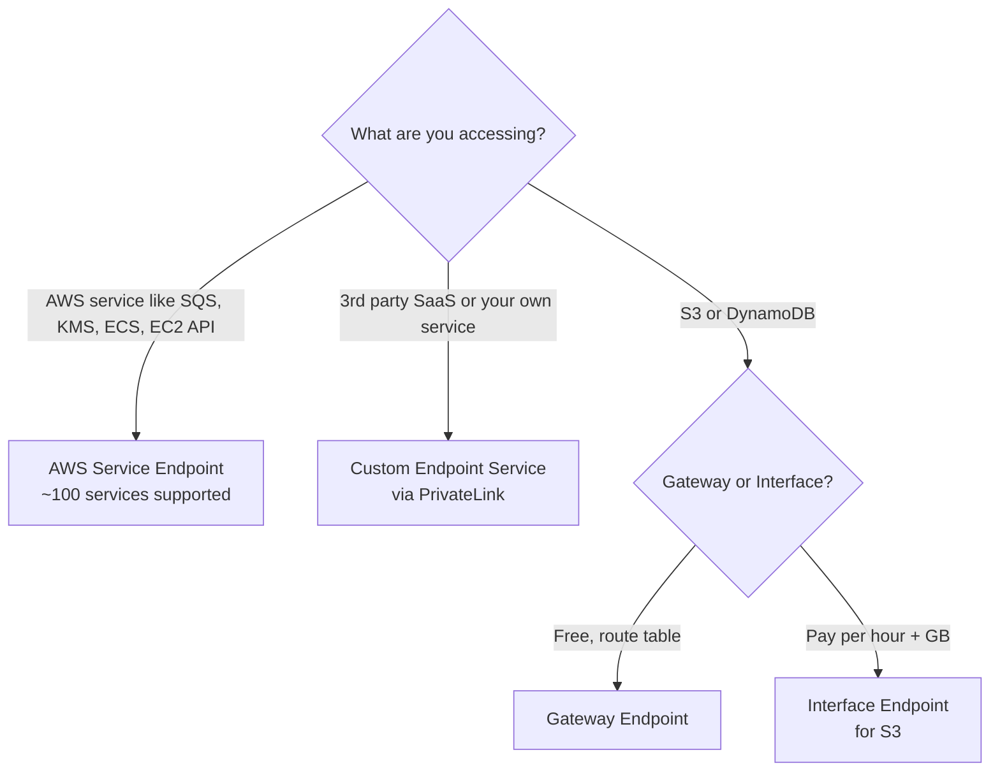
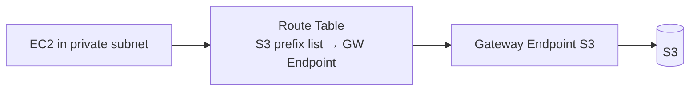
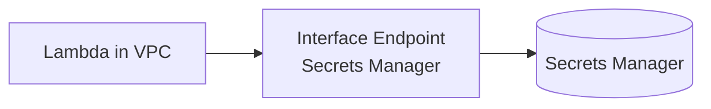
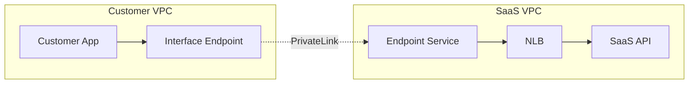
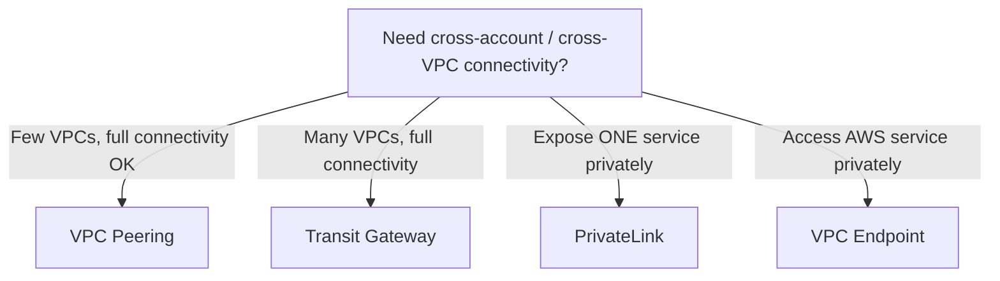

# AWS PrivateLink — Exposing Services Privately

> 🔥 **Recurring SAP-C02 scenario.** Know the patterns for exposing services across accounts/VPCs.

## Problem It Solves
You need to expose a service (your own or AWS's) to other VPCs WITHOUT:
- Going through the internet
- VPC peering with massive CIDR planning
- Worrying about overlapping CIDRs between consumer VPCs
- Bidirectional connectivity (you only want to ALLOW IN)

**PrivateLink creates a unidirectional, private endpoint to your service.**

## How It Works



```
KEY MECHANICS:
─────────────────────────────────────────────
1. PROVIDER creates an NLB in front of their service
2. PROVIDER creates a "VPC Endpoint Service" pointing to NLB
3. PROVIDER grants permission for specific consumer accounts
4. CONSUMER creates an "Interface Endpoint" in their VPC
5. Consumer connects to the endpoint's private DNS/IP
6. Traffic flows: Consumer ENI → PrivateLink → Provider NLB → Backend

NO PEERING REQUIRED.
NO OVERLAPPING CIDR CONCERN — they don't need to know each other's CIDRs.
UNIDIRECTIONAL — consumer can call provider, but provider can't call back.
```

---

## Three Types of Interface Endpoints



### Gateway Endpoint vs Interface Endpoint

| | **Gateway Endpoint** | **Interface Endpoint** |
|---|---|---|
| Services | S3, DynamoDB only | 100+ services (PrivateLink) |
| Mechanism | Route table entry | ENI in your subnet |
| IP | No IP — route prefix | Private IP in subnet |
| Cost | Free | $0.01/hr + $0.01/GB |
| DNS | Same as public service | Private DNS option |
| Cross-region | No | No |
| Cross-account | No | Yes |
| Use case | Most S3/DDB private access | Other AWS services, SaaS, custom |

---

## Real World Scenarios

### Scenario 1: Private S3 Access from VPC



```
Why use Gateway Endpoint for S3?
─────────────────────────────────────────────
✅ FREE — no per-hour or per-GB cost
✅ Removes need for NAT (cost savings!)
✅ Traffic stays inside AWS
✅ Same DNS endpoint works
✅ Same-region only
```

### Scenario 2: Private Access to Secrets Manager from VPC



```
Why use Interface Endpoint?
─────────────────────────────────────────────
✅ Secrets Manager NOT supported by Gateway Endpoint
✅ Avoid sending secret traffic over internet
✅ No NAT required from private subnet
✅ Lambda in VPC can fetch secrets privately
```

### Scenario 3: SaaS Vendor Exposing API to Customers



```
THE SAAS PATTERN:
─────────────────────────────────────────────
SaaS company: "We don't want our API to be public-internet exposed."

SAAS PROVIDER SIDE:
1. Build NLB in front of service
2. Create VPC Endpoint Service (publishes the NLB)
3. Grant whitelist: specific customer AWS accounts
4. Share Endpoint Service name with customers

CUSTOMER SIDE:
1. Create Interface Endpoint in their VPC
2. Point to the Endpoint Service name
3. Use the Interface Endpoint's DNS to call the API

✅ No internet exposure
✅ Both sides keep private CIDRs to themselves
✅ Bidirectional CIDR conflicts don't matter
✅ Pay only for endpoint hours + data
```

### Scenario 4: Sharing Internal Service Across Accounts

```
COMPANY HAS MULTI-ACCOUNT SETUP:
─────────────────────────────────────────────
Shared services account hosts:
- Centralized logging API
- Authentication service
- Internal monitoring

Each team account needs to call these services.

OPTIONS:
─────────────────────────────────────────────
A. VPC Peering → CIDR planning hell as accounts grow
B. Transit Gateway → Bidirectional, more open than needed
C. PrivateLink → ✅ Unidirectional, scales infinitely
```

---

## DNS Resolution with PrivateLink

```
PRIVATE DNS NAMES:
─────────────────────────────────────────────
By default, interface endpoints get an AWS-generated DNS:
  vpce-12345.kinesis.us-east-1.vpce.amazonaws.com

You can enable "Private DNS" so the standard DNS works:
  kinesis.us-east-1.amazonaws.com  ← resolves to private IP

✅ Apps work without code changes
⚠️ Requires VPC DNS Hostnames + DNS Resolution enabled
⚠️ Some services don't support Private DNS for some configs
```

---

## VPC Endpoint Policies

```
ATTACH POLICY TO ENDPOINT:
─────────────────────────────────────────────
Like an IAM policy for the endpoint itself
Controls WHAT can be done via this endpoint

EXAMPLE:
─────────────────────────────────────────────
Allow only s3:GetObject on specific buckets via this endpoint
Block all other S3 operations through here

USE:
─────────────────────────────────────────────
✅ Data exfiltration prevention
   (Even with valid IAM, can't go to "wrong" bucket)
✅ Compliance (specific orgs/buckets accessible)
```

---

## Endpoint Cost Considerations

```
GATEWAY ENDPOINT (S3, DDB):
─────────────────────────────────────────────
FREE — no cost at all
Always use it for VPC → S3/DDB

INTERFACE ENDPOINT:
─────────────────────────────────────────────
$0.01 per AZ per hour (varies by region)
$0.01 per GB processed (varies by region)

NAT GATEWAY (alternative):
─────────────────────────────────────────────
$0.045 per hour
$0.045 per GB processed

COMPARISON FOR 1 TB/month TO AWS SERVICES:
─────────────────────────────────────────────
Via NAT: $32 (hours) + $46 (data) = $78
Via Interface Endpoint: $14 (3 AZs × 24 × 30) + $10 (data) = $24

✅ Interface Endpoints are ~3x cheaper than NAT for AWS API traffic
```

---

## PrivateLink vs Other Options



### When to Choose PrivateLink

```
✅ Exposing a single service (not whole VPCs)
✅ Unidirectional access only
✅ Overlapping CIDRs between consumer and provider
✅ Many consumers (scales without peering complexity)
✅ Cross-account or 3rd-party service exposure
```

### When NOT to Choose PrivateLink

```
❌ Need bidirectional connectivity → use Peering or TGW
❌ Multiple services need accessing → maybe TGW simpler
❌ Layer 3 routing → PrivateLink is L4
❌ Latency-critical and provider is in different region → can't span regions
```

---

## When to Use What — Summary

| Need | Solution |
|---|---|
| Private S3 / DynamoDB from VPC | **Gateway Endpoint** (free) |
| Private SQS / Lambda / KMS from VPC | **Interface Endpoint** |
| Expose internal service across accounts | **PrivateLink Custom Service** |
| SaaS API without internet | **PrivateLink** |
| Many VPCs all need access to internal service | **PrivateLink** (scales better than peering) |
| Bidirectional traffic between 2 VPCs | **VPC Peering** |
| Hub-and-spoke for many VPCs | **Transit Gateway** |
| Cross-region service access | **Direct Connect** / inter-region peering (not PrivateLink) |

## Trade-offs

| Choice | Gain | Sacrifice |
|---|---|---|
| Gateway Endpoint (S3/DDB) | Free, simple | Only S3 / DDB, same region |
| Interface Endpoint | Wide service support, cross-account | Hourly + per-GB cost |
| PrivateLink Custom | Unidirectional, no CIDR concerns | NLB required as front-end |
| Endpoint Policy | Fine-grained control | Adds complexity |

## Real World Example

**A SaaS payment processor** (like Stripe-style):
- Customers don't want their payment data on internet
- **PrivateLink**: customers in their VPCs get an Interface Endpoint to the processor's API
- Processor exposes via NLB → VPC Endpoint Service
- Whitelist customer accounts on the Endpoint Service
- Customer pays per-hour + per-GB for their endpoint
- Processor pays NLB hours + transfer

**A regulated bank** (compliance-driven private connectivity):
- ALL access to AWS services goes through **Interface Endpoints**
- No NAT Gateway in the VPC
- Endpoint policies restrict to specific S3 buckets / KMS keys
- Direct Connect to on-prem with private VIF for hybrid traffic
- Result: zero internet traffic from VPCs

## 🎯 Exam Soundbite

> "PrivateLink exposes services privately within AWS without internet routing or VPC peering. Use Gateway Endpoints for free private access to S3 and DynamoDB, and Interface Endpoints powered by PrivateLink for the 100+ other AWS services and your own services. The custom Endpoint Service pattern lets SaaS providers expose APIs to customer VPCs without IP overlap concerns — providers create an NLB and Endpoint Service, customers create Interface Endpoints. Use VPC Endpoints to dramatically reduce NAT Gateway data processing costs."

---

## ⚡ Quick Recall Card

```
┌─────────────────────────────────────────────────┐
│ PRIVATELINK / VPC ENDPOINTS                      │
├─────────────────────────────────────────────────┤
│ Gateway Endpoint  S3 + DynamoDB only             │
│                   FREE, route table entry        │
│                   Same region only               │
│                                                  │
│ Interface Endpoint  100+ AWS services + custom   │
│                     $/hour + $/GB                │
│                     ENI in your subnet           │
│                     Cross-account supported      │
│                                                  │
│ Endpoint Service  Expose YOUR service            │
│                   Requires NLB as front          │
│                   Whitelist consumer accounts    │
├─────────────────────────────────────────────────┤
│ COST COMPARISON                                  │
│ NAT Gateway:       $0.045/hr + $0.045/GB         │
│ Interface Endpoint:$0.01/hr/AZ + $0.01/GB         │
│ Gateway Endpoint:  FREE                          │
└─────────────────────────────────────────────────┘
```

## 🎓 Common Exam Patterns

> **"Lambda in VPC needs to call DynamoDB. Currently going via NAT Gateway — expensive."**
>
> ✅ **Gateway VPC Endpoint for DynamoDB** — free, removes NAT data processing for DDB traffic.

> **"SaaS company wants to offer their API privately to customers without going through internet."**
>
> ✅ **PrivateLink Endpoint Service** — expose via NLB + VPC Endpoint Service. Customers create Interface Endpoints. No CIDR coordination needed.

> **"Compliance requires that traffic to KMS never traverses the internet."**
>
> ✅ **Interface Endpoint for KMS** in the VPC. KMS API calls stay inside AWS network.
