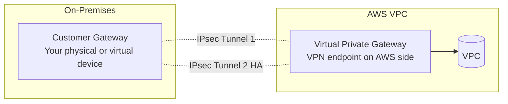
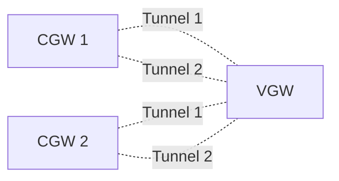
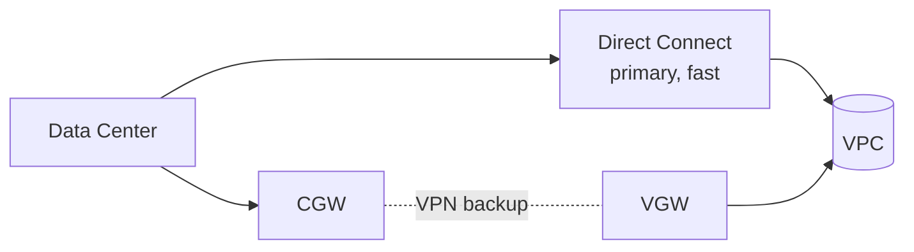
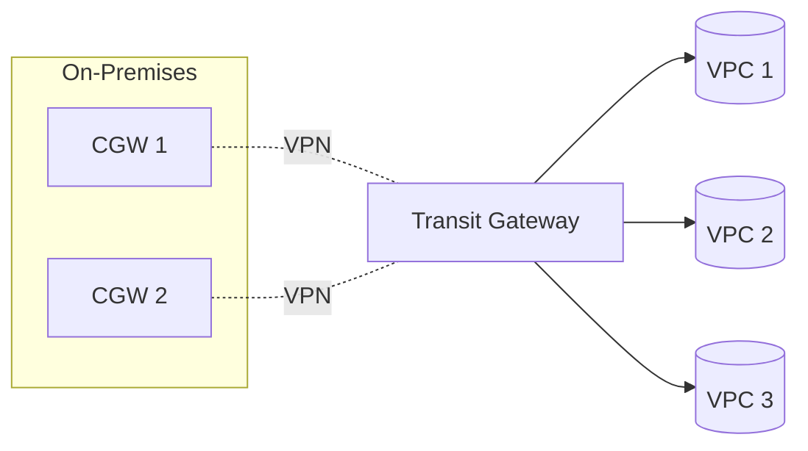
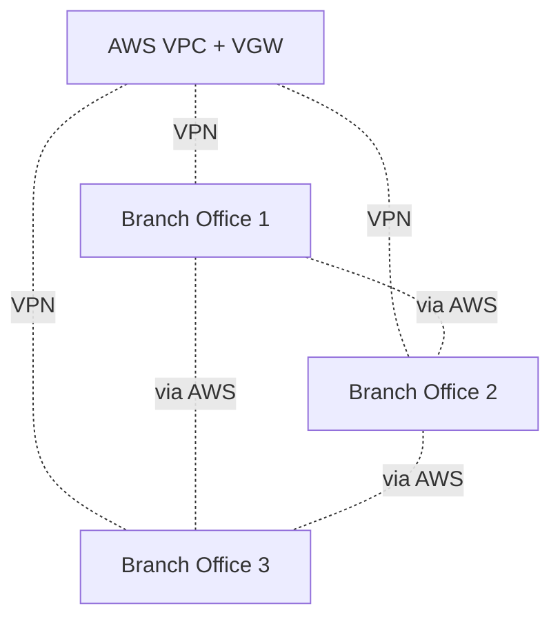

# Site-to-Site VPN

> 🔥 **Standard hybrid topic.** Know the HA pattern and when to combine with Direct Connect.

## Problem It Solves
Connect on-prem networks to AWS without expensive Direct Connect physical lines. Site-to-Site VPN provides IPsec encrypted tunnels over the public internet — fast to set up (minutes), good enough for many workloads.

## How It Works



### Key Components

```
CUSTOMER GATEWAY (CGW):
─────────────────────────────────────────────
- Your end of the VPN
- Can be: physical firewall, software VPN, AWS Transit Gateway
- Identified by public IP
- Configuration includes BGP ASN (if using dynamic routing)

VIRTUAL PRIVATE GATEWAY (VGW):
─────────────────────────────────────────────
- AWS end of the VPN
- Attached to a VPC
- One VPC can have one VGW

TWO TUNNELS PER VPN CONNECTION:
─────────────────────────────────────────────
- Each VPN Connection auto-creates 2 IPsec tunnels
- Use BOTH for HA (active-active or active-passive)
- Each terminates on different AWS endpoints
```

### Routing Options

```
STATIC ROUTING:
─────────────────────────────────────────────
✅ Simple — manually configure routes
✅ Good for small, stable networks
✅ Same on both sides

DYNAMIC ROUTING (BGP):
─────────────────────────────────────────────
✅ Routes advertised via BGP protocol
✅ Auto-failover on link failure
✅ Recommended for production
✅ Requires BGP-capable device

⚠️ EXAM SIGNAL:
"Need automatic failover" → BGP dynamic routing
```

---

## HA Patterns for VPN

### Pattern 1: Basic (Not Production)


```
ANALYSIS:
─────────────────────────────────────────────
✅ Two tunnels = AWS-side redundancy
❌ Single CGW = if your device fails, you lose VPN
```

### Pattern 2: Redundant Customer Gateways



```
ANALYSIS:
─────────────────────────────────────────────
✅ Two CGWs = on-prem redundancy
✅ Total 4 tunnels = AWS + customer-side HA
✅ Recommended production pattern
```

### Pattern 3: VPN + Direct Connect (Hybrid Best Practice)



```
ANALYSIS:
─────────────────────────────────────────────
✅ Direct Connect = primary, low latency
✅ VPN = backup if DX fails
✅ BGP advertises preferred routes
✅ Encryption: DX (with MACsec or VPN-over-DX) + VPN backup encrypted

BEST FOR:
─────────────────────────────────────────────
Production workloads needing both speed AND resilience
```

---

## VPN + Transit Gateway



```
VPN ATTACHED TO TGW:
─────────────────────────────────────────────
✅ Single VPN connects on-prem to ALL VPCs (via TGW)
✅ ECMP (Equal-Cost Multi-Path) — load balance across tunnels
✅ Up to 50 Gbps with multiple VPN attachments
✅ Much simpler than per-VPC VPNs

USE WHEN:
─────────────────────────────────────────────
✅ Multiple VPCs need on-prem access
✅ Want unified routing
✅ Scaling to many on-prem sites
```

---

## VPN Performance

```
BANDWIDTH:
─────────────────────────────────────────────
Per tunnel: Up to ~1.25 Gbps
Per VPN connection (2 tunnels): ~2.5 Gbps theoretical

LIMITATIONS:
─────────────────────────────────────────────
- Internet path = variable latency
- Public internet contention possible
- ECMP via TGW can scale: 50+ Gbps with multiple VPN attachments

VPN ACCELERATION:
─────────────────────────────────────────────
"Accelerated VPN" routes via AWS Global Accelerator
✅ Uses AWS backbone, not internet
✅ Better performance, more consistent
$ Extra cost
```

---

## VPN vs Direct Connect

| | **Site-to-Site VPN** | **Direct Connect** |
|---|---|---|
| Setup time | Minutes | Weeks-months |
| Bandwidth | Up to ~1.25 Gbps per tunnel | 1/10/100 Gbps |
| Latency | Variable (internet) | Predictable, low |
| Encryption | IPsec built-in | None (need MACsec or VPN over DX) |
| Cost | Cheap ($0.05/hr + data) | Expensive (port + cross-connect + data) |
| Reliability | Internet-dependent | High |
| Use case | Backup, small workloads, fast setup | Large, consistent workloads |

---

## AWS Client VPN — Remote Workers

```
DIFFERENT SERVICE — for INDIVIDUAL users, not sites:
─────────────────────────────────────────────
Remote employees connect their laptops to AWS VPC
Uses OpenVPN-based client
Authentication: AD, SAML, certificates

USE:
─────────────────────────────────────────────
✅ Replace traditional remote-access VPN
✅ WFH employees access internal resources in VPC
✅ Contractors getting temporary access

vs Site-to-Site:
─────────────────────────────────────────────
Site-to-Site: Network-to-network (LAN to VPC)
Client VPN:   User-to-network (laptop to VPC)
```

---

## VPN CloudHub Pattern (Legacy but Tested)



```
VPN CLOUDHUB:
─────────────────────────────────────────────
Multiple branch offices connect VPNs to same VGW
AWS acts as hub — branches can communicate through AWS
✅ Hub-and-spoke without dedicated infrastructure
✅ Cost-effective for small branch networks

MODERN ALTERNATIVE:
─────────────────────────────────────────────
Use Transit Gateway as the hub.
Each branch attaches via VPN to TGW.
More scalable and feature-rich.
```

---

## VPN Logging

```
VPN MONITORING:
─────────────────────────────────────────────
✅ CloudWatch metrics:
   - TunnelState (up/down)
   - TunnelDataIn / TunnelDataOut
✅ Alarms on tunnel state for proactive alerting

VPN LOGGING:
─────────────────────────────────────────────
✅ Send tunnel logs to CloudWatch Logs
✅ Debug connection issues
```

---

## When to Use Site-to-Site VPN

| Scenario | VPN OK? |
|---|---|
| Lab / Dev environment hybrid access | ✅ Yes — quick + cheap |
| Small office (< 100 users) to AWS | ✅ Yes |
| Backup for Direct Connect | ✅ Yes — common pattern |
| Production with bandwidth > 2 Gbps | ❌ Use DX |
| Strict, predictable latency | ❌ Use DX |
| Need to set up TODAY | ✅ VPN is the only option (DX takes weeks) |
| Mostly cloud-native, occasional on-prem | ✅ Yes |

## Trade-offs

| Choice | Gain | Sacrifice |
|---|---|---|
| VPN over DX | Fast setup, cheap, encrypted built-in | Variable performance |
| BGP over Static routing | Auto-failover | Requires BGP-capable device |
| VPN + TGW | Connect many VPCs | TGW costs |
| Accelerated VPN | Better performance | Extra cost |
| Two CGWs | On-prem HA | More complex setup |

## Real World Example

**A retail company with 50 stores:**
- **Site-to-Site VPN per store → Transit Gateway** in hub region
- Each store has 2 routers as redundant CGWs
- BGP for automatic failover
- All store VPNs attached to TGW
- TGW connects to centralized VPCs (analytics, security)
- **VPN CloudHub** pattern replaced by TGW

**A startup growing fast:**
- Initially: Single VPN, single CGW (acceptable for early stage)
- Grew: Added second CGW for redundancy
- Bigger: Added Direct Connect for primary path
- Now: DX primary + VPN backup, both via Transit Gateway

## 🎯 Exam Soundbite

> "Site-to-Site VPN provides IPsec encrypted tunnels from on-prem to AWS over the public internet, with each VPN Connection automatically creating two tunnels for AWS-side high availability. Use BGP for dynamic routing and automatic failover. For production, use redundant Customer Gateways and consider VPN as a backup to Direct Connect. Attach VPN to Transit Gateway to connect on-prem to many VPCs with a single VPN. Client VPN is a separate service for individual remote users connecting their laptops."

---

## ⚡ Quick Recall Card

```
┌─────────────────────────────────────────────────┐
│ SITE-TO-SITE VPN KEY FACTS                       │
├─────────────────────────────────────────────────┤
│ Customer Gateway (CGW) Your end of VPN           │
│ Virtual Priv Gateway   AWS end of VPN            │
│ Tunnels per connection 2 (HA)                    │
│ Per-tunnel bandwidth   ~1.25 Gbps                │
│ Routing                Static or BGP             │
│ BGP                    Auto-failover supported   │
│ TGW Attachment         Yes — connect many VPCs   │
│ Accelerated VPN        Via Global Accelerator $  │
│ vs Direct Connect      Cheap, fast setup,        │
│                        encrypted, less BW        │
├─────────────────────────────────────────────────┤
│ HA PATTERNS                                      │
│ Basic       Single CGW, 2 tunnels (AWS-side HA)  │
│ Better      2 CGWs, 4 total tunnels              │
│ Best        DX primary + VPN backup via BGP      │
└─────────────────────────────────────────────────┘
```

## 🎓 Common Exam Patterns

> **"Need encrypted on-prem to AWS connectivity with budget constraints, can set up in days."**
>
> ✅ **Site-to-Site VPN** with 2 tunnels and BGP routing.

> **"Direct Connect already in place but compliance now requires encryption."**
>
> ✅ **VPN over Direct Connect** (Public VIF) — DX provides bandwidth, VPN provides IPsec encryption. Or **MACsec** on Dedicated DX (10/100G).

> **"50 branch offices need connectivity to AWS and to each other."**
>
> ✅ Each branch creates **Site-to-Site VPN to Transit Gateway**. Branches communicate via TGW. Replaces complex mesh VPNs.
