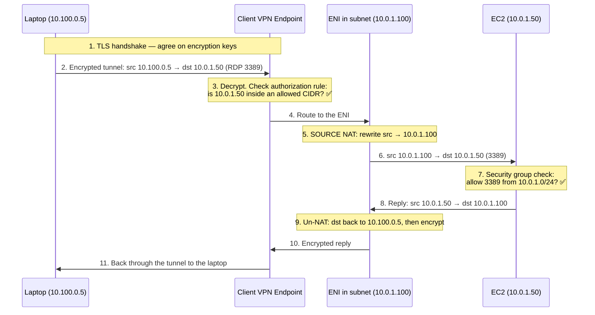
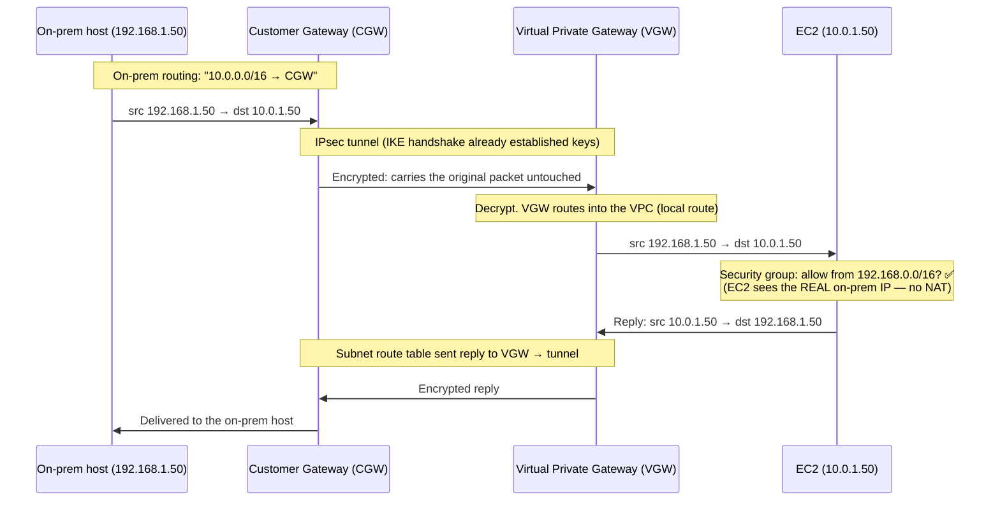
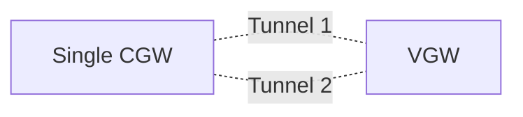
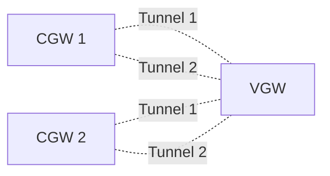
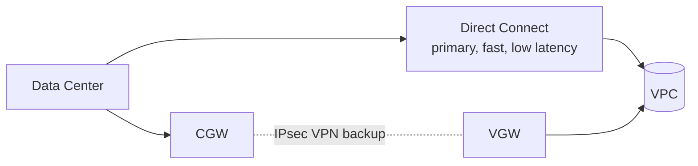
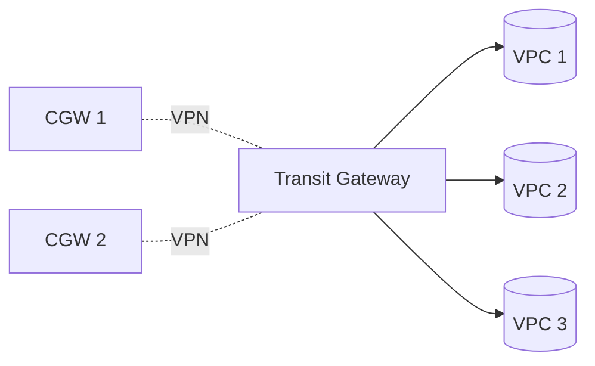

# AWS VPN Notes — Client-to-Site & Site-to-Site

> **Feynman style:** every concept explained from scratch, with analogies, before the jargon. If a sentence has a buzzword, the plain-English version comes first.

---

## 0. First, what even *is* a tunnel?

Imagine you want to send a private letter across a city, but the only delivery service is one where **every postman can read your postcard**. The public internet is exactly that — your packets travel through routers you don't own, and anyone on the path can in principle read them.

A **VPN tunnel** solves this with one simple trick: **put your packet inside another packet, and lock the inner one.**

```
Your real packet:   [ from: me  | to: the EC2 | "open RDP please" ]
                              ↓ wrap + encrypt (this is the "tunnel")
What travels online: [ from: my-router | to: AWS-gateway | <<encrypted blob>> ]
```

- The **inner packet** has the real source and destination (your laptop → the EC2).
- The **outer packet** just says "get this sealed blob from point A to point B."
- Anyone snooping the internet only sees the sealed blob. They can't read the letter inside.
- At the far end, the gateway **unwraps and decrypts**, revealing the original packet, and delivers it locally.

That wrap-encrypt-carry-unwrap pipe is the tunnel. The fancy word for "packet inside a packet" is **encapsulation**. That's the whole idea. Everything below is just *who* builds the tunnel and *how* they lock it.

There are two common locks:
- **TLS** — the same padlock your browser uses for `https://`. Easy, firewall-friendly. Used by **Client VPN**.
- **IPsec** — an older, lower-level, vendor-neutral lock that works at the raw IP layer. Used by **Site-to-Site VPN**.

---

# Part 1 — Client-to-Site VPN (laptop → VPC)

> One **person** connecting **one device** into AWS. "I'm working from home and need to RDP into a private EC2."

## 1.1 The mental model

Think of the Client VPN endpoint as a **receptionist desk that AWS runs at the edge of your VPC**. Your laptop calls the desk, proves who it is, and the desk hands you a visitor badge (an IP). From then on, the desk carries your messages *into* the building and back out.

The twist you must remember: when the receptionist walks your message inside, **they put their own return address on it**, not yours. (That's the source NAT — explained below. It's the #1 thing people get wrong.)

## 1.2 The pieces (and what each one is *for*)

```
Client CIDR  (e.g. 10.100.0.0/22)
─────────────────────────────────────────────
A pool of "visitor badge" IPs. When your laptop connects,
it gets one address from here (e.g. 10.100.0.5).
MUST NOT overlap with the VPC CIDR. They live in different worlds.

Client VPN Endpoint  (regional, AWS-managed)
─────────────────────────────────────────────
The receptionist desk. Holds: server certificate, auth method,
the client CIDR, the authorization rules, and its OWN route table.
It exists at the region level — not "inside" a subnet.

Subnet Association  →  creates an ENI
─────────────────────────────────────────────
You point the endpoint at a subnet. AWS then drops a network
card (ENI) INTO that subnet, with an IP from the subnet's CIDR
(e.g. 10.0.1.100). THIS is the endpoint's actual foot inside
your VPC. AWS creates and manages it — you never touch it.

Authorization Rule  (a whitelist, CIDR-only)
─────────────────────────────────────────────
"Are clients allowed to reach destination X?" Default = DENY ALL.
You add a rule: allow 10.0.0.0/16. It checks DESTINATION CIDR only.
It knows NOTHING about ports. (Ports are the security group's job.)

Endpoint Route Table  (the endpoint's own, not a subnet's)
─────────────────────────────────────────────
On association, a route to the VPC CIDR auto-appears. You only
add routes here manually for things OUTSIDE the VPC: internet,
peered VPCs, on-prem.

EC2 Security Group  (the fine-grained gate)
─────────────────────────────────────────────
Allow inbound TCP 3389 FROM the ASSOCIATED SUBNET's CIDR
(e.g. 10.0.1.0/24) — NOT the client CIDR. (Because of NAT. See below.)
```

## 1.3 The source-NAT detail (the part everyone misses)

When your packet finally leaves the ENI to reach the EC2, the endpoint **rewrites the source IP**:

```
Inside the tunnel:   src = 10.100.0.5   (your client badge IP)
After the ENI/NAT:   src = 10.0.1.100   (the ENI's IP, in the subnet)
Destination stays:   dst = 10.0.1.50    (the EC2)
```

So the **EC2 never sees your real client IP** — it sees the ENI's IP. This is **source NAT (SNAT)**, and AWS does it for you automatically as part of the endpoint. It's *like* a NAT gateway in concept (both swap the source address), but it's **built into the endpoint** — not a separate resource you create or pay for.

👉 **This is exactly why** the EC2 security group allows the **subnet CIDR**, not the client CIDR. By the time the packet arrives, the original `10.100.x.x` is gone.

> ⚠️ For **IPv6**, AWS does **not** apply NAT — the EC2 would see the real client IPv6. SNAT is an IPv4 behaviour.

## 1.4 End-to-end packet flow



Read it as a story: **handshake → tunnel in → authorization check → NAT at the ENI → security-group check → reply un-NATs and goes home.** Two gates must both say yes: the **authorization rule** (coarse, CIDR) and the **security group** (fine, port).

## 1.5 The two gates, side by side

| Gate | Lives at | Checks | Default |
|---|---|---|---|
| **Authorization rule** | Endpoint level | Destination **CIDR** only | **Deny all** — you must add allows |
| **Security group** | EC2 (the ENI's other end) | **Port + protocol** + source | Deny inbound until you allow |

If only one says yes, the connection still fails. Both must pass.

## 1.6 Setup checklist

- [ ] Create endpoint: client CIDR (no overlap), server cert in ACM, auth (cert / AD / SAML)
- [ ] Enable **split-tunnel** if you only want VPC traffic in the tunnel (else *all* your internet goes through AWS)
- [ ] **Associate a subnet** (one per AZ for HA) → ENIs appear automatically
- [ ] **Add an authorization rule** for the VPC CIDR `10.0.0.0/16` ← most-forgotten step
- [ ] EC2 **security group**: allow TCP 3389 from the **associated subnet CIDR**
- [ ] Download `.ovpn`, import into AWS VPN Client / OpenVPN, connect, RDP to the **private IP**

**Common "it connects but I can't reach anything":** missing authorization rule.
**Common "it times out at RDP":** security group not allowing the subnet CIDR on 3389.

---

# Part 2 — Site-to-Site VPN (network → VPC)

> A whole **network** talking to a whole **network**. "Our office/data-center LAN needs to reach our AWS VPC, permanently."

## 2.1 The mental model

Forget visitor badges. This is **two buildings connected by a private sealed pipe**. Your office has a door (the **Customer Gateway**), AWS has a door (the **Virtual Private Gateway**), and there's an armored pipe between them. Anything addressed to the other building just walks through the pipe with its **real return address intact** — nobody hands out badges, nobody rewrites addresses.

The big differences from Client VPN:
- The "client" isn't a laptop — it's your **entire on-prem network**.
- The lock is **IPsec**, not TLS.
- **No ENI, no source NAT.** Original IPs are preserved end to end.
- **No authorization rules.** Security comes from IPsec + routing. If the tunnel is up and routes exist, traffic flows.

## 2.2 The pieces

```
CUSTOMER GATEWAY (CGW)  — your end
─────────────────────────────────────────────
A physical firewall/router OR a software appliance in YOUR network.
You own and operate it. Identified by its public IP.
(Optionally a BGP ASN if you use dynamic routing.)

VIRTUAL PRIVATE GATEWAY (VGW)  — AWS end
─────────────────────────────────────────────
AWS-managed VPN concentrator, ATTACHED to one VPC (1 VGW per VPC).
Sits at the VPC boundary. (Or use a Transit Gateway instead to
serve MANY VPCs at once.)

TWO TUNNELS per VPN connection
─────────────────────────────────────────────
AWS auto-builds 2 IPsec tunnels to 2 different AWS endpoints.
Use BOTH for high availability (active/active or active/passive).

ROUTING — how each side learns where to send traffic
─────────────────────────────────────────────
Static : you type the routes by hand. Simple, small, stable nets.
BGP    : routers advertise routes to each other dynamically.
         → auto-failover. Use for production.
```

## 2.3 What you must wire up (the routing both ways)

This is the part people forget — the tunnel alone isn't enough; **both sides need routes**:

```
On-prem router table : "VPC CIDR 10.0.0.0/16  → send to CGW"
AWS subnet route table: "on-prem CIDR 192.168.0.0/16 → target = VGW"
EC2 security group    : allow traffic from on-prem CIDR (real IPs preserved!)
```

## 2.4 End-to-end packet flow (no NAT — note the preserved IPs)



Contrast with Client VPN: here the EC2 sees `192.168.1.50` — the **actual** source — because there's no ENI rewriting addresses. The gateways own their networks, so they just route.

## 2.5 High-availability patterns

**Basic (not production):** one CGW, two tunnels. AWS side is redundant, but if *your* single device dies, the VPN is gone.



**Better (production):** two CGWs → four tunnels total. Now both ends are redundant.



**Best (hybrid):** Direct Connect as the fast primary, VPN as the encrypted backup, BGP choosing the path.



## 2.6 Scaling to many VPCs / many sites — Transit Gateway

One VPN per VPC gets messy fast. **Transit Gateway (TGW)** is a central router: attach the VPN once to the TGW, and on-prem reaches *all* connected VPCs through it. Supports **ECMP** (spread load across tunnels) for higher throughput.



## 2.7 Performance & cost quick facts

```
Per tunnel bandwidth : ~1.25 Gbps   (2 tunnels ≈ 2.5 Gbps theoretical)
Latency              : variable (rides the public internet)
Accelerated VPN      : routes via AWS Global Accelerator backbone, $extra
Cost                 : cheap (~$0.05/hr + data) vs Direct Connect (expensive)
```

---

# Part 3 — The one-screen comparison

## 3.1 The tunnels themselves

| | **Client VPN tunnel** | **Site-to-Site tunnel** |
|---|---|---|
| Lock / protocol | **TLS** (OpenVPN-based) | **IPsec** (IKE key exchange) |
| Layer | Higher-level, app-friendly | Layer 3, raw IP |
| Firewall/NAT friendliness | Very (looks like HTTPS) | Needs IPsec ports open |
| Who speaks it | AWS VPN Client / OpenVPN on a laptop | Any vendor router (Cisco, Juniper, Fortinet…) |
| Built for | One user, connect from anywhere | Always-on link between two networks |

## 3.2 The services

| | **Client-to-Site (Client VPN)** | **Site-to-Site VPN** |
|---|---|---|
| Connects | **User → network** (laptop to VPC) | **Network → network** (LAN to VPC) |
| AWS-side thing | Client VPN **endpoint** + **ENI** in subnet | **VGW** (or TGW) at VPC edge |
| Your-side thing | VPN client software | **Customer Gateway** (router/firewall) |
| Gets an IP from | **Client CIDR** pool | n/a — keeps its own LAN IP |
| Source NAT? | **Yes** (IPv4) — EC2 sees the ENI IP | **No** — EC2 sees the real source IP |
| Access control | **Authorization rules** + security groups | **Routing** + security groups (no auth rules) |
| Security group source | The **associated subnet** CIDR | The **on-prem** CIDR |
| Typical use | WFH employee, contractor | Office/data-center hybrid, always-on |

**The single sentence that captures it:**
> Client VPN gives a *person* a temporary badge and rewrites their address at the door (NAT); Site-to-Site joins two *networks* with a sealed pipe and leaves every address untouched.

---

# Part 4 — Exam soundbites & recall

> **Client VPN:** "AWS Client VPN is a managed user-to-network VPN. Clients get an IP from the client CIDR, traffic is TLS-tunnelled to the endpoint, source-NATed to an ENI in the associated subnet, gated by authorization rules (CIDR) and the target's security group (port)."

> **Site-to-Site:** "Site-to-Site VPN provides IPsec tunnels from on-prem to AWS over the public internet. Each connection auto-creates **two tunnels** for AWS-side HA. Use **BGP** for dynamic routing and automatic failover. For production use **redundant Customer Gateways**, and consider VPN as a **backup to Direct Connect**. Attach to **Transit Gateway** to reach many VPCs with one VPN."

```
┌────────────────────────────────────────────────────────┐
│ DECISION TRIGGERS                                       │
├────────────────────────────────────────────────────────┤
│ Remote laptop into VPC ............... Client VPN       │
│ Whole office/LAN into VPC ............ Site-to-Site VPN │
│ Need auto-failover on the link ....... BGP dynamic      │
│ Many VPCs / many sites ............... VPN + TGW        │
│ Encryption + cheap + set up today .... Site-to-Site VPN │
│ Consistent low latency, big bandwidth  Direct Connect   │
│ DX exists but compliance needs crypto  VPN over DX /    │
│                                        MACsec           │
└────────────────────────────────────────────────────────┘
```

```
┌────────────────────────────────────────────────────────┐
│ "WHY IS IT BROKEN?" — CLIENT VPN                        │
├────────────────────────────────────────────────────────┤
│ Connects, reaches nothing ... missing authorization rule│
│ RDP times out ............... SG not allowing subnet    │
│                              CIDR on 3389               │
│ Won't connect ............... client CIDR overlaps VPC  │
│ Reaches private IP? ......... use PRIVATE IP, not public │
├────────────────────────────────────────────────────────┤
│ "WHY IS IT BROKEN?" — SITE-TO-SITE                      │
├────────────────────────────────────────────────────────┤
│ Tunnel UP, no traffic ....... missing route (one side)  │
│ One tunnel down ............. normal — use both (HA)    │
│ EC2 drops packets ........... SG must allow on-prem CIDR│
└────────────────────────────────────────────────────────┘
```
