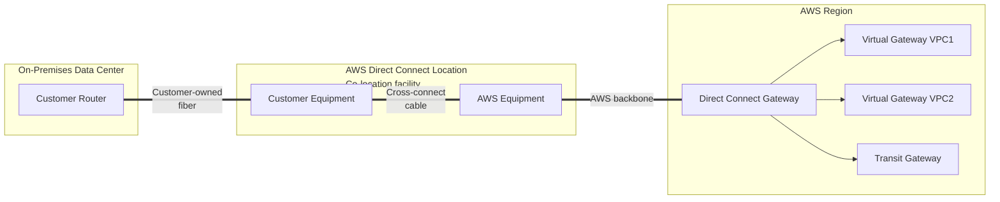
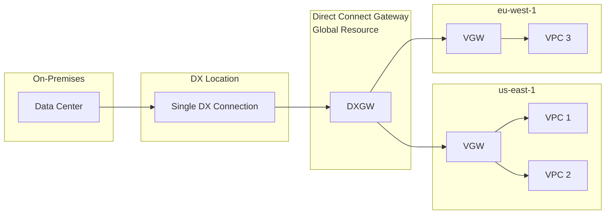

# AWS Direct Connect & Direct Connect Gateway

> 🔥 **Almost guaranteed exam questions on hybrid bandwidth, encryption, and HA designs.** Know DX + VPN backup pattern cold.

## Problem It Solves
Customers with large data volumes, latency-sensitive workloads, or compliance requirements can't use the public internet (or VPN over it) to connect their data center to AWS. They need a **dedicated, predictable, high-bandwidth, low-latency** private connection from their physical location to AWS.

## How It Works



### The Building Blocks

```
┌────────────────────────────────────────────────────────────┐
│ DIRECT CONNECT LOCATION                                     │
│   Physical colocation facility (Equinix, Coresite, etc.)   │
│   Where your network gear meets AWS network gear           │
│   "Cross-connect" = physical fiber cable between racks     │
├────────────────────────────────────────────────────────────┤
│ DEDICATED CONNECTION                                        │
│   1, 10, or 100 Gbps                                       │
│   You order directly from AWS                              │
│   Takes weeks/months to provision (physical port)          │
├────────────────────────────────────────────────────────────┤
│ HOSTED CONNECTION                                           │
│   From AWS Direct Connect Partner (Megaport, Equinix etc.) │
│   50 Mbps to 10 Gbps                                       │
│   Fast to provision (partner manages physical port)        │
├────────────────────────────────────────────────────────────┤
│ VIRTUAL INTERFACES (VIFs)                                  │
│   Private VIF  → Access VPC private resources              │
│   Public VIF   → Access AWS public services (S3 etc.)      │
│   Transit VIF  → Access Transit Gateway (multi-VPC)        │
├────────────────────────────────────────────────────────────┤
│ DIRECT CONNECT GATEWAY (DXGW)                              │
│   Connects DX to VPCs in any AWS region                    │
│   One DXGW can connect to many VGWs/TGWs across regions   │
│   No additional cost                                       │
└────────────────────────────────────────────────────────────┘
```

### Physical vs Logical — What's a Cable vs What's Config

> The single biggest source of confusion. Only **one segment is real fiber you can touch**. Everything past the AWS router at the DX location is AWS-owned backbone you never see or manage.

```
PHYSICAL (real cable)          │ LOGICAL (config / virtual)
───────────────────────────────┼──────────────────────────────────
On-prem router                 │
  │ customer-owned fiber       │
Customer cage (your gear)      │
  │ CROSS-CONNECT cable        │  ← the only "patch cable" you order
AWS cage / AWS DX router       │
                               │  VIF (VLAN + BGP) rides on the port
  AWS backbone fiber  ─────────┼──→ DX Gateway / VGW  (AWS internal)
  (AWS-owned, redundant)       │      │
                               │    VPC  (overlay, AWS internal)
```

**Key facts that clear up the muddle:**
- The **DX location is NOT inside an AWS Region.** It's a carrier-neutral colo (Equinix, Coresite). It's an **edge point-of-presence**.
- The customer-facing physical link **stops at the AWS DX router** at that location.
- From that router back to the Region (where the AZs live) is **AWS's own backbone fiber** — redundant, high-capacity, fully managed by AWS. You never configure it.
- So "DX location → DX Gateway → VGW → VPC" is **all logical/virtual**. The only physical leg is on-prem → customer cage → AWS cage.

### What a VIF Actually Is (Virtual Interface)

> VIF = **V**irtual **I**nter**F**ace. Not "WIF." It's the logical layer you build *on top of* the raw physical port so traffic knows where to go.

The physical cross-connect gives you **raw bandwidth** (e.g. 10 Gbps) but no idea *where* to send packets. A VIF adds that. A VIF is essentially **a VLAN + a BGP session**:

```
┌──────────────────────────────────────────────────────────┐
│ HOW A VIF WORKS AT THE INFRA LEVEL                        │
├──────────────────────────────────────────────────────────┤
│ 1. PHYSICAL PORT                                          │
│    Your cross-connect = fiber into one port on the AWS    │
│    DX router (1/10/100 Gbps). Raw Layer 1/2.              │
│                                                            │
│ 2. 802.1Q VLAN TAG                                         │
│    Each VIF gets a unique VLAN tag (a sub-interface).     │
│    This is how ONE physical fiber carries MANY VIFs —     │
│    the router demuxes frames by tag.                      │
│                                                            │
│ 3. BGP SESSION                                            │
│    Over each VIF's VLAN, a BGP peering runs between your  │
│    router and the AWS DX router, on a tiny /30 or /31     │
│    peering subnet. You advertise on-prem prefixes; AWS    │
│    advertises VPC / public-service prefixes.              │
│                                                            │
│ 4. VRF ISOLATION                                          │
│    AWS drops each VIF into its own VRF (virtual routing   │
│    instance). Hundreds of customers share the same        │
│    physical router + backbone, but route tables NEVER mix.│
└──────────────────────────────────────────────────────────┘
```

**One-liner:** *physical fiber = a port; VLAN tag = slices the port into multiple VIFs; BGP = fills each VIF with routes; VRF = keeps them isolated as AWS carries them over its backbone into the Region.*

The **type** of VIF decides what it reaches — that's the only thing private/public/transit really changes.

### Traffic Flow — Get the Ordering Right

> The VIF comes **BEFORE** the DX Gateway/VGW, not after. And the **DX Gateway is OPTIONAL** — you only need it to fan out to many VPCs or cross regions.

```
SIMPLE (single VPC — no DX Gateway needed):
  On-prem → physical line → customer cage → AWS cage (DX location)
          → PRIVATE VIF → VGW → VPC

SCALED (many VPCs / cross-region — DX Gateway as hub):
  On-prem → PRIVATE VIF → DX Gateway → multiple VGWs → multiple VPCs

TRANSIT (many VPCs that ALSO talk to each other):
  On-prem → TRANSIT VIF → DX Gateway → Transit Gateway → many VPCs
```

**VIF type → what it's allowed to attach to (memorize this mapping):**

```
PRIVATE VIF  → VGW (1 VPC)  or  DX Gateway (many VPCs)
TRANSIT VIF  → DX Gateway → Transit Gateway
PUBLIC VIF   → nothing in your VPC — reaches AWS public endpoints
```

⚠️ You **never** connect a VIF straight to a Transit Gateway. The **DX Gateway is always the doorway** when a TGW is involved. And a single DX Gateway associates with **VGWs OR a TGW — not both at once.**

### DX Location vs DX Gateway — Don't Confuse Them

> They share the name "Direct Connect" but are completely different things. Audiences/interviewers catch this instantly.

```
DIRECT CONNECT LOCATION          DIRECT CONNECT GATEWAY (DXGW)
─────────────────────────        ──────────────────────────────
A physical BUILDING              A logical AWS RESOURCE
Colo facility (Equinix…)         Global software object
Where cages + cross-connect live Lets ONE VIF reach VGWs/TGWs
Edge point-of-presence           across many VPCs/regions/accounts
"a place"                        "a config construct"
```

### Connection Types — Detailed

| Type | Bandwidth | Lead Time | Used For |
|---|---|---|---|
| **Dedicated 1 Gbps** | 1 Gbps | Weeks | Larger workloads |
| **Dedicated 10 Gbps** | 10 Gbps | Weeks | Big enterprise |
| **Dedicated 100 Gbps** | 100 Gbps | Weeks | Massive (media, finance) |
| **Hosted (Partner)** | 50 Mbps - 10 Gbps | Hours/Days | Faster spin-up |

### Virtual Interface Types

```
┌────────────────────────────────────────────────────────┐
│ PRIVATE VIF                                             │
│   Access to:    VPC private resources via VGW           │
│   Routes:       Your VPC CIDRs only                     │
│   Encryption:   None by default — DX is unencrypted!    │
│   Use:          Reach EC2, RDS in private subnets       │
├────────────────────────────────────────────────────────┤
│ PUBLIC VIF                                              │
│   Access to:    All AWS public services (S3, DynamoDB,  │
│                 public endpoints) via AWS backbone      │
│   Routes:       AWS public IP ranges                    │
│   Encryption:   None by default                         │
│   Use:          On-prem → S3 directly bypassing internet│
├────────────────────────────────────────────────────────┤
│ TRANSIT VIF                                             │
│   Access to:    Transit Gateway (many VPCs at once)     │
│   Routes:       Whatever TGW routes you configure       │
│   Required:     DX Gateway                              │
│   Use:          Hybrid with many VPCs                   │
└────────────────────────────────────────────────────────┘
```

### Reaching S3 From On-Prem — Why Public VIF Exists

> The "if private VIF can reach my VPC, why do I need a public VIF?" question. The catch: **S3 lives OUTSIDE your VPC** with a public endpoint. A private VIF only gets you *into* your VPC private space — you still have to get back *out* to reach S3.

```
Option 1 — PUBLIC VIF (most direct)
  On-prem → public VIF → S3 over AWS backbone
  Never touches your VPC. Bypasses public internet. Clean.

Option 2 — PRIVATE VIF + NAT Gateway
  On-prem → private VIF → VPC → NAT GW → IGW → S3 public endpoint
  Works, but adds NAT cost + an egress hop using public IP space.

Option 3 — PRIVATE VIF + S3 Gateway Endpoint
  On-prem → private VIF → VPC → S3 Gateway Endpoint → S3
  Keeps S3 traffic private inside AWS, no NAT needed.
```

**Pick public VIF when** on-prem needs S3/DynamoDB directly and you don't want that traffic entering a VPC at all. **Pick a Gateway Endpoint** when the consumers are EC2/services already *inside* the VPC.

### Direct Connect Gateway Architecture



**Key DXGW Facts:**
- Connect to up to **20 VPCs / Transit Gateways** per DXGW
- VPCs can be **in any region**, but DX physical connection is local
- DXGW itself is **free** — only DX connection + data transfer charged
- DXGW does **NOT** support VPC-to-VPC routing — VPCs can't talk to each other through it

### Direct Connect Gateway vs Transit Gateway

> They appear *together* in the same chain, so people assume they overlap. They solve different problems. **DXGW connects on-prem → AWS. TGW connects AWS → AWS.**

| | **Direct Connect Gateway** | **Transit Gateway** |
|---|---|---|
| **Core job** | Hybrid: get on-prem **into** AWS | Router: move traffic **between** VPCs |
| **Scope** | **Global** (spans regions) | **Regional** (one per region) |
| **VPC-to-VPC routing** | ❌ **NO** | ✅ **YES** |
| **Routing intelligence** | "Dumb" — route propagation only, no route tables you manage | Full router — route tables, blackhole, segmentation |
| **Attaches** | VIF ↔ VGWs / a TGW | VPCs, VPNs, DX (via transit VIF), TGW peers |
| **Cost** | Free | Per-attachment + per-GB |

**Why they chain together:** when on-prem needs to reach a Transit Gateway, the **DX Gateway is still the mandatory doorway** from the Direct Connect side:

```
on-prem → transit VIF → DX GATEWAY → TRANSIT GATEWAY → many VPCs
          └─ DXGW does the "get into AWS" leg ─┘
                         └─ TGW does the "route among VPCs" leg ─┘
```

They're a **relay team**, not competitors. One-liner for a slide: *"DX Gateway gets your Direct Connect into AWS; Transit Gateway moves traffic between your VPCs. You chain them when you need both."*

### Cross-Region — TGW Peering (and what does NOT use DXGW)

> A single TGW is **regional** — it only routes between VPCs *in its own region*. To connect VPCs across regions you use **Transit Gateway Peering** between two regional TGWs.

```
VPC-A (us-east-1) → TGW(us-east-1) → TGW PEERING → TGW(us-west-2) → VPC-B
                    └──── over AWS backbone fiber ────┘
```

⚠️ **Critical distinction — two different flows, two different paths:**

```
On-prem ↔ ANY VPC            → goes THROUGH the DX Gateway
VPC ↔ VPC (even cross-region) → goes via TGW routing / TGW peering,
                                BYPASSES the DX Gateway entirely
```

Sending inter-VPC traffic out to the edge (DXGW) then back into another region would be absurd — TGWs peer directly over the backbone. The DX Gateway **only ever touches on-prem-to-AWS flows.**

### Worked Example — Three Regions, On-Prem + Inter-VPC

> Company has VPCs in 3 regions that must reach on-prem **and** each other.

```
COMPONENTS:
  • 3 Transit Gateways         (one per region)
  • 3 TGW peering connections  (full mesh: R1↔R2, R1↔R3, R2↔R3)
  • 1 Direct Connect Gateway   (global; connects to all 3 TGWs)

TRAFFIC RULES:
  • VPC ↔ VPC within a region   → local TGW
  • VPC ↔ VPC across regions     → TGW peering  (NOT via DXGW)
  • On-prem ↔ any VPC            → DX Gateway → regional TGW → VPC
```

### Direct Connect — The Encryption Reality

```
⚠️  IMPORTANT — Direct Connect is NOT encrypted by default!

A common misconception. DX is "private" (your own circuit, AWS
backbone) but the traffic is in CLEAR TEXT on that circuit.

For encryption over DX:
─────────────────────────────────────────
Option 1: IPsec VPN over Public VIF
          (DX provides bandwidth, VPN provides encryption)
          
Option 2: MACsec (Media Access Control Security)
          Hardware-level encryption at the physical layer
          Available on Dedicated 10G/100G connections
          
Option 3: Application-layer encryption (TLS)
          E.g., HTTPS, encrypted database connections
```

### High Availability Patterns

```
LEVEL 1 — Single DX (NO HA) ❌
─────────────────────────────────────────
On-Prem ── DX ── AWS
Outage = total disconnect
DON'T DO THIS IN PRODUCTION


LEVEL 2 — DX + VPN Backup ✅ (Most Common)
─────────────────────────────────────────
On-Prem ─┬─ DX (primary, low cost per GB)
         └─ VPN over internet (failover)
BGP automatically switches if DX fails
Best balance of cost and HA


LEVEL 3 — Two DX in Same Location ⚠️
─────────────────────────────────────────
Protects against device failure
NOT against location failure
Good but not enough for tier-1 workloads


LEVEL 4 — Two DX in Different Locations ✅✅
─────────────────────────────────────────
On-Prem ─┬─ DX in DX-Loc-A
         └─ DX in DX-Loc-B
Different physical locations + diverse paths
Highest tier of resilience


LEVEL 5 — Multi-Region DX (Global Enterprise) ✅✅✅
─────────────────────────────────────────
On-Prem-East ─┬─ DX → us-east-1
              └─ DX → us-west-2 (DR)
DXGW connects to both regions
Full DR architecture
```

### Routing — BGP

Direct Connect uses **BGP (Border Gateway Protocol)** to dynamically exchange routes:

```
You advertise:    Your on-prem CIDRs to AWS
AWS advertises:   VPC CIDRs to you

With multiple connections, BGP AS_PATH and 
LOCAL_PREF determine which path is preferred.

BGP communities (7224:xxxx) let you signal
AWS to prefer one connection over another.
```

## When to Use

| Need | Solution |
|---|---|
| Predictable, low latency hybrid | **Direct Connect** |
| Large data transfer (>1 Gbps sustained) | **Direct Connect** |
| Compliance: no traffic over public internet | **Direct Connect** |
| Multi-region from one on-prem | **DX + DX Gateway** |
| Hybrid with many VPCs | **DX + Transit Gateway via Transit VIF** |
| Cheap, fast hybrid setup | **Site-to-Site VPN** (not DX) |
| Hybrid encryption end-to-end | **VPN over DX** or **MACsec** |
| DR for DX | **VPN backup over internet** |

## When NOT to Use

- ❌ Don't use DX for **temporary** or **low-volume** needs — VPN is cheaper
- ❌ Don't assume DX is encrypted — it's not
- ❌ Don't deploy a **single DX** in production — always have backup
- ❌ Don't use DXGW for **VPC-to-VPC routing** — use TGW

## Trade-offs

| Choice | Gain | Sacrifice |
|---|---|---|
| Direct Connect over VPN | Low latency, high bandwidth, predictable | Cost, weeks to provision |
| Hosted DX over Dedicated | Faster setup, smaller bandwidth | Partner middleman |
| DX + VPN backup | Resilience | VPN bandwidth limit (1.25 Gbps single tunnel) |
| MACsec encryption | Wire-level encryption | Limited to 10G/100G connections |

## Real World Example

**Netflix's** hybrid setup (legacy era — most is in AWS now):
- Two DX connections at **separate DX locations** (geographic diversity)
- Each connection used different ISPs to reach the DX location
- VPN backup over internet as third layer of resilience
- Encryption at the application layer (TLS) for sensitive data
- DXGW connecting to VPCs in **us-east-1** and **us-west-2**

**Capital One** (data center to AWS migration):
- 100 Gbps DX in two locations
- Transit VIF to **central Transit Gateway**
- TGW Network Firewall in inspection VPC for East-West and North-South traffic
- VPN failover automatic via BGP

## 🎯 Exam Soundbite

> "AWS Direct Connect provides a dedicated, private network connection from your data center to AWS — predictable bandwidth and lower latency than internet-based VPN, but not encrypted by default. For high availability, deploy two DX connections at separate Direct Connect locations and add a Site-to-Site VPN as failover. Use Direct Connect Gateway to connect a single DX to VPCs across multiple regions, or a Transit VIF to reach a Transit Gateway with many VPCs."

---

## ⚡ Quick Recall Card

```
┌──────────────────────────────────────────────────────────────┐
│ DIRECT CONNECT KEY FACTS                                       │
├──────────────────────────────────────────────────────────────┤
│ VIF (what it is)     VLAN tag + BGP session on the port        │
│ VIF → attaches       Private→VGW/DXGW · Transit→DXGW→TGW ·      │
│                      Public→AWS public endpoints (no VPC)       │
│ Only physical leg    on-prem → cage → AWS DX router             │
│ DXGW vs TGW          DXGW = on-prem↔AWS ; TGW = VPC↔VPC         │
│ Cross-region VPC↔VPC  TGW peering (NOT via DXGW)                │
│ Encryption?          NO (use VPN over DX or MACsec)             │
│ Bandwidth            1, 10, 100 Gbps (Dedicated)               │
│                      50 Mbps - 10 Gbps (Hosted)                │
│ Lead time            Weeks (DX) / Hours (Hosted)               │
│ VIF types            Private, Public, Transit                  │
│ DXGW connects        Up to 20 VPCs/TGWs                        │
│ DXGW cross-region    YES                                       │
│ DXGW VPC-to-VPC      NO (use TGW for that)                     │
│ HA pattern (prod)    2 DX at 2 locations + VPN backup          │
│ Routing              BGP                                       │
│ Cost                 $ per hour + $ per GB out                 │
└──────────────────────────────────────────────────────────────┘
```

## 🎓 Common Exam Pattern

> **"Company has 100 TB of data to migrate monthly from on-prem to S3. Currently using VPN — it's saturated. Compliance requires the traffic not traverse the public internet. What do you recommend?"**
>
> ✅ **Direct Connect** with a **Public VIF** to S3, using the AWS backbone — bypasses the public internet entirely and provides the bandwidth they need. Or **Snowball/Snowmobile** for the initial bulk transfer + DX for ongoing.
