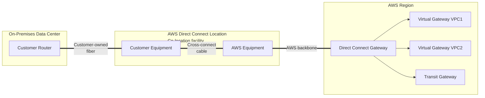
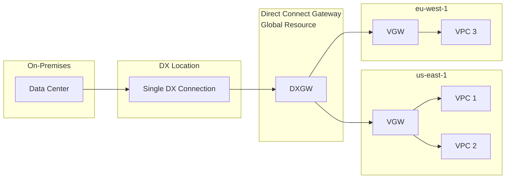

# AWS Direct Connect & Direct Connect Gateway

> 🔥 **Almost guaranteed exam questions on hybrid bandwidth, encryption, and HA designs.** Know DX + VPN backup pattern cold.

## Problem It Solves
Customers with large data volumes, latency-sensitive workloads, or compliance requirements can't use the public internet (or VPN over it) to connect their data center to AWS. They need a **dedicated, predictable, high-bandwidth, low-latency** private connection from their physical location to AWS.

## How It Works



### The Building Blocks

```
┌────────────────────────────────────────────────────────────┐
│ DIRECT CONNECT LOCATION                                     │
│   Physical colocation facility (Equinix, Coresite, etc.)   │
│   Where your network gear meets AWS network gear           │
│   "Cross-connect" = physical fiber cable between racks     │
├────────────────────────────────────────────────────────────┤
│ DEDICATED CONNECTION                                        │
│   1, 10, or 100 Gbps                                       │
│   You order directly from AWS                              │
│   Takes weeks/months to provision (physical port)          │
├────────────────────────────────────────────────────────────┤
│ HOSTED CONNECTION                                           │
│   From AWS Direct Connect Partner (Megaport, Equinix etc.) │
│   50 Mbps to 10 Gbps                                       │
│   Fast to provision (partner manages physical port)        │
├────────────────────────────────────────────────────────────┤
│ VIRTUAL INTERFACES (VIFs)                                  │
│   Private VIF  → Access VPC private resources              │
│   Public VIF   → Access AWS public services (S3 etc.)      │
│   Transit VIF  → Access Transit Gateway (multi-VPC)        │
├────────────────────────────────────────────────────────────┤
│ DIRECT CONNECT GATEWAY (DXGW)                              │
│   Connects DX to VPCs in any AWS region                    │
│   One DXGW can connect to many VGWs/TGWs across regions   │
│   No additional cost                                       │
└────────────────────────────────────────────────────────────┘
```

### Connection Types — Detailed

| Type | Bandwidth | Lead Time | Used For |
|---|---|---|---|
| **Dedicated 1 Gbps** | 1 Gbps | Weeks | Larger workloads |
| **Dedicated 10 Gbps** | 10 Gbps | Weeks | Big enterprise |
| **Dedicated 100 Gbps** | 100 Gbps | Weeks | Massive (media, finance) |
| **Hosted (Partner)** | 50 Mbps - 10 Gbps | Hours/Days | Faster spin-up |

### Virtual Interface Types

```
┌────────────────────────────────────────────────────────┐
│ PRIVATE VIF                                             │
│   Access to:    VPC private resources via VGW           │
│   Routes:       Your VPC CIDRs only                     │
│   Encryption:   None by default — DX is unencrypted!    │
│   Use:          Reach EC2, RDS in private subnets       │
├────────────────────────────────────────────────────────┤
│ PUBLIC VIF                                              │
│   Access to:    All AWS public services (S3, DynamoDB,  │
│                 public endpoints) via AWS backbone      │
│   Routes:       AWS public IP ranges                    │
│   Encryption:   None by default                         │
│   Use:          On-prem → S3 directly bypassing internet│
├────────────────────────────────────────────────────────┤
│ TRANSIT VIF                                             │
│   Access to:    Transit Gateway (many VPCs at once)     │
│   Routes:       Whatever TGW routes you configure       │
│   Required:     DX Gateway                              │
│   Use:          Hybrid with many VPCs                   │
└────────────────────────────────────────────────────────┘
```

### Direct Connect Gateway Architecture



**Key DXGW Facts:**
- Connect to up to **20 VPCs / Transit Gateways** per DXGW
- VPCs can be **in any region**, but DX physical connection is local
- DXGW itself is **free** — only DX connection + data transfer charged
- DXGW does **NOT** support VPC-to-VPC routing — VPCs can't talk to each other through it

### Direct Connect — The Encryption Reality

```
⚠️  IMPORTANT — Direct Connect is NOT encrypted by default!

A common misconception. DX is "private" (your own circuit, AWS
backbone) but the traffic is in CLEAR TEXT on that circuit.

For encryption over DX:
─────────────────────────────────────────
Option 1: IPsec VPN over Public VIF
          (DX provides bandwidth, VPN provides encryption)
          
Option 2: MACsec (Media Access Control Security)
          Hardware-level encryption at the physical layer
          Available on Dedicated 10G/100G connections
          
Option 3: Application-layer encryption (TLS)
          E.g., HTTPS, encrypted database connections
```

### High Availability Patterns

```
LEVEL 1 — Single DX (NO HA) ❌
─────────────────────────────────────────
On-Prem ── DX ── AWS
Outage = total disconnect
DON'T DO THIS IN PRODUCTION


LEVEL 2 — DX + VPN Backup ✅ (Most Common)
─────────────────────────────────────────
On-Prem ─┬─ DX (primary, low cost per GB)
         └─ VPN over internet (failover)
BGP automatically switches if DX fails
Best balance of cost and HA


LEVEL 3 — Two DX in Same Location ⚠️
─────────────────────────────────────────
Protects against device failure
NOT against location failure
Good but not enough for tier-1 workloads


LEVEL 4 — Two DX in Different Locations ✅✅
─────────────────────────────────────────
On-Prem ─┬─ DX in DX-Loc-A
         └─ DX in DX-Loc-B
Different physical locations + diverse paths
Highest tier of resilience


LEVEL 5 — Multi-Region DX (Global Enterprise) ✅✅✅
─────────────────────────────────────────
On-Prem-East ─┬─ DX → us-east-1
              └─ DX → us-west-2 (DR)
DXGW connects to both regions
Full DR architecture
```

### Routing — BGP

Direct Connect uses **BGP (Border Gateway Protocol)** to dynamically exchange routes:

```
You advertise:    Your on-prem CIDRs to AWS
AWS advertises:   VPC CIDRs to you

With multiple connections, BGP AS_PATH and 
LOCAL_PREF determine which path is preferred.

BGP communities (7224:xxxx) let you signal
AWS to prefer one connection over another.
```

## When to Use

| Need | Solution |
|---|---|
| Predictable, low latency hybrid | **Direct Connect** |
| Large data transfer (>1 Gbps sustained) | **Direct Connect** |
| Compliance: no traffic over public internet | **Direct Connect** |
| Multi-region from one on-prem | **DX + DX Gateway** |
| Hybrid with many VPCs | **DX + Transit Gateway via Transit VIF** |
| Cheap, fast hybrid setup | **Site-to-Site VPN** (not DX) |
| Hybrid encryption end-to-end | **VPN over DX** or **MACsec** |
| DR for DX | **VPN backup over internet** |

## When NOT to Use

- ❌ Don't use DX for **temporary** or **low-volume** needs — VPN is cheaper
- ❌ Don't assume DX is encrypted — it's not
- ❌ Don't deploy a **single DX** in production — always have backup
- ❌ Don't use DXGW for **VPC-to-VPC routing** — use TGW

## Trade-offs

| Choice | Gain | Sacrifice |
|---|---|---|
| Direct Connect over VPN | Low latency, high bandwidth, predictable | Cost, weeks to provision |
| Hosted DX over Dedicated | Faster setup, smaller bandwidth | Partner middleman |
| DX + VPN backup | Resilience | VPN bandwidth limit (1.25 Gbps single tunnel) |
| MACsec encryption | Wire-level encryption | Limited to 10G/100G connections |

## Real World Example

**Netflix's** hybrid setup (legacy era — most is in AWS now):
- Two DX connections at **separate DX locations** (geographic diversity)
- Each connection used different ISPs to reach the DX location
- VPN backup over internet as third layer of resilience
- Encryption at the application layer (TLS) for sensitive data
- DXGW connecting to VPCs in **us-east-1** and **us-west-2**

**Capital One** (data center to AWS migration):
- 100 Gbps DX in two locations
- Transit VIF to **central Transit Gateway**
- TGW Network Firewall in inspection VPC for East-West and North-South traffic
- VPN failover automatic via BGP

## 🎯 Exam Soundbite

> "AWS Direct Connect provides a dedicated, private network connection from your data center to AWS — predictable bandwidth and lower latency than internet-based VPN, but not encrypted by default. For high availability, deploy two DX connections at separate Direct Connect locations and add a Site-to-Site VPN as failover. Use Direct Connect Gateway to connect a single DX to VPCs across multiple regions, or a Transit VIF to reach a Transit Gateway with many VPCs."

---

## ⚡ Quick Recall Card

```
┌────────────────────────────────────────────────────┐
│ DIRECT CONNECT KEY FACTS                            │
├────────────────────────────────────────────────────┤
│ Encryption?         NO (use VPN over DX or MACsec)  │
│ Bandwidth           1, 10, 100 Gbps (Dedicated)     │
│                     50 Mbps - 10 Gbps (Hosted)      │
│ Lead time           Weeks (DX) / Hours (Hosted)     │
│ VIF types           Private, Public, Transit        │
│ DXGW connects       Up to 20 VPCs/TGWs              │
│ DXGW cross-region   YES                             │
│ DXGW VPC-to-VPC     NO (use TGW for that)           │
│ HA pattern (prod)   2 DX at 2 locations + VPN backup│
│ Routing             BGP                             │
│ Cost                $ per hour + $ per GB out       │
└────────────────────────────────────────────────────┘
```

## 🎓 Common Exam Pattern

> **"Company has 100 TB of data to migrate monthly from on-prem to S3. Currently using VPN — it's saturated. Compliance requires the traffic not traverse the public internet. What do you recommend?"**
>
> ✅ **Direct Connect** with a **Public VIF** to S3, using the AWS backbone — bypasses the public internet entirely and provides the bandwidth they need. Or **Snowball/Snowmobile** for the initial bulk transfer + DX for ongoing.
