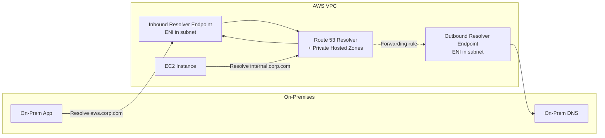
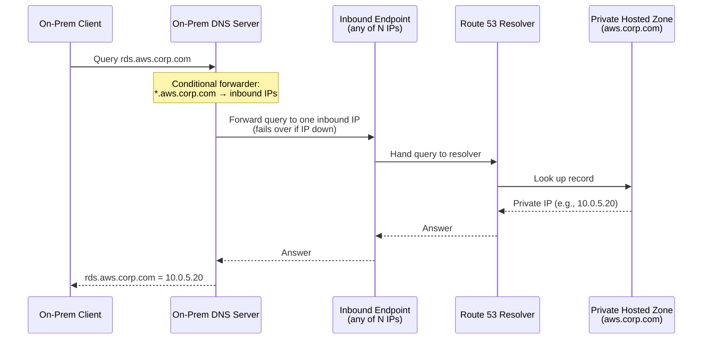
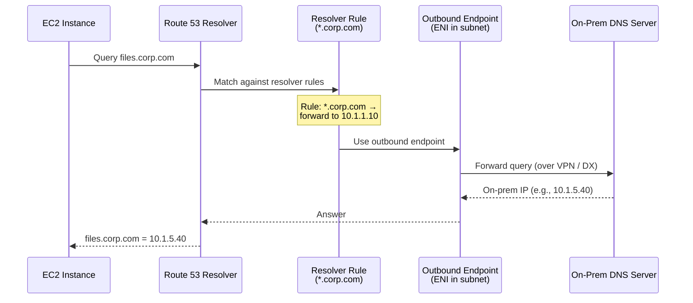

# Hybrid DNS — Route 53 Resolver

> 🔥 **Common hybrid scenario.** Know inbound vs outbound endpoints.

## Problem It Solves
In a hybrid setup, you have **two DNS systems**:
1. On-prem DNS server (resolves `internal.corp.com`)
2. AWS Route 53 (resolves `aws.internal.corp.com` and AWS service DNS)

Without help, they don't know about each other:
- On-prem app trying to reach RDS in VPC → can't resolve the private DNS
- EC2 instance trying to reach `internal.corp.com` → on-prem AD → can't resolve

**Route 53 Resolver Endpoints bridge the two DNS worlds.**

## How It Works



> ⚠️ **Key distinction — where does the config live?**
> The two directions are configured in **different places**:
>
> | Direction | What you configure | Where it lives |
> |---|---|---|
> | **Inbound** (on-prem → AWS) | Forwarders pointing at the inbound endpoint IPs | **On the on-prem DNS server** (not in AWS) |
> | **Outbound** (AWS → on-prem) | **Resolver Rules** (conditional forwarding) | **In AWS**, attached to the VPC |
>
> ➡️ **Resolver Rules are an OUTBOUND-only concept.** Inbound needs no AWS rule — the on-prem server just forwards to the endpoint IPs, and Route 53 answers from the private hosted zone.

---

## Inbound Resolver Endpoint

```
PURPOSE:
─────────────────────────────────────────────
Allow ON-PREM systems to query AWS DNS
(specifically, private hosted zones in your VPCs)

HOW IT WORKS:
─────────────────────────────────────────────
1. Create Inbound Endpoint, specifying MULTIPLE SUBNETS
   in your VPC. You get ONE IP per subnet automatically.
   (e.g., pick 3 subnets → 3 inbound IPs, 1 per subnet)
   → This is for redundancy across AZs.
2. On-prem DNS server configured to forward queries
   for AWS domains (e.g., aws.corp.com) to those IPs.
   ⚠️ Provide ALL inbound IPs to on-prem as forwarders /
   conditional forwarders. If one IP/subnet is down,
   on-prem fails over to the next.
3. AWS Route 53 Resolver answers with private record values

USE CASES:
─────────────────────────────────────────────
✅ On-prem app needs to call private API in VPC
✅ On-prem servers need RDS endpoint (private DNS)
✅ Hybrid Active Directory needs to resolve AWS records
```

---

## Outbound Resolver Endpoint

```
PURPOSE:
─────────────────────────────────────────────
Forward DNS queries from AWS VPC TO on-prem DNS

HOW IT WORKS:
─────────────────────────────────────────────
1. Create Outbound Endpoint with IPs in your VPC
2. Create Resolver RULES that say:
   "For *.corp.com, forward to on-prem DNS at 10.x.x.x"
3. Rules attached to specific VPCs
4. EC2 instances resolve corp.com domains via on-prem

USE CASES:
─────────────────────────────────────────────
✅ EC2 needs to resolve on-prem app domains
✅ Lambda in VPC needs internal corp records
✅ AWS workloads need to resolve AD-integrated names
```

---

## Hybrid DNS Architecture (Full Pattern)

```mermaid
flowchart TB
    subgraph ONP[On-Premises]
        ODNS[On-Prem DNS<br/>10.1.1.10]
        OAPP[On-Prem App]
        OAPP --> ODNS
    end
    
    subgraph CLOUD[AWS VPC]
        IB[Inbound Endpoint<br/>10.0.1.5, 10.0.2.5]
        OB[Outbound Endpoint<br/>10.0.1.6, 10.0.2.6]
        R53[Route 53 Resolver]
        PHZ[(Private Hosted Zone:<br/>aws.corp.com)]
        EC2[EC2 Instance]
        EC2 --> R53
    end
    
    ODNS -.Forward aws.corp.com queries.-> IB
    IB --> R53
    R53 --> PHZ
    R53 -.Forwarding rule corp.com.-> OB
    OB -.Forward.-> ODNS
```

```
ROUTING FLOW:
─────────────────────────────────────────────
On-prem queries "rds.aws.corp.com":
  On-prem DNS → Forward → Inbound Endpoint → Route 53 → Private Zone
  Returns private IP of RDS

EC2 queries "files.corp.com":
  EC2 → Route 53 Resolver → Forwarding Rule matched → Outbound Endpoint → On-prem DNS
  Returns IP of on-prem file server

EC2 queries "google.com":
  EC2 → Route 53 Resolver → Public DNS (default)
  Returns public IP

EC2 queries "s3.amazonaws.com":
  EC2 → Route 53 Resolver → AWS service DNS
  Returns S3 IPs
```

---

## 📦 Packet Flow (Step-by-Step)

> Sequence of how a single DNS query travels end-to-end. Useful for explaining the *order* of hops, not just the topology.

### Inbound flow — on-prem client resolves an AWS private name



### Outbound flow — AWS resource resolves an on-prem name



> 💡 **No rule match?** Route 53 Resolver falls back to its default behaviour: AWS service DNS for `*.amazonaws.com`, public recursive DNS for everything else.

---

## Resolver Rules

```
RULE TYPES:
─────────────────────────────────────────────

CONDITIONAL FORWARDING:
- "Forward queries for *.corp.com to 10.1.1.10 via outbound endpoint"
- Most common type

SYSTEM RULE:
- Auto-created for AWS hosted zones

RECURSIVE:
- Default for all other queries (public DNS)

RULES CAN BE SHARED:
─────────────────────────────────────────────
✅ Use AWS RAM to share Resolver Rules across accounts
✅ Centralized DNS strategy across Org
```

---

## Private Hosted Zones (Important Context)

```
PRIVATE HOSTED ZONE:
─────────────────────────────────────────────
DNS records visible ONLY inside specified VPCs
Resolved by Route 53 Resolver

USE:
─────────────────────────────────────────────
✅ Internal service names (auth.internal, db.internal)
✅ Override public DNS with private values
✅ Separate prod / staging hosted zones

ASSOCIATE TO MULTIPLE VPCs:
─────────────────────────────────────────────
Must associate the zone to a VPC for that VPC to resolve it
Same private zone → many VPCs (consistent internal DNS)
Cross-REGION VPCs: ✅ allowed, but same account
Cross-ACCOUNT VPCs: ✅ allowed, but only via API/CLI
  (can't do cross-account association in the console)
No forwarding needed between associated VPCs —
  the zone itself is shared
```

---

## Route 53 Resolver DNS Firewall

```
DNS FIREWALL (security feature):
─────────────────────────────────────────────
Block egress DNS queries to malicious domains
Protect against data exfiltration via DNS tunneling

RULES:
─────────────────────────────────────────────
- Allow / Block / Alert on specific domain lists
- Custom domain lists you maintain
- AWS-managed lists (known bad domains)

USE:
─────────────────────────────────────────────
✅ Compliance: prevent egress to suspicious domains
✅ Defense against malware C2 callbacks
✅ Audit trail of DNS queries

INTEGRATES WITH:
─────────────────────────────────────────────
Network Firewall, Firewall Manager for central management
```

---

## Common Patterns

### Pattern 1: Hybrid AD + AWS

```
Active Directory on-prem owns: corp.com
─────────────────────────────────────────────
AWS gets sub-zone:           aws.corp.com (Private Hosted Zone)
On-prem DNS forwards:        Anything *.aws.corp.com → Inbound Endpoint
AWS Outbound Endpoint:       *.corp.com queries → On-prem DNS

✅ Both worlds resolve each other's names
✅ Single namespace conceptually
```

### Pattern 2: Multi-Account DNS

```
CENTRAL DNS ACCOUNT:
─────────────────────────────────────────────
Hosts the Private Hosted Zone (corp.com)
Hosts Outbound Endpoint + Resolver Rules

SHARING:
─────────────────────────────────────────────
- Associate Private Hosted Zone with VPCs in other accounts
  (via cross-account API)
- Share Resolver Rules via RAM
- Workload accounts get DNS resolution without infrastructure
```

### Pattern 3: VPC ↔ VPC DNS via Private Hosted Zone

```
SAME PRIVATE HOSTED ZONE → MULTIPLE VPCs:
─────────────────────────────────────────────
Associate "internal.corp.com" zone with VPC-A and VPC-B
Both VPCs resolve same private records
No need for forwarding (zone IS shared)
```

---

## When to Use What

| Scenario | Solution |
|---|---|
| On-prem needs to resolve AWS private DNS | **Inbound Endpoint** |
| AWS needs to resolve on-prem DNS | **Outbound Endpoint + Resolver Rule** |
| Both directions | **Both endpoints + rules** |
| Multi-account hybrid DNS | **Central Resolver + RAM shared rules** |
| Block egress to bad domains | **Resolver DNS Firewall** |
| Internal-only AWS service DNS | **Private Hosted Zone** |
| Override public DNS for some records | **Private Hosted Zone (split-horizon DNS)** |

## When NOT to Use

- ❌ Don't add Resolver complexity if you don't need on-prem ↔ AWS DNS
- ❌ Don't put all DNS in one VPC — Private Hosted Zones can associate to many
- ❌ Don't forget security: Outbound Endpoint could exfiltrate via DNS → use DNS Firewall

## Trade-offs

| Choice | Gain | Sacrifice |
|---|---|---|
| Resolver Endpoints | Hybrid DNS works | $$$ per ENI per hour + query cost |
| Central DNS account | Single source of truth | Cross-account complexity |
| DNS Firewall | Prevent DNS-based attacks | Per-query cost |
| Private Hosted Zones | Internal names | Need to associate VPCs |

## Real World Example

**A bank's hybrid DNS:**
- On-prem AD owns `bank.local`
- AWS gets sub-zone `aws.bank.local` (Private Hosted Zone)
- **Inbound Endpoints** in shared services VPC (2 IPs across AZs)
- On-prem AD configured to forward `*.aws.bank.local` to those IPs
- **Outbound Endpoints** in same VPC
- Resolver Rule: `*.bank.local` → on-prem DNS via Outbound
- **DNS Firewall** blocks known bad domains (Network Firewall handles other egress)
- All workload VPCs use the shared services VPC's Resolver via TGW + Rules shared via RAM

## 🎯 Exam Soundbite

> "Route 53 Resolver enables hybrid DNS — Inbound Endpoints let on-prem DNS servers query AWS private hosted zones via your VPC, while Outbound Endpoints + Resolver Rules let AWS workloads query on-prem DNS for corporate domains. For multi-account setups, host endpoints and rules in a central DNS account and share rules via AWS RAM. Add Route 53 Resolver DNS Firewall to block egress queries to known malicious domains and prevent DNS-based exfiltration."

---

## ⚡ Quick Recall Card

```
┌─────────────────────────────────────────────────┐
│ HYBRID DNS                                       │
├─────────────────────────────────────────────────┤
│ INBOUND ENDPOINT                                 │
│   Direction:   On-prem → AWS                     │
│   Use:         On-prem queries AWS private zones │
│                                                  │
│ OUTBOUND ENDPOINT                                │
│   Direction:   AWS → On-prem                     │
│   Use:         AWS queries on-prem DNS           │
│   Needs:       Resolver Rules (conditional fwd)  │
│                                                  │
│ PRIVATE HOSTED ZONE                              │
│   Visibility:  Only specified VPCs               │
│   Cross-acct:  Associate via API                 │
│                                                  │
│ DNS FIREWALL                                     │
│   Use:         Block egress to bad domains       │
│                                                  │
│ RESOLVER RULE SHARING (via RAM)                  │
│   Central DNS team owns rules                    │
│   Workload accounts inherit                      │
└─────────────────────────────────────────────────┘
```

## 🎓 Common Exam Patterns

> **"On-prem app needs to connect to RDS in VPC by hostname. The RDS endpoint is a private DNS name."**
>
> ✅ **Inbound Resolver Endpoint** in the VPC. On-prem DNS configured to forward queries for the RDS domain to the endpoint IPs.

> **"EC2 in VPC needs to call internal corporate API at api.corp.internal which resolves via on-prem AD."**
>
> ✅ **Outbound Resolver Endpoint + Resolver Rule** for `*.corp.internal` → forward to on-prem DNS IPs.

> **"Multiple AWS accounts need consistent hybrid DNS. Don't want to recreate endpoints in each account."**
>
> ✅ Build endpoints in a **central network account**. **Share Resolver Rules via AWS RAM** to workload accounts. Private Hosted Zones associated cross-account.
