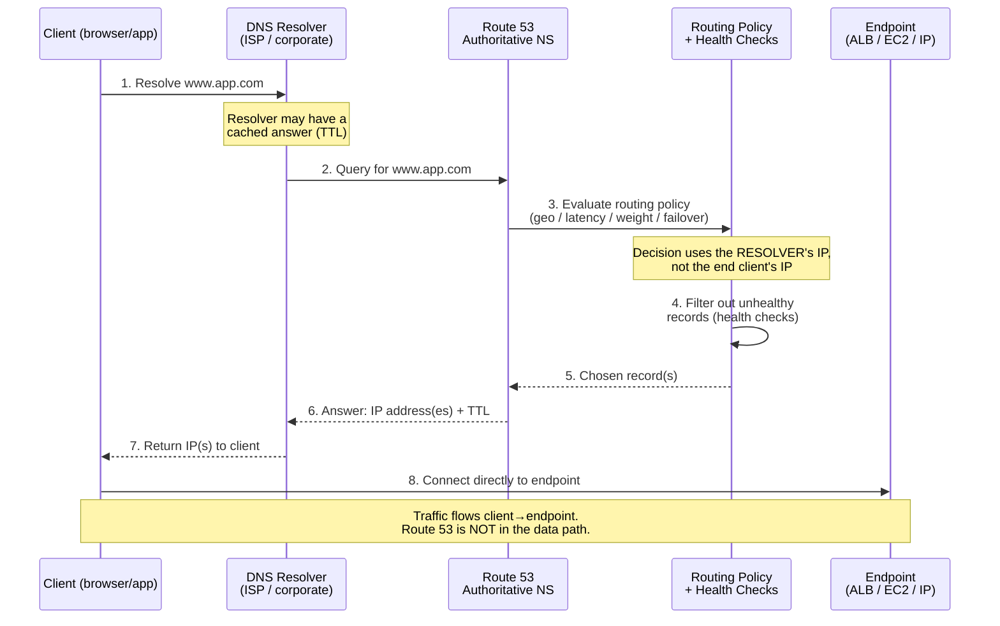
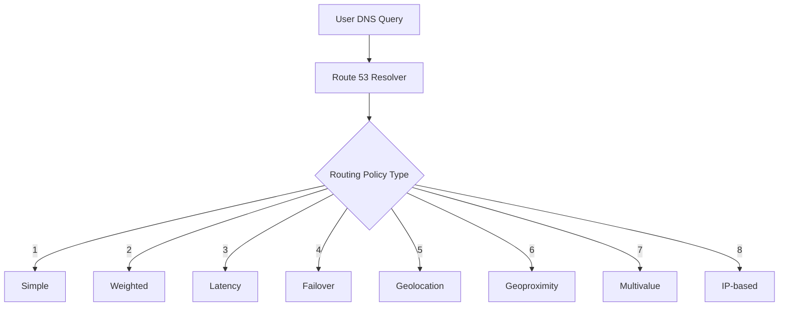
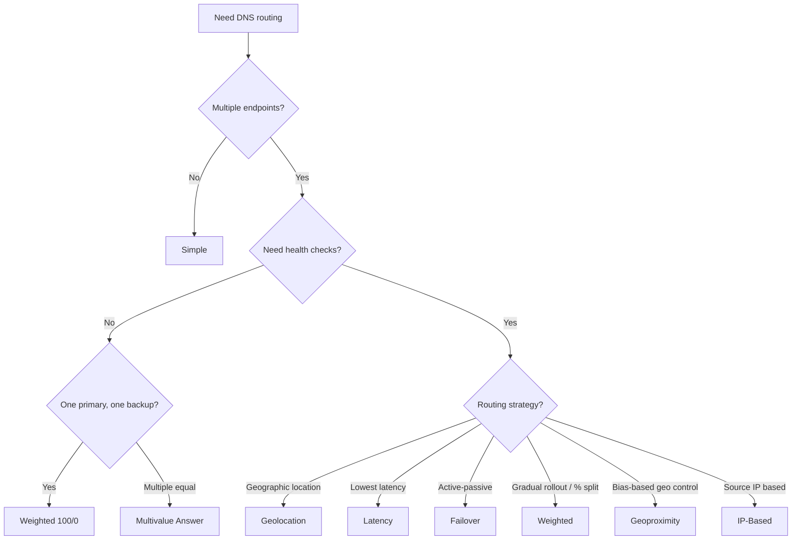
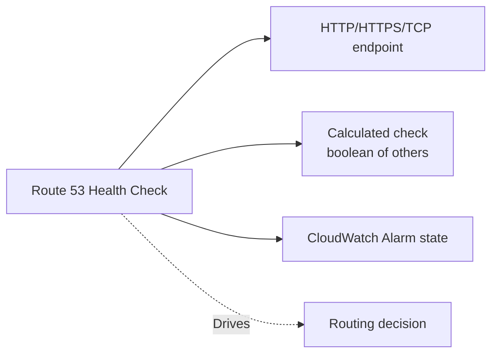
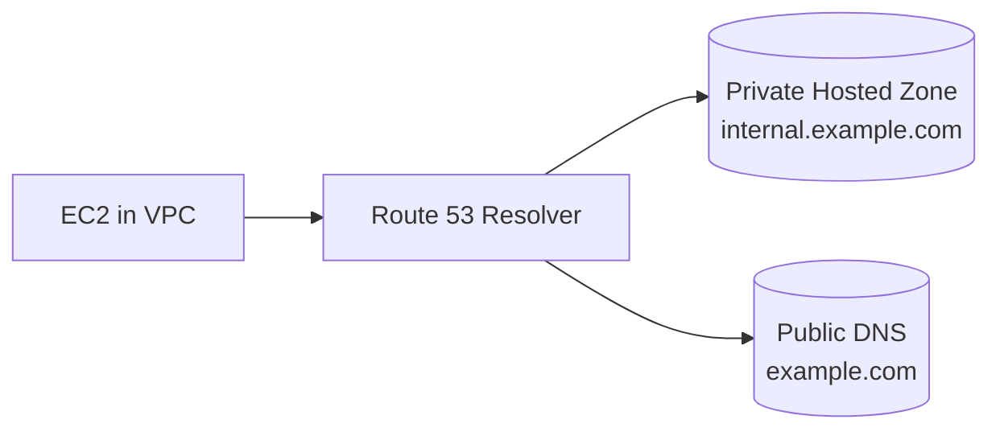

# Route 53 Routing Policies

> 🔥 **Always tested.** Every multi-region scenario question on SAP-C02 hinges on picking the right routing policy.

## Problem It Solves

DNS at its core converts a domain name into an IP address so clients can find your servers. The reason you point clients at a name instead of hardcoding an IP:

- **The IP behind a name can change** (servers replaced, ALB scaling) while the name stays stable — the application never has to be updated.
- **Names are human-friendly** — easier to identify than raw IP addresses.

A single A-record pointing to one IP works for a basic site, but real architectures need more: failover when a region dies, sending users to the lowest-latency endpoint, complying with geo-data laws, gradual blue/green rollouts, and returning multiple healthy endpoints. Route 53's routing policies handle all of these. **Route 53 is the DNS service — it decides *which* record to return; it is not itself a load balancer.**

## How It Works — DNS Resolution Packet Flow

Before the routing policies, it helps to see what actually happens on a query. Route 53 runs authoritative DNS servers across the globe; a client's resolver asks them for the record, and the routing policy decides which answer comes back.



> ⚠️ **Key subtlety:** Route 53 makes its decision based on the **DNS resolver's IP**, not the end user's device IP. For geolocation, latency, and IP-based routing, "where the user is" really means "where their resolver is." Usually close, occasionally not.



### The 8 Routing Policies

```
┌─────────────────────────────────────────────────────────┐
│ 1. SIMPLE                                                │
│    One record, one or multiple values                    │
│    Random selection if multiple                          │
│    No health checks                                      │
│    Single endpoint, single region only                   │
│    Use: Single-server, basic DNS                         │
├─────────────────────────────────────────────────────────┤
│ 2. WEIGHTED                                              │
│    Multiple records, % traffic to each                   │
│    Weights 0-255 (0 = no traffic)                        │
│    Both targets ACTIVE simultaneously                    │
│    Health-check aware; works across regions              │
│    Use: A/B testing, blue/green, gradual rollout         │
├─────────────────────────────────────────────────────────┤
│ 3. LATENCY                                               │
│    Routes to lowest-latency AWS region                   │
│    Based on HISTORICAL AWS latency measurements          │
│    (not a live, per-request measurement)                 │
│    Health-check aware                                    │
│    Use: Global apps with multi-region active deployment  │
├─────────────────────────────────────────────────────────┤
│ 4. FAILOVER                                              │
│    Active-passive (Primary / Secondary)                  │
│    Routes to Secondary only if Primary fails health check│
│    Automatic — Route 53 handles the switch               │
│    Use: DR, active-passive multi-region                  │
├─────────────────────────────────────────────────────────┤
│ 5. GEOLOCATION                                           │
│    Routes by user's geographic location (country/state)  │
│    STRICT — a location always maps to one endpoint       │
│    Must have a "default" record                          │
│    Use: Compliance, language-specific content, GDPR      │
├─────────────────────────────────────────────────────────┤
│ 6. GEOPROXIMITY (requires Traffic Flow)                  │
│    Routes by geographic DISTANCE with BIAS               │
│    Bias = expand/shrink region's coverage                │
│    Use: Steer traffic between AWS regions or on-prem     │
├─────────────────────────────────────────────────────────┤
│ 7. MULTIVALUE ANSWER                                     │
│    Returns up to 8 healthy random records                │
│    Client picks one — app-level failover                 │
│    Not a substitute for ELB (no load balancing)          │
│    Use: Simple HA across multiple endpoints              │
├─────────────────────────────────────────────────────────┤
│ 8. IP-BASED                                              │
│    Routes by source IP CIDR (custom mappings)            │
│    Use: ISP-specific routing, advanced enterprise        │
└─────────────────────────────────────────────────────────┘
```

### Visual Decision Tree



---

## Policy Deep-Dives (with the "why", not just the "what")

### 1. Simple Routing
- Maps a domain name to one record with one or more values; if multiple values, the client gets them in random order.
- **No health checks.** If the single endpoint dies, you are down — no automatic recovery.
- Lives in / serves **one region** — there is no cross-region awareness.
- **When it's enough:** a single server or single load balancer, one region, no HA requirement.
- **The trap:** zero high availability. The moment you care about downtime, move to Failover (or another HA policy).

### 2. Weighted Routing
- Assign each record a weight; Route 53 directs roughly that **percentage of DNS queries** to each (e.g. 70/30).
- **Both endpoints are active and serving simultaneously** — this is the active-active contrast to Failover's active-passive.
- Works **across multiple regions** (e.g. blue in `us-east-1`, green in `eu-west-1`).
- **Blue/green:** keep current ("blue") at 90%, send 10% to the new version ("green"), watch errors, then shift to 100% green.
- Configured by creating multiple records with the **same name**, each pointing at its endpoint (use alias records for ALBs/NLBs) with a weight.

### 3. Failover Routing
- **Primary + Secondary**, typically in two different regions.
- Route 53 runs a **health check** against the primary's endpoint; if it fails, traffic switches to secondary **automatically**.
- Health checks aren't HTTP-only — they support **HTTP, HTTPS, TCP, and CloudWatch alarms** (alarms are how you health-check private resources).
- The health check is **configurable**: the **request interval** (how often it probes, e.g. every 30s or fast 10s) and the **failure threshold** (how many consecutive failed checks flip it over).
- **Load balancer support:** works with **Classic (CLB), Application (ALB), and Network (NLB)** load balancers.
  - Because ALBs and NLBs **don't have static IPs** (AWS scales them and IPs change), point the record at the load balancer with an **alias record**, not a hardcoded A record.

### 4. Latency-Based Routing
- Routes each user to the AWS region that gives them the **lowest network latency**.
- **Critical nuance discovered:** this is **not a live, per-request measurement.** AWS continuously measures latency between user locations and AWS regions **over a period of time** and stores it as historical data. A query is answered from that stored data, so the same user might be sent to one region this week and a different one next week as patterns shift.
- It's measured at the level of **resolver/region patterns**, not per individual user — all users behind a London resolver get the same latency-based decision.
- Latency ≠ pure distance: it reflects real network conditions, which is why it's usually preferred over geoproximity.

### 5. Geolocation Routing
- Routes by **where the user is**, geographically (continent / country / state) — *not* by speed.
- **Strict mapping:** London users always go to the London endpoint even if another region would be faster.
- **Why use it over latency:** you *need* location-based separation — data-residency/compliance (e.g. GDPR: EU data stays in EU) or localized/language-specific content.
- It knows location, not language preference — it serves the version *you mapped* to that location.
- **Must define a default record** for users whose location doesn't match any rule, or they get nothing.

### 6. Geoproximity Routing (Traffic Flow)
- Routes by **geographic distance**, but with an adjustable **bias**.
- Bias lets you pull traffic toward a region even if it isn't strictly closest — useful when a region is **cheaper, more compliant, or you want to drain/shift load**. A positive bias on Region A makes Route 53 treat it as closer than it really is.
- **Why pick distance over latency at all?** Mostly when you want **explicit manual control** over the geographic split (cost/compliance steering) rather than letting measured speed decide. In raw "make it fast" terms, latency-based is usually the better choice.

### 7. Multivalue Answer Routing
- Returns **up to 8 healthy records** in one response; the **client picks** which IP to use.
- **Health-check aware** — unhealthy endpoints are excluded, so the client only ever sees healthy options.
- It's app-level resilience: if one returned IP is down, the client tries another **without a new DNS lookup**. Think "mini load balancer inside DNS" — but it is **not** a real load balancer (no traffic balancing, no session handling).
- **Real example (from our discussion):** a Redis setup where multiple Redis server IPs are returned and the client connects to any available one.

### 8. IP-Based Routing
- Routes by the **source IP (CIDR block)** of the incoming DNS query — you define CIDR collections and map each range to an endpoint.
- **Use cases:** route a specific company's/ISP's IP ranges to dedicated endpoints, optimize transit cost/performance per ISP, send internal corporate traffic somewhere different from external, or override an existing geolocation setup based on what you know about your clients.
- Works across regions. **Not supported for private hosted zones.**
- Differs from Simple: Simple ignores who's asking; IP-based makes the decision *based on the requester's IP range*.

---

### Use Case Examples

#### Weighted — Blue/Green Deployment
```
www.app.com → 
   v1 (Blue):  weight 90  →  ALB in us-east-1 (current)
   v2 (Green): weight 10  →  ALB in us-east-1 (new)

Start at 90/10, monitor errors, shift to 50/50, then 0/100
```

#### Latency — Global User Base
```
www.app.com →
   us-east-1 endpoint    (US users routed here)
   eu-west-1 endpoint    (EU users routed here)
   ap-south-1 endpoint   (Indian users routed here)

User in Berlin gets eu-west-1 because Route 53's HISTORICAL
latency data says that region is fastest for them.
```

#### Failover — DR Pattern
```
www.app.com →
   Primary:   ALB in us-east-1   [health check on /health]
   Secondary: ALB in us-west-2   [health check on /health]

If us-east-1 health check fails (interval + threshold met),
traffic auto-shifts to us-west-2. When primary recovers,
traffic returns. Records use ALIAS (ALB has no static IP).
```

#### Geolocation — GDPR Compliance
```
www.app.com →
   EU users     → ALB in eu-west-1 (GDPR data stays in EU)
   US users     → ALB in us-east-1
   Asia users   → ALB in ap-south-1
   Default      → ALB in us-east-1 (must always exist)

A user in Germany gets eu-west-1 regardless of latency,
because data residency requirement says so.
```

#### Multivalue — Redis Endpoints
```
redis.internal.app.com →
   10.0.1.10  [healthy]
   10.0.2.10  [healthy]
   10.0.3.10  [unhealthy → excluded]

Client receives the healthy IPs and connects to any of them.
No new DNS lookup needed if one connection fails.
```

### Latency vs Geolocation — The Common Confusion

```
LATENCY POLICY:
─────────────────────────────────────
Question: Where will this user get fastest response?
Decision based on: AWS historical network latency measurements

User in Mumbai → ap-south-1 (closest, fastest network)


GEOLOCATION POLICY:
─────────────────────────────────────
Question: Where is this user geographically located?
Decision based on: GeoIP of the DNS resolver, country/state

User in Mumbai → ap-south-1 (because they're in India)
                  Even if us-east-1 were somehow faster!


KEY DIFFERENCE:
─────────────────────────────────────
Latency:     "Pick the lowest latency option for the user"
Geolocation: "Force users from THIS country to THIS server"
             (Used for compliance, content localization)
```

### Latency vs Geoproximity — The Other Confusion

```
LATENCY:      Metric = measured network SPEED (historical)
              "Whatever region is actually fastest, send them there."

GEOPROXIMITY: Metric = geographic DISTANCE + a BIAS knob
              "Closest by distance — but I can tilt it toward
               a cheaper/compliant region using bias."

Rule of thumb: want raw performance → Latency.
               want manual geographic control → Geoproximity.
```

### Health Checks — How They Plug In



**3 types:**
1. **Endpoint** — Health check pings an HTTP/HTTPS or TCP endpoint (e.g. expects an HTTP `200`)
2. **Calculated** — Combine multiple checks with AND/OR/NOT
3. **CloudWatch Alarm** — Health based on a CloudWatch alarm state (used for private resources)

**Key health-check facts:**
- **Request interval** is configurable: default 30-second intervals, or 10s for faster failover (costs more)
- **Failure threshold** is configurable: "healthy/unhealthy" flips after N consecutive checks (default 3)
- Checks run from **multiple locations globally**
- For private resources (not reachable from internet) → use **CloudWatch alarm**-based health check

### Private Hosted Zones

DNS that works **only inside VPCs**:



- Define internal records like `db.internal.example.com → 10.0.5.20`
- VPC must have **DNS hostnames and DNS resolution** enabled
- Same domain can exist as private AND public — **private wins inside VPC**
- Shared across multiple VPCs (same or different accounts)
- Note: **IP-based routing is not supported** in private hosted zones

## When to Use Which

| Scenario | Policy |
|---|---|
| One server, simple DNS | **Simple** |
| Blue/green or A/B testing | **Weighted** |
| Multi-region active-active | **Latency** |
| Multi-region active-passive (DR) | **Failover** |
| Comply with data residency laws | **Geolocation** |
| Steer traffic with custom geo bias | **Geoproximity (Traffic Flow)** |
| HA across few endpoints, no LB | **Multivalue Answer** |
| Route specific ISPs differently | **IP-Based** |

## When NOT to Use

- ❌ Don't use **Simple** when you need any HA — one dead endpoint = full outage
- ❌ Don't use **Latency** for compliance — it doesn't respect data residency
- ❌ Don't use **Geolocation** when you want fastest response — use Latency
- ❌ Don't use **Multivalue** to replace a real load balancer — it's not one
- ❌ Don't forget the **default record** in Geolocation — users from "unknown" locations get nothing
- ❌ Don't use **A records with hardcoded IPs for ALB/NLB** — use alias records (their IPs change)

## Trade-offs

| Choice | Gain | Sacrifice |
|---|---|---|
| Simple policy | Dead simple | No HA, single region, no health checks |
| Failover policy | Simple DR | Active-passive (idle capacity) |
| Latency policy | Best user experience | Doesn't respect data residency |
| Geolocation | Data residency compliance | Not lowest latency necessarily |
| Weighted | Granular traffic control | Manual weight management |
| Geoproximity | Manual geo steering w/ bias | More complex (Traffic Flow), distance ≠ speed |

## Real World Example

**Netflix** uses **Latency** + **Failover** routing combined:
- `www.netflix.com` is a **Latency-based** record routing to multiple regions
- Each regional endpoint is itself a **Failover** record routing to primary ALB with secondary backup
- Health checks at multiple layers — region health and app health
- Geolocation overrides for specific compliance regions (e.g. data-residency markets)

**Spotify** uses **Weighted** for safe deploys:
- New backend version deployed alongside old
- Weight set to 5% initially
- Auto-shift to 50/50, then 100% over hours if no errors
- Auto-rollback (weight to 0) if error rates spike

## 🎯 Exam Soundbite

> "Route 53 offers 8 routing policies — pick by answering: do I need active-passive failover (Failover), gradual rollout or weighted split (Weighted), lowest-latency global routing (Latency), or compliance-driven geographic routing (Geolocation)? Multivalue Answer provides simple multi-endpoint HA without true load balancing. Combine with health checks for automatic failover."

---

## ⚡ Quick Recall Card

```
┌─────────────────────────────────────────────────────┐
│ ROUTING POLICY CHEAT SHEET                           │
├─────────────────────────────────────────────────────┤
│ Simple        → Single value or random (no HA)      │
│ Weighted      → Blue/Green, A/B testing (active-act)│
│ Latency       → Lowest network latency (historical) │
│ Failover      → Active-Passive DR                   │
│ Geolocation   → Compliance, GDPR, language (strict) │
│ Geoproximity  → Custom geo BIAS (Traffic Flow)      │
│ Multivalue    → Simple HA, up to 8 healthy records  │
│ IP-Based      → Custom mapping by source CIDR       │
└─────────────────────────────────────────────────────┘

REMEMBER: Route 53 decides on the RESOLVER's IP, not the
end-user device. Latency uses HISTORICAL data, not live.
ALB/NLB → ALIAS records (no static IP).
```

## 🎓 Common Exam Patterns

> **"A SaaS company has customers in EU, US, and APAC. EU data must stay in EU per GDPR. They also want US and APAC users to get the fastest response."**
>
> ✅ **Geolocation** as the primary policy (EU → eu-west-1 strictly). Inside US and APAC geolocations, use **Latency** sub-policies (or single regional endpoints).
> 
> A combination uses **Geolocation** at the top tier to enforce compliance, and within compliant regions use **Latency** for performance.

---

## 🧠 Gaps Still to Verify (from review session)

These came up during the Feynman review and are worth nailing down before presenting:

1. **Geoproximity** — still the fuzziest policy. Be ready to explain bias with a concrete number (e.g. "+50 bias halves the perceived distance to that region"). Practice the one-line distinction vs latency.
2. **Latency measurement timing** — say "historical, updated over time" confidently; avoid the word "real-time."
3. **Geolocation language handling** — it routes on *location*, then serves whatever content you mapped there; it does not detect language preference itself.
4. There is **no separate "failover geolocation" policy** — failover and geolocation are distinct policies that *can* be layered, nothing more.
