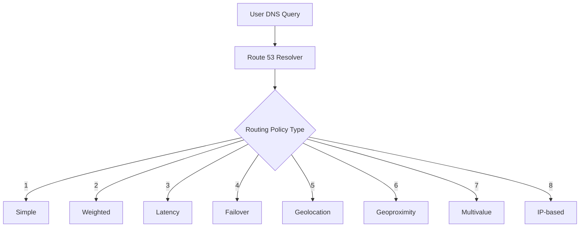
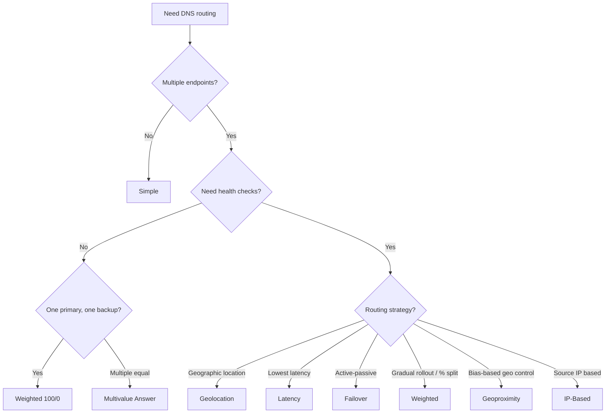
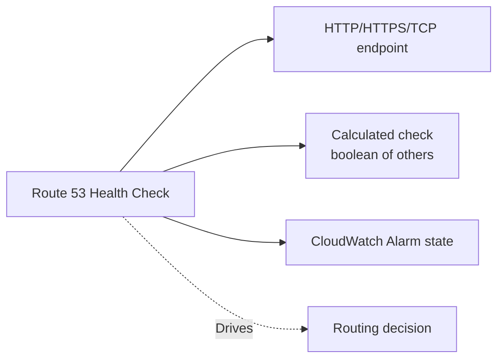
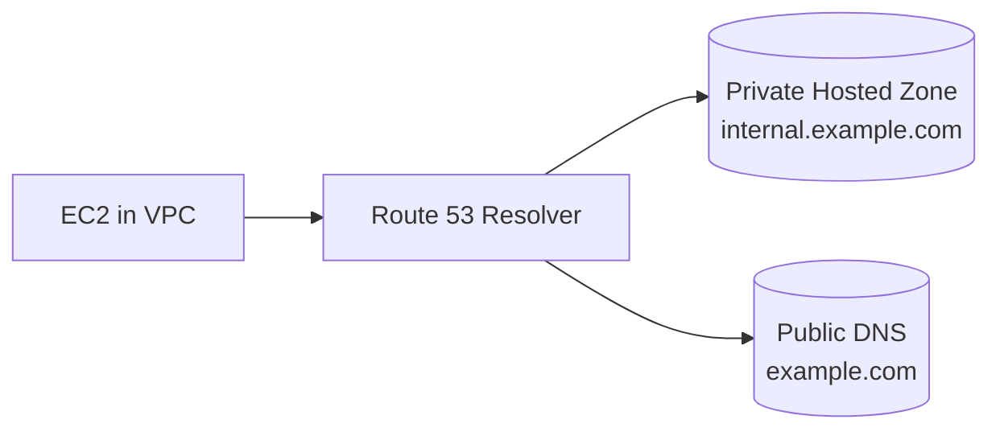

# Route 53 Routing Policies

> 🔥 **Always tested.** Every multi-region scenario question on SAP-C02 hinges on picking the right routing policy.

## Problem It Solves
Single DNS A-record pointing to one IP works for simple sites, but real architectures need: failover when a region dies, sending users to the lowest-latency endpoint, complying with geo-data laws, gradual blue/green rollouts, and routing based on user health. Route 53's routing policies handle all of these.

## How It Works



### The 8 Routing Policies

```
┌─────────────────────────────────────────────────────────┐
│ 1. SIMPLE                                                │
│    One record, one or multiple values                    │
│    Random selection if multiple                          │
│    No health checks                                      │
│    Use: Single-server, basic DNS                         │
├─────────────────────────────────────────────────────────┤
│ 2. WEIGHTED                                              │
│    Multiple records, % traffic to each                   │
│    Weights 0-255 (0 = no traffic)                        │
│    Health-check aware                                    │
│    Use: A/B testing, blue/green, gradual rollout         │
├─────────────────────────────────────────────────────────┤
│ 3. LATENCY                                               │
│    Routes to lowest-latency AWS region                   │
│    Based on AWS network latency measurements             │
│    Health-check aware                                    │
│    Use: Global apps with multi-region active deployment  │
├─────────────────────────────────────────────────────────┤
│ 4. FAILOVER                                              │
│    Active-passive (Primary / Secondary)                  │
│    Routes to Secondary only if Primary fails health check│
│    Use: DR, active-passive multi-region                  │
├─────────────────────────────────────────────────────────┤
│ 5. GEOLOCATION                                           │
│    Routes by user's geographic location (country/state)  │
│    Must have a "default" record                          │
│    Use: Compliance, language-specific content, GDPR      │
├─────────────────────────────────────────────────────────┤
│ 6. GEOPROXIMITY (requires Traffic Flow)                  │
│    Routes by geographic distance with BIAS               │
│    Bias = expand/shrink region's coverage                │
│    Use: Steer traffic between AWS regions or on-prem     │
├─────────────────────────────────────────────────────────┤
│ 7. MULTIVALUE ANSWER                                     │
│    Returns up to 8 healthy random records                │
│    Like "simple with health checks"                      │
│    Not a substitute for ELB (no load balancing)          │
│    Use: Simple HA across multiple endpoints              │
├─────────────────────────────────────────────────────────┤
│ 8. IP-BASED                                              │
│    Routes by source IP CIDR (custom mappings)            │
│    Use: ISP-specific routing, advanced enterprise        │
└─────────────────────────────────────────────────────────┘
```

### Visual Decision Tree



### Use Case Examples

#### Weighted — Blue/Green Deployment
```
www.app.com → 
   v1 (Blue):  weight 90  →  ALB in us-east-1 (current)
   v2 (Green): weight 10  →  ALB in us-east-1 (new)

Start at 90/10, monitor errors, shift to 50/50, then 0/100
```

#### Latency — Global User Base
```
www.app.com →
   us-east-1 endpoint    (US users routed here)
   eu-west-1 endpoint    (EU users routed here)
   ap-south-1 endpoint   (Indian users routed here)

User in Berlin gets eu-west-1 automatically because
Route 53 measures their latency to each region.
```

#### Failover — DR Pattern
```
www.app.com →
   Primary:   ALB in us-east-1   [health check on /health]
   Secondary: ALB in us-west-2   [health check on /health]

If us-east-1 health check fails, traffic auto-shifts
to us-west-2. When primary recovers, traffic returns.
```

#### Geolocation — GDPR Compliance
```
www.app.com →
   EU users     → ALB in eu-west-1 (GDPR data stays in EU)
   US users     → ALB in us-east-1
   Asia users   → ALB in ap-south-1
   Default      → ALB in us-east-1 (must always exist)

A user in Germany gets eu-west-1 regardless of latency,
because data residency requirement says so.
```

### Latency vs Geolocation — The Common Confusion

```
LATENCY POLICY:
─────────────────────────────────────
Question: Where will this user get fastest response?
Decision based on: AWS network latency measurements

User in Mumbai → ap-south-1 (closest, fastest network)


GEOLOCATION POLICY:
─────────────────────────────────────
Question: Where is this user geographically located?
Decision based on: GeoIP database, country/state

User in Mumbai → ap-south-1 (because they're in India)
                  Even if us-east-1 were somehow faster!


KEY DIFFERENCE:
─────────────────────────────────────
Latency:     "Pick the lowest latency option for the user"
Geolocation: "Force users from THIS country to THIS server"
             (Used for compliance, content localization)
```

### Health Checks — How They Plug In



**3 types:**
1. **Endpoint** — Health check pings an HTTP/S or TCP endpoint
2. **Calculated** — Combine multiple checks with AND/OR/NOT
3. **CloudWatch Alarm** — Health based on a CloudWatch alarm state (used for private resources)

**Key health-check facts:**
- Default: 30-second intervals (or 10s for faster failover, costs more)
- "Healthy" after 3 consecutive successful checks
- Can check from multiple locations globally
- For private resources (not reachable from internet) → use **CloudWatch alarm**-based health check

### Private Hosted Zones

DNS that works **only inside VPCs**:



- Define internal records like `db.internal.example.com → 10.0.5.20`
- VPC must have **DNS hostnames and DNS resolution** enabled
- Same domain can exist as private AND public — **private wins inside VPC**
- Shared across multiple VPCs (same or different accounts)

## When to Use Which

| Scenario | Policy |
|---|---|
| One server, simple DNS | **Simple** |
| Blue/green or A/B testing | **Weighted** |
| Multi-region active-active | **Latency** |
| Multi-region active-passive (DR) | **Failover** |
| Comply with data residency laws | **Geolocation** |
| Steer traffic with custom geo bias | **Geoproximity (Traffic Flow)** |
| HA across few endpoints, no LB | **Multivalue Answer** |
| Route specific ISPs differently | **IP-Based** |

## When NOT to Use

- ❌ Don't use **Latency** for compliance — it doesn't respect data residency
- ❌ Don't use **Geolocation** when you want fastest response — use Latency
- ❌ Don't use **Multivalue** to replace a real load balancer — it's not
- ❌ Don't forget the **default record** in Geolocation — users from "unknown" locations get nothing

## Trade-offs

| Choice | Gain | Sacrifice |
|---|---|---|
| Failover policy | Simple DR | Active-passive (idle capacity) |
| Latency policy | Best user experience | Doesn't respect data residency |
| Geolocation | Data residency compliance | Not lowest latency necessarily |
| Weighted | Granular traffic control | Manual weight management |

## Real World Example

**Netflix** uses **Latency** + **Failover** routing combined:
- `www.netflix.com` is a **Latency-based** record routing to multiple regions
- Each regional endpoint is itself a **Failover** record routing to primary ALB with secondary backup
- Health checks at multiple layers — region health and app health
- Geolocation overrides for specific compliance regions (e.g. data-residency markets)

**Spotify** uses **Weighted** for safe deploys:
- New backend version deployed alongside old
- Weight set to 5% initially
- Auto-shift to 50/50, then 100% over hours if no errors
- Auto-rollback (weight to 0) if error rates spike

## 🎯 Exam Soundbite

> "Route 53 offers 8 routing policies — pick by answering: do I need active-passive failover (Failover), gradual rollout or weighted split (Weighted), lowest-latency global routing (Latency), or compliance-driven geographic routing (Geolocation)? Multivalue Answer provides simple multi-endpoint HA without true load balancing. Combine with health checks for automatic failover."

---

## ⚡ Quick Recall Card

```
┌─────────────────────────────────────────────────────┐
│ ROUTING POLICY CHEAT SHEET                           │
├─────────────────────────────────────────────────────┤
│ Simple        → Single value or random              │
│ Weighted      → Blue/Green, A/B testing             │
│ Latency       → Lowest network latency              │
│ Failover      → Active-Passive DR                   │
│ Geolocation   → Compliance, GDPR, language          │
│ Geoproximity  → Custom geo BIAS (Traffic Flow)      │
│ Multivalue    → Simple HA, up to 8 healthy records  │
│ IP-Based      → Custom mapping by source CIDR       │
└─────────────────────────────────────────────────────┘
```

## 🎓 Common Exam Patterns

> **"A SaaS company has customers in EU, US, and APAC. EU data must stay in EU per GDPR. They also want US and APAC users to get the fastest response."**
>
> ✅ **Geolocation** as the primary policy (EU → eu-west-1 strictly). Inside US and APAC geolocations, use **Latency** sub-policies (or single regional endpoints).
> 
> A combination uses **Geolocation** at the top tier to enforce compliance, and within compliant regions use **Latency** for performance.
