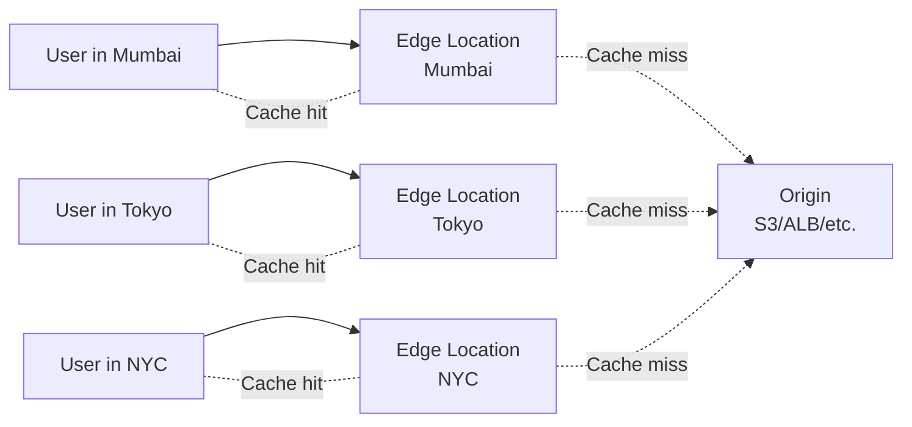
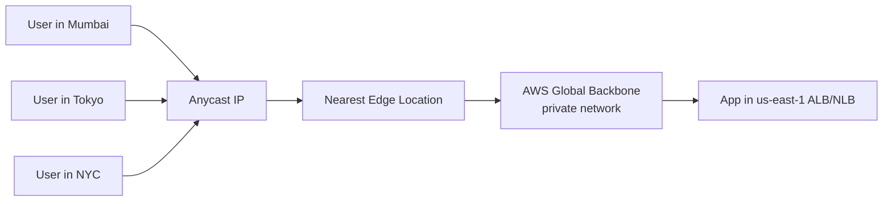
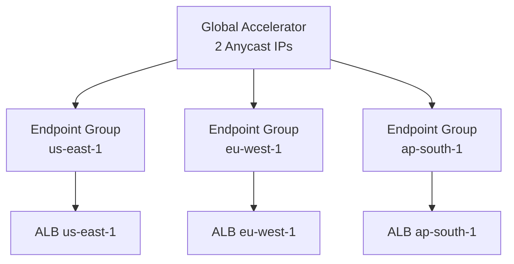
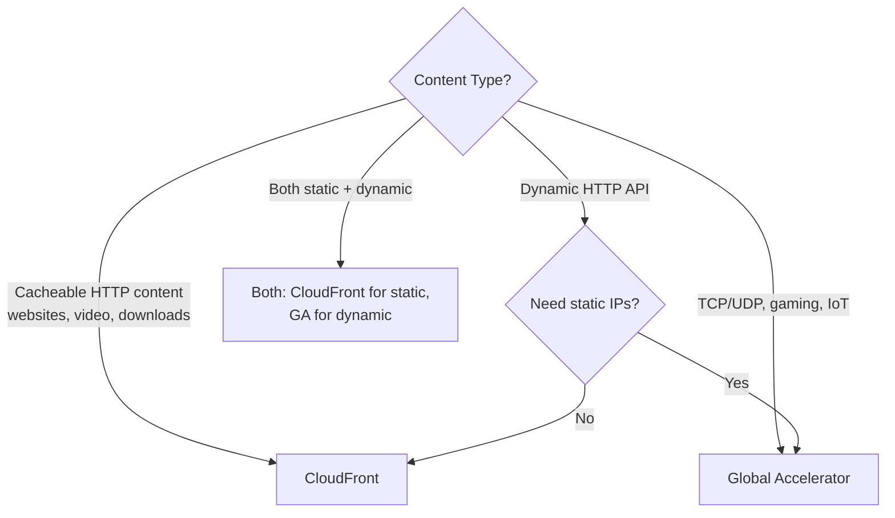
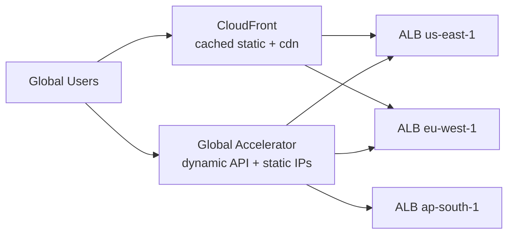

# CloudFront vs Global Accelerator

> 🔥 **Frequently confused on the exam.** Know exactly when to use each.

## Problem They Solve
Global users + cloud apps = high latency for users far from the origin region. Two AWS edge services help, but they solve different problems:

- **CloudFront**: Caches content close to users (CDN — Content Delivery Network)
- **Global Accelerator**: Routes traffic over AWS's private backbone with static IPs (no caching)

## Quick Visual



```
CLOUDFRONT (CDN):
─────────────────────────────────────────────
Edge locations CACHE content close to users
Cache hit = served from edge (fast)
Cache miss = fetched from origin once, then cached
```



```
GLOBAL ACCELERATOR (GA):
─────────────────────────────────────────────
2 static Anycast IPs (same IP everywhere)
User connects to nearest edge POP
Traffic routed via AWS backbone (not internet)
NO CACHING — every request reaches origin
```

---

## Side-by-Side Comparison

| | **CloudFront** | **Global Accelerator** |
|---|---|---|
| Type | CDN | Network accelerator |
| Layer | 7 (HTTP/HTTPS) | 4 (TCP/UDP) |
| Caching | ✅ Yes | ❌ No |
| Static IPs | ❌ Domain names | ✅ 2 Anycast IPs |
| Protocols | HTTP/HTTPS, WebSocket | Any TCP/UDP |
| Origins | S3, ALB, EC2, custom HTTP | ALB, NLB, EC2, EIPs |
| Edge Functions | Lambda@Edge, CloudFront Functions | None |
| Use cases | Websites, APIs, video, static content | Gaming (UDP), IoT, real-time apps |
| Failover | Origin failover (multiple origins) | Instant via health-checked Anycast |
| TLS | Termination at edge | Pass-through to origin |
| WAF | ✅ Integrates | ❌ |
| Shield Std | ✅ | ✅ |
| Pricing | Per request + data transfer | Per accelerator-hour + data |

---

## CloudFront Deep Features

### Origin Types

```
✅ S3 buckets (static sites, downloads)
✅ ALB (dynamic apps)
✅ NLB (TCP backends)
✅ EC2 instances
✅ MediaStore / MediaPackage (video)
✅ Custom HTTP origins (on-prem, other clouds)
✅ Lambda Function URLs (newer)
```

### Cache Behaviors

```
PATH-BASED CACHING:
─────────────────────────────────────────────
Different rules per URL path:
  /static/*  → Long cache (TTL 1 year)
  /api/*     → No cache (TTL 0)
  /images/*  → Medium cache (TTL 1 day)

CACHE KEYS:
─────────────────────────────────────────────
By default, cache by URL only.
Can include headers, cookies, query strings.
  - Cache by Accept-Language (per-language pages)
  - Cache by User-Agent (mobile vs desktop)
```

### CloudFront Origin Failover

```
TWO ORIGINS — primary + secondary:
─────────────────────────────────────────────
If primary returns 5xx, automatically fail over to secondary

USE:
─────────────────────────────────────────────
✅ Multi-region origin (region failure protection)
✅ S3 + EC2 fallback patterns
```

### Lambda@Edge & CloudFront Functions

```
LAMBDA@EDGE:
─────────────────────────────────────────────
Full Lambda runs at CloudFront edge
Up to 5 sec exec, 128 MB RAM
Triggers: viewer request/response, origin request/response

USE: Auth checks, A/B testing, SEO redirects

CLOUDFRONT FUNCTIONS (newer):
─────────────────────────────────────────────
JavaScript runs in <1ms at edge
Lower latency than Lambda@Edge
Cheaper, for simple transformations
Triggers: viewer request/response only

USE: URL rewrites, header manipulation, simple auth
```

### Origin Shield

```
ORIGIN SHIELD:
─────────────────────────────────────────────
Extra caching layer between edge locations and origin
Reduces load on origin during cache invalidations

USE:
─────────────────────────────────────────────
✅ Many edge locations hitting same origin
✅ Origin is expensive to scale
✅ Cache invalidations cause origin spikes
```

### CloudFront Geo Restriction

```
GEO BLOCKING:
─────────────────────────────────────────────
Allow or deny by country
Compliance (sanctioned countries) or licensing

✅ Block all except whitelist
✅ Block specific countries
```

### Signed URLs / Signed Cookies

```
PROTECT CONTENT:
─────────────────────────────────────────────
Issue time-limited URLs to authorized users
Or set signed cookies for entire session

USE:
─────────────────────────────────────────────
✅ Pay-walled content (videos, downloads)
✅ Time-limited access to private S3
```

---

## Global Accelerator Deep Features

### Two Anycast IPs

```
EVERY GA CREATES 2 ANYCAST IPs:
─────────────────────────────────────────────
Same 2 IPs work globally
Users routed to nearest AWS edge POP
✅ Whitelist 2 IPs once for your customers
✅ Won't change (unless you delete the accelerator)
```

### Endpoint Groups



```
ENDPOINT GROUPS:
─────────────────────────────────────────────
One per region
Each can have multiple endpoints (ALB, NLB, EC2, EIP)
Traffic dial: % of traffic this group receives

✅ Route by region (closest user gets closest region)
✅ Adjust dial to 0% to drain a region
✅ Health-checked failover automatic
```

### Traffic Dials & Weights

```
TRAFFIC DIAL (per Endpoint Group):
─────────────────────────────────────────────
0-100%: How much of total traffic goes to this group
Use: Failover by setting dial to 0%, gradual rollouts

ENDPOINT WEIGHTS (within group):
─────────────────────────────────────────────
0-255 each: Relative distribution among endpoints
Use: Load balance within region
```

### Failover Behavior

```
HEALTH CHECKS:
─────────────────────────────────────────────
GA continuously checks each endpoint
Unhealthy endpoint → traffic shifts immediately
Within seconds (much faster than DNS TTL)
```

---

## When to Use What



### CloudFront Wins When

```
✅ Static content (S3, images, videos)
✅ HTTP/HTTPS APIs that benefit from caching
✅ Need WAF integration
✅ Need edge functions (Lambda@Edge)
✅ Need signed URLs for content protection
✅ Lots of repeated content (cache hit ratio matters)
```

### Global Accelerator Wins When

```
✅ Gaming (UDP-heavy, latency-sensitive)
✅ IoT devices needing static IPs to whitelist
✅ Real-time apps (WebSocket, voice/video)
✅ Need faster failover than DNS-based
✅ Non-HTTP TCP protocols
✅ Customer firewalls require static IP whitelist
✅ Multi-region active-active app with regional failover
```

### Combining Them



```
COMMON PATTERN — USE BOTH:
─────────────────────────────────────────────
- Static assets via CloudFront (cached at edge)
- Dynamic API via Global Accelerator (no caching, fast routing)
- Different DNS names: cdn.example.com vs api.example.com

OR even crazier:
─────────────────────────────────────────────
GA → ALB (for static IP requirement) → CloudFront sits in front of
the same ALB (for caching) via separate path
```

---

## When NOT to Use

- ❌ Don't use CloudFront for non-HTTP — use GA
- ❌ Don't use GA for highly cacheable content — wasting cache potential
- ❌ Don't use either for in-region apps — pure overkill, ALB/CLB sufficient
- ❌ Don't use CloudFront if origin is internal-only — defeats purpose

## Trade-offs

| Choice | Gain | Sacrifice |
|---|---|---|
| CloudFront | Caching = lower origin load + cost | More cache complexity |
| Global Accelerator | Static IPs + fast failover | Per-hour cost, no caching |
| Both | Best of both | Pay for both |
| Origin Shield | Better cache efficiency | Extra cost |
| Lambda@Edge | Compute at edge | Higher cost than CF Functions |

## Real World Example

**Netflix** uses extensive CloudFront (and their own CDN):
- Video catalog cached at edge globally
- Adaptive bitrate streaming origin = AWS Media Services
- Signed URLs for paid content
- Origin Shield reduces origin load

**Riot Games (League of Legends)** uses Global Accelerator:
- Game traffic is UDP — CloudFront can't help
- Static Anycast IPs simplify game client config
- Players routed via AWS backbone (better than internet)
- Regional endpoint groups for matchmaking by region

**A bank's customer portal**:
- **CloudFront** for the public marketing site + static assets
- **Global Accelerator** for the trading API (static IPs needed for partner firewalls + fast regional failover)

## 🎯 Exam Soundbite

> "CloudFront is a CDN that caches HTTP/HTTPS content at edge locations close to users, reducing latency and offloading origins — use it for websites, APIs, video, and static content. Global Accelerator provides two static Anycast IPs that route any TCP or UDP traffic via the AWS global backbone with health-checked instant failover — use it for gaming, IoT, real-time apps, or when customers require static IPs to whitelist. They complement each other: CloudFront for cacheable content, Global Accelerator for dynamic non-HTTP traffic."

---

## ⚡ Quick Recall Card

```
┌─────────────────────────────────────────────────┐
│ CLOUDFRONT vs GLOBAL ACCELERATOR                 │
├─────────────────────────────────────────────────┤
│ CLOUDFRONT                                       │
│   Layer 7, HTTP/HTTPS                            │
│   ✅ Caching at edge                              │
│   ✅ Lambda@Edge / CF Functions                  │
│   ✅ WAF integration                              │
│   ✅ Signed URLs / Cookies                       │
│   ✅ Geo restriction                             │
│   ❌ No static IPs                               │
│                                                  │
│ GLOBAL ACCELERATOR                               │
│   Layer 4, any TCP/UDP                           │
│   ✅ 2 static Anycast IPs                        │
│   ✅ Fast failover (seconds)                     │
│   ✅ AWS backbone routing                        │
│   ❌ No caching                                   │
│   ❌ No edge compute                             │
├─────────────────────────────────────────────────┤
│ PICK CF if: HTTP cacheable content               │
│ PICK GA if: TCP/UDP / static IPs / non-HTTP      │
│ USE BOTH for: Mixed apps (CDN + API)             │
└─────────────────────────────────────────────────┘
```

## 🎓 Common Exam Patterns

> **"Multiplayer game with UDP traffic, players worldwide. Need fast routing and predictable IPs for game client config."**
>
> ✅ **Global Accelerator** — UDP support, static Anycast IPs, AWS backbone routing.

> **"News website with 100M daily page views, mostly static content, global audience."**
>
> ✅ **CloudFront** with S3 origin (or EC2). Caching dramatically reduces origin load + cost.

> **"Trading API serving millions of users globally. Needs failover between us-east-1 and eu-west-1 in seconds. Customer firewalls require IP whitelist."**
>
> ✅ **Global Accelerator** — static IPs for whitelisting, sub-second failover via health-checked endpoint groups.
