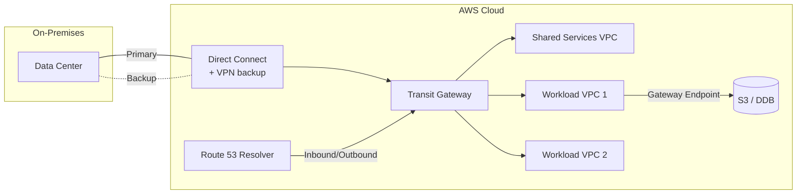

# 02 — Networking: VPC, Hybrid Connectivity, DNS

> **Exam weight:** ⭐⭐⭐⭐⭐ — Roughly 20% of the exam. Networking scenarios appear in EVERY domain. Master Transit Gateway, Direct Connect, and PrivateLink trade-offs.

---

## 🗺️ Topic Map

```mermaid
graph TD
    A[Networking] --> B[VPC Fundamentals]
    A --> C[Inter-VPC Connectivity]
    A --> D[Hybrid Connectivity]
    A --> E[DNS - Route 53]
    A --> F[Content Delivery]
    
    B --> B1[Subnets / Route Tables]
    B --> B2[NAT Gateway / IGW]
    B --> B3[Security Groups / NACLs]
    B --> B4[VPC Endpoints - Interface/Gateway]
    
    C --> C1[VPC Peering]
    C --> C2[Transit Gateway]
    C --> C3[PrivateLink]
    
    D --> D1[Site-to-Site VPN]
    D --> D2[Direct Connect]
    D --> D3[Direct Connect Gateway]
    D --> D4[Client VPN]
    
    E --> E1[Routing Policies]
    E --> E2[Health Checks]
    E --> E3[Private Hosted Zones]
    E --> E4[Route 53 Resolver]
    
    F --> F1[CloudFront]
    F --> F2[Global Accelerator]
```



---

## 📚 Notes in This Section

| # | Topic | Priority |
|---|---|---|
| 01 | [VPC Fundamentals & Components](./01-vpc-fundamentals.md) | 🔥 |
| 02 | [VPC Endpoints — Gateway vs Interface](./02-vpc-endpoints.md) | 🔥 |
| 03 | [VPC Peering vs Transit Gateway](./03-peering-vs-tgw.md) | 🔥 |
| 04 | [AWS PrivateLink Deep Dive](./04-privatelink.md) | 🔥 |
| 05 | [Site-to-Site VPN](./05-site-to-site-vpn.md) | High |
| 06 | [Direct Connect & DX Gateway](./06-direct-connect.md) | 🔥 |
| 07 | [Hybrid DNS — Route 53 Resolver](./07-hybrid-dns.md) | High |
| 08 | [Route 53 Routing Policies](./08-route53-policies.md) | 🔥 |
| 09 | [CloudFront vs Global Accelerator](./09-cloudfront-vs-ga.md) | 🔥 |

---

## 🎯 The 5 Networking Mental Models for SAP-C02

```
1. "TRANSIT GATEWAY vs PEERING"
   - <3 VPCs, low cost, no transitive → Peering
   - Many VPCs, hub-spoke, hybrid → Transit Gateway
   - >50 VPCs or shared services → TGW + RAM

2. "PRIVATE TRAFFIC TO AWS SERVICES"
   - S3, DynamoDB → Gateway Endpoint (FREE)
   - Everything else → Interface Endpoint (PrivateLink)
   - Cross-VPC private service → PrivateLink

3. "HYBRID CONNECTIVITY"
   - Quick + cheap + over internet → Site-to-Site VPN
   - High bandwidth + low latency + dedicated → Direct Connect
   - Connect to many VPCs from on-prem → DX Gateway + TGW
   - Backup for DX → VPN as failover

4. "DNS ROUTING"
   - Multi-region active-active → Latency
   - Multi-region active-passive → Failover
   - Gradual rollout → Weighted
   - Geo-specific compliance → Geolocation
   - Lowest latency to closest endpoint → Latency

5. "GLOBAL CONTENT/TRAFFIC"
   - Cacheable HTTP/S content → CloudFront
   - TCP/UDP, static IPs, instant failover → Global Accelerator
```

---

## 🏗️ The Reference Architecture



This is the **canonical SAP-C02 hybrid architecture**. Know it cold.
