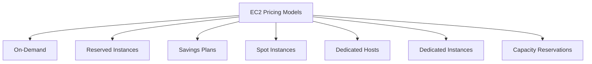
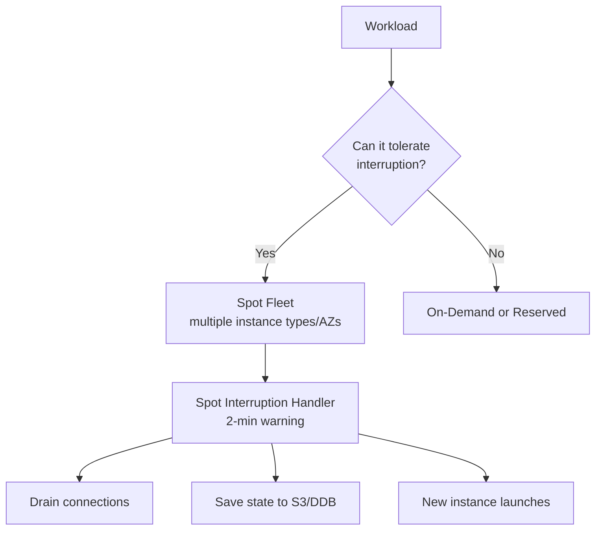

# EC2 Instance Families & Pricing Models

## Problem It Solves
Different workloads have wildly different needs — memory-hungry databases, CPU-heavy ML, GPU graphics, network-intensive caching. EC2 offers many **instance families** so you don't pay for what you don't need. And different consumption patterns (24/7 vs spiky vs interruptible) need different **pricing models** for cost efficiency.

## How It Works — Instance Families

```mermaid
graph TD
    EC2[EC2 Instance Families]
    EC2 --> GP[General Purpose<br/>balanced]
    EC2 --> CO[Compute Optimized<br/>CPU intensive]
    EC2 --> MO[Memory Optimized<br/>RAM intensive]
    EC2 --> SO[Storage Optimized<br/>IO intensive]
    EC2 --> AO[Accelerated Computing<br/>GPU/FPGA]
    EC2 --> HPC[HPC Optimized]
    
    GP --> M[M-series: M7g, M7i]
    GP --> T[T-series: T3, T4g - burstable]
    GP --> A[A-series: ARM economy]
    
    CO --> C[C-series: C7g, C7i]
    
    MO --> R[R-series: R7g, R7i]
    MO --> X[X-series: X2idn - extreme memory]
    MO --> U[U-series: u-24tb1 - 24TB RAM!]
    MO --> Z[z1d: high freq + memory]
    
    SO --> I[I-series: I4i - NVMe SSD]
    SO --> D[D-series: D3 - HDD dense]
    SO --> H[H-series: HDD]
    
    AO --> P[P-series: P5 - GPU AI/ML]
    AO --> G[G-series: G5 - graphics/inference]
    AO --> F[F1: FPGA]
    AO --> INF[Inf, Trn: Inferentia/Trainium]
    
    HPC --> HPC7[Hpc7a: ARM HPC]
```



### The Naming Convention

```
r7i.2xlarge
│ │ │   │
│ │ │   └── Size (nano, micro, small, medium, large, xlarge, 2xlarge...)
│ │ └────── Additional capabilities:
│ │            g = AWS Graviton (ARM, ~20% cheaper)
│ │            n = Network optimized
│ │            d = NVMe SSD instance storage
│ │            a = AMD EPYC processor
│ │            e = Extra memory
│ │            i = Intel
│ └──────── Generation (higher = newer)
└────────── Family
            t/m/a = General purpose
            c     = Compute optimized
            r/x/u = Memory optimized
            i/d/h = Storage optimized
            p/g/f = Accelerated (GPU/FPGA)
```

### Family-to-Use-Case Map

| Family | Use Case | Real Example |
|---|---|---|
| **T-series** (burstable) | Variable CPU, low baseline | Dev/test, low-traffic sites |
| **M-series** | Balanced workloads | Web servers, small DBs, app servers |
| **C-series** | CPU-bound | Batch processing, video encoding, gaming servers |
| **R-series** | Memory-bound | In-memory caches (Redis), real-time big data |
| **X / U-series** | Extreme memory | SAP HANA, Apache Spark, large in-memory DBs |
| **I-series** | High IOPS local NVMe | NoSQL DBs, OLTP, search engines |
| **D-series** | Dense HDD storage | Hadoop HDFS, data warehousing |
| **P-series** | GPU ML training | Deep learning model training |
| **G-series** | GPU inference / graphics | ML inference, game streaming, CAD |
| **Inf / Trn** | Custom AI silicon | Cost-optimized inference / training |

### Burstable T-Series — The Hidden Gotcha

```
T instances earn CPU credits when idle.
You SPEND credits when busy above baseline.

Run out of credits = throttled to baseline (very slow).

Two modes:
─────────────────────────────────────────
STANDARD     → Throttles when credits = 0
UNLIMITED    → Lets you burst but charges $$ for it

⚠️ T-series in production with sustained CPU often
   ends up COSTING MORE than M-series due to unlimited
   mode charges. Use M when CPU is consistently >40%.
```

## How It Works — Pricing Models



### The 6 Pricing Models

```
┌──────────────────────────────────────────────────────────┐
│ 1. ON-DEMAND                                              │
│    Pay per second/hour, no commitment                    │
│    Most expensive, most flexible                         │
│    Use: Unpredictable workloads, dev/test                │
├──────────────────────────────────────────────────────────┤
│ 2. RESERVED INSTANCES (RIs)                              │
│    1- or 3-year commitment                               │
│    Up to 72% discount                                    │
│    Standard RI = locked to instance type                 │
│    Convertible RI = can change family/OS (less discount) │
│    Can be sold on Reserved Instance Marketplace          │
│    Use: Predictable steady-state workloads               │
├──────────────────────────────────────────────────────────┤
│ 3. SAVINGS PLANS                                         │
│    Commit $/hour spend for 1-3 years                     │
│    Up to 72% discount                                    │
│    Compute SP = any region, any family, any OS, even    │
│                  Lambda + Fargate                        │
│    EC2 SP = locked to region/family but flexible size    │
│    Use: Predictable spend but flexible workload          │
├──────────────────────────────────────────────────────────┤
│ 4. SPOT INSTANCES                                        │
│    Up to 90% discount                                    │
│    AWS can reclaim with 2-minute warning                 │
│    Spot Fleet for mixed instance types                   │
│    Use: Stateless batch, fault-tolerant, big data, ML    │
├──────────────────────────────────────────────────────────┤
│ 5. DEDICATED HOSTS                                       │
│    Whole physical server reserved for you                │
│    BYOL (Bring Your Own License) — Windows/Oracle/SQL   │
│    Compliance: no other tenants on same hardware         │
│    Most expensive                                        │
├──────────────────────────────────────────────────────────┤
│ 6. DEDICATED INSTANCES                                   │
│    Instances on hardware dedicated to your account       │
│    Less control than Hosts (no socket/core visibility)   │
│    Cheaper than Hosts, more expensive than On-Demand     │
├──────────────────────────────────────────────────────────┤
│ + CAPACITY RESERVATIONS                                  │
│    Reserve capacity in a specific AZ                     │
│    No discount, just guaranteed availability             │
│    Use: DR, predictable scaling events (Black Friday)    │
└──────────────────────────────────────────────────────────┘
```

### Savings Plans — Why They're Usually Better Than RIs

```
COMPUTE SAVINGS PLAN (the powerful one):
─────────────────────────────────────────────
✅ Covers EC2 in ANY region
✅ Covers ANY instance family
✅ Covers Linux/Windows
✅ Covers Fargate
✅ Covers Lambda
✅ Up to 66% off

vs Standard RI: tied to instance family, OS, region

Almost always use Compute SP unless you need RI's
   "Capacity Reservation" guarantee.
```

### Spot — How to Use Safely



**Spot best practices:**
- Use **Spot Fleet** with diversified instance types (more spare capacity = less interruption)
- Listen to the **2-minute interruption notice** via instance metadata
- Use **Capacity-optimized** allocation strategy (least likely to be interrupted)
- Pair with Auto Scaling Group for automatic replacement
- **Never** for state-heavy workloads without checkpointing

### Mixing Pricing Models — Best Practice Pattern

```
Real production fleet pricing mix:
─────────────────────────────────────────────

Baseline (always-on capacity)
  → 70% Reserved or Savings Plan
  
Predictable peaks
  → 20% On-Demand

Burst / batch / stateless
  → 10% Spot

Compliance / BYOL workload
  → Dedicated Hosts (if applicable)
```

## When to Use What

| Workload Profile | Best Pricing |
|---|---|
| Web app, 24/7, predictable | Savings Plan / Reserved |
| Batch processing, stateless | Spot |
| Dev/test, sporadic | On-Demand |
| HPC training cluster | Spot Fleet (huge savings) |
| Database (statefull) | Reserved/Savings Plan |
| Sudden burst (Black Friday) | Capacity Reservation + On-Demand |
| Compliance: no shared tenancy | Dedicated Instance |
| Windows/Oracle BYOL | Dedicated Host |
| Real-time gaming server | On-Demand + Capacity Reservation |

## When NOT to Use

- ❌ Don't put a **production database on Spot** — interruption = data loss
- ❌ Don't use **T-series for sustained workloads** — credit exhaustion → throttling
- ❌ Don't buy **Standard RIs** without analyzing trends — too rigid
- ❌ Don't run all of fleet on **Spot** — risk of mass interruption
- ❌ Don't use **Dedicated Hosts** unless BYOL or compliance requires — expensive

## Trade-offs

| Choice | Gain | Sacrifice |
|---|---|---|
| Spot | Up to 90% cheaper | Can be reclaimed |
| Savings Plan over RI | Flexibility | Slightly less max discount |
| Reserved | Big discount + capacity | Lock-in (1-3 yrs) |
| Graviton (ARM) | ~20% cheaper, faster | Need to rebuild containers for ARM |
| Burstable T | Cheap when idle | Throttle when sustained |

## Real World Example

**Pinterest's** cost-optimized fleet:
- Web tier: **Compute Savings Plan** for predictable baseline (~75% of capacity)
- Image rendering: **Spot Fleet** (~80% spot) — interruption tolerable for async jobs
- Big data (Spark): **Spot Instances** across many instance types — saved millions/year
- Databases: **Standard RIs** because of capacity reservation guarantee

**Airbnb** uses **Graviton (ARM)** for most of its services — same throughput at ~20% lower cost. Required some app rebuilds.

## 🎯 Exam Soundbite

> "EC2 instance families align CPU, memory, network, and storage ratios to workload type — General Purpose for balanced needs, Memory Optimized for caches and analytics, Compute Optimized for CPU-bound work, Storage Optimized for high IOPS local storage. For pricing, layer Compute Savings Plans for predictable baseline, On-Demand for variable peaks, and Spot for fault-tolerant workloads. Use Dedicated Hosts only for BYOL or compliance."

---

## ⚡ Quick Recall Card

```
┌─────────────────────────────────────────────────┐
│ INSTANCE FAMILY MNEMONIC                         │
├─────────────────────────────────────────────────┤
│ T = Turbo (burstable, cheap)                     │
│ M = Main (balanced)                              │
│ C = Compute (CPU)                                │
│ R = RAM (memory)                                 │
│ X = eXtreme memory                               │
│ U = Ultra memory (24TB)                          │
│ I = IOPS (NVMe SSD)                              │
│ D = Dense HDD                                    │
│ P = Powerful GPU                                 │
│ G = Graphics GPU                                 │
└─────────────────────────────────────────────────┘

┌─────────────────────────────────────────────────┐
│ PRICING DECISION                                 │
├─────────────────────────────────────────────────┤
│ 24/7 known        → Compute Savings Plan         │
│ Spiky predictable → SP baseline + On-Demand      │
│ Fault tolerant    → Spot                         │
│ Short-lived       → On-Demand                    │
│ BYOL / compliance → Dedicated Host               │
│ Capacity guarantee → Capacity Reservation        │
└─────────────────────────────────────────────────┘
```
