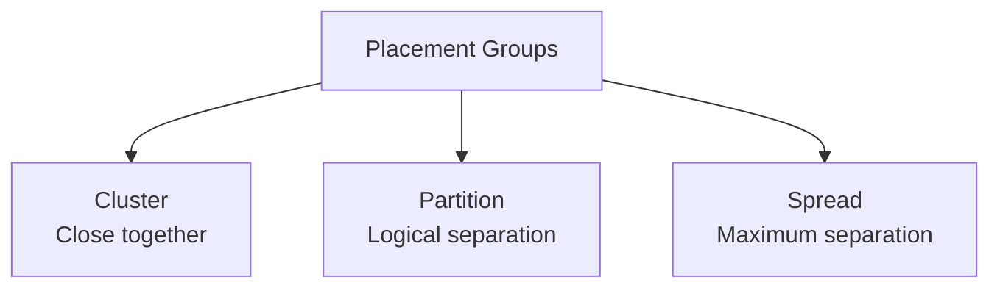
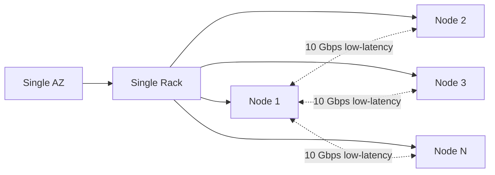
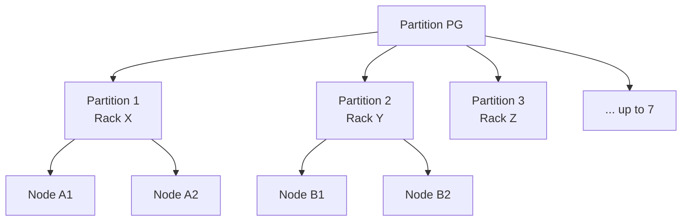
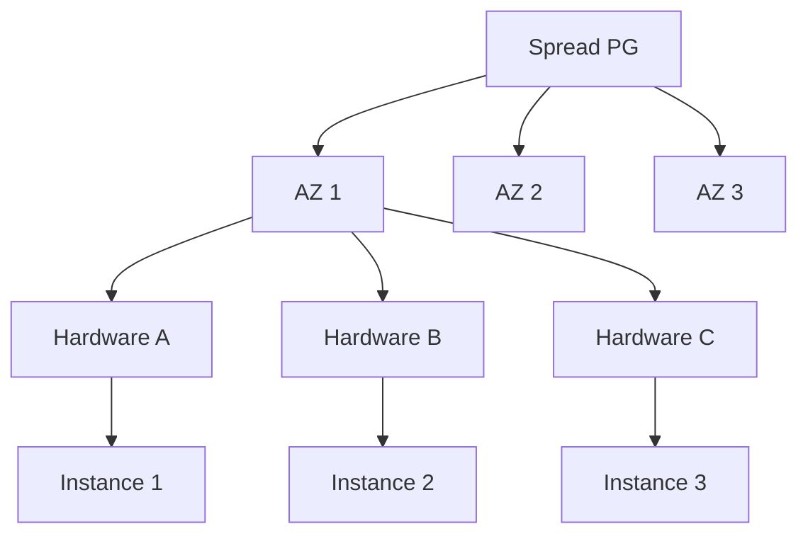

# EC2 Placement Groups

> 🔥 **Niche but tested topic.** Know the three types and their use cases.

## Problem It Solves
By default, EC2 places instances wherever it has capacity — across AZs, racks, hardware. For most workloads that's fine. But some workloads need explicit control:
- HPC clusters need instances physically close together (low latency)
- Critical workloads need instances spread across racks (avoid hardware failure)
- Big distributed databases want partition-aware placement

**Placement Groups give you that control.**

## The Three Types



| | **Cluster** | **Partition** | **Spread** |
|---|---|---|---|
| Goal | Lowest latency | Distributed system fault isolation | Maximum hardware independence |
| Placement | Same AZ, close hardware | Multiple partitions, distinct racks | Each instance on different hardware |
| Network | 10/25 Gbps single-flow | Standard | Standard |
| Use case | HPC, ML training | Hadoop, Cassandra, HDFS | Critical small fleets |
| Max instances | Limited (depends on instance type) | Many (7 partitions × N per AZ) | 7 per AZ |

---

## Cluster Placement Group



```
CLUSTER PLACEMENT GROUP:
─────────────────────────────────────────────
✅ Instances placed close together
✅ Same Availability Zone
✅ Same underlying network/rack
✅ Up to 10 Gbps single-flow throughput (vs 5 Gbps standard)
✅ Low-latency interconnect

LIMITATIONS:
─────────────────────────────────────────────
❌ Single AZ = AZ failure kills entire group
❌ Limited capacity (may fail to launch if capacity tight)
❌ Best to launch all instances at once

USE CASES:
─────────────────────────────────────────────
✅ HPC clusters (MPI workloads)
✅ Distributed ML training (multi-GPU)
✅ Real-time tightly-coupled apps
✅ Big data with intra-cluster network demands
✅ Financial trading systems

RECOMMENDATION:
─────────────────────────────────────────────
Use ENA (Elastic Network Adapter) instance types
Use same instance type for all (consistent)
```

---

## Partition Placement Group



```
PARTITION PLACEMENT GROUP:
─────────────────────────────────────────────
✅ Up to 7 partitions per AZ
✅ Each partition has its own racks (hardware-isolated)
✅ Multiple instances per partition
✅ Different partitions = different physical hardware
✅ Can span multiple AZs (each AZ has its own partitions)

KEY GUARANTEE:
─────────────────────────────────────────────
Failure of one partition's hardware ≠ failure of another's
Distributed system can replicate across partitions for resilience

USE CASES:
─────────────────────────────────────────────
✅ HDFS (Hadoop Distributed File System)
✅ Cassandra clusters
✅ Kafka brokers
✅ Large distributed databases
✅ Big data workloads with partition-aware replication

EXAMPLE:
─────────────────────────────────────────────
Cassandra cluster:
- 7 partitions in us-east-1a
- 7 partitions in us-east-1b
- 7 partitions in us-east-1c
- Replicate data across partitions and AZs
- Single rack failure = at most one partition affected
```

### Partition-Aware Apps

```
WHY PARTITIONS MATTER:
─────────────────────────────────────────────
Distributed systems can query partition number:
  http://169.254.169.254/latest/meta-data/placement/partition-number

Use this for replica placement decisions:
- Replica 1 in partition 1
- Replica 2 in partition 4 (different partition)
- Replica 3 in partition 7

Result: Hardware fault in partition 1 doesn't take all replicas.
```

---

## Spread Placement Group



```
SPREAD PLACEMENT GROUP:
─────────────────────────────────────────────
✅ Each instance on completely separate hardware
✅ Max 7 instances per AZ in the group
✅ Can span multiple AZs (7 per AZ)
✅ MAXIMUM fault isolation
✅ Strictest of the three types

USE CASES:
─────────────────────────────────────────────
✅ Small fleets where each instance is critical
✅ Master/leader nodes in distributed systems
✅ Quorum-based systems (3-5 critical nodes)
✅ Anything where you can't lose multiple at once

EXAMPLE:
─────────────────────────────────────────────
Etcd / Consul / ZooKeeper cluster:
- 5 nodes, each on different hardware
- Single hardware failure = lose 1 node only
- Quorum (3 of 5) still met
```

### Spread Levels

```
HOST-LEVEL SPREAD (default):
─────────────────────────────────────────────
Spreads across underlying hosts
For shared tenancy

RACK-LEVEL SPREAD (Outposts only):
─────────────────────────────────────────────
For AWS Outposts deployments
Spreads across racks within the Outpost
```

---

## Comparison Matrix

| Aspect | Cluster | Partition | Spread |
|---|---|---|---|
| Best for | Latency | Distributed DB | Small critical fleet |
| Network throughput | Up to 10 Gbps single flow | Standard | Standard |
| Same AZ requirement | Yes | No (can span AZs) | No (can span AZs) |
| Max instances | Depends on instance/capacity | Many (7 partitions × N) | 7 per AZ |
| Hardware isolation | None (tight together) | Per partition | Per instance |
| Fault tolerance | None (single rack) | Partition-level | Per-instance |
| Latency between instances | Lowest | Higher (partitions) | Higher (spread) |

---

## When to Use Each

### Cluster

```
✅ "MPI workload — need lowest latency between nodes"
✅ "Training large ML model across 8 GPUs"
✅ "Financial trading platform — every microsecond counts"
✅ "Big data Spark job, lots of shuffle traffic"
✅ "HPC simulation"
```

### Partition

```
✅ "Hadoop / HDFS cluster with replication"
✅ "Cassandra ring needing hardware isolation"
✅ "Kafka cluster with partition-aware brokers"
✅ "Large distributed database (50+ nodes)"
✅ "Want both isolation AND many instances"
```

### Spread

```
✅ "5-node Consul cluster, can't lose 2 at once"
✅ "Database primary + 2 replicas, all must survive"
✅ "Small but critical service tier"
✅ "Quorum-based system with 3-7 nodes"
```

---

## Mixing & Limitations

```
CAN'T MIX TYPES:
─────────────────────────────────────────────
Each placement group is ONE type
Need different types? Multiple placement groups

INSTANCE TYPE LIMITS:
─────────────────────────────────────────────
Cluster: needs supported instance types (most modern)
Spread: not supported on t2 / smaller instance types

MOVING INSTANCES:
─────────────────────────────────────────────
Can move existing instance INTO placement group
(must be stopped first)
Same for moving out

CAPACITY ISSUES:
─────────────────────────────────────────────
Cluster: may fail if AZ doesn't have enough capacity
         on close hardware
Mitigation: Launch all at once, request capacity reservation
```

---

## Combining with Other Tactics

### Cluster + Capacity Reservation

```
ENSURE CLUSTER LAUNCH SUCCEEDS:
─────────────────────────────────────────────
Reserve capacity in advance with On-Demand Capacity Reservation
Specify placement group when reserving
Guarantees the instances can launch when needed
```

### Partition + ASG

```
AUTO SCALING WITH PARTITIONS:
─────────────────────────────────────────────
ASG can launch into a partition placement group
Distribute new instances across partitions
Maintain partition-aware fault tolerance as you scale
```

---

## When NOT to Use

- ❌ Don't use Cluster for HA workloads (single AZ)
- ❌ Don't use Spread for >7 instances per AZ (use Partition)
- ❌ Don't use Partition if you don't have partition-aware app logic
- ❌ Don't use any PG if standard placement is fine (most workloads)

## Trade-offs

| Choice | Gain | Sacrifice |
|---|---|---|
| Cluster | Best network performance | No AZ HA, capacity constraints |
| Partition | Big fleet + hardware isolation | App must be partition-aware |
| Spread | Strongest per-instance isolation | Hard limit of 7/AZ |
| No PG | Maximum flexibility | No control over placement |

## Real World Example

**A trading firm:**
- Latency-critical matching engine: **Cluster PG** in one AZ, with capacity reservation
- 10 Gbps inter-node communication for order matching
- Trade-off: AZ failure = entire matching engine down
- Mitigation: Active-standby matching engines in different AZs (separate cluster PGs)

**A big data company (Cassandra):**
- **Partition PG** with 7 partitions per AZ × 3 AZs
- Cassandra replication strategy aware of partitions
- Configured replicas to span different partitions and AZs
- Single rack failure = 1 partition affected, replication keeps cluster healthy

**A critical microservice:**
- 3-node etcd cluster (cluster state for K8s)
- **Spread PG** ensures each node on different hardware
- Single hardware fault doesn't kill quorum (need 2 of 3)

## 🎯 Exam Soundbite

> "EC2 Placement Groups control instance placement for specific needs. Cluster placement groups put instances physically close for lowest network latency (10 Gbps single-flow) but require a single AZ — use for HPC and tightly-coupled workloads. Partition placement groups divide instances across up to 7 hardware-isolated partitions per AZ — use for large distributed databases like Cassandra, HDFS, and Kafka where the app is partition-aware. Spread placement groups put each instance on completely separate hardware (max 7 per AZ) — use for small critical fleets where you can't tolerate multiple simultaneous failures."

---

## ⚡ Quick Recall Card

```
┌─────────────────────────────────────────────────┐
│ PLACEMENT GROUPS                                 │
├─────────────────────────────────────────────────┤
│ CLUSTER                                          │
│   Same AZ, close hardware                        │
│   10 Gbps single-flow possible                   │
│   Use: HPC, ML training, low-latency             │
│                                                  │
│ PARTITION                                        │
│   Up to 7 partitions per AZ                      │
│   Each partition = isolated hardware             │
│   Use: HDFS, Cassandra, Kafka (big distributed)  │
│   App should be partition-aware                  │
│                                                  │
│ SPREAD                                           │
│   Each instance on different hardware            │
│   Max 7 instances per AZ                         │
│   Use: Small critical fleets (3-7 nodes)         │
└─────────────────────────────────────────────────┘
```

## 🎓 Common Exam Patterns

> **"HPC application running MPI, need lowest possible latency between nodes."**
>
> ✅ **Cluster Placement Group** in a single AZ with ENA-enabled instances.

> **"100-node Cassandra cluster needs hardware isolation for fault tolerance."**
>
> ✅ **Partition Placement Group** with 7 partitions × 3 AZs = up to 21 partitions, Cassandra config replicates across partitions.

> **"5-node consul cluster — each node must be on independent hardware."**
>
> ✅ **Spread Placement Group** (max 7 per AZ — 5 fits easily).
