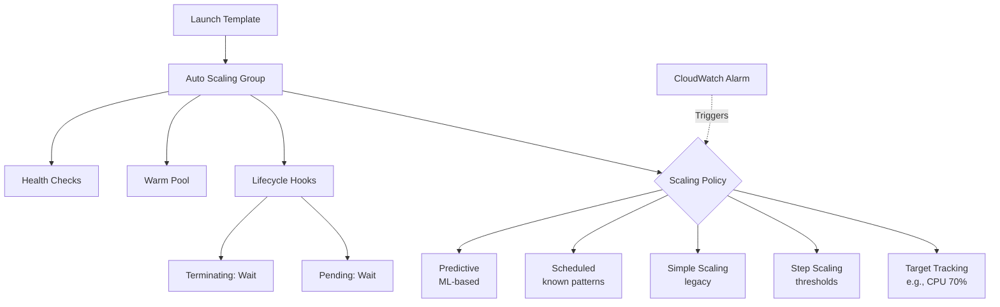
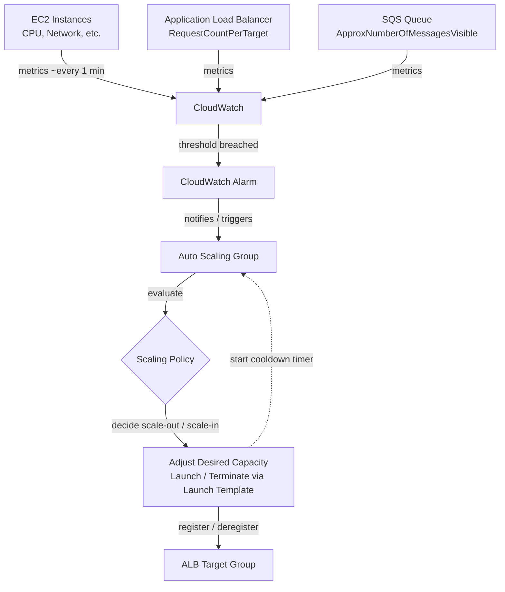
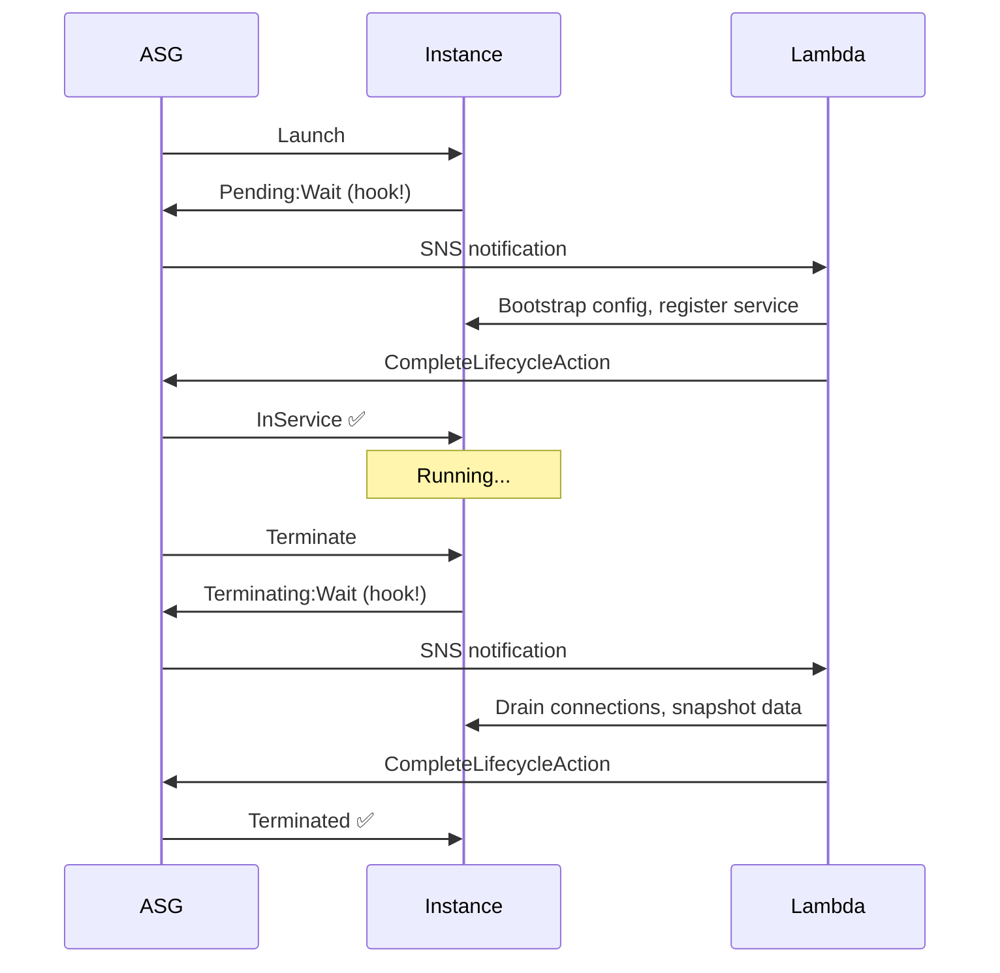

# Auto Scaling Deep Dive

> 🔥 **Exam staple.** Know the difference between scaling policies, lifecycle hooks, warm pools, and predictive scaling.

## Problem It Solves
Static fleets are either over-provisioned (wasted money) or under-provisioned (outages during peaks). Auto Scaling automatically adjusts capacity based on demand — scaling out during load spikes and scaling in during quiet periods — saving money while maintaining reliability.

## How It Works



### The Building Blocks

```
┌────────────────────────────────────────────────────────────┐
│ LAUNCH TEMPLATE                                             │
│   Defines: AMI, instance type, security groups, user data, │
│            IAM instance profile, storage                   │
│   Versions: Multiple versions, can set default             │
│   Replaces: Launch Configurations (deprecated)             │
├────────────────────────────────────────────────────────────┤
│ AUTO SCALING GROUP (ASG)                                   │
│   Defines: Min, Desired, Max capacity                      │
│            AZs and subnets                                 │
│            Load balancer target group                      │
│            Health check type (EC2 / ELB)                   │
│            Termination policy                              │
├────────────────────────────────────────────────────────────┤
│ MIXED INSTANCES POLICY                                      │
│   Run multiple instance types (e.g. mix of m5, m6i, m6a)   │
│   Mix of On-Demand and Spot in one ASG                     │
│   Spot allocation: lowest-price OR capacity-optimized      │
└────────────────────────────────────────────────────────────┘
```

#### Min / Desired / Max — Don't Confuse These

```
MIN      = floor. ASG never goes below this (your guardrail)
MAX      = ceiling. ASG never goes above this (your guardrail)
DESIRED  = how many you actually want running RIGHT NOW
           — the "sweet spot" the ASG keeps converging to

Example:  Min=2, Desired=5, Max=10  →  5 running now,
          can grow to 10 or shrink to 2 — never outside that.
```

> Scaling policies work by **changing the Desired capacity**. Target tracking,
> step, simple, scheduled, predictive — all of them ultimately move the
> *Desired* number up or down, and the ASG launches/terminates to match it
> (always clamped between Min and Max).

### Metric Flow — How a Scaling Decision Actually Happens

Auto Scaling itself does **not** watch your instances. **CloudWatch** does the
monitoring; the ASG only *acts* on alarms. Metrics are collected every **1 minute**
by default (standard monitoring); detailed monitoring tightens this further.



**The loop in words:**
1. EC2 / ALB / SQS continuously emit metrics → CloudWatch aggregates them.
2. CloudWatch compares the metric (e.g. **average** CPU across the ASG) to the
   alarm threshold you defined.
3. When breached, the alarm **triggers the ASG's scaling policy**.
4. The policy changes **Desired capacity**; new instances launch from the
   **Launch Template** and **auto-register with the load balancer's target group**.
5. A **cooldown timer** starts — see below.

> 🔑 Same flow for *every* metric source — CPU, ALB request count, or SQS queue
> depth. CloudWatch monitors all of them continuously; only the metric changes.

### The 5 Scaling Policy Types

```
┌──────────────────────────────────────────────────────────┐
│ 1. TARGET TRACKING (Default - most common)               │
│    "Keep average CPU at 70%"                             │
│    AWS auto-calculates scale-out/in                      │
│    Simplest to configure ✅                              │
│    Use: Most workloads                                   │
├──────────────────────────────────────────────────────────┤
│ 2. STEP SCALING                                          │
│    "If CPU > 60% add 1, if > 80% add 3, if >90% add 5"   │
│    Multiple thresholds, granular control                 │
│    Use: When you need different action at different      │
│         severity                                          │
├──────────────────────────────────────────────────────────┤
│ 3. SIMPLE SCALING (Legacy)                               │
│    "If alarm fires, add 1 instance, wait, check again"   │
│    Has cooldown — can't respond to multiple alarms       │
│    Don't use ❌ — superseded by Step / Target Tracking   │
├──────────────────────────────────────────────────────────┤
│ 4. SCHEDULED SCALING                                     │
│    "Every Monday 9am scale to 10, 6pm scale to 2"        │
│    Known patterns — business hours, holiday traffic     │
│    Combines with other policies                          │
├──────────────────────────────────────────────────────────┤
│ 5. PREDICTIVE SCALING                                    │
│    Machine learning analyzes 14+ days history            │
│    Scales OUT proactively before predicted spike         │
│    Forecasts up to 2 days ahead                          │
│    Combines with target tracking                         │
│    Use: Recurring patterns (daily/weekly cycles)         │
└──────────────────────────────────────────────────────────┘
```

### Target Tracking — How It Works Visually

```
       Capacity
          │
          │
   12 ────┼──────────         ╭──── scale out
          │                  ╱
    8 ────┼──────────╮      ╱       ◄── CPU > 70%
          │           ╲    ╱
    4 ────┼─────╮      ╲  ╱         ◄── CPU back at 70%
          │      ╲      ╲╱
    2 ────┼───────╲─────╯           ◄── CPU < 70%
          │
          └──────────────────────────────► Time
```

### Scaling Cooldowns vs Warm Pools

```
COOLDOWN (Simple Scaling era):
─────────────────────────────────────
After a scaling action, wait N seconds before next
Default: 300 seconds
Prevents oscillation

⚠️ It's a BLANKET PAUSE: during cooldown, NO scaling action
   fires at all — neither another scale-out NOR a scale-in.
   Only after it expires can the next metric breach act.


WARM POOL (Modern):
─────────────────────────────────────
Pre-initialized instances sitting in "stopped" state
When you need them, just "start" — boot in seconds
vs Launching new = minutes (AMI download, init, ELB register)

Use: Slow-starting apps (Java, large containers)
Cost: Pay for EBS during stopped state only
```

#### Cooldown behavior per policy type

```
SIMPLE SCALING
  • You explicitly set HOW MANY instances per action
    ("CPU > 60% → add 2", "CPU < 30% → remove 1")
  • Hard cooldown blocks ALL actions until it expires
  • This is why it's legacy — can't react to a second alarm
    while waiting

STEP SCALING
  • Also has a cooldown, but evaluates STEPS during the breach
    ("60-70% +1, 70-80% +2, >80% +4")
  • More responsive — picks action size by severity

TARGET TRACKING
  • No manual instance count — AWS calculates it to hit target
  • Has built-in protection so it won't thrash while instances
    are still warming up; default scale-related cooldown ~300s
  • CONFIGURABLE: separate scale-in vs scale-out cooldown,
    and you can DISABLE SCALE-IN entirely (auto scale-out,
    manual scale-in)
```

> **Why this matters (the "instance still booting" problem):** with target
> tracking you worried a second scale-out could fire before the first instances
> are up. AWS guards against this by evaluating the metric over a window (not
> every spike) plus the cooldown/warm-up window — so it stabilizes instead of
> over-launching.

### Scaling on Request Count & Queue Depth (beyond CPU)

CPU is the default, but it's a poor signal for IO-bound or queue-driven apps.
Two very common alternatives — both monitored continuously by CloudWatch, same
flow as CPU:

```
ALB REQUEST COUNT
─────────────────────────────────────
Metric: RequestCountPerTarget
"Keep ~1000 requests per instance"
→ scale on actual traffic hitting the fleet

SQS QUEUE DEPTH (worker fleets)
─────────────────────────────────────
Metric: ApproximateNumberOfMessagesVisible
"Add workers when > N messages waiting"
→ scale consumers to drain a backlog
   (often used as a custom/target-tracking metric:
    backlog-per-instance)
```

### Setup Walk-through — Simple Scaling Behind a Load Balancer

End-to-end wiring for an app fronted by an ALB:

```
1. Launch Template   → defines AMI, instance type, SGs, user-data
2. Auto Scaling Group → Min/Desired/Max, subnets across AZs
3. Attach ASG to the ALB's TARGET GROUP
      → new instances auto-register; ALB spreads traffic to all
4. Scaling policy    → "avg CPU > 70% → add 2 instances"
5. CloudWatch alarm  → watches the metric, triggers the policy
6. On breach: ASG launches from the template, registers the new
   instances with the target group, ALB starts routing to them
```

> Traffic always enters through the ALB → target group → instances. The ASG's
> job is only to keep the *right number* of instances registered there.

### Lifecycle Hooks — Custom Init/Shutdown



**Use cases:**
- Drain database connections before termination
- Snapshot logs/data
- Deregister from service discovery
- Warm up JVM, cache populate
- Custom init beyond user-data

### Health Checks

```
EC2 HEALTH CHECK (default):
─────────────────────────────────────
Checks if instance is running (status checks)
Doesn't know if your app is healthy

ELB HEALTH CHECK:
─────────────────────────────────────
ASG marks instance unhealthy if ELB fails it
Use when behind load balancer (best practice)
ELB pings /health (you define) regularly
```

### Termination Policies — Who Dies First?

```
When scaling in, which instance terminates?

Default order:
1. AZ with most instances (rebalance)
2. Instance with the oldest Launch Template/Config
3. Instance closest to next billing hour
4. Random

Custom policies:
─────────────────────────────────────
- OldestInstance         (rolling fleet refresh)
- NewestInstance         (canary rollback)
- OldestLaunchTemplate
- AllocationStrategy     (Spot — match strategy)
```

### Instance Refresh (Rolling Updates)

```
You changed the Launch Template. How to update fleet?
─────────────────────────────────────────────

OLD WAY: Manually terminate instances one by one
NEW WAY: Instance Refresh

aws autoscaling start-instance-refresh \
    --auto-scaling-group-name my-asg \
    --strategy Rolling \
    --preferences '{
       "MinHealthyPercentage": 90,
       "InstanceWarmup": 300
    }'

✅ Automatically replaces instances in batches
✅ Maintains MinHealthyPercentage during replace
✅ Supports cancel/rollback
```

## When to Use Each Policy

| Pattern | Policy |
|---|---|
| Default web/app workload | **Target Tracking** (CPU 70% or RequestCount/target) |
| Asymmetric scale-out/in (slow scale-in) | **Step Scaling** with different alarms |
| Known recurring traffic peaks | **Scheduled** + Target Tracking |
| Predictable daily/weekly cycle | **Predictive** + Target Tracking |
| Pre-warm before known event | **Scheduled** |
| Slow-starting app (JVM, big containers) | **Warm Pool** |

## When NOT to Use

- ❌ Don't use **EC2 health check** when behind a load balancer — use ELB checks
- ❌ Don't set **min=0** for stateful workloads — risk of cold start
- ❌ Don't only use **CPU metric** for Auto Scaling — bad for IO-bound or memory-bound apps
- ❌ Don't put **databases in ASGs** — wrong tool (use RDS or DynamoDB instead)
- ❌ Don't forget **subnet ordering across AZs** — uneven distribution risk

## Trade-offs

| Choice | Gain | Sacrifice |
|---|---|---|
| Aggressive scaling | Responsive | Costlier, oscillation risk |
| Predictive scaling | Proactive, no lag | Needs history, ML adds complexity |
| Warm Pool | Fast scale-out | EBS costs during standby |
| Mixed instances + Spot | Massive cost savings | Spot interruptions to handle |
| Many small instances | Less blast radius | More overhead, more cost per CPU |

## Real World Example

**Slack** uses:
- **Predictive Scaling** for weekday business-hour spikes (very predictable pattern)
- **Target Tracking on custom metric** — connection count per instance (not just CPU)
- **Warm pools** for their messaging service — JVM-based, slow to start
- **Instance Refresh** for daily AMI rotations (security patches)

**Netflix** uses:
- **Spot fleets** with **Mixed Instances** policy — 5+ instance types per ASG
- **Target tracking** on custom metric (Atlas — their monitoring)
- **Capacity-optimized allocation** for Spot to minimize interruption
- Auto-replacement instantly on Spot interruption

## 🎯 Exam Soundbite

> "Use Target Tracking as the default Auto Scaling policy for simplicity — pick a metric like CPU or RequestCountPerTarget and AWS handles the math. Add Scheduled or Predictive scaling for known recurring patterns. Use Warm Pools for slow-starting applications. Always health-check via the load balancer when behind one, and use Instance Refresh for safe rolling deploys."

---

## ⚡ Quick Recall Card

```
┌─────────────────────────────────────────────────┐
│ AUTO SCALING QUICK FACTS                         │
├─────────────────────────────────────────────────┤
│ Default policy        Target Tracking            │
│ Multi-step thresholds Step Scaling               │
│ Time-based            Scheduled                  │
│ ML pattern detection  Predictive                 │
│ Slow-boot app fix     Warm Pool                  │
│ Custom init/shutdown  Lifecycle Hooks            │
│ Rolling deploy        Instance Refresh           │
│ Multi-instance type   Mixed Instances Policy     │
│ Health checks         Use ELB (not just EC2)     │
│ Cooldown              Replaced by warm-up        │
│ Who monitors?         CloudWatch (~1 min metrics)│
│ Web traffic metric    RequestCountPerTarget (ALB)│
│ Worker fleet metric   SQS messages visible       │
│ Policies change...    DESIRED capacity           │
└─────────────────────────────────────────────────┘
```

## 🎓 Common Exam Pattern

> **"App takes 8 minutes to start due to JVM warmup. Traffic spikes happen in seconds. They're losing requests during scale-out events. What's the fix?"**
>
> ✅ Use a **Warm Pool** with pre-initialized instances in stopped state. When ASG needs to scale out, instances are started (seconds) instead of launched fresh (minutes). Combine with **Predictive Scaling** so AWS adds capacity *before* the predicted spike.
