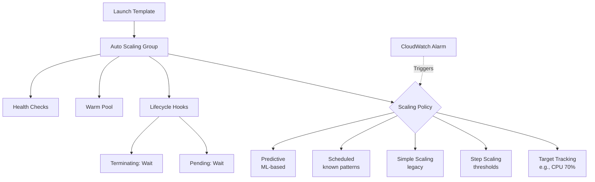
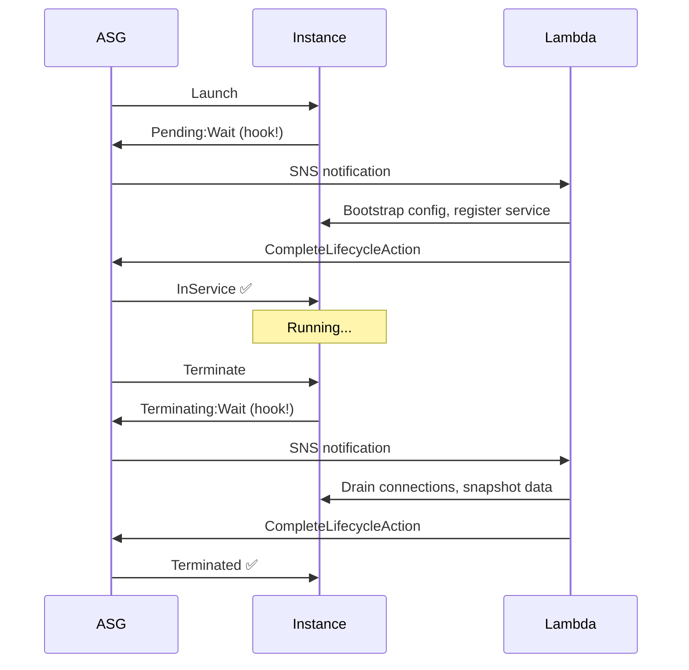

# Auto Scaling Deep Dive

> 🔥 **Exam staple.** Know the difference between scaling policies, lifecycle hooks, warm pools, and predictive scaling.

## Problem It Solves
Static fleets are either over-provisioned (wasted money) or under-provisioned (outages during peaks). Auto Scaling automatically adjusts capacity based on demand — scaling out during load spikes and scaling in during quiet periods — saving money while maintaining reliability.

## How It Works



### The Building Blocks

```
┌────────────────────────────────────────────────────────────┐
│ LAUNCH TEMPLATE                                             │
│   Defines: AMI, instance type, security groups, user data, │
│            IAM instance profile, storage                   │
│   Versions: Multiple versions, can set default             │
│   Replaces: Launch Configurations (deprecated)             │
├────────────────────────────────────────────────────────────┤
│ AUTO SCALING GROUP (ASG)                                   │
│   Defines: Min, Desired, Max capacity                      │
│            AZs and subnets                                 │
│            Load balancer target group                      │
│            Health check type (EC2 / ELB)                   │
│            Termination policy                              │
├────────────────────────────────────────────────────────────┤
│ MIXED INSTANCES POLICY                                      │
│   Run multiple instance types (e.g. mix of m5, m6i, m6a)   │
│   Mix of On-Demand and Spot in one ASG                     │
│   Spot allocation: lowest-price OR capacity-optimized      │
└────────────────────────────────────────────────────────────┘
```

### The 5 Scaling Policy Types

```
┌──────────────────────────────────────────────────────────┐
│ 1. TARGET TRACKING (Default - most common)               │
│    "Keep average CPU at 70%"                             │
│    AWS auto-calculates scale-out/in                      │
│    Simplest to configure ✅                              │
│    Use: Most workloads                                   │
├──────────────────────────────────────────────────────────┤
│ 2. STEP SCALING                                          │
│    "If CPU > 60% add 1, if > 80% add 3, if >90% add 5"   │
│    Multiple thresholds, granular control                 │
│    Use: When you need different action at different      │
│         severity                                          │
├──────────────────────────────────────────────────────────┤
│ 3. SIMPLE SCALING (Legacy)                               │
│    "If alarm fires, add 1 instance, wait, check again"   │
│    Has cooldown — can't respond to multiple alarms       │
│    Don't use ❌ — superseded by Step / Target Tracking   │
├──────────────────────────────────────────────────────────┤
│ 4. SCHEDULED SCALING                                     │
│    "Every Monday 9am scale to 10, 6pm scale to 2"        │
│    Known patterns — business hours, holiday traffic     │
│    Combines with other policies                          │
├──────────────────────────────────────────────────────────┤
│ 5. PREDICTIVE SCALING                                    │
│    Machine learning analyzes 14+ days history            │
│    Scales OUT proactively before predicted spike         │
│    Forecasts up to 2 days ahead                          │
│    Combines with target tracking                         │
│    Use: Recurring patterns (daily/weekly cycles)         │
└──────────────────────────────────────────────────────────┘
```

### Target Tracking — How It Works Visually

```
       Capacity
          │
          │
   12 ────┼──────────         ╭──── scale out
          │                  ╱
    8 ────┼──────────╮      ╱       ◄── CPU > 70%
          │           ╲    ╱
    4 ────┼─────╮      ╲  ╱         ◄── CPU back at 70%
          │      ╲      ╲╱
    2 ────┼───────╲─────╯           ◄── CPU < 70%
          │
          └──────────────────────────────► Time
```

### Scaling Cooldowns vs Warm Pools

```
COOLDOWN (Simple Scaling era):
─────────────────────────────────────
After a scaling action, wait N seconds before next
Default: 300 seconds
Prevents oscillation


WARM POOL (Modern):
─────────────────────────────────────
Pre-initialized instances sitting in "stopped" state
When you need them, just "start" — boot in seconds
vs Launching new = minutes (AMI download, init, ELB register)

Use: Slow-starting apps (Java, large containers)
Cost: Pay for EBS during stopped state only
```

### Lifecycle Hooks — Custom Init/Shutdown



**Use cases:**
- Drain database connections before termination
- Snapshot logs/data
- Deregister from service discovery
- Warm up JVM, cache populate
- Custom init beyond user-data

### Health Checks

```
EC2 HEALTH CHECK (default):
─────────────────────────────────────
Checks if instance is running (status checks)
Doesn't know if your app is healthy

ELB HEALTH CHECK:
─────────────────────────────────────
ASG marks instance unhealthy if ELB fails it
Use when behind load balancer (best practice)
ELB pings /health (you define) regularly
```

### Termination Policies — Who Dies First?

```
When scaling in, which instance terminates?

Default order:
1. AZ with most instances (rebalance)
2. Instance with the oldest Launch Template/Config
3. Instance closest to next billing hour
4. Random

Custom policies:
─────────────────────────────────────
- OldestInstance         (rolling fleet refresh)
- NewestInstance         (canary rollback)
- OldestLaunchTemplate
- AllocationStrategy     (Spot — match strategy)
```

### Instance Refresh (Rolling Updates)

```
You changed the Launch Template. How to update fleet?
─────────────────────────────────────────────

OLD WAY: Manually terminate instances one by one
NEW WAY: Instance Refresh

aws autoscaling start-instance-refresh \
    --auto-scaling-group-name my-asg \
    --strategy Rolling \
    --preferences '{
       "MinHealthyPercentage": 90,
       "InstanceWarmup": 300
    }'

✅ Automatically replaces instances in batches
✅ Maintains MinHealthyPercentage during replace
✅ Supports cancel/rollback
```

## When to Use Each Policy

| Pattern | Policy |
|---|---|
| Default web/app workload | **Target Tracking** (CPU 70% or RequestCount/target) |
| Asymmetric scale-out/in (slow scale-in) | **Step Scaling** with different alarms |
| Known recurring traffic peaks | **Scheduled** + Target Tracking |
| Predictable daily/weekly cycle | **Predictive** + Target Tracking |
| Pre-warm before known event | **Scheduled** |
| Slow-starting app (JVM, big containers) | **Warm Pool** |

## When NOT to Use

- ❌ Don't use **EC2 health check** when behind a load balancer — use ELB checks
- ❌ Don't set **min=0** for stateful workloads — risk of cold start
- ❌ Don't only use **CPU metric** for Auto Scaling — bad for IO-bound or memory-bound apps
- ❌ Don't put **databases in ASGs** — wrong tool (use RDS or DynamoDB instead)
- ❌ Don't forget **subnet ordering across AZs** — uneven distribution risk

## Trade-offs

| Choice | Gain | Sacrifice |
|---|---|---|
| Aggressive scaling | Responsive | Costlier, oscillation risk |
| Predictive scaling | Proactive, no lag | Needs history, ML adds complexity |
| Warm Pool | Fast scale-out | EBS costs during standby |
| Mixed instances + Spot | Massive cost savings | Spot interruptions to handle |
| Many small instances | Less blast radius | More overhead, more cost per CPU |

## Real World Example

**Slack** uses:
- **Predictive Scaling** for weekday business-hour spikes (very predictable pattern)
- **Target Tracking on custom metric** — connection count per instance (not just CPU)
- **Warm pools** for their messaging service — JVM-based, slow to start
- **Instance Refresh** for daily AMI rotations (security patches)

**Netflix** uses:
- **Spot fleets** with **Mixed Instances** policy — 5+ instance types per ASG
- **Target tracking** on custom metric (Atlas — their monitoring)
- **Capacity-optimized allocation** for Spot to minimize interruption
- Auto-replacement instantly on Spot interruption

## 🎯 Exam Soundbite

> "Use Target Tracking as the default Auto Scaling policy for simplicity — pick a metric like CPU or RequestCountPerTarget and AWS handles the math. Add Scheduled or Predictive scaling for known recurring patterns. Use Warm Pools for slow-starting applications. Always health-check via the load balancer when behind one, and use Instance Refresh for safe rolling deploys."

---

## ⚡ Quick Recall Card

```
┌─────────────────────────────────────────────────┐
│ AUTO SCALING QUICK FACTS                         │
├─────────────────────────────────────────────────┤
│ Default policy        Target Tracking            │
│ Multi-step thresholds Step Scaling               │
│ Time-based            Scheduled                  │
│ ML pattern detection  Predictive                 │
│ Slow-boot app fix     Warm Pool                  │
│ Custom init/shutdown  Lifecycle Hooks            │
│ Rolling deploy        Instance Refresh           │
│ Multi-instance type   Mixed Instances Policy     │
│ Health checks         Use ELB (not just EC2)     │
│ Cooldown              Replaced by warm-up        │
└─────────────────────────────────────────────────┘
```

## 🎓 Common Exam Pattern

> **"App takes 8 minutes to start due to JVM warmup. Traffic spikes happen in seconds. They're losing requests during scale-out events. What's the fix?"**
>
> ✅ Use a **Warm Pool** with pre-initialized instances in stopped state. When ASG needs to scale out, instances are started (seconds) instead of launched fresh (minutes). Combine with **Predictive Scaling** so AWS adds capacity *before* the predicted spike.
