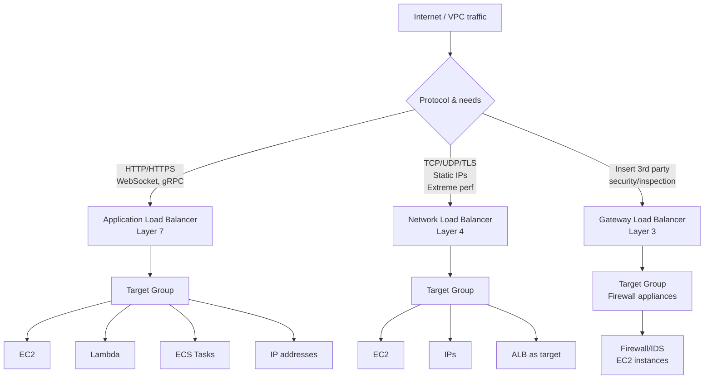
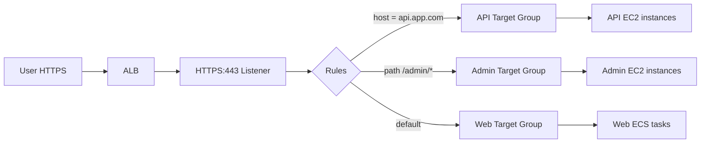
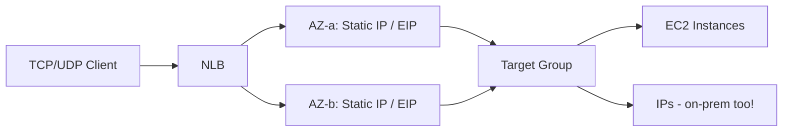
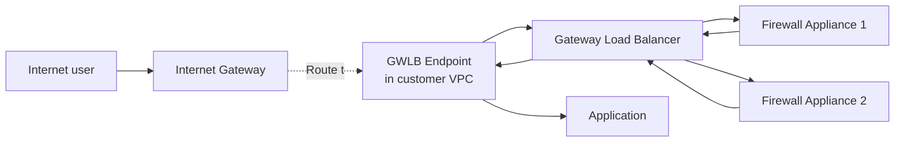
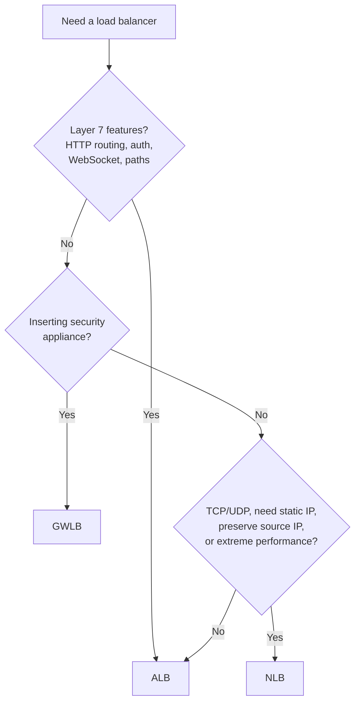

# Elastic Load Balancers — ALB vs NLB vs GWLB

> 🔥 **Always tested.** Know which LB type fits which scenario.

## Problem It Solves
Single backend = single point of failure. You need to distribute traffic across many backends, handle TLS termination, route based on host/path, integrate with security appliances, support real-time protocols (WebSocket, gaming UDP)… No single LB does all this. AWS gives you 3 specialized types.

## How They Work



### Side-by-Side Comparison

| | **ALB** | **NLB** | **GWLB** |
|---|---|---|---|
| Layer | 7 (Application) | 4 (Transport) | 3 (Network) |
| Protocols | HTTP, HTTPS, WebSocket, gRPC | TCP, UDP, TLS | IP / GENEVE |
| Latency | ~milliseconds | ~microseconds | Low |
| Throughput | High | **Extreme** (millions/sec) | High |
| Static IP | ❌ (DNS only) | ✅ One per AZ + EIP support | ❌ |
| Preserve client IP | ❌ (via X-Forwarded-For header) | ✅ Natively | ✅ |
| Route on host/path/header | ✅ | ❌ | ❌ |
| TLS termination | ✅ | ✅ | ❌ (passes through) |
| Targets | EC2, IP, Lambda, ECS, ALB | EC2, IP, ALB | EC2 |
| Cross-zone LB | Default on | Default off (extra cost) | Default on |
| Auth integration | Cognito, OIDC | ❌ | ❌ |
| Use cases | Web apps, microservices | Gaming, IoT, finance, real-time | Inline firewall/IDS |

---

## ALB (Application Load Balancer)

### Architecture



### Key ALB Features

```
✅ Host-based routing            api.app.com vs www.app.com
✅ Path-based routing            /api → API, /admin → Admin
✅ Header-based routing          User-Agent: mobile → mobile pool
✅ Query string routing          ?lang=fr → French pool
✅ HTTP method routing           POST vs GET
✅ Sticky sessions               Via app cookie or LB-generated cookie
✅ Lambda target                 ALB invokes Lambda directly!
✅ User authentication           Cognito, OIDC IDP at the LB
✅ WAF integration               Block bad requests at the edge
✅ HTTP/2 and gRPC               Modern protocols
✅ WebSocket                     Long-lived connections
✅ Redirect rules                HTTP → HTTPS, /old → /new
✅ Fixed response rules          Return custom 503 page during maintenance
```

### Common ALB Pattern

```
Single ALB serves multiple services on different domains/paths:
─────────────────────────────────────────────────────────────

www.example.com   → ALB → web-fleet-tg
api.example.com   → ALB → api-fleet-tg
admin.example.com → ALB → admin-fleet-tg (only allows /admin/*)
*.example.com     → ALB → default-tg (catches everything else)

Cost-efficient — one LB, many services.
```

---

## NLB (Network Load Balancer)

### Architecture



### Key NLB Features

```
✅ Static IP per AZ              For firewall allow-listing
✅ Elastic IPs supported          Bring your own EIP
✅ Preserves source IP            Server sees real client IP
✅ UDP support                    Gaming, VoIP, IoT, DNS
✅ TLS termination                Offload TLS at LB
✅ Millions of requests/sec       Lowest latency
✅ Long idle timeouts             Up to 350s (vs ALB ~60s)
✅ Cross-zone (opt-in, charged)   Default off to save costs
✅ Target = ALB                   Combine: NLB front, ALB behind (static IP for ALB)
```

### When NLB Shines

```
Use case 1: STATIC IP REQUIREMENT
─────────────────────────────────────────────
Customer firewall whitelists IP addresses only.
ALB has dynamic IPs — bad.
NLB has static IPs (and EIPs) — good.
PrivateLink Service requires NLB.

Use case 2: GAMING / IOT (UDP)
─────────────────────────────────────────────
ALB doesn't speak UDP. NLB does.
Real-time multiplayer servers, IoT telemetry.

Use case 3: EXTREME PERFORMANCE
─────────────────────────────────────────────
Trading platforms, real-time analytics.
NLB has microsecond latency, scales to millions
of req/sec without warm-up.

Use case 4: SOURCE IP PRESERVATION
─────────────────────────────────────────────
Auditing/logging needs real client IP.
NLB preserves it natively. ALB needs X-Forwarded-For.
```

---

## GWLB (Gateway Load Balancer)

### Architecture — The Bump in the Wire



### GWLB — The Specialized One

```
GWLB sits "transparently" in the traffic path.

PURPOSE:
─────────────────────────────────────────────
Insert third-party network security appliances
(firewalls, IDS/IPS, deep packet inspection) 
without changing application architecture.

HOW:
─────────────────────────────────────────────
GWLB uses GENEVE protocol (encapsulates traffic)
to send all traffic through your security fleet,
then forwards on to the destination.

Common appliances on AWS Marketplace:
- Palo Alto VM-Series
- Check Point CloudGuard
- Fortinet FortiGate
- Cisco Secure Firewall
```

### GWLB Use Case Diagram

```
Without GWLB:
─────────────────────────────────────────
Internet → IGW → App
(No inspection)

With GWLB (Centralized Inspection VPC):
─────────────────────────────────────────
Internet → IGW → Routing intercepts
                        │
                        ▼
              ┌──────────────────────┐
              │   Inspection VPC      │
              │   GWLB → Firewalls    │
              └──────────────────────┘
                        │
                        ▼
                  Workload VPCs
```

---

## Decision Tree



## When to Use What

| Scenario | LB |
|---|---|
| Web app with multiple services on same domain | **ALB** (path routing) |
| Microservices behind one entry point | **ALB** |
| Gaming server, UDP traffic | **NLB** |
| Customer needs to whitelist your IP | **NLB** (static IPs or EIPs) |
| High-frequency trading endpoint | **NLB** (microsecond latency) |
| Need ALB features but customer wants static IP | **NLB → ALB** chained |
| Insert Palo Alto/Check Point firewall transparently | **GWLB** |
| Centralize traffic inspection across many VPCs | **GWLB** in inspection VPC |
| Lambda as backend | **ALB** (Lambda target type) |
| Authentication at the LB | **ALB** + Cognito/OIDC |

## When NOT to Use

- ❌ Don't use ALB for **UDP** — use NLB
- ❌ Don't use NLB for **path-based routing** — use ALB
- ❌ Don't use GWLB for **regular load balancing** — it's purpose-built for inspection
- ❌ Don't use Classic Load Balancer (CLB) at all — it's legacy

## Trade-offs

| Choice | Gain | Sacrifice |
|---|---|---|
| ALB | Rich Layer 7 routing | Higher per-request cost, dynamic IPs |
| NLB | Performance, static IPs, UDP | No Layer 7 features (no path routing) |
| GWLB | Transparent appliance insertion | Specialized — only for inspection |
| ALB→NLB chain | ALB features + NLB IPs | Two LBs to manage and pay for |

## Real World Example

**Discord** uses **NLB** for their gaming voice/video traffic:
- UDP-based real-time voice
- Static IPs whitelisted by enterprise customers
- Source IP preservation for fraud detection
- Microsecond latency requirement

**Stripe** uses **ALB** with rich path-based routing:
- `api.stripe.com/v1/charges` → charges service
- `api.stripe.com/v1/customers` → customers service
- All on one ALB → multiple target groups → microservices

**Netflix** uses **GWLB** in their inspection VPC:
- All North-South and East-West traffic flows through GWLB
- Fleet of inspection appliances scale via Auto Scaling
- Transit Gateway routes attract traffic to GWLB endpoints

## 🎯 Exam Soundbite

> "Application Load Balancers operate at Layer 7 and provide host/path-based routing, WebSocket, gRPC, and authentication integration — best for HTTP-based microservices. Network Load Balancers operate at Layer 4 with static IPs, UDP support, source IP preservation, and microsecond latency — best for gaming, IoT, and TCP/UDP workloads. Gateway Load Balancers transparently insert third-party network security appliances into the traffic path using GENEVE encapsulation."

---

## ⚡ Quick Recall Card

```
┌─────────────────────────────────────────────────┐
│ LB QUICK PICK                                    │
├─────────────────────────────────────────────────┤
│ Web/HTTP/path routing  → ALB                     │
│ TCP/UDP / static IP    → NLB                     │
│ Insert firewall        → GWLB                    │
│ Lambda backend         → ALB                     │
│ User auth at LB        → ALB + Cognito/OIDC      │
│ WebSocket              → ALB                     │
│ Gaming UDP             → NLB                     │
│ Whitelist IPs          → NLB (EIPs)              │
│ Extreme low latency    → NLB                     │
│ Preserve client IP     → NLB native, ALB header  │
└─────────────────────────────────────────────────┘
```

## 🎓 Common Exam Pattern

> **"Customer firewall requires static IP whitelist. Application is HTTP and needs path-based routing for /api and /web. What architecture?"**
>
> ✅ Use **NLB in front of ALB**. NLB provides the static IPs (or EIPs) the customer firewall can whitelist. NLB forwards to ALB. ALB handles path-based routing. Best of both worlds.
