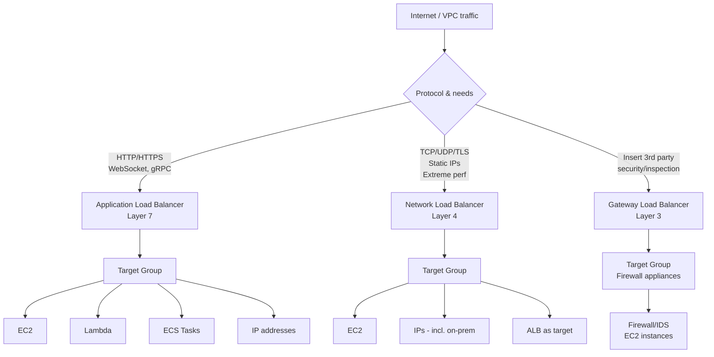
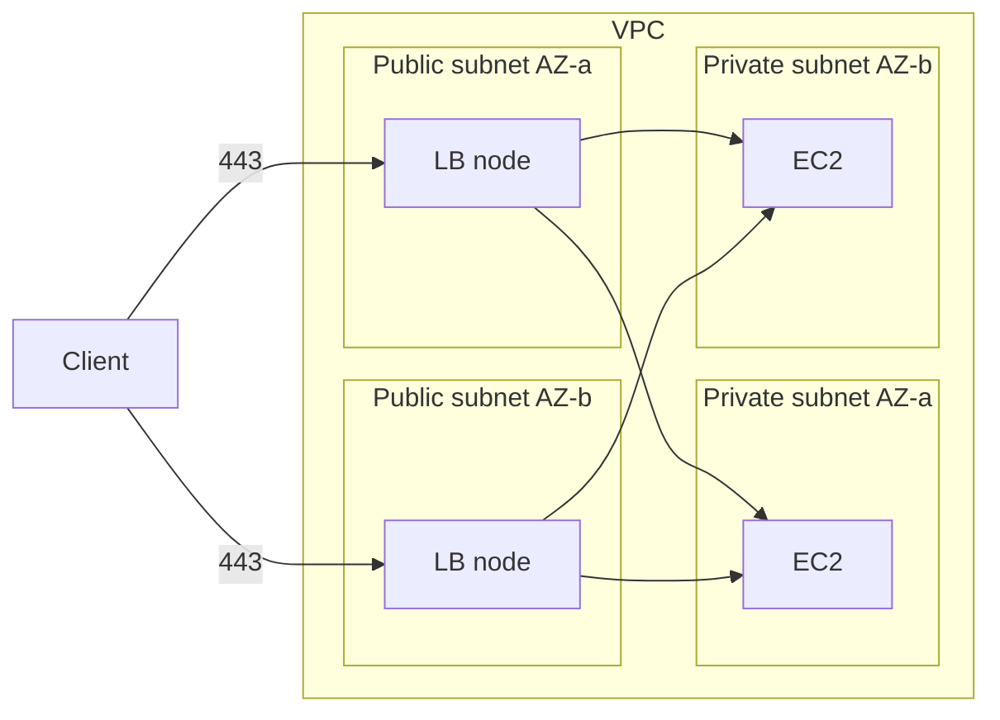
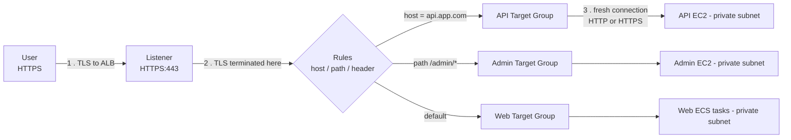
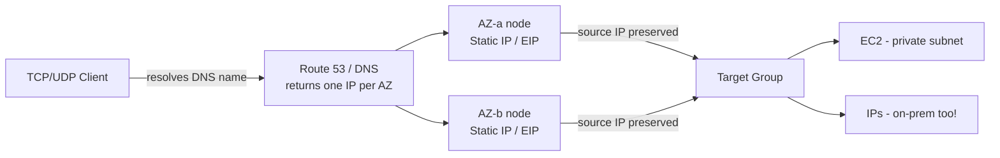
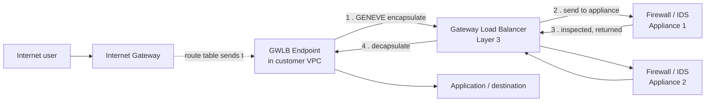
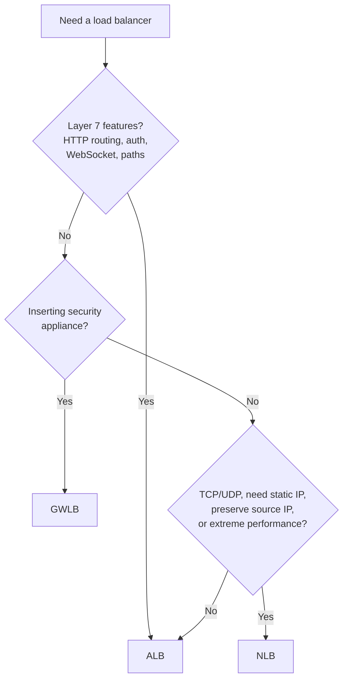

# Elastic Load Balancers — ALB vs NLB vs GWLB

> 🔥 **Always tested.** Know which LB type fits which scenario.

## Problem It Solves
Single backend = single point of failure. You need to distribute traffic across many backends, handle TLS termination, route based on host/path, integrate with security appliances, support real-time protocols (WebSocket, gaming UDP)… No single LB does all this. AWS gives you 3 specialized types.

## Mental Model (one line)
- **ALB** = smart HTTP router (Layer 7) — reads the request, routes on host/path/header.
- **NLB** = fast pipe (Layer 4) — moves TCP/UDP packets, static IPs, microsecond latency.
- **GWLB** = bump-in-the-wire (Layer 3) — forces all traffic through a security appliance fleet, then forwards on.

## How They Work



### Side-by-Side Comparison

| | **ALB** | **NLB** | **GWLB** |
|---|---|---|---|
| Layer | 7 (Application) | 4 (Transport) | 3 (Network) |
| Protocols | HTTP, HTTPS, WebSocket, gRPC | TCP, UDP, TLS | IP / GENEVE |
| Listener config | Protocol **and** port (e.g. HTTPS:443) | Protocol **and** port (e.g. TCP:3306) | GENEVE:6081 (fixed) |
| Latency | ~milliseconds | ~microseconds | Low |
| Throughput | High | **Extreme** (millions/sec) | High |
| Static IP | ❌ (DNS only) | ✅ One per AZ + EIP support | ❌ |
| Preserve client IP | ❌ (via X-Forwarded-For header) | ✅ Natively | ✅ |
| Route on host/path/header | ✅ | ❌ | ❌ |
| TLS termination | ✅ | ✅ | ❌ (passes through) |
| Targets | EC2, IP, Lambda, ECS, ALB | EC2, IP (incl. on-prem), ALB | EC2 (appliances) |
| Security group on LB | ✅ | ✅ *(since Aug 2023; set at creation)* | ❌ |
| Cross-zone LB | Default on | Default off (extra cost) | Default off |
| Auth integration | Cognito, OIDC | ❌ | ❌ |
| Use cases | Web apps, microservices | Gaming, IoT, finance, real-time | Inline firewall/IDS |

---

## Subnet Placement — true for ALL load balancers

> Discussed at length — this is the part people get fuzzy on.

- The **load balancer nodes live in the subnets you assign** (public subnets if internet-facing, private if internal).
- You **must assign at least two subnets in two different AZs** at creation. This is what gives high availability — if one AZ fails, the other keeps serving.
- **Targets can live in private subnets** regardless of where the LB sits. The LB is the bridge: public side faces the client, private side reaches the backends.
- Multiple targets in the **same** subnet/AZ is allowed — spreading across AZs is best practice, not a hard rule for targets (it *is* a hard rule for the LB itself).



---

## ALB (Application Load Balancer)

### Packet Flow



**Key flow facts (from discussion):**
1. Client opens a TLS connection **to the ALB** — the ALB sits in the **public** subnet.
2. **ALB terminates TLS.** The client's connection ends at the ALB. The original client IP is *not* preserved on the wire — it's passed in the `X-Forwarded-For` header instead.
3. The ALB opens a **separate, fresh connection** to the backend (which can be plain HTTP or a new HTTPS connection). Two independent connections — client→ALB and ALB→target.

### Listener vs Target Group — both take protocol + port

> This was the sticking point. You configure protocol **and** port in **both** places.

```
LISTENER (front side — client → ALB)
    Protocol: HTTP or HTTPS
    Port:     80 or 443 (any 1–65535)

TARGET GROUP (back side — ALB → target)
    Protocol: HTTP or HTTPS   (can differ from the listener)
    Port:     whatever the app listens on (e.g. 8080)
```

A single listener can fan out to many target groups using rules (host/path/header/query/method).

### Key ALB Features

```
✅ Host-based routing            api.app.com vs www.app.com
✅ Path-based routing            /api → API, /admin → Admin
✅ Header-based routing          User-Agent: mobile → mobile pool
✅ Query string routing          ?lang=fr → French pool
✅ HTTP method routing           POST vs GET
✅ Sticky sessions               Via app cookie or LB-generated cookie
✅ Lambda target                 ALB invokes Lambda directly!
✅ User authentication           Cognito, OIDC IDP at the LB
✅ WAF integration               Block bad requests at the edge
✅ HTTP/2 and gRPC               Modern protocols
✅ WebSocket                     Long-lived connections
✅ Redirect rules                HTTP → HTTPS, /old → /new
✅ Fixed response rules          Return custom 503 page during maintenance
```

### Common ALB Pattern

```
Single ALB serves multiple services on different domains/paths:
─────────────────────────────────────────────────────────────

www.example.com   → ALB → web-fleet-tg
api.example.com   → ALB → api-fleet-tg
admin.example.com → ALB → admin-fleet-tg (only allows /admin/*)
*.example.com     → ALB → default-tg (catches everything else)

Cost-efficient — one LB, many services.
```

---

## NLB (Network Load Balancer)

### Packet Flow



**Key flow facts (from discussion):**
- The NLB has **one static IP per AZ** (and you can attach your own **Elastic IP** per AZ). Two AZs ⇒ two IPs.
- The **client connects to a single DNS name**, not the individual IPs. DNS resolves that name to the per-AZ IPs; the client just hits one. They do **not** manually target both IPs.
- **Source IP is preserved natively** — the backend sees the real client IP, no header needed.
- Operates at **Layer 4** — routes on protocol/port only, no path/host awareness.

### Listener config

```
LISTENER (NLB)
    Protocol: TCP, UDP, TCP_UDP, or TLS
    Port:     the port the NLB listens on (e.g. 3306, 53, 1234)

TARGET GROUP
    Protocol: TCP / UDP / TLS
    Target type: instance | IP | ALB
```

### Targets — including on-prem

- Target types: **EC2 instances, IP addresses, or an ALB.**
- Because IP addresses are valid targets, an NLB can point at **on-premises servers** (reachable over Direct Connect / VPN) by their IP. ⚠️ **Lambda is NOT a valid NLB target** — that's ALB-only.

### Security groups (UPDATED)

> Correction vs earlier chat: NLB **can** have security groups.

```
Since Aug 10, 2023, NLB supports security groups on the LB itself.
  • Must be assigned AT CREATION — you can't toggle SG support on/off later
    (you can change which SGs are attached, but not add support after the fact).
  • Lets you allow-list trusted source IPs right at the NLB.
Before this, you secured traffic only at the target EC2 security group,
relying on preserved source IP. (NACLs always applied at the subnet level.)
```

### Key NLB Features

```
✅ Static IP per AZ              For firewall allow-listing
✅ Elastic IPs supported          Bring your own EIP (one per AZ)
✅ Preserves source IP            Server sees real client IP
✅ UDP support                    Gaming, VoIP, IoT, DNS
✅ TLS termination                Offload TLS at LB
✅ Security groups (Aug 2023)     Allow-list at the LB, set at creation
✅ Millions of requests/sec       Lowest latency
✅ Long idle timeouts             Up to 350s (vs ALB ~60s)
✅ Cross-zone (opt-in, charged)   Default off to save costs
✅ Target = ALB                   Combine: NLB front, ALB behind (static IP for ALB)
✅ On-prem targets                Via IP target type (DX / VPN)
```

### When NLB Shines

```
Use case 1: STATIC IP REQUIREMENT
─────────────────────────────────────────────
Customer firewall whitelists IP addresses only.
ALB has dynamic IPs — bad.
NLB has static IPs (and EIPs) — good.
PrivateLink Service requires NLB.

Use case 2: GAMING / IOT (UDP)
─────────────────────────────────────────────
ALB doesn't speak UDP. NLB does.
Real-time multiplayer servers, IoT telemetry.

Use case 3: EXTREME PERFORMANCE
─────────────────────────────────────────────
Trading platforms, real-time analytics.
NLB has microsecond latency, scales to millions
of req/sec without warm-up.

Use case 4: SOURCE IP PRESERVATION
─────────────────────────────────────────────
Auditing/logging needs real client IP.
NLB preserves it natively. ALB needs X-Forwarded-For.
```

---

## GWLB (Gateway Load Balancer)

### Packet Flow — The Bump in the Wire



**Key flow facts (from discussion):**
1. Request arrives → route table steers it to the **GWLB endpoint**, then to the **GWLB**.
2. GWLB **forwards traffic to the security appliances** (the target group is the firewall/IDS fleet) using **GENEVE encapsulation on port 6081**.
3. Appliances inspect/process, then hand traffic **back** to the GWLB.
4. GWLB forwards on to the **actual destination**.

So the order you stated is right: **client → GWLB → security appliances → (back to GWLB) → target/destination.**

### Protocols

```
GWLB is Layer 3 — it does NOT speak HTTP/HTTPS like an ALB.
It encapsulates ALL IP traffic with GENEVE (UDP 6081) and is
protocol-agnostic underneath (TCP, UDP, anything IP).
No TLS termination — traffic passes through transparently.
```

### The Specialized One

```
PURPOSE:
─────────────────────────────────────────────
Insert third-party network security appliances
(firewalls, IDS/IPS, deep packet inspection)
without changing application architecture.

Common appliances on AWS Marketplace:
- Palo Alto VM-Series
- Check Point CloudGuard
- Fortinet FortiGate
- Cisco Secure Firewall
```

### GWLB Use Case Diagram

```
Without GWLB:
─────────────────────────────────────────
Internet → IGW → App
(No inspection)

With GWLB (Centralized Inspection VPC):
─────────────────────────────────────────
Internet → IGW → Routing intercepts
                        │
                        ▼
              ┌──────────────────────┐
              │   Inspection VPC      │
              │   GWLB → Firewalls    │
              └──────────────────────┘
                        │
                        ▼
                  Workload VPCs
```

---

## Decision Tree



## When to Use What

| Scenario | LB |
|---|---|
| Web app with multiple services on same domain | **ALB** (path routing) |
| Microservices behind one entry point | **ALB** |
| Gaming server, UDP traffic | **NLB** |
| Customer needs to whitelist your IP | **NLB** (static IPs or EIPs) |
| High-frequency trading endpoint | **NLB** (microsecond latency) |
| Need ALB features but customer wants static IP | **NLB → ALB** chained |
| On-premises backend over DX/VPN | **NLB** (IP target type) |
| Insert Palo Alto/Check Point firewall transparently | **GWLB** |
| Centralize traffic inspection across many VPCs | **GWLB** in inspection VPC |
| Lambda as backend | **ALB** (Lambda target type) |
| Authentication at the LB | **ALB** + Cognito/OIDC |

## When NOT to Use

- ❌ Don't use ALB for **UDP** — use NLB
- ❌ Don't use NLB for **path-based routing** — use ALB
- ❌ Don't use NLB for a **Lambda backend** — Lambda is an ALB-only target
- ❌ Don't use GWLB for **regular load balancing** — it's purpose-built for inspection
- ❌ Don't use Classic Load Balancer (CLB) at all — it's legacy

## Trade-offs

| Choice | Gain | Sacrifice |
|---|---|---|
| ALB | Rich Layer 7 routing | Higher per-request cost, dynamic IPs, terminates client connection |
| NLB | Performance, static IPs, UDP, source IP | No Layer 7 features (no path routing) |
| GWLB | Transparent appliance insertion | Specialized — only for inspection |
| ALB→NLB chain | ALB features + NLB IPs | Two LBs to manage and pay for |

## Real World Example

**Discord** uses **NLB** for their gaming voice/video traffic:
- UDP-based real-time voice
- Static IPs whitelisted by enterprise customers
- Source IP preservation for fraud detection
- Microsecond latency requirement

**Stripe** uses **ALB** with rich path-based routing:
- `api.stripe.com/v1/charges` → charges service
- `api.stripe.com/v1/customers` → customers service
- All on one ALB → multiple target groups → microservices

**Netflix** uses **GWLB** in their inspection VPC:
- All North-South and East-West traffic flows through GWLB
- Fleet of inspection appliances scale via Auto Scaling
- Transit Gateway routes attract traffic to GWLB endpoints

## 🎯 Exam Soundbite

> "Application Load Balancers operate at Layer 7 and provide host/path-based routing, WebSocket, gRPC, and authentication integration — best for HTTP-based microservices. Network Load Balancers operate at Layer 4 with static IPs, UDP support, source IP preservation, and microsecond latency — best for gaming, IoT, and TCP/UDP workloads. Gateway Load Balancers transparently insert third-party network security appliances into the traffic path using GENEVE encapsulation."

---

## ⚡ Quick Recall Card

```
┌─────────────────────────────────────────────────┐
│ LB QUICK PICK                                    │
├─────────────────────────────────────────────────┤
│ Web/HTTP/path routing  → ALB                     │
│ TCP/UDP / static IP    → NLB                     │
│ Insert firewall        → GWLB                    │
│ Lambda backend         → ALB                     │
│ User auth at LB        → ALB + Cognito/OIDC      │
│ WebSocket              → ALB                     │
│ Gaming UDP             → NLB                     │
│ Whitelist IPs          → NLB (EIPs)              │
│ On-prem backend        → NLB (IP target)         │
│ Extreme low latency    → NLB                     │
│ Preserve client IP     → NLB native, ALB header  │
└─────────────────────────────────────────────────┘
```

## 🧠 Discussion Recap — Easy-to-Confuse Points

```
1. Subnets: LB needs ≥2 subnets in ≥2 AZs (HA). Targets can be private,
   and can share a subnet.
2. ALB listener takes BOTH protocol AND port (HTTPS:443). So does the
   target group (protocol + port, can differ from listener).
3. ALB terminates the client connection, opens a fresh one to the target.
   NLB can pass through; source IP preserved natively.
4. NLB static IP = one per AZ (EIP optional). Client hits ONE DNS name
   that resolves to those IPs — not the IPs directly.
5. NLB targets: EC2 / IP (incl. on-prem) / ALB.  NO Lambda.
   ALB targets: EC2 / IP / Lambda / ECS / ALB.
6. Security groups: ALB yes (LB + EC2). NLB yes too, since Aug 2023
   (must set at creation). GWLB no. NACLs apply at subnet level for all.
7. GWLB flow: client → GWLB → appliances → back to GWLB → destination,
   using GENEVE (UDP 6081), Layer 3, no HTTP/TLS handling.
```

## 🎓 Common Exam Pattern

> **"Customer firewall requires static IP whitelist. Application is HTTP and needs path-based routing for /api and /web. What architecture?"**
>
> ✅ Use **NLB in front of ALB**. NLB provides the static IPs (or EIPs) the customer firewall can whitelist. NLB forwards to ALB. ALB handles path-based routing. Best of both worlds.
