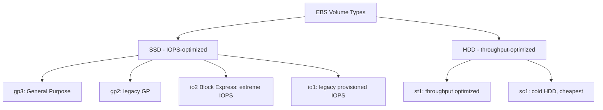
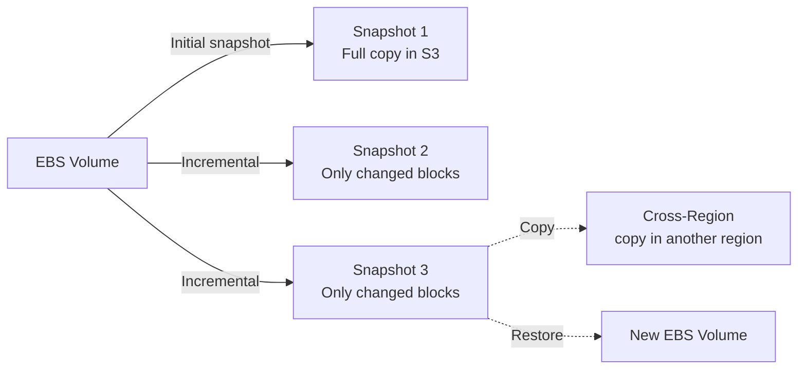

# EBS Volume Types & Snapshots

> 🔥 **Workhorse SAP-C02 topic.** Know IOPS/throughput characteristics and when to pick io2 Block Express vs gp3.

## Problem It Solves
EC2 instances need persistent block storage that survives reboots. Different workloads need different IOPS, throughput, and cost profiles — databases hammer IOPS, big-data jobs need throughput, dev/test needs cheap-enough. EBS volume types match these profiles.

## How It Works



### Volume Type Matrix

| Type | Use Case | Max IOPS | Max Throughput | Max Size | Cost |
|---|---|---|---|---|---|
| **gp3** ✅ | Default modern choice | 16,000 | 1,000 MB/s | 16 TiB | $$ |
| **gp2** | Legacy | 16,000 | 250 MB/s | 16 TiB | $$ |
| **io2 Block Express** | Extreme DBs (SAP HANA, Oracle) | 256,000 | 4,000 MB/s | 64 TiB | $$$$ |
| **io2** | Mission-critical DBs | 64,000 | 1,000 MB/s | 16 TiB | $$$ |
| **io1** | Legacy provisioned IOPS | 64,000 | 1,000 MB/s | 16 TiB | $$$ |
| **st1** | Big data, log processing | 500 | 500 MB/s | 16 TiB | $ |
| **sc1** | Cold archive, rarely accessed | 250 | 250 MB/s | 16 TiB | ¢ |

### gp3 vs gp2 (Critical to know)

```
gp2 (Legacy):
─────────────────────────────────────────────
IOPS = 3 × volume size in GiB
Min: 100 IOPS / Max: 16,000
Throughput tied to IOPS (250 MB/s max)
Cost: $0.10/GB-month
Larger volume = more IOPS (forced overprovisioning)


gp3 (Modern, default):
─────────────────────────────────────────────
Baseline IOPS: 3,000 (any size)
Baseline throughput: 125 MB/s
IOPS and throughput PROVISIONED INDEPENDENTLY from size
Max IOPS: 16,000 | Max throughput: 1,000 MB/s
Cost: $0.08/GB-month + extra IOPS/throughput
20% cheaper than gp2 at baseline ✅

ALMOST ALWAYS USE gp3 OVER gp2
```

### Throughput-Optimized vs Provisioned IOPS

```
io2 Block Express — when you need EXTREME random IO:
─────────────────────────────────────────────
- Up to 256,000 IOPS
- Sub-millisecond latency
- 99.999% durability (5 nines, vs 99.999% standard)
- Use: SAP HANA, Oracle RAC, SQL Server Always On

st1 — when you need SEQUENTIAL throughput:
─────────────────────────────────────────────
- Up to 500 MB/s
- Optimized for streaming/sequential workloads
- Cheap (HDD)
- Use: Big data, log processing, data warehouses
- BAD for random IO

sc1 — when you need cheap and cold:
─────────────────────────────────────────────
- Up to 250 MB/s, low IOPS
- Cheapest EBS
- Use: Rarely-accessed but needs to be block storage
```

### Multi-Attach (Critical SAP feature)

```
Most EBS volumes: ONE instance at a time

io1 & io2: Support MULTI-ATTACH
─────────────────────────────────────────────
- Up to 16 EC2 instances in same AZ
- All can read AND write concurrently
- Requires cluster-aware file system (not regular ext4!)
- Use: Shared databases with clustering 
       (Oracle RAC, SQL Always On FCI)

⚠️ Not for general-purpose shared storage — use EFS
   or FSx for that.
```

### EBS Snapshots — How They Work



```
Snapshots are:
─────────────────────────────────────────────
✅ Stored in S3 (managed by AWS, you don't see the bucket)
✅ INCREMENTAL — only changed blocks since last snapshot
✅ Region-scoped (must copy to use in another region)
✅ Can be encrypted (default = inherit from volume)
✅ Can be shared with other AWS accounts (unencrypted) or
   shared via KMS key (encrypted)
✅ Restore to new volume in same or different AZ
✅ Public snapshots = ⚠️ DANGER (data leak)
```

### Snapshot Lifecycle Manager (DLM)

```yaml
# Automate snapshot creation, retention, deletion
Policy:
  Type: EBS_SNAPSHOT_MANAGEMENT
  TargetTags: [Environment=production]
  Schedules:
    - Name: DailySnapshots
      Frequency: Daily
      Time: "03:00"
      RetainRule:
        Count: 30  # Keep 30 days of daily snapshots
    - Name: MonthlyArchive
      Frequency: Monthly
      RetainRule:
        Count: 12
      CrossRegionCopyRules:
        - Target: us-west-2
          RetainRule:
            Days: 365
```

### Fast Snapshot Restore (FSR)

```
PROBLEM:
─────────────────────────────────────────────
First time you read a block from a snapshot-restored
volume, it must be lazily fetched from S3. Slow.
Big production restore = degraded perf for hours.

SOLUTION — FSR:
─────────────────────────────────────────────
Pre-warm snapshots in specific AZs
Volumes created from FSR-enabled snapshots get
full performance immediately.
Cost: Per snapshot-AZ-hour (expensive!)
Use: DR snapshots, golden AMIs
```

### EBS Encryption

```
Encryption: At-rest + In-transit (between EC2 and EBS)
─────────────────────────────────────────────
Uses AWS KMS (CMK — Customer Managed Key)

Defaults:
- Account-level "EBS encryption by default" setting
  → All new volumes encrypted with default KMS key
- Snapshots of encrypted volumes = encrypted
- AMIs from encrypted snapshots = encrypted

Trick: Can't directly unencrypt a volume.
       To unencrypt: snapshot → copy snapshot (unencrypted)
                     → new volume from copy
```

### Instance Store — Don't Confuse with EBS

```
INSTANCE STORE (ephemeral SSD/NVMe attached to host):
─────────────────────────────────────────────
✅ Highest IO performance — physically attached NVMe
✅ Included in instance price
❌ DATA LOST when instance stops/terminates
❌ Cannot detach and reattach
❌ Cannot snapshot

Use: Temporary scratch, cache, buffer
     Distributed databases that replicate data (Cassandra)
DON'T: Use for persistent data (use EBS)
```

## When to Use What

| Workload | Volume Type |
|---|---|
| Default EC2 root volume | **gp3** |
| Boot volumes, general purpose | **gp3** |
| MySQL/Postgres up to 16k IOPS | **gp3** with provisioned IOPS |
| SAP HANA, Oracle, SQL Server | **io2 Block Express** |
| MongoDB / Cassandra (single node) | **io2** or **gp3** |
| Data warehouse, log processing | **st1** |
| Backups, infrequent block access | **sc1** |
| Distributed storage (Hadoop) | **st1** for HDFS data nodes |
| Highest performance scratch | **Instance Store** (NVMe) |
| Cluster shared block | **io2 Multi-Attach** |

## When NOT to Use

- ❌ Don't use **gp2** for new volumes — gp3 is cheaper and more flexible
- ❌ Don't use **st1/sc1** for random IO — terrible IOPS performance
- ❌ Don't use **Instance Store** for persistent data
- ❌ Don't use **EBS** for shared filesystem across many instances — use EFS instead
- ❌ Don't snapshot **without DLM** — manual snapshots get forgotten and cost money

## Trade-offs

| Choice | Gain | Sacrifice |
|---|---|---|
| gp3 over gp2 | 20% cheaper, independent IOPS/throughput | None — modern default |
| io2 over gp3 | Higher max IOPS, durability | 2-3x cost |
| io2 Block Express | Up to 256k IOPS | Premium pricing |
| st1 over gp3 | Way cheaper per GB | Terrible at random IO |
| FSR | Fast restore | Costly per snapshot-AZ-hour |
| Encryption everywhere | Compliance | Slight perf overhead (~minimal) |

## Real World Example

**Stripe** (financial data — extreme reliability):
- Database tier: **io2 Block Express** for max IOPS and 99.999% durability
- Application tier: **gp3** with provisioned IOPS
- Log tier: **st1** for streaming high-volume writes
- Snapshots: **Daily via DLM**, copied cross-region for DR
- FSR enabled for critical DR snapshots in failover region

**A SaaS company** (cost optimization story):
- Was using gp2 across fleet
- Migrated everything to **gp3** → saved ~20% on EBS bill
- Independent IOPS/throughput → didn't need to overprovision size

## 🎯 Exam Soundbite

> "gp3 is the modern default — independently provision IOPS and throughput from size, at lower cost than gp2. Use io2 Block Express for extreme database workloads requiring up to 256,000 IOPS and 5-nines durability. Use st1 for sequential big-data workloads and sc1 for cold archive. Use io2 Multi-Attach for cluster-aware shared block storage like Oracle RAC. For everything else file-shared, use EFS or FSx — not EBS."

---

## ⚡ Quick Recall Card

```
┌─────────────────────────────────────────────────┐
│ EBS PICKER                                       │
├─────────────────────────────────────────────────┤
│ Default for everything    → gp3 ✅               │
│ Extreme IOPS DB           → io2 Block Express    │
│ Mission-critical DB       → io2                  │
│ Cluster shared block      → io1/io2 Multi-Attach │
│ Big data sequential       → st1                  │
│ Cold archive (rare access)→ sc1                  │
│ Temporary scratch         → Instance Store       │
│ Shared file storage       → EFS (NOT EBS)        │
├─────────────────────────────────────────────────┤
│ SNAPSHOTS                                        │
│ Incremental, stored in S3                        │
│ Region-scoped (copy to share regions)            │
│ Automate via DLM                                 │
│ Fast Snapshot Restore for DR pre-warming         │
└─────────────────────────────────────────────────┘
```

## 🎓 Common Exam Pattern

> **"Migrating an Oracle RAC cluster to AWS. Need shared block storage between 4 EC2 instances in the same AZ."**
>
> ✅ **io2 Multi-Attach** — supports up to 16 instances in the same AZ, all read/write. Requires cluster-aware filesystem (Oracle's clustered filesystem handles this).
