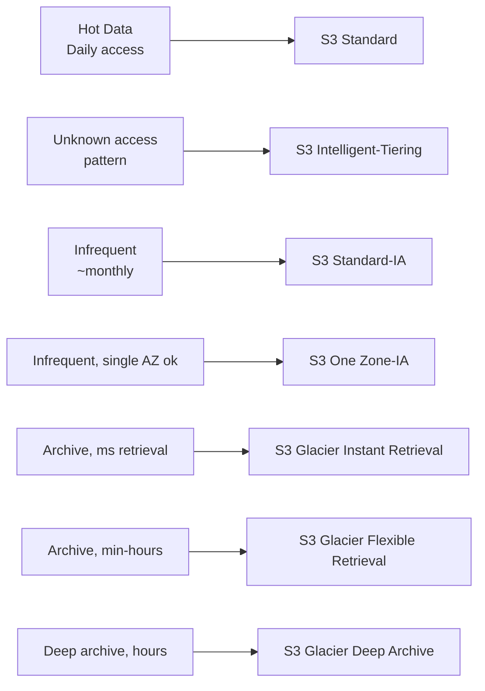
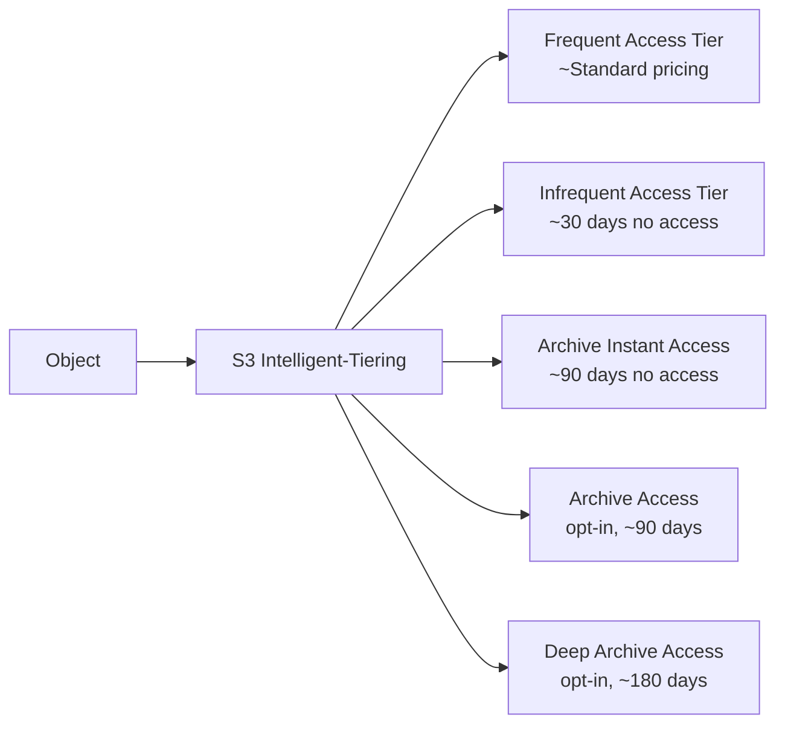

# S3 Storage Classes & Lifecycle

> 🔥 **Classic SAP-C02 question pattern: "Pick the cheapest storage class for this access pattern."** Know retrieval times and minimum durations cold.

## Problem It Solves
Not all data is created equal. Some files are accessed thousands of times per day (product images), some are accessed monthly (backups), some are accessed once per year (compliance archives). Paying Standard pricing for archives wastes money; paying Glacier pricing for hot data ruins UX. **S3 storage classes match price to access pattern.**

## How It Works



### The Storage Class Matrix

| Class | Cost (per GB/mo) | Retrieval | Min Duration | Min Object Size | Use Case |
|---|---|---|---|---|---|
| **Standard** | $$$$ ($0.023) | Instant | None | None | Hot data |
| **Intelligent-Tiering** | $$$ (varies) | Instant | None | None | Unknown/variable patterns |
| **Standard-IA** | $$ ($0.0125) | Instant | 30 days | 128 KB | Backups, DR |
| **One Zone-IA** | $$ ($0.01) | Instant | 30 days | 128 KB | Re-creatable data |
| **Glacier Instant** | $ ($0.004) | Instant (ms) | 90 days | 128 KB | Quarterly access |
| **Glacier Flexible** | $ ($0.0036) | Min-Hours | 90 days | 40 KB | Annual access |
| **Glacier Deep Archive** | ¢ ($0.00099) | 12 hours | 180 days | 40 KB | 7-10 yr retention |

(Prices are us-east-1; check current pricing.)

### Key Facts to Memorize

```
┌──────────────────────────────────────────────────────────┐
│ DURABILITY (all classes)         11 nines (99.999999999%) │
│ AVAILABILITY                                              │
│   Standard / Int-Tier            99.99%                   │
│   Standard-IA                    99.9%                    │
│   One Zone-IA                    99.5% (1 AZ!)            │
│   Glacier Instant                99.9%                    │
│   Glacier Flexible/Deep          99.99%                   │
├──────────────────────────────────────────────────────────┤
│ AZ DISTRIBUTION                                           │
│   All classes except One Zone-IA: ≥3 AZs                  │
│   One Zone-IA: 1 AZ (lose AZ = lose data)                 │
├──────────────────────────────────────────────────────────┤
│ RETRIEVAL CHARGES                                         │
│   Standard / Int-Tier: No retrieval fees                  │
│   IA classes: Per-GB retrieval fee                        │
│   Glacier: Per-GB + per-request retrieval fee             │
└──────────────────────────────────────────────────────────┘
```

### Intelligent-Tiering — Set It and Forget It



**How it works:**
- Object moves between tiers automatically based on access
- Small monthly monitoring fee per object (~$0.0025 / 1,000 objects)
- **NO retrieval fees** between Frequent and Infrequent
- For objects < 128 KB, always in Frequent tier (monitoring fee waived)

**When to use:** When you don't know the access pattern. Modern best practice = put almost everything in Intelligent-Tiering.

### Lifecycle Policies

Lifecycle policies automatically transition objects between classes or expire them.

```yaml
# Example policy: documents in a knowledge base
Rules:
  - id: DocsLifecycle
    Prefix: documents/
    Transitions:
      - Days: 30
        StorageClass: STANDARD_IA
      - Days: 90
        StorageClass: GLACIER_IR
      - Days: 365
        StorageClass: DEEP_ARCHIVE
    Expiration:
      Days: 2555   # 7 years
    NoncurrentVersionTransitions:
      - NoncurrentDays: 30
        StorageClass: GLACIER
    NoncurrentVersionExpiration:
      NoncurrentDays: 365
```

### The Transition Rules (Important Trap)

```
Object can ONLY transition DOWN, never up.

Standard → Standard-IA       ✅
Standard → Glacier           ✅
Glacier → Standard-IA        ❌ Must restore first

Standard → One Zone-IA       ✅
One Zone-IA → Standard-IA    ❌

Minimum age before transitions:
  Standard-IA / One Zone-IA: 30 days (often enforced)
  Glacier:                   No minimum from Standard
```

### Glacier Retrieval Options

| Tier | Speed | Cost |
|---|---|---|
| **Glacier Instant** | Milliseconds (instant) | Higher storage, no retrieval delay |
| **Glacier Flexible — Expedited** | 1-5 minutes | $$$ |
| **Glacier Flexible — Standard** | 3-5 hours | $$ |
| **Glacier Flexible — Bulk** | 5-12 hours | $ (cheapest) |
| **Deep Archive — Standard** | 12 hours | $ |
| **Deep Archive — Bulk** | 48 hours | ¢ (cheapest of all) |

```
EXAM TRAP:
─────────────────────────────────────────
"Compliance archive, accessed only during legal audits.
 Retrieval within 24 hours is acceptable.
 7-year retention requirement."

Wrong answer: Glacier Flexible
Right answer: Glacier Deep Archive ✅
(Cheapest, 12-hour retrieval is fine, well over 180-day min)
```

### S3 Storage Lens & Storage Class Analysis

```
S3 Storage Lens
─────────────────────────────────────────
Org-wide storage visibility
Dashboards showing usage across all buckets
Recommendations: "These objects unused 90+ days → IA"

S3 Storage Class Analysis
─────────────────────────────────────────
Per-bucket analysis
Tells you: "These objects accessed rarely → Standard-IA"
Output: CSV reports for review
Then: Configure lifecycle based on findings
```

## When to Use Each Class

| Pattern | Class |
|---|---|
| Active website assets, hot data | **Standard** |
| Unknown / variable access | **Intelligent-Tiering** ✅ default modern choice |
| Backups, accessed monthly | **Standard-IA** |
| Re-creatable data (logs, derived data) | **One Zone-IA** (cheaper, less reliable) |
| Quarterly compliance reports, instant access | **Glacier Instant Retrieval** |
| Yearly retrieval, hours OK | **Glacier Flexible Retrieval** |
| 7+ year retention, rarely retrieved | **Glacier Deep Archive** |
| Cross-region log mirror | **One Zone-IA** in DR region |
| Critical encrypted backups, long-term | **Glacier Deep Archive** + versioning + Object Lock |

## When NOT to Use

- ❌ Don't use **One Zone-IA** for critical data (single AZ = AZ failure = data loss)
- ❌ Don't transition objects **smaller than 128 KB to IA** — minimum object charge makes it expensive
- ❌ Don't put hot data in Glacier — retrieval costs + delays kill economics
- ❌ Don't forget the **30-day / 90-day / 180-day minimums** — early deletion is charged for the full duration

## Trade-offs

| Choice | Gain | Sacrifice |
|---|---|---|
| Intelligent-Tiering | No analysis needed, auto-optimize | Monthly monitoring fee per object |
| Lifecycle policies | Predictable cost reduction | Manual analysis upfront |
| One Zone-IA | 20% cheaper than Standard-IA | Single AZ — risky for unique data |
| Glacier Deep Archive | Cheapest storage in AWS | 12-48 hour retrieval, 180-day minimum |
| Standard-IA over Standard | Cheaper for cold data | Retrieval fees + minimum duration |

## Real World Example

**Dropbox** uses tiered S3 storage extensively:
- **Standard**: Recently uploaded files, frequently shared
- **Intelligent-Tiering**: User files older than 30 days
- **Glacier Deep Archive**: Files deleted (kept for legal hold)

**Netflix** (for catalog masters):
- Original master tapes scanned → **Glacier Deep Archive** (accessed maybe once per decade)
- Working copies → **Standard** while being edited
- Encoded streams → **Standard** while popular → **Standard-IA** after popularity declines

**A medical imaging company**:
- Images < 1 year old → **Standard** (active patient cases)
- Images 1-7 years → **Glacier Instant Retrieval** (occasional consultation)
- Images > 7 years → **Glacier Deep Archive** (legal retention only, very rare access)

## 🎯 Exam Soundbite

> "S3 offers 6 storage classes balancing cost against retrieval time and availability. Standard for hot data, Intelligent-Tiering for unknown patterns with automatic optimization, Standard-IA/One Zone-IA for monthly access, and three Glacier tiers for archives — Instant Retrieval for millisecond access, Flexible Retrieval for hours, and Deep Archive for the cheapest storage with 12-48 hour retrieval. Use lifecycle policies to automatically transition objects through these tiers."

---

## ⚡ Quick Recall Card

```
┌─────────────────────────────────────────────────┐
│ S3 STORAGE CLASS PICKER                          │
├─────────────────────────────────────────────────┤
│ Hot, daily access      → Standard                │
│ Unknown pattern        → Intelligent-Tiering 🎯  │
│ Monthly access         → Standard-IA             │
│ Monthly, can re-create → One Zone-IA             │
│ Quarterly, instant     → Glacier Instant         │
│ Yearly, hours OK       → Glacier Flexible        │
│ Decades, 12h+ OK       → Glacier Deep Archive    │
├─────────────────────────────────────────────────┤
│ MIN DURATION                                     │
│ Standard / Int-Tier    None                      │
│ IA classes             30 days                   │
│ Glacier (Instant/Flex) 90 days                   │
│ Deep Archive           180 days                  │
├─────────────────────────────────────────────────┤
│ DURABILITY (all)       11 nines                  │
│ AZs (all except OZ-IA) 3+                        │
│ One Zone-IA            1 AZ                      │
└─────────────────────────────────────────────────┘
```

## 🎓 Common Exam Pattern

> **"7-year financial records, accessed once or twice a year during audits. Retrieval within 5 hours is required. What's the cheapest storage class?"**
>
> ✅ **Glacier Flexible Retrieval** with **Standard retrieval** (3-5 hours). Deep Archive would be cheaper but 12-hour retrieval exceeds the 5-hour requirement.

> **"Logs that are reproducible from another source if lost. Access is monthly. Need to minimize cost."**
>
> ✅ **One Zone-IA** — 20% cheaper than Standard-IA. AZ loss is acceptable because logs are recreatable.
