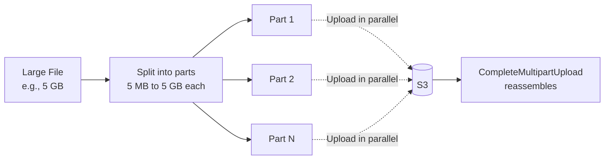
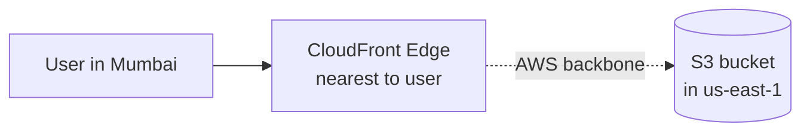
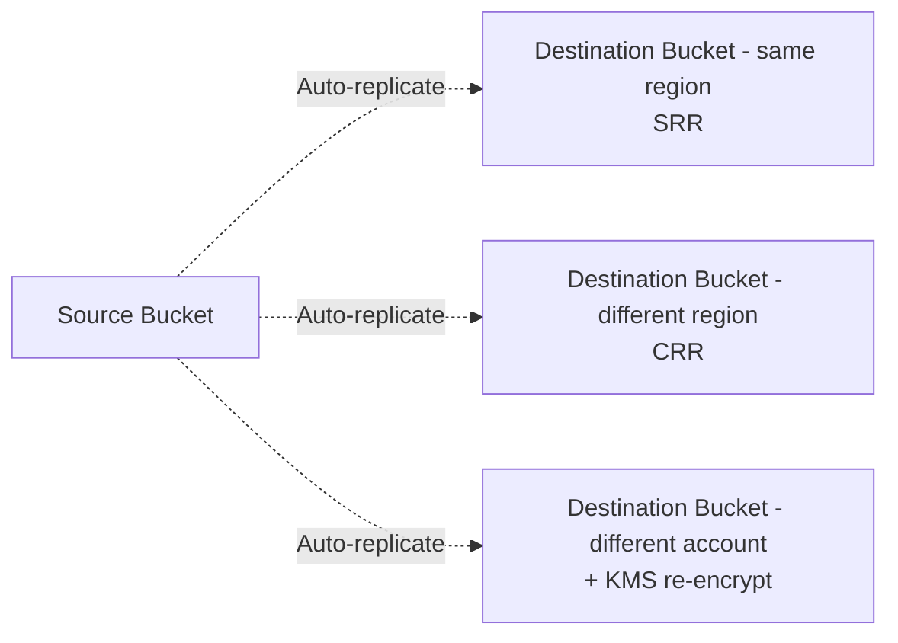
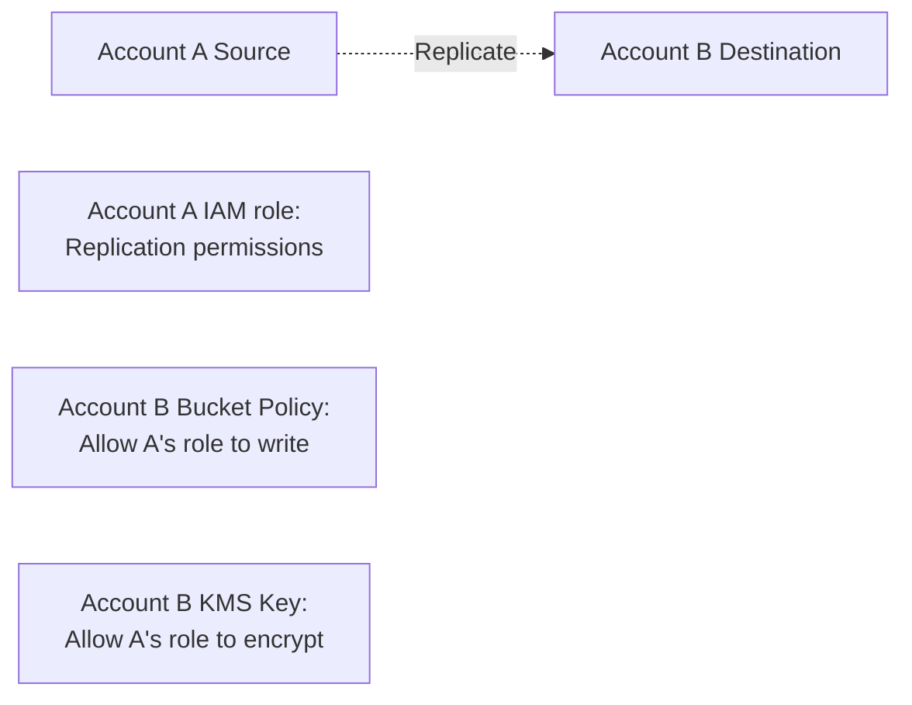
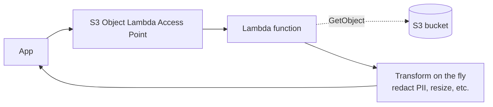
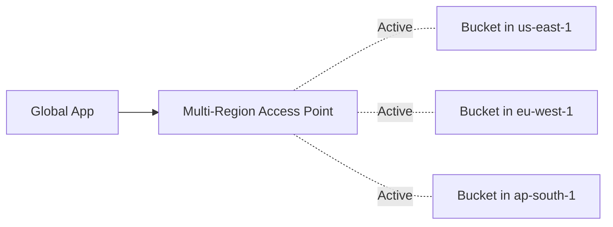

# S3 Performance & Replication

> 🔥 **Multipart, Transfer Acceleration, and CRR/SRR are common exam questions.**

## Problem It Solves
S3 has near-infinite scale but you need specific patterns to maximize:
- Upload throughput for large files
- Global upload speeds from far regions
- Cross-region/account replication for DR + compliance
- Cost-effective request patterns

## Performance — The S3 Performance Toolbox

```
S3 PERFORMANCE LIMITS (per prefix):
─────────────────────────────────────────────
- 3,500 PUT/COPY/POST/DELETE/sec per prefix
- 5,500 GET/HEAD per prefix
- No limit on total prefixes per bucket

KEY: SCALE BY USING MULTIPLE PREFIXES
─────────────────────────────────────────────
Old advice: avoid sequential prefixes (timestamps, alphabetical)
Current: S3 auto-partitions, less worry
But: Spreading prefixes still helps for extreme workloads
```

---

## Multipart Upload



```
MULTIPART UPLOAD:
─────────────────────────────────────────────
✅ Required for objects > 5 GB
✅ Recommended for objects > 100 MB
✅ Parallel uploads speed up large transfers
✅ Resumable — retry failed parts only
✅ Pause and resume long uploads

LIFECYCLE FOR INCOMPLETE UPLOADS:
─────────────────────────────────────────────
Incomplete multipart parts COST you (still in S3)
Add lifecycle rule to clean up after N days:

LifecycleRule:
  AbortIncompleteMultipartUpload:
    DaysAfterInitiation: 7

✅ Avoid silent storage costs

PART LIMITS:
─────────────────────────────────────────────
Part size: 5 MB - 5 GB (last part can be smaller)
Up to 10,000 parts per upload
Max object size: 5 TB
```

---

## S3 Transfer Acceleration



```
S3 TRANSFER ACCELERATION:
─────────────────────────────────────────────
Use CloudFront edge locations as entry points
Traffic to S3 goes via AWS backbone (faster than internet)
Per-bucket toggle

ENABLE:
─────────────────────────────────────────────
Bucket setting: Transfer Acceleration = Enabled
Endpoint changes:
  bucket-name.s3-accelerate.amazonaws.com
  bucket-name.s3-accelerate.dualstack.amazonaws.com (IPv6)

USE WHEN:
─────────────────────────────────────────────
✅ Users far from bucket region
✅ Large uploads from distant locations
✅ Bandwidth-constrained connections

DON'T USE WHEN:
─────────────────────────────────────────────
❌ Same-region access (no benefit)
❌ Tiny objects (overhead doesn't pay off)
❌ Cost-sensitive (extra $ per GB)

COST:
─────────────────────────────────────────────
~$0.04-0.08 per GB on top of normal transfer
Use only when needed
```

### Speed Comparison Tool

```
AWS PROVIDES:
─────────────────────────────────────────────
S3 Transfer Acceleration Speed Comparison Tool
https://s3-accelerate-speedtest.s3-accelerate.amazonaws.com/en/accelerate-speed-comparsion.html

Tests upload speed with and without acceleration from
your location to all AWS regions.
```

---

## S3 Replication (CRR & SRR)



### Cross-Region Replication (CRR)

```
CRR USE CASES:
─────────────────────────────────────────────
✅ DR / business continuity (data survives region outage)
✅ Compliance (e.g., data in 2+ regions)
✅ Lower latency for users in different regions
✅ Cross-account backups
```

### Same-Region Replication (SRR)

```
SRR USE CASES:
─────────────────────────────────────────────
✅ Aggregate logs from multiple buckets to one
✅ Cross-account compliance copies
✅ Production → test environment data sync
✅ Different storage classes between source and dest
```

### Replication Requirements & Behavior

```
PREREQUISITES:
─────────────────────────────────────────────
✅ Versioning ENABLED on source AND destination
✅ IAM Role with replication permissions
✅ If different accounts: bucket policies must allow

REPLICATION TIME:
─────────────────────────────────────────────
Standard: minutes (eventually consistent)
S3 RTC (Replication Time Control): 99.99% within 15 min
  - SLA-backed
  - $0.015/GB extra
  - For strict RPO needs

WHAT GETS REPLICATED:
─────────────────────────────────────────────
✅ New objects after replication enabled
✅ Metadata, ACLs, tags (configurable)
✅ Object encryption (re-encrypt if KMS keys differ)

WHAT DOESN'T (by default):
─────────────────────────────────────────────
❌ Existing objects (need batch replication or one-time job)
❌ Delete markers (configurable to include)
❌ Lifecycle actions
❌ Replicated objects don't re-replicate (no cascading)

CONFIGURABLE OPTIONS:
─────────────────────────────────────────────
- Storage class for destination (e.g., Standard → Glacier)
- KMS encryption with destination's CMK
- Replicate delete markers (off by default)
- Replicate replica modifications
```

### Cross-Account Replication



```
SETUP:
─────────────────────────────────────────────
1. Source bucket (Account A): enable versioning
2. Destination bucket (Account B): enable versioning
3. Replication role in Account A with permissions
4. Bucket policy in Account B allowing Account A
5. If KMS: key policy in Account B allows encryption

USE: Cross-account DR / backups / compliance
```

---

## S3 Batch Operations

```
S3 BATCH OPERATIONS:
─────────────────────────────────────────────
Run actions across millions/billions of objects:
- Copy / move
- Replace tags
- Update ACL
- Restore from Glacier
- Invoke Lambda per object
- S3 Object Lock retention

USE FOR:
─────────────────────────────────────────────
✅ Replicate EXISTING objects (replication only does new)
✅ Bulk re-encrypt with new KMS key
✅ Bulk lifecycle changes
✅ Compliance retention adjustments
```

### S3 Batch Replication (for existing objects)

```
TO REPLICATE OBJECTS THAT EXISTED BEFORE CRR WAS ENABLED:
─────────────────────────────────────────────
1. Enable replication (only future objects replicated)
2. Run S3 Batch Replication job
3. Existing objects replicated to destination
4. Done!
```

---

## S3 Object Lambda



```
S3 OBJECT LAMBDA:
─────────────────────────────────────────────
Lambda runs on every GetObject
Transform data before returning to client

USE CASES:
─────────────────────────────────────────────
✅ Redact PII for specific roles
✅ Resize images on the fly
✅ Filter/redact rows in CSV
✅ Compress/decompress on read
✅ Format conversion (JSON → XML)

✅ Same object, different views per consumer
```

---

## Other Performance Patterns

### S3 Inventory

```
WHAT IT IS:
─────────────────────────────────────────────
Daily/weekly CSV/Parquet/ORC reports of bucket contents
- Object listings
- Sizes
- Storage class
- Encryption status

USE:
─────────────────────────────────────────────
✅ Compliance auditing
✅ Lifecycle planning
✅ Cost analysis
```

### S3 Storage Lens

```
STORAGE LENS:
─────────────────────────────────────────────
Org-wide visibility into S3 usage
- Cost optimization recommendations
- Activity patterns
- Free + paid tiers (paid has more metrics)

USE:
─────────────────────────────────────────────
✅ Find cold data to tier down
✅ Identify oversized buckets
✅ Detect unintended public buckets
```

### S3 Select / Glacier Select

```
S3 SELECT:
─────────────────────────────────────────────
Query CSV/JSON/Parquet objects with SQL
Returns only matching rows (less network transfer)

vs Athena:
─────────────────────────────────────────────
S3 Select: ONE object at a time, single-key SQL
Athena:    Across many objects, full SQL, joins, etc.
```

---

## Common Patterns

### Pattern 1: Global Upload Optimization

```
USERS WORLDWIDE UPLOAD TO us-east-1 BUCKET:
─────────────────────────────────────────────
- Enable S3 Transfer Acceleration
- Use multipart uploads for files > 100 MB
- Endpoint: bucket.s3-accelerate.amazonaws.com
- 50-300% faster from distant regions
```

### Pattern 2: DR via CRR

```
PRIMARY us-east-1 → DR eu-west-1:
─────────────────────────────────────────────
- Versioning on both buckets
- CRR rule (full bucket or filtered prefix)
- RTC if RPO < 15 min required
- S3 Replication Metrics (CloudWatch)
- Failover: redirect app to DR bucket
- Or use S3 Multi-Region Access Point for transparent failover
```

### Pattern 3: Multi-Region Access Point



```
S3 MULTI-REGION ACCESS POINT (MRAP):
─────────────────────────────────────────────
Single global endpoint for many buckets
Routes to nearest healthy bucket
Active-active or active-passive

USE:
─────────────────────────────────────────────
✅ Global apps wanting transparent multi-region
✅ Active-active S3 for resilience
✅ Lower latency for global users

REQUIRES:
─────────────────────────────────────────────
Bucket replication configured between regions
```

### Pattern 4: Compliance Archive

```
LONG-TERM IMMUTABLE STORAGE:
─────────────────────────────────────────────
1. S3 bucket with Versioning + Object Lock (Compliance mode)
2. Lifecycle: Standard → Glacier Deep Archive after 30 days
3. CRR to another region (Object Lock there too)
4. Retention: 7 years (regulatory)
5. Result: tamper-proof, geo-redundant, cheap archive
```

---

## When to Use What

| Need | Solution |
|---|---|
| Upload large files | **Multipart Upload** |
| Speed up global uploads | **Transfer Acceleration** |
| DR / multi-region copy | **CRR** |
| Cross-account compliance copy | **SRR or CRR cross-account** |
| Replicate EXISTING objects | **S3 Batch Replication** |
| Bulk operations on millions of objects | **S3 Batch Operations** |
| Transform data on read | **S3 Object Lambda** |
| Query within objects | **S3 Select** |
| Bucket-wide inventory | **S3 Inventory** |
| Org-wide S3 usage analysis | **S3 Storage Lens** |
| Global multi-region endpoint | **Multi-Region Access Point** |
| < 15 min replication RPO | **S3 RTC** |

## When NOT to Use

- ❌ Don't use Transfer Acceleration same-region (no benefit, extra cost)
- ❌ Don't enable CRR without lifecycle on dest (storage cost grows forever)
- ❌ Don't forget to clean up incomplete multipart uploads
- ❌ Don't use S3 Select for cross-object queries — use Athena

## Trade-offs

| Choice | Gain | Sacrifice |
|---|---|---|
| Transfer Acceleration | Faster uploads | Extra $/GB |
| Multipart | Parallel upload, retry parts | Extra coordination, cleanup needed |
| CRR | DR, compliance | Double storage cost + transfer |
| S3 RTC | Strict RPO SLA | $0.015/GB extra |
| Object Lambda | Per-consumer views | Lambda cost per GET |
| MRAP | Transparent multi-region | Replication infrastructure cost |

## Real World Example

**Dropbox-like file service:**
- **Multipart upload** required for files > 5 MB
- **Transfer Acceleration** for users far from bucket regions
- **CRR** for DR (us-east-1 → eu-west-1)
- **S3 RTC** for RPO < 15 min on customer-critical data
- **Multi-Region Access Point** for users to upload to nearest region
- Lifecycle: Standard → Standard-IA after 30d, Glacier after 1 yr

**Compliance archive:**
- **Glacier Deep Archive** for primary storage (after 30 days)
- **Object Lock Compliance Mode** prevents deletion
- **CRR** to second region (also locked)
- **S3 Inventory** for audit reports
- **Batch Replication** ran once to backfill historical data

## 🎯 Exam Soundbite

> "For large object uploads, use multipart upload — required above 5 GB, recommended above 100 MB. For global uploads to a single bucket, enable Transfer Acceleration to route through CloudFront edges and AWS backbone. For replication, use Cross-Region Replication for DR or low-latency global access, Same-Region Replication for aggregating logs or cross-account copies. Both require Versioning enabled. Use Replication Time Control for strict RPO of 15 minutes. For replicating objects that existed before replication was enabled, use S3 Batch Replication. For transparent global access across replicated buckets, use S3 Multi-Region Access Point."

---

## ⚡ Quick Recall Card

```
┌─────────────────────────────────────────────────┐
│ S3 PERFORMANCE                                   │
├─────────────────────────────────────────────────┤
│ MULTIPART UPLOAD                                 │
│   Required > 5 GB, recommended > 100 MB          │
│   Parallel parts, resumable                      │
│   Add lifecycle: AbortIncompleteMultipartUpload  │
│                                                  │
│ TRANSFER ACCELERATION                            │
│   Routes via CloudFront edges + backbone         │
│   Endpoint: bucket.s3-accelerate.amazonaws.com   │
│   Extra $/GB, only for distant uploads           │
│                                                  │
│ REPLICATION                                      │
│   CRR  — cross-region                            │
│   SRR  — same-region                             │
│   Requires Versioning on both sides              │
│   Cross-account: bucket policy + KMS key policy  │
│   New objects only (use Batch for existing)      │
│   RTC: 99.99% within 15 min, SLA-backed          │
│                                                  │
│ MULTI-REGION ACCESS POINT                        │
│   Single global endpoint                         │
│   Routes to nearest healthy bucket               │
│                                                  │
│ OBJECT LAMBDA                                    │
│   Transform data on GET                          │
│   Per-consumer views                             │
└─────────────────────────────────────────────────┘
```

## 🎓 Common Exam Patterns

> **"Upload 100 GB files from Mumbai to bucket in us-east-1. Want fastest upload."**
>
> ✅ **Multipart upload + Transfer Acceleration**.

> **"Compliance requires data replication to a second region with replication SLA under 15 minutes."**
>
> ✅ **CRR + S3 Replication Time Control (RTC)**.

> **"After enabling CRR on a 500 TB bucket, existing objects didn't replicate. How?"**
>
> ✅ **S3 Batch Replication** — one-time job replicates all existing objects.

> **"Global app needs S3 access from any region with automatic failover."**
>
> ✅ **S3 Multi-Region Access Point** routes to nearest healthy bucket.
