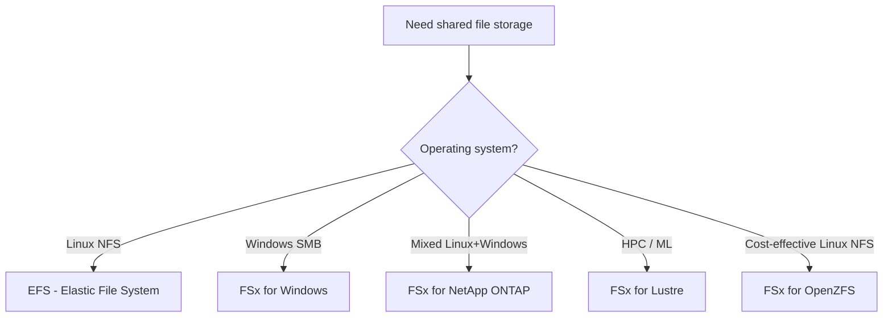
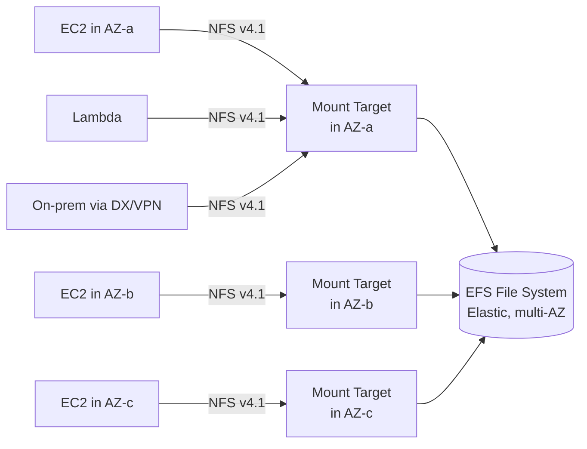
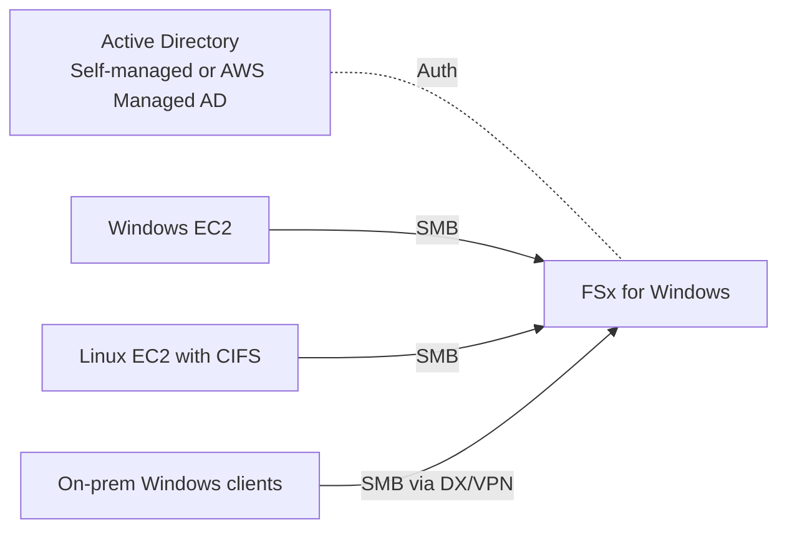
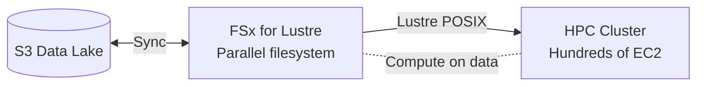
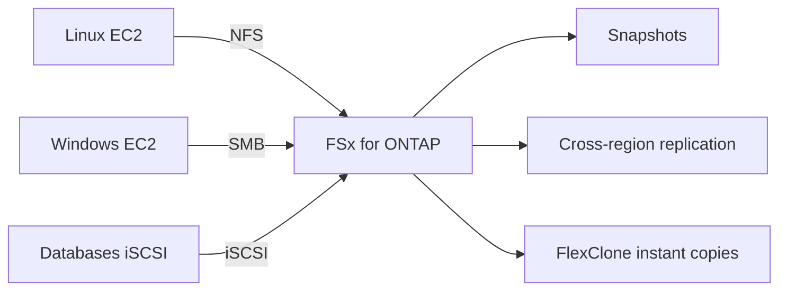
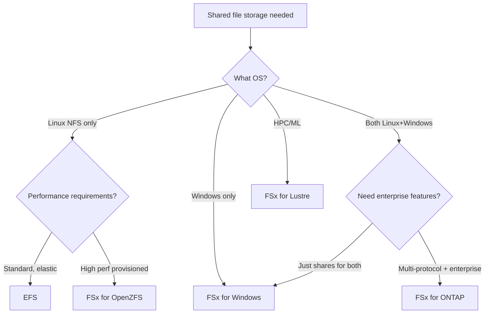

# EFS vs FSx — Choosing Your Shared Filesystem

> 🔥 **Common exam scenario.** Memorize the 4 FSx variants and their protocols.

## Problem It Solves
EBS is great for one instance. S3 is object storage. But what about applications that need **shared file storage** — content management systems, home directories, HPC clusters, Windows file shares? AWS offers two product families: **EFS** (simple NFS) and **FSx** (specialized filesystems).

## How It Works



### The 5 Options Side by Side

| | **EFS** | **FSx Windows** | **FSx Lustre** | **FSx ONTAP** | **FSx OpenZFS** |
|---|---|---|---|---|---|
| Protocol | NFS v4.1 | SMB / CIFS | Lustre (POSIX) | NFS, SMB, iSCSI | NFS |
| OS | Linux | Windows (AD) | Linux | Linux + Windows | Linux |
| Scale | Auto-elastic | Provisioned | Provisioned | Provisioned | Provisioned |
| Max size | Unlimited (PB+) | 64 TB | Hundreds of PB | Hundreds of TB | 192 TB |
| Performance | 10s GB/s | 2 GB/s | Hundreds of GB/s | 4 GB/s | 21 GB/s |
| Use case | General Linux file share | Windows shares, AD-joined | HPC, ML, big data | Enterprise NAS (multi-protocol) | High-perf Linux NFS |
| AZ coverage | Multi-AZ ✅ | Single or Multi-AZ | Single AZ + S3 backup | Multi-AZ ✅ | Single AZ |
| Cost | $$ (auto-tiered) | $$$ | $$$ | $$$ | $$ |

---

## EFS — Amazon Elastic File System

### Architecture



### Network & Security Architecture (How It Mounts)

```
EFS is a REGIONAL service (one filesystem per region).
You create a MOUNT TARGET in each AZ you want to use.

  - Mount target lives in a subnet within your VPC
  - EC2 connects to the mount target in ITS OWN AZ via NFS
  - Instances across AZs all reach the SAME filesystem,
    each through their local mount target

SECURITY LAYERS:
  - Security Group → attached to the MOUNT TARGET (not the
    filesystem). Controls which instances can reach it.
  - NACLs → apply at the SUBNET level, filter traffic before
    it reaches the mount target.
  → You manage a security group on EACH mount target.
```

### Key EFS Features

```
✅ Fully managed NFS v4.1
✅ Automatically scales — no provisioning
✅ Mount from EC2, ECS, Lambda, on-prem (DX/VPN)
✅ Multi-AZ by default (replicates across AZs)
✅ POSIX-compliant — supports symlinks, permissions
✅ Mount from thousands of clients concurrently
✅ Encryption at rest (KMS) and in transit
```

### EFS Storage Classes

```
STANDARD STORAGE CLASSES:
─────────────────────────────────────────────
EFS Standard       → Multi-AZ, hot data
EFS Standard-IA    → Multi-AZ, infrequent ($cheaper)

ONE ZONE CLASSES (20-50% cheaper):
─────────────────────────────────────────────
EFS One Zone       → Single AZ, hot data
EFS One Zone-IA    → Single AZ, infrequent

Use Lifecycle Management to transition files:
  → Files not accessed for 30/60/90 days → IA
  → Files re-accessed → moved back to Standard
```

### EFS Performance Modes (Choose at Creation)

```
GENERAL PURPOSE (default):
─────────────────────────────────────────────
Lower latency per operation
Up to 35,000 IOPS
Best for: Web servers, CMS, home directories

MAX IO:
─────────────────────────────────────────────
Higher throughput, more concurrent ops
Slightly higher latency per op
Best for: Big data, media processing
DEPRECATED — newer EFS doesn't need this distinction
```

### EFS Throughput Modes

```
BURSTING (default):
─────────────────────────────────────────────
Throughput scales with file system size
50 KB/s per GB
Bursts up to 100 MB/s using credits

PROVISIONED:
─────────────────────────────────────────────
Pay extra for throughput regardless of size
Good for small file system with high throughput need

ELASTIC:
─────────────────────────────────────────────
NEW! Automatically scales up to 10 GB/s read, 3 GB/s write
Pay per request — best for unpredictable workloads
Modern default ✅
```

---

## FSx for Windows File Server



### Network & Security Architecture (vs EFS)

```
KEY DIFFERENCE from EFS:
  - EFS uses MOUNT TARGETS (a separate resource per AZ)
  - FSx uses an ELASTIC NETWORK INTERFACE (ENI) directly
    in your subnet(s) — like an EC2's ENI, but AWS-managed.

  - The file system's DNS name maps to the ENI's private IP.
  - Instances in the subnet connect to that ENI via SMB.

SECURITY:
  - Security Group → attached to the FSx ENI(s) (same idea
    as a security group on an EC2 instance's ENI).
  - NACLs → apply at the subnet level, same as EFS.
  ⚠️ Do NOT modify/delete the ENI — breaks connectivity
     permanently.
```

### Key FSx Windows Features

```
✅ Native SMB protocol (Windows file shares)
✅ Active Directory integration (AD-joined)
✅ Windows ACLs and permissions
✅ Single-AZ or Multi-AZ deployment
✅ DFS Namespaces for scaling across multiple FSx
✅ Shadow copies, deduplication
✅ Backups to S3 (continuous + scheduled)

USE: Lift-and-shift Windows workloads
     SharePoint, IIS apps, Windows home directories
     Joining Windows EC2 to existing AD domain
```

---

## FSx for Lustre — HPC & Machine Learning



### Key FSx Lustre Features

```
✅ Parallel distributed filesystem (POSIX)
✅ HUNDREDS OF GB/S throughput
✅ Sub-millisecond latency
✅ Tight S3 integration:
   - Backed by S3 bucket
   - Files lazy-loaded from S3 on first read
   - Changes can be written back to S3
✅ Two deployment types:
   - SCRATCH: Cheaper, no replication, for temporary
   - PERSISTENT: HA, replication, longer-term

USE: ML model training (Hugging Face, PyTorch)
     Genomics, financial modeling, video rendering
     Any HPC workload with shared data
```

### FSx Lustre + S3 Pattern

```
THE KILLER PATTERN:
─────────────────────────────────────────────
1. Data already in S3 (e.g., training images)
2. Create FSx Lustre linked to S3 bucket
3. Files appear instantly in Lustre (metadata only)
4. Compute reads files → first read pulls from S3
5. After training, results pushed back to S3
6. Delete FSx — only paid for compute time

✅ Pay for performance only when needed
✅ S3 remains source of truth
```

---

## FSx for NetApp ONTAP



### Key ONTAP Features

```
✅ Multi-protocol: NFS, SMB, iSCSI on SAME filesystem
✅ Enterprise NAS features:
   - Snapshots, replication (SnapMirror)
   - Deduplication, compression
   - FlexClone instant copies
   - Tiering to cheap capacity tier
✅ Lift-and-shift from on-prem NetApp
✅ Multi-AZ HA

USE: Migrating from on-prem NetApp ONTAP
     Need NFS AND SMB on same data
     Database storage over iSCSI
     Enterprise features (snapshots, clones, replication)
```

---

## FSx for OpenZFS

```
✅ POSIX NFS (similar to EFS but provisioned)
✅ ZFS features:
   - Snapshots, clones
   - Compression
   - Up to 21 GB/s throughput
✅ Lower cost than ONTAP for Linux-only NFS
✅ Single AZ
✅ Up to 192 TB

USE: High-performance NFS for Linux
     Cheaper than ONTAP if you don't need SMB
     Lift-and-shift from on-prem ZFS
```

---

## Concurrent Access (Multiple Instances, Same File)

```
When two EC2 instances in different AZs write to the same
file, the filesystem handles it via PROTOCOL-LEVEL LOCKING:

  - EFS  → file locking built into NFS v4.1
  - FSx  → file locking built into SMB

You don't manage this manually — the filesystem enforces
locks so one writer proceeds while others wait, preventing
corruption. This is what makes these true SHARED filesystems
(vs EBS, which is single-attach by default).
```

## Decision Tree



## When to Use What

| Scenario | Solution |
|---|---|
| Linux web tier shared content | **EFS** |
| WordPress multi-EC2 setup | **EFS** |
| Container shared volume | **EFS** (ECS/EKS supported) |
| Windows AD-joined file share | **FSx for Windows** |
| SharePoint, IIS file storage | **FSx for Windows** |
| Genomics, ML training data | **FSx for Lustre** (linked to S3) |
| HPC scientific simulation | **FSx for Lustre** |
| Migrating from on-prem NetApp | **FSx for ONTAP** |
| Need same data via NFS AND SMB | **FSx for ONTAP** |
| Database via iSCSI | **FSx for ONTAP** |
| Cheap high-perf Linux NFS | **FSx for OpenZFS** |

## When NOT to Use

- ❌ Don't use **EFS for high-performance HPC** — use FSx Lustre
- ❌ Don't use **FSx Lustre for Windows** — it's Linux only
- ❌ Don't use **EFS for low-latency single-host writes** — EBS or instance store wins
- ❌ Don't use **FSx Windows without AD** — it requires AD integration
- ❌ Don't pick **One Zone EFS** for primary data — single AZ = risk

## Trade-offs

| Choice | Gain | Sacrifice |
|---|---|---|
| EFS | Elastic, fully managed, multi-AZ | Higher latency than FSx |
| FSx Windows | Native SMB, AD | Windows-only, more complex |
| FSx Lustre | Insane throughput | Specialized, often single-AZ |
| FSx ONTAP | Enterprise features | Premium pricing |
| FSx OpenZFS | High perf, lower cost than ONTAP | No SMB, single-AZ |

## Real World Example

**A genomics startup** uses FSx Lustre linked to S3:
- 50 TB genome data sits in S3
- For each analysis job, spin up FSx Lustre linked to S3
- 200 EC2 spot instances read data in parallel (hundreds of GB/s)
- Results written back to S3
- FSx Lustre deleted after job → no idle cost

**A WordPress hosting company** uses EFS:
- Multiple PHP EC2 instances behind ALB
- All mount EFS for shared `wp-content` directory
- Plugins/themes/uploads visible across all instances
- No "session affinity" needed

**A finance firm** moving off on-prem NetApp:
- 100 TB of mixed NFS (Linux) and SMB (Windows) data
- Need snapshots, replication, deduplication
- Solution: **FSx for ONTAP** — same features as on-prem, lift-and-shift

## 🎯 Exam Soundbite

> "Use EFS for elastic, multi-AZ NFS shared by Linux workloads — fully managed, scales automatically. Use FSx for Windows for AD-joined SMB shares. Use FSx for Lustre for HPC and ML workloads needing hundreds of GB/s, with S3 integration for the data lake pattern. Use FSx for ONTAP for multi-protocol enterprise needs (NFS + SMB + iSCSI) and FSx for OpenZFS as a high-performance lower-cost NFS alternative."

---

## ⚡ Quick Recall Card

```
┌─────────────────────────────────────────────────┐
│ SHARED FILE STORAGE PICKER                       │
├─────────────────────────────────────────────────┤
│ Linux NFS, elastic           → EFS               │
│ Linux NFS, high-perf         → FSx OpenZFS       │
│ Windows SMB, AD-joined       → FSx for Windows   │
│ Multi-protocol (NFS+SMB+iSCSI)→ FSx for ONTAP    │
│ HPC, ML, parallel processing → FSx for Lustre    │
│ Single instance block        → EBS (not file!)   │
│ Object storage               → S3 (not file!)    │
└─────────────────────────────────────────────────┘
```

## 🎓 Common Exam Pattern

> **"Machine learning team needs to train models on 10 TB of training data sitting in S3. Multiple GPU instances need fast parallel access. What storage?"**
>
> ✅ **FSx for Lustre** linked to the S3 bucket. Files are lazy-loaded from S3 to Lustre, hundreds of GB/s throughput available, results can be exported back to S3, and Lustre can be deleted after training to save cost.
