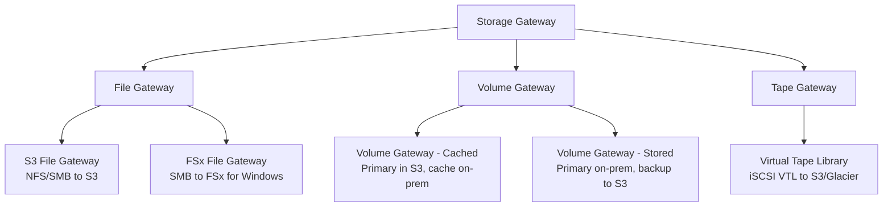
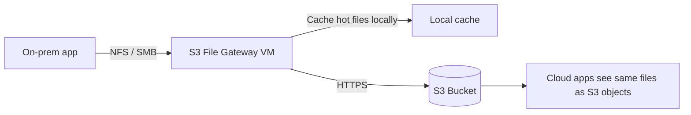
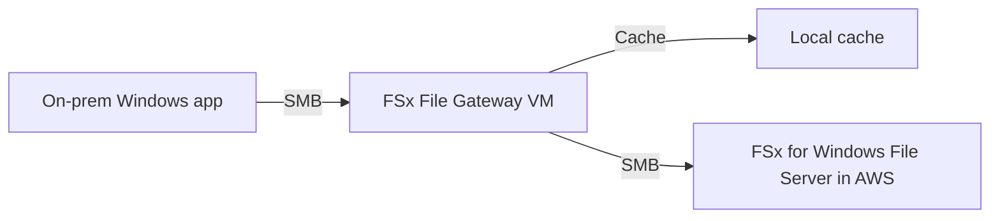
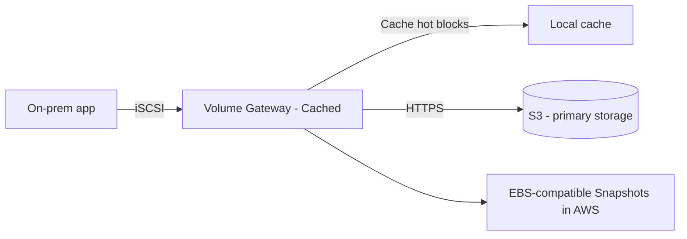
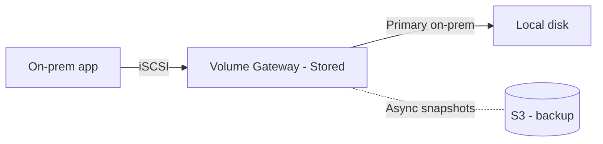
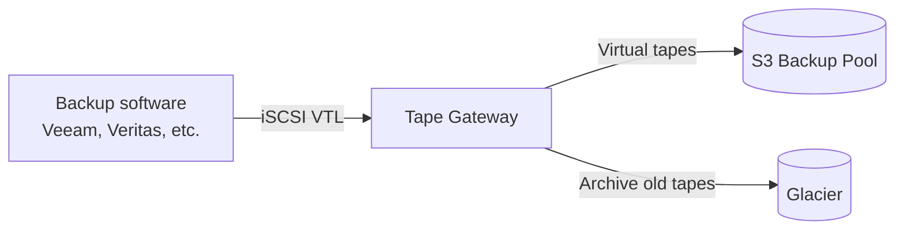

# AWS Storage Gateway

> 🔥 **Hybrid storage scenarios.** Know the 4 gateway types and when each fits.

## Problem It Solves
You have on-prem apps that need storage. Options:
1. Buy more on-prem storage (expensive, doesn't scale)
2. Move apps to AWS entirely (big rewrite)
3. **Hybrid: keep app on-prem but use AWS storage** ← Storage Gateway

Storage Gateway runs as a VM/appliance on-prem (or as an EC2), presents familiar protocols (NFS, SMB, iSCSI, VTL) to apps, and stores data in AWS (S3, EBS Snapshots, Glacier).

## The Four Gateway Types



| Type | Protocol | Data Location | Best For |
|---|---|---|---|
| **S3 File Gateway** | NFS / SMB | S3 (objects) | NAS replacement to S3 |
| **FSx File Gateway** | SMB | FSx for Windows | Windows shares with on-prem cache |
| **Volume Gateway Cached** | iSCSI (block) | S3, cached on-prem | Cloud-backed block storage |
| **Volume Gateway Stored** | iSCSI (block) | On-prem, backed up to S3 | Local block + cloud DR |
| **Tape Gateway** | iSCSI VTL | S3 / Glacier | Replace physical tapes |

---

## S3 File Gateway



```
S3 FILE GATEWAY:
─────────────────────────────────────────────
✅ Presents NFS (Linux) and SMB (Windows) on-prem
✅ Files appear as S3 objects (1:1 mapping)
✅ Local cache serves frequently-accessed files
✅ Multiple file shares per gateway
✅ Authenticate SMB via AD or local users

ON-PREM PERSPECTIVE:
─────────────────────────────────────────────
Looks like a file server. Apps mount NFS or SMB share.

CLOUD PERSPECTIVE:
─────────────────────────────────────────────
Files are S3 objects. Cloud apps can read them directly from S3.
S3 lifecycle rules apply (e.g., archive to Glacier).

USE CASES:
─────────────────────────────────────────────
✅ Lift-and-shift file server to cloud
✅ Hybrid analytics (on-prem ingest → S3 → cloud processing)
✅ Cheap backup target for on-prem apps
✅ Multi-site file sharing via S3

KEY BENEFIT:
─────────────────────────────────────────────
Cloud-side apps see plain S3 objects (no proprietary format)
→ Easy migration path to fully cloud-native later
```

---

## FSx File Gateway



```
FSx FILE GATEWAY:
─────────────────────────────────────────────
On-prem cache for FSx for Windows File Server
SMB protocol
AD authentication

USE WHEN:
─────────────────────────────────────────────
✅ Existing Windows file share workload
✅ Want FSx for Windows in cloud (main storage)
✅ On-prem users need low-latency local access
✅ Mixed cloud+on-prem Windows file workload

vs S3 FILE GATEWAY:
─────────────────────────────────────────────
S3 FG: files become S3 objects
FSx FG: files stay as Windows files in FSx
FSx FG keeps full Windows ACLs, NTFS features
```

---

## Volume Gateway — Cached Mode



```
VOLUME GATEWAY CACHED:
─────────────────────────────────────────────
Presents iSCSI block volumes on-prem
PRIMARY data stored in S3
Frequently-accessed blocks cached on-prem

VOLUME SIZE:
─────────────────────────────────────────────
Up to 32 TB per volume, up to 32 volumes per gateway
Total: up to 1 PB per gateway

USE:
─────────────────────────────────────────────
✅ Want huge volumes without on-prem capacity
✅ Cold data lives in S3, hot data cached
✅ Lift app without rewriting block storage assumptions
✅ Take EBS-compatible snapshots
```

---

## Volume Gateway — Stored Mode



```
VOLUME GATEWAY STORED:
─────────────────────────────────────────────
Primary data ON-PREM
Asynchronous snapshots to AWS S3
Local low latency
Cloud as DR / backup target

VOLUME SIZE:
─────────────────────────────────────────────
Up to 16 TB per volume, up to 32 volumes per gateway
Total: up to 512 TB per gateway

USE:
─────────────────────────────────────────────
✅ Need primary data local (latency, regulatory)
✅ Want cloud DR for on-prem block volumes
✅ Disaster recovery: restore in EC2 from snapshots

DR PATTERN:
─────────────────────────────────────────────
1. Stored Volume Gateway on-prem
2. Snapshots replicated to AWS
3. On disaster: launch EC2 with restored EBS from snapshot
4. Business continuity
```

---

## Tape Gateway (VTL)



```
TAPE GATEWAY:
─────────────────────────────────────────────
Presents a virtual tape library (VTL)
Backup software thinks it's writing to tapes
Tapes are virtual — actually stored in S3
Aged tapes auto-archive to Glacier

USE:
─────────────────────────────────────────────
✅ Replace physical tape libraries (libraries are EXPENSIVE)
✅ Keep existing backup software unchanged
✅ Long retention compliance (Glacier Deep Archive)
✅ No tape management (no logistics, courier, etc.)

WORKS WITH:
─────────────────────────────────────────────
- Veeam Backup & Replication
- Veritas Backup Exec / NetBackup
- IBM Spectrum Protect
- Dell EMC NetWorker
- Other LTO-compatible backup software

ARCHITECTURE:
─────────────────────────────────────────────
Tape Pools:
- Active pool: in S3 (recently written tapes)
- Archive pool: in Glacier / Deep Archive
Move tapes between pools manually or automatically
```

---

## Storage Gateway Deployment

```
DEPLOYMENT OPTIONS:
─────────────────────────────────────────────

ON-PREM VM:
- VMware ESXi
- Microsoft Hyper-V
- Linux KVM
- 80 GB local disk for cache (minimum)
- Network connectivity to AWS

ON-PREM HARDWARE APPLIANCE:
- Pre-built physical appliance
- Plug-and-play
- For shops without virtualization

ON EC2:
- Run gateway as EC2 instance in AWS
- Useful for: AWS-only file-share access
- E.g., gateway in VPC providing NFS to EC2 fleet

CACHE SIZING:
─────────────────────────────────────────────
For File / Cached Volume: cache hot working set
Rule of thumb: 10-20% of total data
SSD recommended for cache disks
```

---

## Storage Gateway vs Other Hybrid Tools

### vs DataSync

```
STORAGE GATEWAY:
─────────────────────────────────────────────
Ongoing hybrid access — app keeps using on-prem
Files accessible from both worlds simultaneously
Lower-priority: bulk migrations

DATASYNC:
─────────────────────────────────────────────
One-time or scheduled BULK transfers
Move data INTO AWS (then app moves too)
Not for ongoing hybrid use

EXAM SIGNAL:
─────────────────────────────────────────────
"App stays on-prem, uses cloud storage" → Storage Gateway
"Migrate data to AWS" → DataSync (or Snow for huge data)
```

### vs Direct EFS Mount Targets

```
EFS:
─────────────────────────────────────────────
Direct NFS mount to AWS EFS from on-prem via Direct Connect / VPN
Native EFS performance
For apps already designed for cloud-native FS

STORAGE GATEWAY:
─────────────────────────────────────────────
Adds caching layer for better local performance
Doesn't require Direct Connect (HTTPS over internet OK)
For lift-and-shift scenarios
```

---

## Common Patterns

### Pattern 1: NAS Modernization

```
SCENARIO:
─────────────────────────────────────────────
On-prem NetApp NAS at end of life. 50 TB.
Apps mount NFS shares. Migration in stages.

SOLUTION:
─────────────────────────────────────────────
1. Deploy S3 File Gateway on-prem
2. Migrate data to S3 via DataSync
3. Apps switch NFS mounts to File Gateway
4. Hot data still local (cache)
5. Cold data lives only in S3 (cheap)
6. Eventually move apps to cloud — same S3 data
```

### Pattern 2: Backup Tape Elimination

```
SCENARIO:
─────────────────────────────────────────────
Veeam writes to LTO tape library. Tapes expensive,
courier costs, off-site storage fees.

SOLUTION:
─────────────────────────────────────────────
1. Deploy Tape Gateway VM
2. Configure Veeam to point at VTL endpoint
3. Veeam writes "tapes" — actually go to S3
4. Lifecycle: auto-archive to Glacier Deep Archive after 30 days
5. Decommission physical tape library
6. Massive cost savings + cloud durability
```

### Pattern 3: Block Storage with Cloud DR

```
SCENARIO:
─────────────────────────────────────────────
On-prem app needs fast local block storage.
DR requirement: restorable in cloud within 4 hours.

SOLUTION:
─────────────────────────────────────────────
1. Volume Gateway STORED mode
2. App writes to iSCSI volumes (local, low latency)
3. Snapshots replicate to AWS asynchronously
4. On disaster: restore snapshots → EBS → EC2
5. Achieve RTO of hours
```

---

## When to Use What

| Scenario | Gateway Type |
|---|---|
| Replace NAS with S3-backed file shares | **S3 File Gateway** |
| Windows file shares with on-prem cache | **FSx File Gateway** |
| Block volumes, primary in cloud | **Volume Gateway Cached** |
| Block volumes, primary on-prem | **Volume Gateway Stored** |
| Replace physical tape library | **Tape Gateway** |
| Move on-prem files to S3 once | **DataSync** (not Storage Gateway) |
| Ongoing hybrid file access | **Storage Gateway** |
| AWS-side NFS for EC2 | EFS directly (no gateway) |
| Massive data offline transfer | **Snow Family** |

## When NOT to Use Storage Gateway

- ❌ Don't use for one-time migrations — use DataSync
- ❌ Don't use for cloud-only workloads — direct EFS / FSx / EBS
- ❌ Don't use if Direct Connect already provides direct EFS access
- ❌ Don't use Stored Volume if you want primary in cloud

## Trade-offs

| Choice | Gain | Sacrifice |
|---|---|---|
| File Gateway | Easy lift, S3-native data | NFS/SMB performance over WAN |
| FSx File Gateway | Full Windows features | More expensive than S3 FG |
| Cached Volume | Massive volumes, hot cached | Cache misses = latency |
| Stored Volume | Local primary performance | On-prem capacity needed |
| Tape Gateway | Eliminate tapes | Backup software config needed |

## Real World Example

**A media company:**
- 200 TB of video archives on aging NAS
- **S3 File Gateway** deployed → migrate to S3 via DataSync
- Editors keep using same SMB share path
- Hot videos cached locally
- Cold archive automatically tiered to Glacier
- Future: cloud editing workflows use same S3 data directly

**A hospital's compliance archive:**
- Old patient records on physical LTO tapes
- Tapes wear out, library upgrades expensive
- **Tape Gateway** deployed
- Veritas NetBackup unchanged — still writes "tapes"
- Tapes auto-archive to Glacier Deep Archive
- 7-year retention compliance with S3 Object Lock
- Eliminated $50k/year in tape library + offsite storage

## 🎯 Exam Soundbite

> "AWS Storage Gateway enables hybrid storage by presenting standard protocols on-prem while storing data in AWS. S3 File Gateway exposes NFS or SMB and stores data as S3 objects with local caching — use for NAS modernization. FSx File Gateway is similar but stores data in FSx for Windows File Server for full Windows file system features. Volume Gateway exposes iSCSI block storage in two modes: Cached (primary in S3, hot cached locally) for huge volumes, and Stored (primary on-prem, snapshots to S3) for local performance with cloud DR. Tape Gateway provides a virtual tape library, letting backup software write to virtual tapes that live in S3 and Glacier — eliminating physical tape libraries."

---

## ⚡ Quick Recall Card

```
┌─────────────────────────────────────────────────┐
│ STORAGE GATEWAY TYPES                            │
├─────────────────────────────────────────────────┤
│ S3 FILE GATEWAY                                  │
│   NFS/SMB → S3 objects                           │
│   Use: NAS lift to S3                            │
│                                                  │
│ FSx FILE GATEWAY                                 │
│   SMB → FSx for Windows                          │
│   Use: Windows file share with on-prem cache     │
│                                                  │
│ VOLUME GATEWAY - CACHED                          │
│   iSCSI → S3 (primary), local cache              │
│   Use: Huge cloud-backed volumes                 │
│                                                  │
│ VOLUME GATEWAY - STORED                          │
│   iSCSI → local primary, S3 snapshots            │
│   Use: Local block + cloud DR                    │
│                                                  │
│ TAPE GATEWAY                                     │
│   iSCSI VTL → S3 + Glacier                       │
│   Use: Replace physical tape libraries           │
└─────────────────────────────────────────────────┘
```

## 🎓 Common Exam Patterns

> **"Replace on-prem NAS with cloud storage. App keeps running on-prem using same NFS mount."**
>
> ✅ **S3 File Gateway** — same NFS interface, data lands in S3.

> **"Use Veeam to back up to S3 and Glacier without changing the backup software config."**
>
> ✅ **Tape Gateway** — Veeam sees it as a tape library, tapes go to S3 → Glacier.

> **"Need 50 TB iSCSI block volumes on-prem, primary in cloud, hot data locally cached."**
>
> ✅ **Volume Gateway Cached mode** — up to 1 PB total per gateway.

> **"Block storage primary on-prem (latency-critical app) but want async DR copy in cloud."**
>
> ✅ **Volume Gateway Stored mode** — local primary, snapshots to S3 for restore.
