# 03 — Compute & Storage

> **Exam weight:** ⭐⭐⭐⭐⭐ — Major surface area: EC2 placement, Auto Scaling strategies, ELB types, S3 storage classes, EBS, EFS, FSx variants.

---

## 🗺️ Topic Map

```mermaid
graph TD
    A[Compute & Storage] --> B[Compute]
    A --> C[Block Storage]
    A --> D[Object Storage - S3]
    A --> E[File Storage]
    
    B --> B1[EC2 Instance Families]
    B --> B2[Pricing Models]
    B --> B3[Placement Groups]
    B --> B4[Auto Scaling]
    B --> B5[ELB - ALB/NLB/GWLB]
    
    C --> C1[EBS Volume Types]
    C --> C2[EBS Snapshots]
    C --> C3[Instance Store]
    
    D --> D1[Storage Classes]
    D --> D2[Lifecycle Policies]
    D --> D3[Replication CRR/SRR]
    D --> D4[Performance Patterns]
    D --> D5[Encryption SSE-S3/KMS/C]
    D --> D6[Access Control]
    
    E --> E1[EFS]
    E --> E2[FSx for Windows]
    E --> E3[FSx for Lustre]
    E --> E4[FSx for NetApp ONTAP]
    E --> E5[FSx for OpenZFS]
```



---

## 📚 Notes in This Section

| # | Topic | Priority |
|---|---|---|
| 01 | [EC2 Instance Families & Pricing](./01-ec2-instances.md) | 🔥 |
| 02 | [EC2 Placement Groups](./02-placement-groups.md) | High |
| 03 | [Auto Scaling Deep Dive](./03-auto-scaling.md) | 🔥 |
| 04 | [Elastic Load Balancers — ALB vs NLB vs GWLB](./04-elb-types.md) | 🔥 |
| 05 | [EBS Volume Types & Snapshots](./05-ebs.md) | High |
| 06 | [S3 Storage Classes & Lifecycle](./06-s3-storage-classes.md) | 🔥 |
| 07 | [S3 Performance & Replication](./07-s3-performance.md) | High |
| 08 | [S3 Encryption — SSE-S3/KMS/C](./08-s3-encryption.md) | 🔥 |
| 09 | [EFS vs FSx — Choose Your Filesystem](./09-efs-vs-fsx.md) | 🔥 |
| 10 | [Storage Gateway Patterns](./10-storage-gateway.md) | High |

---

## 🎯 The Compute & Storage Decision Frameworks

### EC2 Pricing Decision

```
Predictable, year-round workload (24/7)    → Reserved or Savings Plan
Spiky but predictable peaks                → Reserved baseline + On-Demand
Workload tolerates interruption            → Spot Instances (up to 90% off)
Quick / unknown duration                   → On-Demand
Compliance: cannot share hardware          → Dedicated Hosts
License: BYOL tied to host                 → Dedicated Hosts
```

### ELB Decision

```
HTTP/HTTPS, WebSocket, gRPC           → ALB
TCP/UDP/TLS, static IP, extreme perf  → NLB
Insert 3rd-party security appliances  → GWLB
Legacy app, EC2-Classic               → Classic Load Balancer (CLB)
```

### Storage Decision

```
Block storage for one EC2             → EBS
Shared file storage across EC2/Lambda → EFS
SMB shares for Windows                → FSx for Windows
HPC, ML, parallel file system         → FSx for Lustre
Enterprise NAS (NFS+SMB)              → FSx for NetApp ONTAP
Cost-effective enterprise file        → FSx for OpenZFS
Object storage / data lake            → S3
Archive (rarely accessed)             → S3 Glacier / Deep Archive
Hybrid on-prem + cloud                → Storage Gateway
```

### S3 Storage Class Decision

```
Access frequency unknown / variable    → Intelligent-Tiering
Multiple times per day                 → Standard
1x per month                           → Standard-IA
1x per quarter, single AZ ok           → One Zone-IA
1-2x per year, archive                 → Glacier Instant Retrieval
Annual, minutes-to-hours retrieval     → Glacier Flexible Retrieval
Long-term archive, hours retrieval ok  → Glacier Deep Archive
```
