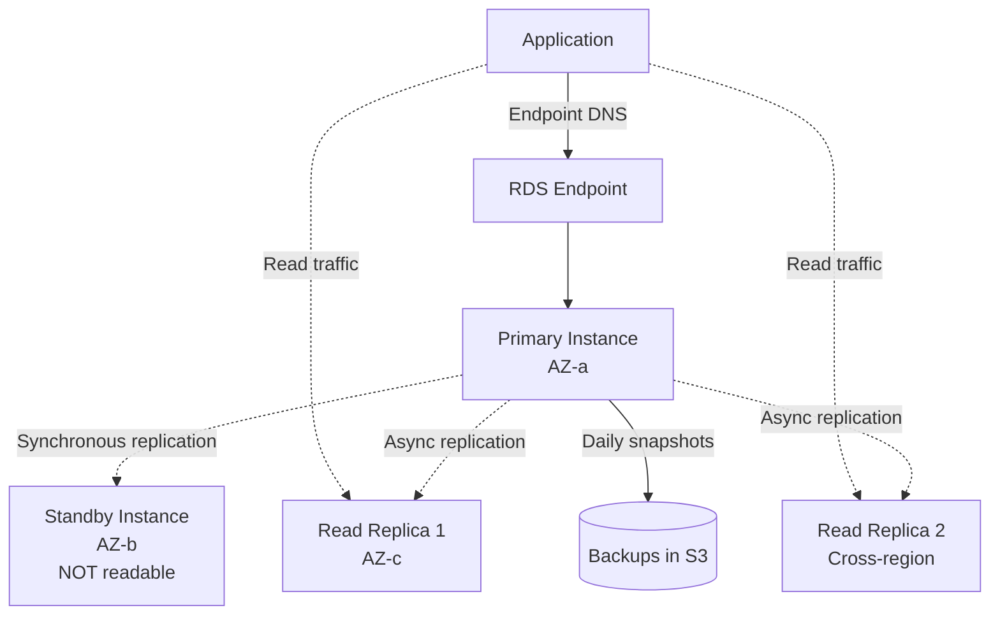
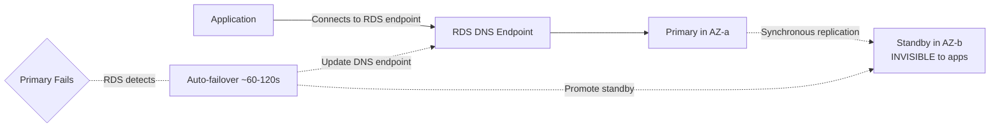
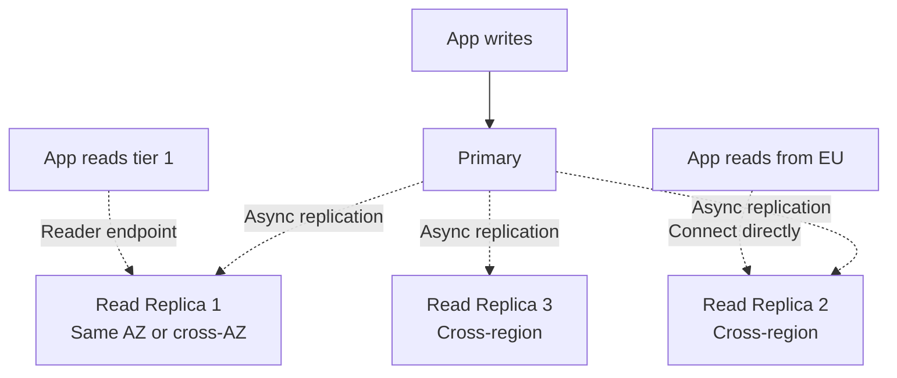
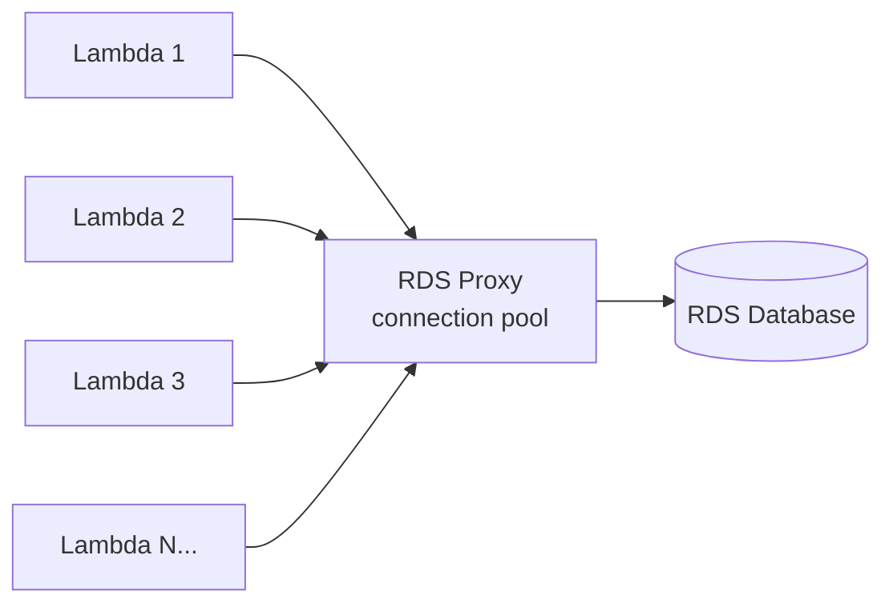

# RDS — Multi-AZ, Read Replicas, Performance

> 🔥 **Multi-AZ vs Read Replica confusion is a top exam trap.** Master the distinction.

## Problem It Solves
You want a relational database but don't want to manage backups, patching, replication, failover, monitoring, and OS-level concerns. **RDS provides managed relational databases** across MySQL, PostgreSQL, MariaDB, Oracle, and SQL Server engines.

## How It Works



### RDS Supported Engines

```
┌──────────────────────────────────────────────────────────┐
│ AWS-OWNED OPEN-SOURCE:                                    │
│   MySQL                                                   │
│   PostgreSQL                                              │
│   MariaDB                                                 │
├──────────────────────────────────────────────────────────┤
│ COMMERCIAL (BYOL or License-Included):                    │
│   Oracle                                                  │
│   Microsoft SQL Server                                    │
├──────────────────────────────────────────────────────────┤
│ AURORA (separate service, RDS-managed):                   │
│   Aurora MySQL                                            │
│   Aurora PostgreSQL                                       │
└──────────────────────────────────────────────────────────┘
```

---

## RDS Multi-AZ — High Availability



```
MULTI-AZ KEY FACTS:
─────────────────────────────────────────────
✅ SYNCHRONOUS replication (zero data loss target)
✅ Standby in DIFFERENT AZ
✅ Auto-failover on primary failure (~60-120 sec)
✅ DNS endpoint updates automatically — apps reconnect
✅ Standby is INVISIBLE — you CANNOT read from it
✅ Backups taken from STANDBY (no perf impact on primary)
✅ Same engine version, same instance class

USE CASE:
─────────────────────────────────────────────
HIGH AVAILABILITY (not scale)
Production databases that must survive AZ failure
```

### Multi-AZ Cluster (NEW, Beta-to-GA)

```
RDS MULTI-AZ DB CLUSTER (newer feature):
─────────────────────────────────────────────
- 1 writer + 2 READABLE standbys (3 nodes total!)
- Synchronous to standbys
- Standbys are READABLE (different from classic Multi-AZ)
- Faster failover (~35 seconds)
- Lower write latency than classic Multi-AZ

Supported on: MySQL, PostgreSQL (limited engines)
Considered a step between classic Multi-AZ and Aurora
```

---

## RDS Read Replicas — Read Scaling



```
READ REPLICA KEY FACTS:
─────────────────────────────────────────────
✅ ASYNCHRONOUS replication
✅ Replica is READ-ONLY (until promoted)
✅ Up to 5 replicas per primary
✅ Can be in different AZ, region, or even Aurora!
✅ Each has its own DNS endpoint
✅ Can be PROMOTED to standalone primary (manual)
✅ Promoted replica = no more replication from old primary

USE CASE:
─────────────────────────────────────────────
SCALE READS (offload from primary)
Lower-latency reads in distant regions
Reporting workloads (heavy queries) isolated from prod
```

### Read Replica Special Behaviors

```
WRITE TARGETS:
─────────────────────────────────────────────
- MySQL replicas CAN be writers (cascading)
- PostgreSQL replicas are read-only until promoted
- SQL Server, Oracle, MariaDB also support replicas

CROSS-REGION REPLICAS:
─────────────────────────────────────────────
- Encrypted with KMS in DESTINATION region
- Asynchronous replication over public/VPC peering
- Useful for: DR, low-latency reads in distant regions
- Can be promoted for region failover

REPLICA OF A REPLICA:
─────────────────────────────────────────────
- MySQL: supports cascading replicas
- Limits the load on the primary
```

---

## Multi-AZ vs Read Replica — The Critical Distinction

| | **Multi-AZ** | **Read Replicas** |
|---|---|---|
| Purpose | High Availability | Read Scaling |
| Replication | Synchronous | Asynchronous |
| Readable? | NO (standby invisible) | YES |
| Failover | Automatic, 60-120s | Manual promotion |
| Same/Different region | Different AZ same region | Same AZ, region, or cross-region |
| Standby visibility | None (you only see primary) | Each has own endpoint |
| Cost | 2x (standby always running) | Per-replica cost |
| Can have both? | YES — Multi-AZ + Read Replicas | YES |

```
COMBINED ARCHITECTURE:
─────────────────────────────────────────────
Primary (us-east-1a) ←→ Standby (us-east-1b) — Multi-AZ
   │
   ├─→ Read Replica 1 (us-east-1c) — for reads
   ├─→ Read Replica 2 (us-east-1c) — for reports
   └─→ Read Replica 3 (eu-west-1) — for EU users + DR
```

---

## RDS Backups

```
AUTOMATED BACKUPS:
─────────────────────────────────────────────
✅ Enabled by default (retention: 0-35 days)
✅ Daily full backup + transaction logs every 5 min
✅ Point-in-Time Recovery (PITR) to any second within window
✅ Restore creates a NEW instance (cannot overwrite)
✅ Stored in S3 (managed, you don't see the bucket)

MANUAL SNAPSHOTS:
─────────────────────────────────────────────
✅ Triggered by you (CLI, console, API)
✅ Retained until you delete
✅ Can be shared with other AWS accounts
✅ Can be copied cross-region (often for DR)
✅ Survive instance deletion

BACKUP IMPACT:
─────────────────────────────────────────────
Single-AZ: brief I/O suspension during backup
Multi-AZ: backup taken from standby — zero primary impact
```

---

## RDS Performance Insights

```
PERFORMANCE INSIGHTS:
─────────────────────────────────────────────
✅ Database performance dashboard
✅ Top SQL statements
✅ Wait events analysis
✅ Free up to 7 days history; longer = paid
✅ Available for all RDS engines
✅ NO agent installation needed
✅ Visualize blocked queries, locks

PARTNERED WITH:
─────────────────────────────────────────────
CloudWatch Enhanced Monitoring:
  OS-level metrics on DB host
  Per-second granularity
  Process and thread visibility
```

---

## RDS Proxy — Connection Pooling



```
RDS PROXY:
─────────────────────────────────────────────
✅ Manages a pool of DB connections
✅ Solves Lambda + RDS scaling issue
   (Lambda can spawn 1000s of containers → 
    1000s of new DB connections → DB dies)
✅ Failover-aware (uses Multi-AZ)
✅ Reduces failover time from 60s to ~15s
✅ Auth via IAM or Secrets Manager
✅ TLS in transit

USE:
─────────────────────────────────────────────
✅ Lambda + RDS pattern
✅ Spiky workloads with many connections
✅ Improve resilience to DB failover
```

---

## RDS Instance Types & Storage

```
INSTANCE CLASSES:
─────────────────────────────────────────────
db.t — Burstable (dev/test)
db.m — General purpose
db.r — Memory-optimized (most DBs love this)
db.x — Extreme memory (SAP HANA)
db.z — High frequency CPU

STORAGE TYPES (similar to EBS):
─────────────────────────────────────────────
gp3      — General purpose SSD (default)
gp2      — Legacy general purpose SSD
io1/io2  — Provisioned IOPS (high perf)
magnetic — Legacy HDD (don't use)

STORAGE AUTO SCALING:
─────────────────────────────────────────────
✅ Enable to auto-grow storage as it fills
✅ Avoid "disk full" outages
✅ Recommended for production
```

---

## RDS Custom — for Oracle and SQL Server

```
RDS CUSTOM:
─────────────────────────────────────────────
Standard RDS gives you very limited OS access.
For Oracle/SQL Server, often you need:
- Custom database options
- Custom installs
- SSH to the OS

RDS Custom provides:
✅ SSH access to underlying EC2
✅ Sudo, kernel parameters
✅ Custom Oracle settings
✅ Still managed (backups, etc.)

DON'T USE: For new workloads — use regular RDS or Aurora
USE: Lift-and-shift Oracle/SQL Server needing OS access
```

---

## When to Use RDS vs Aurora

```
RDS:
─────────────────────────────────────────────
✅ Need Oracle or SQL Server
✅ Cost-sensitive small workloads (db.t classes)
✅ Need specific MySQL/PG version Aurora doesn't support
✅ Lift-and-shift with no rewrite

AURORA:
─────────────────────────────────────────────
✅ Need MySQL/PG with cloud-native features
✅ Want < 1 sec replica lag
✅ Want sub-minute failover
✅ Need multi-region active-passive
✅ Variable workload (Serverless v2)
✅ Modern default for new builds
```

## Trade-offs

| Choice | Gain | Sacrifice |
|---|---|---|
| Multi-AZ over single | HA, auto-failover | 2x cost (standby) |
| Read Replicas | Read scale, geographic reads | Async lag, manual promote |
| Multi-AZ Cluster | Readable standbys | Newer, limited engines |
| RDS Custom | OS access for Oracle/SQL | More complexity, fewer auto-managed features |
| RDS Proxy | Connection pooling, faster failover | Extra cost per proxy |
| Aurora over RDS | Performance, faster failover | Slightly more expensive |

## Real World Example

**A B2B SaaS company:**
- **RDS PostgreSQL Multi-AZ** for main tenant database
- **3 Read Replicas** in different AZs for read scaling
- **Cross-region Read Replica** in DR region (manual promote on disaster)
- **RDS Proxy** in front (their app is Lambda-based)
- **Daily automated backups** + manual snapshots before migrations
- **Performance Insights** to spot slow queries

**A traditional enterprise** migrating Oracle:
- **RDS Custom for Oracle** to lift-and-shift with required customizations
- Multi-AZ for HA
- License-included pricing model
- Plan to refactor to Aurora PostgreSQL via Babelfish later

## 🎯 Exam Soundbite

> "RDS provides managed relational databases across six engines. Multi-AZ provides high availability with a synchronous standby in a different AZ — the standby is not readable, but automatic failover happens in 60-120 seconds. Read Replicas provide read scaling via asynchronous replication — they're readable and can be in the same region or cross-region, with up to five per primary. Use both together for HA plus read scale. For connection pooling and faster failover with Lambda, use RDS Proxy. For Oracle and SQL Server workloads needing OS access, use RDS Custom."

---

## ⚡ Quick Recall Card

```
┌─────────────────────────────────────────────────┐
│ RDS KEY FACTS                                    │
├─────────────────────────────────────────────────┤
│ Multi-AZ           HA, sync, NOT readable        │
│ Read Replica       Read scale, async, READABLE   │
│ Failover Multi-AZ  60-120s automatic             │
│ Failover with RR   Manual promote                │
│ Max Read Replicas  5 per primary                 │
│ Backups retention  0-35 days                     │
│ PITR               To any second within window   │
│ Encryption         At CREATION only              │
│ RDS Proxy          Pool conns, faster failover   │
│ Multi-AZ Cluster   3 nodes, readable standbys    │
│ Performance        Performance Insights (free)   │
└─────────────────────────────────────────────────┘
```

## 🎓 Common Exam Patterns

> **"Need both HA and read scaling for MySQL workload."**
>
> ✅ **Multi-AZ + Read Replicas** (yes, you can have both — Multi-AZ for HA, replicas for read scale).

> **"Lambda function exhausts RDS connections during traffic spikes."**
>
> ✅ **RDS Proxy** — manages connection pool, Lambda functions reuse pooled connections instead of each creating new ones.

> **"DR plan: PostgreSQL DB in us-east-1 needs failover to eu-west-1 with RPO of seconds."**
>
> ✅ **Cross-region Read Replica** in eu-west-1, manually promoted on disaster. RPO = replication lag (seconds typically). Or **Aurora Global Database** for faster RTO and < 1s RPO.
