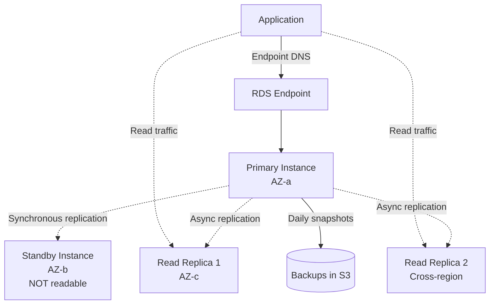
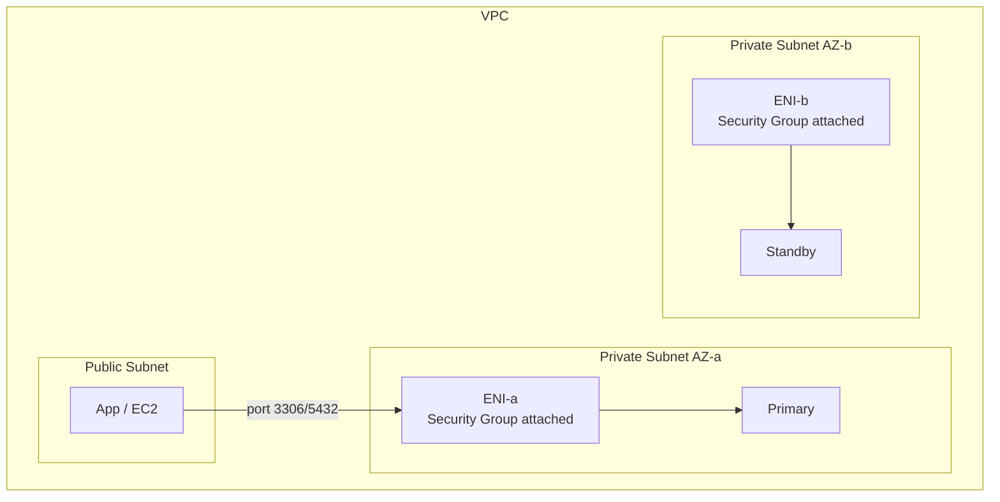
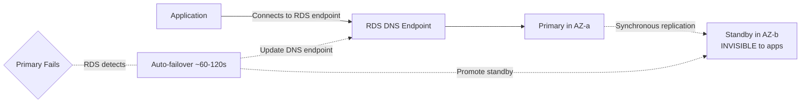
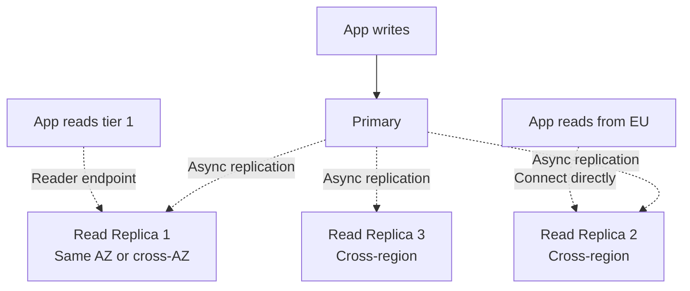
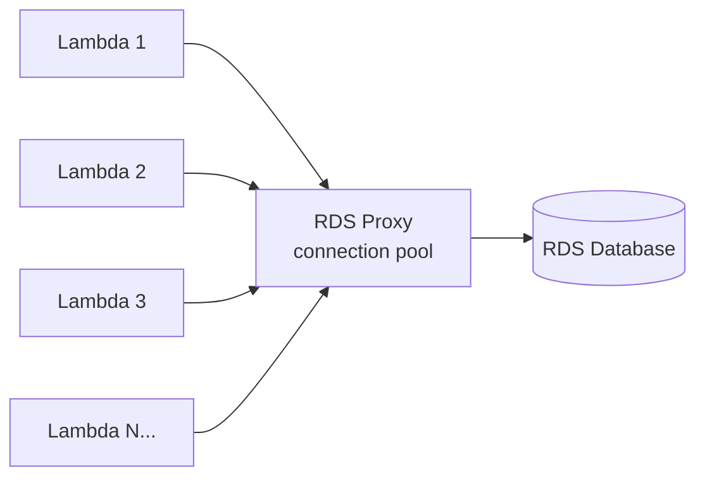
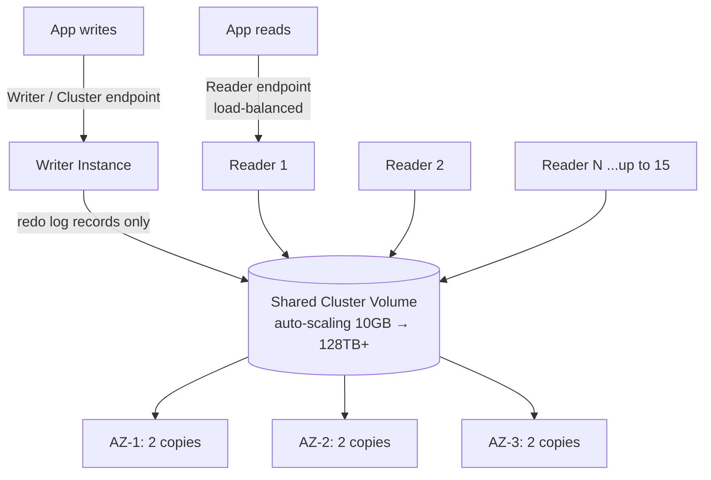

# RDS — Multi-AZ, Read Replicas, Performance

> 🔥 **Multi-AZ vs Read Replica confusion is a top exam trap.** Master the distinction.

## Problem It Solves
You want a relational database but don't want to manage backups, patching, replication, failover, monitoring, and OS-level concerns. **RDS provides managed relational databases** across MySQL, PostgreSQL, MariaDB, Oracle, and SQL Server engines.

## How It Works



### RDS Supported Engines

```
┌──────────────────────────────────────────────────────────┐
│ AWS-OWNED OPEN-SOURCE:                                    │
│   MySQL                                                   │
│   PostgreSQL                                              │
│   MariaDB                                                 │
├──────────────────────────────────────────────────────────┤
│ COMMERCIAL (BYOL or License-Included):                    │
│   Oracle                                                  │
│   Microsoft SQL Server                                    │
├──────────────────────────────────────────────────────────┤
│ AURORA (separate service, RDS-managed):                   │
│   Aurora MySQL                                            │
│   Aurora PostgreSQL                                       │
└──────────────────────────────────────────────────────────┘
```

---

## RDS Network & Security Architecture



```
NETWORKING — WHERE RDS LIVES:
─────────────────────────────────────────────
✅ RDS lives in PRIVATE subnets (never public — no direct internet)
✅ DB SUBNET GROUP = the set of private subnets (across AZs)
   RDS is allowed to place instances in. Needs ≥2 AZs for Multi-AZ.
✅ In each subnet RDS provisions an ENI (Elastic Network Interface)
   — AWS-managed, you don't create or see it directly
✅ SECURITY GROUP is attached at RDS-config time → AWS wires it
   onto the ENI(s) internally. That is where traffic is filtered.
✅ App in public subnet → connects THROUGH the SG rules to the ENI
   e.g. allow inbound tcp 3306 (MySQL) / 5432 (PostgreSQL)

MENTAL MODEL:
  "You attach the Security Group during config,
   AWS applies it internally at the ENI level."
```

```
SECURITY LAYERS (defense in depth):
─────────────────────────────────────────────
NETWORK   VPC + private subnets + Security Groups (firewall on ENI)
AT REST   AES-256 via AWS KMS — MUST be enabled at CREATION time
          (can't toggle on later on an existing instance)
IN TRANSIT SSL/TLS — download the RDS CA cert, enforce SSL in the
          connection string / parameter group
ACCESS    IAM policies control who manages RDS resources;
          IAM DB authentication can map DB users → IAM (no password)
```

### Encryption at Rest — how the app still reads the data

```
FLOW (transparent to the app):
─────────────────────────────────────────────
1. Data on disk (files, backups, snapshots) is encrypted (AES-256)
2. RDS requests the data key from KMS
3. RDS decrypts on the fly when serving a query
4. Decrypted result travels back over the SSL/TLS connection

→ App does NOTHING special. Encryption at rest + in transit are
  independent layers; the app just connects normally over SSL.
```

---

## RDS Multi-AZ — High Availability



```
MULTI-AZ KEY FACTS:
─────────────────────────────────────────────
✅ SYNCHRONOUS replication (zero data loss target)
✅ Standby in DIFFERENT AZ
✅ Auto-failover on primary failure (~60-120 sec)
✅ DNS endpoint updates automatically — apps reconnect
✅ Standby is INVISIBLE — you CANNOT read from it
✅ Backups taken from STANDBY (no perf impact on primary)
   ⚠ SQL Server backs up from PRIMARY (brief I/O suspend)
✅ Same engine version, same instance class

USE CASE:
─────────────────────────────────────────────
HIGH AVAILABILITY (not scale)
Production databases that must survive AZ failure
```

### Multi-AZ Cluster (NEW, Beta-to-GA)

```
RDS MULTI-AZ DB CLUSTER (newer feature):
─────────────────────────────────────────────
- 1 writer + 2 READABLE standbys (3 nodes total!)
- Synchronous to standbys
- Standbys are READABLE (different from classic Multi-AZ)
- Faster failover (~35 seconds)
- Lower write latency than classic Multi-AZ

Supported on: MySQL, PostgreSQL (limited engines)
Considered a step between classic Multi-AZ and Aurora
```

---

## RDS Read Replicas — Read Scaling



```
READ REPLICA KEY FACTS:
─────────────────────────────────────────────
✅ ASYNCHRONOUS replication
✅ Replica is READ-ONLY (until promoted)
✅ Up to 15 replicas per primary (MySQL/MariaDB/PostgreSQL/Oracle)
   — SQL Server = 5 max
✅ Can be in different AZ, region, or even Aurora!
✅ Each has its own DNS endpoint
✅ Can be PROMOTED to standalone primary (manual)
✅ Promoted replica = no more replication from old primary

USE CASE:
─────────────────────────────────────────────
SCALE READS (offload from primary)
Lower-latency reads in distant regions
Reporting workloads (heavy queries) isolated from prod
```

### Read Replica Special Behaviors

```
WRITE TARGETS:
─────────────────────────────────────────────
- MySQL replicas CAN be writers (cascading)
- PostgreSQL replicas are read-only until promoted
- SQL Server, Oracle, MariaDB also support replicas

CROSS-REGION REPLICAS:
─────────────────────────────────────────────
- Encrypted with KMS in DESTINATION region
- Asynchronous replication over public/VPC peering
- Useful for: DR, low-latency reads in distant regions
- Can be promoted for region failover

REPLICA OF A REPLICA:
─────────────────────────────────────────────
- MySQL/MariaDB: supports cascading replicas
- Max 4 instances in a replication chain
- Limits the load on the primary
```

### Scenario — both Primary AND Standby down

```
DISASTER SCENARIO (top-of-mind for exam):
─────────────────────────────────────────────
Setup: Primary + synchronous Standby (Multi-AZ)
       + async Read Replica
Event: BOTH primary and standby fail

→ Multi-AZ auto-failover CAN'T help (both are down)
→ Read Replica can be PROMOTED to a new primary
   • MANUAL action (console / API) — NOT automatic
   • Replica was async → possible small data loss
     (= however far it lagged behind)
→ It becomes an independent standalone DB with its own
  endpoint & backups; stops replicating from the old primary

RULE OF THUMB:
  Standby  → automatic failover (HA)
  Replica  → manual promotion (recovery option / DR)
```

---

## Multi-AZ vs Read Replica — The Critical Distinction

| | **Multi-AZ** | **Read Replicas** |
|---|---|---|
| Purpose | High Availability | Read Scaling |
| Replication | Synchronous | Asynchronous |
| Readable? | NO (standby invisible) | YES |
| Failover | Automatic, 60-120s | Manual promotion |
| Same/Different region | Different AZ same region | Same AZ, region, or cross-region |
| Standby visibility | None (you only see primary) | Each has own endpoint |
| Cost | 2x (standby always running) | Per-replica cost |
| Can have both? | YES — Multi-AZ + Read Replicas | YES |

```
COMBINED ARCHITECTURE:
─────────────────────────────────────────────
Primary (us-east-1a) ←→ Standby (us-east-1b) — Multi-AZ
   │
   ├─→ Read Replica 1 (us-east-1c) — for reads
   ├─→ Read Replica 2 (us-east-1c) — for reports
   └─→ Read Replica 3 (eu-west-1) — for EU users + DR
```

---

## RDS Backups

```
AUTOMATED BACKUPS:
─────────────────────────────────────────────
✅ Enabled by default (retention: 0-35 days)
✅ Daily full backup + transaction logs every 5 min
✅ Point-in-Time Recovery (PITR) to any second within window
✅ Restore creates a NEW instance (cannot overwrite)
✅ Stored in S3 (managed, you don't see the bucket)

MANUAL SNAPSHOTS:
─────────────────────────────────────────────
✅ Triggered by you (CLI, console, API)
✅ Retained until you delete
✅ Can be shared with other AWS accounts
✅ Can be copied cross-region (often for DR)
✅ Survive instance deletion

BACKUP IMPACT (who is backed up):
─────────────────────────────────────────────
Single-AZ: taken from the (only) instance → brief I/O
           suspension during backup (secs–mins)
Multi-AZ:  taken from the STANDBY → no I/O suspension on
           primary (MariaDB/MySQL/Oracle/PostgreSQL)
           ⚠ EXCEPTION: SQL Server → backup taken from
             PRIMARY, brief I/O suspension even in Multi-AZ

NOTE (correction): in classic Multi-AZ the backup source is
the *standby*, NOT the active primary. It's the standby's
storage that's snapshotted — that's precisely why the primary
sees no I/O suspension.

WHERE STORED: automated backups + snapshots live in S3
(AWS-managed bucket you don't see). Restore always creates a
NEW instance with a new endpoint (never overwrites in place).
```

---

## RDS Performance Insights

```
PERFORMANCE INSIGHTS:
─────────────────────────────────────────────
✅ Database performance dashboard
✅ Top SQL statements
✅ Wait events analysis
✅ Free up to 7 days history; longer = paid
✅ Available for all RDS engines
✅ NO agent installation needed
✅ Visualize blocked queries, locks

PARTNERED WITH:
─────────────────────────────────────────────
CloudWatch Enhanced Monitoring:
  OS-level metrics on DB host
  Per-second granularity
  Process and thread visibility
```

---

## RDS Proxy — Connection Pooling



```
RDS PROXY:
─────────────────────────────────────────────
✅ Manages a pool of DB connections
✅ Solves Lambda + RDS scaling issue
   (Lambda can spawn 1000s of containers → 
    1000s of new DB connections → DB dies)
✅ Failover-aware (uses Multi-AZ)
✅ Reduces failover time from 60s to ~15s
✅ Auth via IAM or Secrets Manager
✅ TLS in transit

USE:
─────────────────────────────────────────────
✅ Lambda + RDS pattern
✅ Spiky workloads with many connections
✅ Improve resilience to DB failover
```

---

## RDS Instance Types & Storage

```
INSTANCE CLASSES:
─────────────────────────────────────────────
db.t — Burstable (dev/test)
db.m — General purpose
db.r — Memory-optimized (most DBs love this)
db.x — Extreme memory (SAP HANA)
db.z — High frequency CPU

STORAGE TYPES (similar to EBS):
─────────────────────────────────────────────
gp3      — General purpose SSD (default)
gp2      — Legacy general purpose SSD
io1/io2  — Provisioned IOPS (high perf)
magnetic — Legacy HDD (don't use)

STORAGE AUTO SCALING:
─────────────────────────────────────────────
✅ Enable to auto-grow storage as it fills
✅ Avoid "disk full" outages
✅ Recommended for production
```

---

## RDS Custom — for Oracle and SQL Server

```
RDS CUSTOM:
─────────────────────────────────────────────
Standard RDS gives you very limited OS access.
For Oracle/SQL Server, often you need:
- Custom database options
- Custom installs
- SSH to the OS

RDS Custom provides:
✅ SSH access to underlying EC2
✅ Sudo, kernel parameters
✅ Custom Oracle settings
✅ Still managed (backups, etc.)

DON'T USE: For new workloads — use regular RDS or Aurora
USE: Lift-and-shift Oracle/SQL Server needing OS access
```

---

## Aurora — Cloud-Native Architecture

> Aurora is MySQL- and PostgreSQL-**compatible**, but a **completely
> different engine** built by AWS from the ground up. The key difference
> is the **shared distributed storage layer** — compute and storage are
> decoupled.



### The Shared Storage Volume — the heart of Aurora

```
NOT AN EBS VOLUME:
─────────────────────────────────────────────
- It's Aurora's PROPRIETARY distributed storage service
- All instances (writer + readers) point to the SAME volume
  → There is NO separate standby like classic RDS Multi-AZ
  → Readers don't get their own copy of data — they share it
- Storage auto-scales in 10GB chunks, up to 128TB (256 TiB some engines)
- You pay only for storage actually used (high-water mark)

DURABILITY — 6 copies / 3 AZs:
─────────────────────────────────────────────
Every write is replicated 6 ways: 2 copies in each of 3 AZs.
Quorum model:
  • WRITE quorum = 4 of 6  (write commits when 4 acknowledge)
  • READ quorum  = 3 of 6  (used for recovery/repair)
Because 4-of-6 spans ≥2 AZs, a write is durable in ≥2 AZs at commit.

Fault tolerance:
  • Survives loss of an entire AZ (2 copies) with NO write loss
  • Survives AZ + 1 additional storage node loss without data loss
  • Self-healing: bad segments auto-rebuilt from surviving copies
```

### How writes work (log-based)

```
KEY EFFICIENCY TRICK:
─────────────────────────────────────────────
The writer sends ONLY REDO LOG RECORDS to the storage layer,
NOT full data pages. The storage nodes assemble pages themselves.
→ Massively less network I/O (AWS reports up to ~30x reduction)
→ This is a big reason Aurora is faster than stock MySQL/PostgreSQL

CONCURRENCY / CONSISTENCY:
─────────────────────────────────────────────
- Single writer enforces write ordering (via ordered redo log / LSN)
- Readers replay the same log stream → always consistent view
- Replica lag typically ~10-20 ms (vs seconds/minutes for RDS)
- Data corruption guarded by checksums + storage-layer consistency
```

### Aurora Replicas & Failover

```
AURORA REPLICAS:
─────────────────────────────────────────────
✅ Up to 15 replicas per cluster (vs RDS's separate copies)
✅ All share the cluster volume → adding a replica is cheap/fast
   (no new copy of data made)
✅ READER ENDPOINT load-balances read connections across replicas
✅ WRITER / CLUSTER ENDPOINT always points to the current writer

FAILOVER (fast — usually < 30s):
─────────────────────────────────────────────
- No data sync needed on failover (storage already shared)
- Any reader can be promoted to writer
- FAILOVER (PROMOTION) TIERS: tier 0 = highest priority; lowest
  tier number is promoted first
- If NO replica exists, Aurora spins up a new instance
  (slower — no warm reader waiting)
- Writer endpoint auto-repoints to the new writer → app reconnects
```

### Aurora Global Database — cross-region

```
GLOBAL DATABASE (the primary cross-region option for BOTH engines):
─────────────────────────────────────────────
- 1 PRIMARY cluster (read/write) in one region
- Secondary read-only clusters in other regions:
    • Aurora MySQL      → up to 5 secondary regions
    • Aurora PostgreSQL → up to 10 secondary regions
- Each secondary region can itself have up to 15 Aurora replicas
- Secondaries serve LOW-LATENCY LOCAL READS
- USE: global reads + cross-region DR with far better RTO/RPO
       than a plain cross-region read replica.

HOW REPLICATION WORKS (SAME mechanism for MySQL & PostgreSQL):
─────────────────────────────────────────────
- STORAGE-LEVEL physical replication on dedicated cross-region
  infrastructure — NOT database-engine / binlog replication
- Primary ships compact REDO LOG RECORDS (not full pages) across
  the network; secondary storage volumes apply the logs
- ASYNCHRONOUS, typical lag < 1 second (efficient because it's
  log records, not pages)
- This is why both engines get sub-second lag

FAILOVER = MANUAL for BOTH engines:
─────────────────────────────────────────────
- On primary-region failure you MANUALLY promote a secondary
  cluster to become the new primary (console / API)
- NOT automatic — deliberately, to avoid promoting on a transient
  network blip or brief outage; you decide to cut over
- After promotion: secondary becomes the new writer; old primary
  (if it returns) is read-only
- RPO depends on replication lag at time of failure
  RTO depends on how fast you run the promotion (mins for DNS +
  cluster metadata to update)

⚠ DON'T CONFUSE:
  Replication (storage-level, continuous, automatic) is always on.
  FAILOVER PROMOTION is the manual step.
```

### Cross-region: MySQL vs PostgreSQL (the key difference)

```
BOTH engines → Aurora GLOBAL DATABASE (storage-level, best choice).

The difference is the SECOND / alternative cross-region method:
─────────────────────────────────────────────
Aurora MySQL      : ALSO supports cross-region replicas via
                    native MySQL BINLOG replication (engine-level,
                    slower, async) — an extra option outside
                    Global Database.
Aurora PostgreSQL : NO binlog-style cross-region replicas.
                    PostgreSQL has no binlog equivalent, so
                    Global Database is the ONLY cross-region option.

TAKEAWAY: MySQL has an extra (slower) cross-region path; Postgres
relies entirely on Global Database. But for BOTH, Global Database
(storage-level, sub-second) is the recommended choice anyway.

Note: this binlog difference is about CROSS-REGION replicas.
Within a region, replicas for both engines just share the
cluster volume (no binlog needed).
```

### Aurora Serverless

```
AURORA SERVERLESS (v2 is current):
─────────────────────────────────────────────
- No fixed instance size — you set MIN and MAX capacity in
  ACUs (Aurora Capacity Units = bundle of CPU + memory)
- Auto-scales up under load, down when idle (v2 scales in fine
  increments, in-place, fast)
- Pay per second for capacity actually used
USE:
  • Unpredictable / spiky / intermittent workloads
  • Dev/test environments
  • New apps where you can't predict capacity yet
```

```
RDS Multi-AZ  vs  AURORA — architecture contrast:
─────────────────────────────────────────────
RDS Multi-AZ : Primary + standby, EACH has its own storage;
               data synced instance-to-instance; standby NOT readable
AURORA       : One shared volume for all instances; readers ARE
               readable; failover fast (no sync); 6-copy/3-AZ storage
```

---

## When to Use RDS vs Aurora

```
RDS:
─────────────────────────────────────────────
✅ Need Oracle or SQL Server
✅ Cost-sensitive small workloads (db.t classes)
✅ Need specific MySQL/PG version Aurora doesn't support
✅ Lift-and-shift with no rewrite

AURORA:
─────────────────────────────────────────────
✅ Need MySQL/PG with cloud-native features
✅ Want < 1 sec replica lag
✅ Want sub-minute failover
✅ Need multi-region active-passive
✅ Variable workload (Serverless v2)
✅ Modern default for new builds
```

## Trade-offs

| Choice | Gain | Sacrifice |
|---|---|---|
| Multi-AZ over single | HA, auto-failover | 2x cost (standby) |
| Read Replicas | Read scale, geographic reads | Async lag, manual promote |
| Multi-AZ Cluster | Readable standbys | Newer, limited engines |
| RDS Custom | OS access for Oracle/SQL | More complexity, fewer auto-managed features |
| RDS Proxy | Connection pooling, faster failover | Extra cost per proxy |
| Aurora over RDS | Performance, faster failover | Slightly more expensive |

## Real World Example

**A B2B SaaS company:**
- **RDS PostgreSQL Multi-AZ** for main tenant database
- **3 Read Replicas** in different AZs for read scaling
- **Cross-region Read Replica** in DR region (manual promote on disaster)
- **RDS Proxy** in front (their app is Lambda-based)
- **Daily automated backups** + manual snapshots before migrations
- **Performance Insights** to spot slow queries

**A traditional enterprise** migrating Oracle:
- **RDS Custom for Oracle** to lift-and-shift with required customizations
- Multi-AZ for HA
- License-included pricing model
- Plan to refactor to Aurora PostgreSQL via Babelfish later

## 🎯 Exam Soundbite

> "RDS provides managed relational databases across six engines. Multi-AZ provides high availability with a synchronous standby in a different AZ — the standby is not readable, but automatic failover happens in 60-120 seconds. Read Replicas provide read scaling via asynchronous replication — they're readable and can be in the same region or cross-region, with up to fifteen per primary (five for SQL Server). Use both together for HA plus read scale. For connection pooling and faster failover with Lambda, use RDS Proxy. For Oracle and SQL Server workloads needing OS access, use RDS Custom."

> **Aurora:** "Aurora is MySQL/PostgreSQL-compatible but built cloud-native around a single shared distributed storage volume that keeps six copies of data across three AZs, using a four-of-six write quorum and three-of-six read quorum. Writers ship only redo log records, not full pages, which is why Aurora is faster and has ~10-20 ms replica lag. Up to fifteen replicas share the volume, so failover is under 30 seconds and any reader can be promoted based on promotion tier. Aurora Global Database replicates to secondary regions (up to 5 for MySQL, 10 for PostgreSQL) using storage-level replication with sub-second lag for global reads and cross-region DR — replication is automatic and continuous, but failover promotion of a secondary to primary is manual for both engines. Only Aurora MySQL has an extra cross-region option via native binlog replication; PostgreSQL relies solely on Global Database. Aurora Serverless v2 auto-scales capacity for unpredictable workloads."

> **Security/Network:** "RDS lives in private subnets defined by a DB subnet group. Behind the scenes AWS provisions an ENI in each subnet, and the security group you attach at config time is applied at the ENI level — that's where traffic is filtered. Encryption at rest uses AES-256 via KMS and must be enabled at creation; encryption in transit uses SSL/TLS. The app reads encrypted data transparently — RDS fetches the KMS key, decrypts on the fly, and returns results over the SSL connection."

---

## ⚡ Quick Recall Card

```
┌─────────────────────────────────────────────────┐
│ RDS KEY FACTS                                    │
├─────────────────────────────────────────────────┤
│ Multi-AZ           HA, sync, NOT readable        │
│ Read Replica       Read scale, async, READABLE   │
│ Failover Multi-AZ  60-120s automatic             │
│ Failover with RR   Manual promote (DR option)    │
│ Max Read Replicas  15 (5 for SQL Server)         │
│ Backups retention  0-35 days                     │
│ PITR               To any second within window   │
│ Backups source     Standby (SQL Server=primary)  │
│ Backups stored     S3; restore = NEW instance    │
│ Encryption at rest AES-256 via KMS, at CREATION  │
│ Encryption transit SSL/TLS (download RDS CA cert)│
│ Network            Private subnets + DB subnet grp│
│ Security applied   At the ENI via Security Group │
│ RDS Proxy          Pool conns, faster failover   │
│ Multi-AZ Cluster   3 nodes, readable standbys    │
│ Performance        Performance Insights (free)   │
├─────────────────────────────────────────────────┤
│ AURORA KEY FACTS                                 │
├─────────────────────────────────────────────────┤
│ Storage            1 shared volume, 6 copies/3 AZ│
│ Write quorum       4 of 6   Read quorum  3 of 6  │
│ Writes send        Redo log records (not pages)  │
│ Replicas           Up to 15, share the volume    │
│ Endpoints          Writer (cluster) + Reader (LB)│
│ Failover           <30s, promotion tiers (0=top) │
│ Replica lag        ~10-20 ms                     │
│ Global Database    1 primary + secondaries:      │
│                    MySQL 5 / PostgreSQL 10 regns │
│ Global DB replicat Storage-level, <1s, async     │
│ Global DB failover MANUAL promote (both engines) │
│ X-region MySQL     Global DB OR binlog replicas  │
│ X-region PostgreSQL Global DB ONLY (no binlog)   │
│ Serverless v2      Auto-scale ACUs, pay/sec      │
│ Storage autoscale  10GB → 128TB, pay for used    │
└─────────────────────────────────────────────────┘
```

## 🎓 Common Exam Patterns

> **"Need both HA and read scaling for MySQL workload."**
>
> ✅ **Multi-AZ + Read Replicas** (yes, you can have both — Multi-AZ for HA, replicas for read scale).

> **"Lambda function exhausts RDS connections during traffic spikes."**
>
> ✅ **RDS Proxy** — manages connection pool, Lambda functions reuse pooled connections instead of each creating new ones.

> **"DR plan: PostgreSQL DB in us-east-1 needs failover to eu-west-1 with RPO of seconds."**
>
> ✅ **Cross-region Read Replica** in eu-west-1, manually promoted on disaster. RPO = replication lag (seconds typically). Or **Aurora Global Database** for faster RTO and < 1s RPO.

> **"Multi-AZ primary AND standby both fail. How do you recover the database?"**
>
> ✅ Multi-AZ auto-failover can't help (both down). **Manually promote a Read Replica** to a standalone primary. Because the replica is async, expect minor data loss equal to the replication lag. Promotion is a manual console/API action.

> **"Where is the security group applied for an RDS instance in a private subnet?"**
>
> ✅ At the **ENI** (Elastic Network Interface) that RDS provisions in each subnet. You attach the SG during configuration; AWS wires it to the ENI internally. RDS sits in private subnets defined by a **DB subnet group**.

> **"Enable encryption at rest on an existing unencrypted RDS instance."**
>
> ✅ Can't toggle it directly — encryption at rest must be set **at creation**. Workaround: take a snapshot, **copy the snapshot with encryption enabled**, then restore from the encrypted copy.

> **"Reads need to scale globally with < 1s lag; single-region read replicas aren't enough."**
>
> ✅ **Aurora Global Database** — up to 5 secondary regions, storage-level replication, sub-second lag, local low-latency reads, and manual promotion of a secondary for regional DR.

> **"Unpredictable, spiky, or intermittent database workload — don't want to pay for idle capacity."**
>
> ✅ **Aurora Serverless v2** — auto-scales ACUs up/down, pay per second for capacity used.

> **"Aurora PostgreSQL needs a read-only copy in another region."**
>
> ✅ **Aurora Global Database** — PostgreSQL has no binlog-based cross-region replica option, so Global Database is the *only* cross-region path (up to 10 secondary regions). Aurora MySQL could use Global Database OR native binlog replicas, but Global Database is preferred either way.

> **"Aurora Global Database: primary region goes down. Does it fail over automatically?"**
>
> ✅ **No — failover is manual for both MySQL and PostgreSQL.** Replication is automatic and continuous (storage-level, <1s lag), but you must manually promote a secondary cluster to primary. Manual by design, to avoid cutting over on a transient outage.
