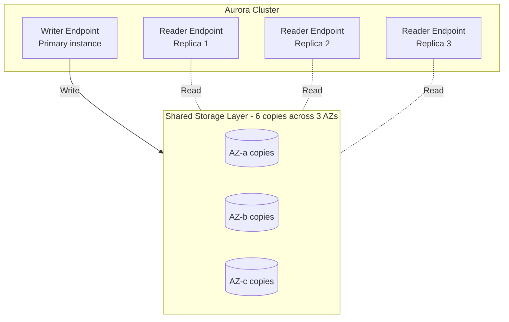
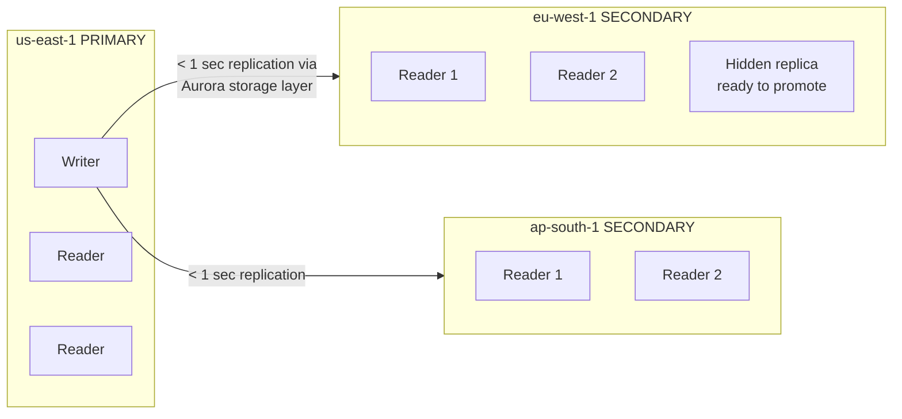
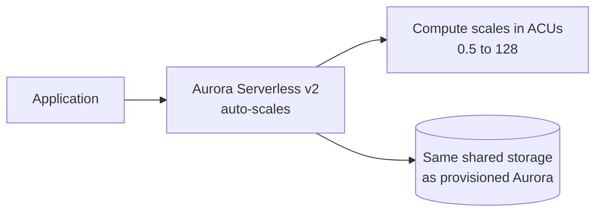

# Aurora Deep Dive — Global Database & Serverless

> 🔥 **Aurora is the SAP-C02 favorite.** Always tested. Know architecture, global vs read replicas, and Serverless v2.

## Problem It Solves
Standard RDS engines (MySQL, PostgreSQL) work, but at scale they hit limits: read replica lag, storage growth pain, slow failover, single-region scope. **Aurora rebuilds the storage layer for the cloud** — distributed storage across 3 AZs, faster failover, near-zero replica lag, and global multi-region support.

## How It Works — Aurora Architecture



### The Killer Architectural Innovation

```
TRADITIONAL RDS (e.g. MySQL):
─────────────────────────────────────────────
Primary writes to its own EBS volume.
Read replica has its own copy.
Replication = async binlog → some lag, some inconsistency.


AURORA:
─────────────────────────────────────────────
SHARED storage layer underneath all instances.
Writer writes log records, storage handles replication.
All readers see the SAME storage.
✅ Replica lag: ~milliseconds (not seconds)
✅ 6 copies across 3 AZs (vs 2 copies on RDS)
✅ Auto-heals corrupted data blocks
✅ Storage auto-grows to 128 TB (no provisioning)
```

### Aurora Cluster Endpoints

```
┌──────────────────────────────────────────────────────────┐
│ CLUSTER ENDPOINT (Writer Endpoint)                        │
│   Always points to current primary                       │
│   Used for: Writes + critical reads                      │
│   Failover: Auto-updated to new primary                  │
├──────────────────────────────────────────────────────────┤
│ READER ENDPOINT                                          │
│   Load-balances across all replicas                      │
│   Used for: Read-only workloads                          │
│   Auto-adjusts as replicas added/removed                 │
├──────────────────────────────────────────────────────────┤
│ CUSTOM ENDPOINTS                                         │
│   Group replicas by purpose                              │
│   E.g., "analytics-endpoint" → 3 specific replicas       │
│   Useful for tier separation                             │
├──────────────────────────────────────────────────────────┤
│ INSTANCE ENDPOINT                                        │
│   Specific replica DNS — bypass load balancing           │
│   Used for: Diagnostics, specific instance               │
└──────────────────────────────────────────────────────────┘
```

### Failover Behavior

```
Primary fails:
─────────────────────────────────────────────
1. Aurora detects failure (~5-10 seconds)
2. Promotes one of the replicas to primary
3. Writer endpoint DNS now points to new primary
4. Total failover: typically 30-60 seconds

Compared to RDS Multi-AZ:
─────────────────────────────────────────────
RDS Multi-AZ failover: 60-120 seconds
Aurora failover:       30-60 seconds (faster!)
```

---

## Aurora Global Database



### Aurora Global Key Facts

```
✅ One PRIMARY region (writes here)
✅ Up to 5 SECONDARY regions (read-only)
✅ Storage-level replication (NOT logical / binlog)
✅ < 1 second cross-region lag
✅ Up to 16 read replicas per secondary region
✅ Promote a secondary region to primary in < 1 minute
✅ Used for: Multi-region read scale + DR

⚠️ ACTIVE-PASSIVE writes — secondaries are read-only
⚠️ For active-active writes, use DynamoDB Global Tables
```

### Aurora Global — DR Pattern

```
NORMAL OPERATION:
─────────────────────────────────────────────
Writes → us-east-1 primary
Reads → users in EU/APAC route to nearest secondary
Cross-region lag < 1 sec


DISASTER — us-east-1 fails:
─────────────────────────────────────────────
1. Detect failure
2. Manually promote eu-west-1 to primary (managed promotion)
3. RPO < 1 second of data loss
4. RTO < 1 minute (failover completion)


APPS:
─────────────────────────────────────────────
Need a layer (Route 53, Global Accelerator)
to direct writes to current primary region.
```

---

## Aurora Serverless v2



### Aurora Serverless v2 — The Modern Default

```
SCALING:
─────────────────────────────────────────────
Capacity measured in ACUs (Aurora Capacity Units)
1 ACU ≈ 2 GB memory + matching CPU + IO
Range: 0.5 → 128 ACUs (256 GB memory)
Scales in chunks of 0.5 ACU
SUB-SECOND scaling


WHEN TO USE:
─────────────────────────────────────────────
✅ Variable, unpredictable workloads
✅ Dev/test (scale to 0.5 ACU when idle)
✅ Multi-tenant SaaS apps (scale per tenant)
✅ Spiky workloads (no over-provisioning)

DON'T USE:
─────────────────────────────────────────────
❌ Steady, predictable workload (provisioned cheaper)
❌ Very heavy continuous load (provisioned often better)
```

### Serverless v1 vs v2

| | v1 (Legacy) | v2 (Modern) ✅ |
|---|---|---|
| Scaling step | Doubles (1→2→4→8) | Granular (0.5 ACU steps) |
| Scaling speed | Slow (seconds-minutes) | Sub-second |
| Min capacity | 1 ACU | 0.5 ACU |
| Read replicas | No | Yes |
| Aurora Global | No | Yes (since 2022) |
| Pause when idle | Yes (and slow to wake) | No (always-on baseline) |

### Aurora Auto Scaling Replicas

```
Provisioned Aurora + Auto Scaling:
─────────────────────────────────────────────
Target metric: CPU or Connections
Auto-add reader replicas as load grows
Min: 1 replica, Max: 15 replicas
✅ Read-scale automatically
```

---

## Aurora Backtrack vs Backup

```
BACKUP (point-in-time restore):
─────────────────────────────────────────────
Standard daily backups + transaction logs
Restore creates a NEW cluster
Takes minutes-hours depending on size

BACKTRACK (Aurora MySQL only):
─────────────────────────────────────────────
"Time machine" — rewind cluster in place
Up to 72 hours back
No new cluster created
Use: "Oops, dropped a table" — fix in minutes
```

---

## Aurora Performance Insights & Cloning

```
DATABASE CLONING:
─────────────────────────────────────────────
"Fork" your production database in seconds
Copy-on-write at storage layer (cheap)
Use: Create staging from production data
     Test schema changes safely
     Ad-hoc analytics on production data

PERFORMANCE INSIGHTS:
─────────────────────────────────────────────
DB performance dashboard
Shows top SQL, wait events, locks
Built-in, no agents needed
```

---

## When to Use Aurora

| Scenario | Solution |
|---|---|
| Need MySQL/PostgreSQL with better scale & reliability | **Aurora (Provisioned)** |
| Variable workload, dev/test, multi-tenant | **Aurora Serverless v2** |
| Multi-region reads + DR | **Aurora Global Database** |
| Need to rewind DB state quickly | **Aurora MySQL + Backtrack** |
| Frequent staging refreshes from prod | **Aurora Cloning** |
| Heavy analytics on operational DB | **Aurora + custom endpoint** for analytics |

## When NOT to Use Aurora

- ❌ Need Oracle or SQL Server — use **RDS** (Aurora only does MySQL/PG)
- ❌ Need active-active multi-region writes — use **DynamoDB Global Tables**
- ❌ Workload is genuinely tiny — RDS micro instances can be cheaper
- ❌ Need extreme key-value scale (millions/sec) — use **DynamoDB**

## Trade-offs

| Choice | Gain | Sacrifice |
|---|---|---|
| Aurora over RDS | Better performance, faster failover, auto-storage | ~20% more $$ |
| Aurora Global | Multi-region scale + DR | Active-passive only |
| Aurora Serverless v2 | No capacity planning | Slightly higher per-ACU cost |
| Aurora cloning | Instant copies | Cost grows with divergent writes |
| Aurora Backtrack | Quick rewind | MySQL only, limited window |

## Real World Example

**Netflix** uses Aurora extensively for stateful internal services:
- Multi-region with Aurora Global for several critical services
- Aurora Serverless v2 for internal dev/test envs
- Cloning for nightly test environment refreshes from prod
- Custom endpoints to isolate analytics queries from OLTP

**Capital One** runs core banking on Aurora PostgreSQL:
- Multi-AZ with multiple reader replicas
- Performance Insights for query optimization
- Auto Scaling readers based on CPU
- Hourly backup snapshots with cross-region copy for DR

## 🎯 Exam Soundbite

> "Amazon Aurora is a cloud-native relational database with a distributed storage layer that maintains six copies across three Availability Zones, enabling sub-second replica lag and faster failover than standard RDS. Use Aurora Global Database for multi-region reads and disaster recovery with under one second cross-region lag, but note that writes go to a single primary region. Use Aurora Serverless v2 for variable workloads with sub-second auto-scaling in 0.5 ACU increments."

---

## ⚡ Quick Recall Card

```
┌─────────────────────────────────────────────────┐
│ AURORA KEY FACTS                                 │
├─────────────────────────────────────────────────┤
│ Engines                MySQL, PostgreSQL only     │
│ Storage                Distributed, 6 copies/3 AZ │
│ Max storage            128 TB                    │
│ Read replicas          Up to 15 per cluster       │
│ Failover time          30-60 sec                 │
│ Aurora Global regions  Primary + 5 secondaries    │
│ Global lag             < 1 second                │
│ Global failover RTO    < 1 minute                │
│ Serverless v2 ACUs     0.5 to 128                │
│ Backtrack (MySQL)      Up to 72 hours            │
│ Cloning                Copy-on-write, instant     │
└─────────────────────────────────────────────────┘
```

## 🎓 Common Exam Patterns

> **"Application needs active-active writes across us-east-1 and eu-west-1 for very low write latency in both regions. What database?"**
>
> ❌ Aurora Global (active-passive only)  
> ✅ **DynamoDB Global Tables** (true active-active)

> **"Unpredictable workload, idle most nights, spikes during the day. PostgreSQL-compatible. What database?"**
>
> ✅ **Aurora Serverless v2 PostgreSQL** — sub-second scaling, pay for ACUs as needed.

> **"Need MySQL with multi-region disaster recovery, RPO < 1 second, RTO < 1 minute."**
>
> ✅ **Aurora Global Database (MySQL)** — meets both RPO and RTO targets.
